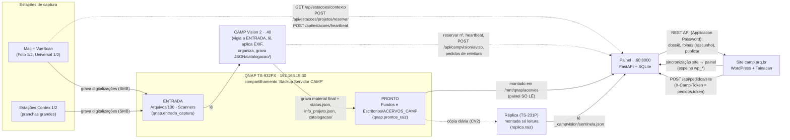

# CAMP Acervos — Como funciona (guia técnico completo)

Este guia explica, passo a passo, **como funciona absolutamente tudo** no painel de administração dos acervos da CAMP: o servidor, o banco, o caminho do material (do scanner à folha conferida), o CAMP Vision, a publicação no site, cada tela do painel, os alertas e como desenvolver e testar.

Foi escrito lendo o código deste repositório (versão de 14/10/2026, `main`). Quando o código e um documento antigo discordam, **vale o código**; os pontos em que encontramos diferença estão anotados em "Pontos de atenção" (A.11).

## Como ler

| Quero… | Vá para |
|---|---|
| entender as peças e o caminho do material | A.1 e Parte B |
| instalar, atualizar ou mexer no servidor | A.4 a A.10 |
| saber por que uma folha não entrou, ou como o CAMP Vision conversa com o painel | Parte B |
| publicar, despublicar, entender o site, pedidos, Analytics, relatórios, exportação | Parte C |
| saber o que cada tela faz e quem pode usar | Parte D (D.1 a D.3) |
| mexer no código, rodar os testes, criar tela/rota/migração | D.7 |

## Comandos essenciais

```bash
# Atualizar o painel no servidor (puxa o main, instala dependências, migra o banco com backup, confere a interface e reinicia)
cd <pasta do camp-painel> && ./atualizar.sh

# Rodar o painel localmente
python3 -m venv .venv && source .venv/bin/activate
pip install -r backend/requirements.txt
cp backend/.env.example backend/.env       # preencher
uvicorn app.main:app --app-dir backend --reload --port 8000

# Conferir a interface (o deploy trava se falhar)
python3 scripts/check_ui.py

# Testes do backend: tudo, ou um modo isolado
python3 tests/teste_backend.py
CAMP_DB_PATH=/tmp/x.db PYTHONPATH=$PWD/backend python3 tests/teste_backend.py --filho <modo>

# Testes no navegador (porta 8765; uma rodada por vez)
bash tests/rodar_auditoria.sh                 # painel, novas, atalhos, xss
bash tests/rodar_um.sh tests/auditoria_painel.js
```

> Observação: o `atualizar.sh` não tem opções; `./atualizar.sh --agora --sem-log` funciona igual a `./atualizar.sh` (as opções são ignoradas). Veja A.5.

## Índice

- [Parte A — Arquitetura, servidor e operação](#parte-a--arquitetura-servidor-e-operação)
   - [A.1 Visão geral](#a1-visão-geral)
   - [A.2 Estrutura do repositório](#a2-estrutura-do-repositório)
   - [A.3 Banco de dados](#a3-banco-de-dados)
- [ou](#ou)
   - [A.4 Configuração](#a4-configuração)
- [false enquanto o acesso for por http://192.168.15.60:8000; true quando entrar o túnel HTTPS](#false-enquanto-o-acesso-for-por-http19216815608000-true-quando-entrar-o-túnel-https)
   - [A.5 Instalação e atualização](#a5-instalação-e-atualização)
- [http://localhost:8000](#httplocalhost8000)
   - [A.6 Autenticação e papéis](#a6-autenticação-e-papéis)
   - [A.7 Tarefas periódicas do servidor](#a7-tarefas-periódicas-do-servidor)
   - [A.8 Backups, logs, alertas e "Máquinas e site"](#a8-backups-logs-alertas-e-máquinas-e-site)
- [trocar em produção (manual, de propósito):](#trocar-em-produção-manual-de-propósito)
   - [A.9 QNAP](#a9-qnap)
- [--simular, --senha-de-stdin, --raiz (padrão /mnt/qnap/replica), --vers](#--simular---senha-de-stdin---raiz-padrão-mntqnapreplica---vers)
   - [A.10 Cloudflare Tunnel e acesso externo](#a10-cloudflare-tunnel-e-acesso-externo)
- [Parte B — O caminho do material](#parte-b--o-caminho-do-material)
   - [B.1 Códigos](#b1-códigos)
   - [B.2 Estações (/api/estacoes/*)](#b2-estações-apiestacoes)
   - [B.3 O CAMP Vision 2 (o "vigia")](#b3-o-camp-vision-2-o-vigia)
   - [B.4 Fila / Material novo (lista_processamento)](#b4-fila--material-novo-listaprocessamento)
   - [B.5 Importação (importador_lote.importar_lote)](#b5-importação-importadorloteimportarlote)
   - [B.6 Saídas do CAMP Vision na tela (saidas_cv.py)](#b6-saídas-do-camp-vision-na-tela-saidascvpy)
   - [B.7 Revisão (rotas_revisao.py e companhia)](#b7-revisão-rotasrevisaopy-e-companhia)
   - [B.8 Releitura (rotas_releitura.py)](#b8-releitura-rotasreleiturapy)
   - [B.9 Decisões (decisoes.py, rotas_decisoes.py)](#b9-decisões-decisoespy-rotasdecisoespy)
   - [B.10 Mover folhas, mesclar projetos, mover lote, recodificar (rotas_mesclar.py)](#b10-mover-folhas-mesclar-projetos-mover-lote-recodificar-rotasmesclarpy)
   - [B.11 Apêndice — mapa rápido de rotas desta parte](#b11-apêndice--mapa-rápido-de-rotas-desta-parte)
- [Parte C — Publicação, site e público](#parte-c--publicação-site-e-público)
   - [C.1 O site: WordPress + Tainacan](#c1-o-site-wordpress--tainacan)
   - [C.2 Espelho do site (wp_item e companhia)](#c2-espelho-do-site-wpitem-e-companhia)
   - [C.3 Publicação](#c3-publicação)
   - [C.4 Tarefas em segundo plano](#c4-tarefas-em-segundo-plano)
   - [C.5 Páginas públicas, hub do arquiteto, capa, descrição e direitos](#c5-páginas-públicas-hub-do-arquiteto-capa-descrição-e-direitos)
   - [C.6 Redirecionamentos (/api/redirecionamentos) e o 301](#c6-redirecionamentos-apiredirecionamentos-e-o-301)
   - [C.7 Pedidos de material](#c7-pedidos-de-material)
   - [C.8 Uso do acervo / Downloads do site (rotas_uso.py)](#c8-uso-do-acervo--downloads-do-site-rotasusopy)
   - [C.9 Google Analytics: Site Kit × GA4 direto](#c9-google-analytics-site-kit--ga4-direto)
   - [C.10 Relatórios para prestação de contas (rotas_relatorios.py)](#c10-relatórios-para-prestação-de-contas-rotasrelatoriospy)
   - [C.11 Exportação EAD 2002 / CSV / BagIt (exportacao.py)](#c11-exportação-ead-2002--csv--bagit-exportacaopy)
- [Parte D — Telas, acervo e desenvolvimento](#parte-d--telas-acervo-e-desenvolvimento)
   - [D.1 O frontend (frontend/index.html)](#d1-o-frontend-frontendindexhtml)
   - [D.2 As telas do menu, uma a uma](#d2-as-telas-do-menu-uma-a-uma)
   - [D.3 Páginas de detalhe](#d3-páginas-de-detalhe)
   - [D.4 Problemas (tabela erro)](#d4-problemas-tabela-erro)
   - [D.5 Alertas e notificações por e-mail](#d5-alertas-e-notificações-por-e-mail)
   - [D.6 Auditoria: a tabela evento e as frases do histórico](#d6-auditoria-a-tabela-evento-e-as-frases-do-histórico)
   - [D.7 Desenvolvimento e testes](#d7-desenvolvimento-e-testes)

---

# Parte A — Arquitetura, servidor e operação

> Escrito a partir do código do repositório `camp-painel` (branch `integra`, commit `456e54f`, 14/10/2026).
> Os caminhos são relativos à raiz do repositório. No servidor de produção, a raiz é `/home/camp/camp-painel`
> (é o que está em `scripts/camp-painel.service`). Quando algo descrito aqui não bate com o que você vê no
> servidor, vale o código: abra o arquivo citado.

---

### A.0 Resumo para quem chega agora

- O painel é **um único processo Python** (FastAPI servido pelo `uvicorn`), na porta **8000**, como serviço systemd **`camp-painel`**, rodando com o usuário Linux **`camp`**.
- Os dados ficam num **único arquivo SQLite** (por padrão `backend/camp.db`).
- A tela é **um único arquivo HTML** (`frontend/index.html`, sem etapa de build) servido pelo próprio backend em `/`.
- O schema do banco é criado por `db/schema.sql` e evolui por **migrações numeradas** em `db/migrations/*.sql`, que rodam **sozinhas toda vez que o serviço inicia**.
- O código de produção é atualizado com **`./atualizar.sh`**, que só roda na branch `main`, faz backup do banco antes e para se a checagem da tela (`scripts/check_ui.py`) falhar.
- O acervo digital fica no **QNAP**, montado por SMB em **`/mnt/qnap/acervos`**. O painel **só lê** o QNAP.
- O acesso de fora da rede passa por **Cloudflare Tunnel** (`painel.camp.arq.br` → `localhost:8000`).

---

## A.1 Visão geral

### A.1.1 O que o sistema faz

O "CAMP Acervos — Painel de administração" é o sistema interno da CAMP (Casa da Arquitetura Moderna Paulista) que controla o acervo de arquitetura (`README.md`):

- **cadastro de autoridade**: fundos (`F0xx`), séries (`S0x`), arquitetos/agentes (ISAAR-CPF), projetos/dossiês (`F0xx-P000x`) e folhas/itens (`F0xx-P000x-AAAA-S0x-DNNNNN`). Os códigos nunca mudam nem se reaproveitam. Recodificar cria um redirecionamento (tabela `redirecionamento`) e não sobrescreve nada;
- **numeração oficial de projetos** para as estações de digitalização e para o CAMP Vision 2 (reserva do próximo `P`);
- **fila de processamento**: os lotes que o CAMP Vision 2 deixa prontos no QNAP, a revisão das folhas e a aprovação;
- **publicação no site** (WordPress + Tainacan): envia dossiê e folhas como rascunho e publica; mantém um espelho do site e aponta divergências;
- **operação**: pedidos de material (solicitações), problemas relatados (erros), empréstimos, localização física, etiquetas, decisões pendentes, relatórios, uso do acervo (downloads do site);
- **infraestrutura**: saúde das máquinas (estações, CAMP Vision, QNAP, site), backups, logs técnicos e alertas por e-mail.

Regras que o sistema impõe (README): o código vem da tabela de autoridade, nunca do nome da pasta; história e biografia só existem com fonte citada; erro bloqueante impede publicar (autoria divergente é aviso desde o contrato 2.4); o painel é a fonte da verdade e o Tainacan recebe uma cópia.

### A.1.2 Quem usa

| Quem | Como usa |
|---|---|
| Equipe da CAMP (papéis `leitura`, `operador`, `admin`, `master`) | navegador, em `http://192.168.15.60:8000` na rede local ou `https://painel.camp.arq.br` de fora |
| Estações de digitalização (Macs com VueScan, estações Contex, estações "universais") | chamam rotas HTTP **sem login**, protegidas por rede local e/ou token (`estacao.token`) |
| CAMP Vision 2 (computador Ubuntu `.40`) | chama as mesmas rotas sem login: contexto, reserva de projeto, heartbeat, aviso de lote pronto, pedidos de releitura |
| Site (formulário de pedido de material) | chama `POST /api/pedidos/site` com o token `pedidos.token` |

### A.1.3 As peças

| Peça | Onde | Endereço / caminho |
|---|---|---|
| Servidor do painel | Ubuntu, máquina `camp` (usuário `camp`) | `192.168.15.60:8000` (`docs/padroes.md` §1) |
| QNAP TS-932PX ("Server-Camp" no Mac) | rede local | `192.168.15.30`, compartilhamento `Backup Servidor CAMP` |
| QNAP TS-231P (réplica / backup frio) | rede local | `qnap.backup_ip`; réplica montada só leitura em `/mnt/qnap/replica` |
| CAMP Vision 2 (repositório `github.com/mullets/campvision-new`) | Ubuntu dedicado | `192.168.15.40` (`campvision2.ip`) |
| Estações de captura | Foto 1/2, Contex 1/2, Universal 1/2 | `192.168.15.41` a `.46` (migração `023_infraestrutura_estacoes.sql`) |
| Site | WordPress + Tainacan | `https://camp.arq.br` (`WP_BASE_URL` / `wp.url`) |
| Acesso externo | Cloudflare Tunnel | `https://painel.camp.arq.br` |

### A.1.4 Diagrama do caminho do material



Versão em texto, para quem lê no terminal:

```
[Mac/VueScan, Contex, Universal]
      │  grava digitalizações (SMB)            ┌──── HTTP sem login (rede local + X-Camp-Token) ────┐
      ▼                                        │  contexto · reservar nº de projeto · heartbeat      │
QNAP: Arquivos/100 - Scanners  (ENTRADA)       │                                                     ▼
      │  CAMP Vision 2 vigia e lê                                                          PAINEL (.60:8000)
      ▼                                                                                   FastAPI + SQLite
CAMP Vision 2 (.40) ── grava ──▶ QNAP: Fundos e Escritorios/ACERVOS_CAMP (PRONTO) ──lê──▶   │      ▲
      │                                     │                                               │      │ sincronização
      └── POST /api/campvision/aviso ───────┼──────────────────────────────────────────────▶│      │ (leitura)
                                            └─ réplica (TS-231P) ── sentinela.json ──lê──▶  │      │
                                                                                            ▼      │
                                                                         Site camp.arq.br (WordPress + Tainacan)
```

Regras do fluxo (`docs/campvision.md` §1 e `backend/app/rotas_operacao.py::_varrer_qnap`):

1. **Mão única.** O painel só **lê** a pasta final e responde a chamadas HTTP. Ele **não grava** no QNAP e **não chama** o CAMP Vision. Quando o painel precisa de algo do CV2 (por exemplo, "Ler dados agora"), ele registra um pedido (`pedido_releitura`) e o CV2 pergunta (`GET /api/estacoes/pedidos-releitura`).
2. **O painel nunca lê lotes da ENTRADA.** Da ENTRADA ele só mede e conta pastas (coletor do QNAP). Lote só existe a partir da pasta PRONTO.
3. O jeito normal de um lote aparecer na Fila é o **aviso do CV2** (`POST /api/campvision/aviso`), que faz o painel reler só aquela pasta (`rotas_operacao.ler_pasta_do_aviso`). A varredura completa (*Filas → Varrer QNAP*, `POST /api/filas/varrer-qnap`, operador ou acima) é reconciliação.
4. O contrato entre painel e CV2 tem versão: `CONTRATO_PAINEL = "2.2"` em `backend/app/contrato.py`. Se o heartbeat do CV2 informar outra versão, a tela "Máquinas e site" mostra um aviso (`contrato.aviso_contrato`). A fonte única do contrato é `campvision-new/docs/contrato-painel.md`; há uma cópia com exemplos em `tests/contrato/` (o `docs/campvision.md` ainda fala em "Contrato 2.1" no cabeçalho, mas a constante do código é 2.2).

---

## A.2 Estrutura do repositório

```
camp-painel/
├── atualizar.sh            # atualização de produção (ver A.5)
├── README.md
├── .gitignore              # ignora .venv/, backend/.env, *.db, backend/logs/, backend/backups/, *.db.gz
├── backend/
│   ├── .env.example        # modelo do backend/.env (o .env real NUNCA vai para o git)
│   ├── requirements.txt    # dependências Python (versões fixas)
│   ├── VERSION             # gerado pelo atualizar.sh ("<hash> <data>"); lido por GET /api/versao
│   ├── camp.db             # banco (padrão; não versionado)
│   ├── backups/            # backups do banco (não versionado)
│   ├── logs/               # log técnico JSONL (não versionado)
│   ├── cache_previas/      # cache de miniaturas giradas (ao lado do banco; CAMP_CACHE_DIR muda)
│   └── app/                # o código da API (um módulo por assunto)
├── db/
│   ├── schema.sql          # modelo base (banco novo)
│   └── migrations/         # NNN_nome.sql, aplicadas em ordem alfabética no startup
├── frontend/
│   └── index.html          # o painel inteiro (HTML + CSS + JS num arquivo, ~4.400 linhas)
├── scripts/                # instalação, montagem do QNAP, túnel, backup, diagnósticos, importações
├── docs/                   # decisões, contratos e padrões (leia docs/padroes.md antes de mexer)
│   └── site/               # cópia de referência de trechos do plugin WordPress (painel-hub.php, painel-midia.php)
└── tests/                  # teste_backend.py, auditorias de navegador (jsdom), contrato do CV2, fixtures
```

### A.2.1 Pastas

| Pasta | O que tem |
|---|---|
| `backend/app/` | API FastAPI. `main.py` monta o app e inclui os routers (`rotas_*.py`); os demais módulos são regras de negócio compartilhadas. |
| `db/` | `schema.sql` (estado inicial: autoridade, projeto, item, operação, histórico, visões) e `migrations/` (toda mudança posterior). |
| `frontend/` | `index.html`: tela de login, menu, todas as páginas. Chama a API por `fetch` com o cookie de sessão. Sem build. |
| `scripts/` | Shell e Python de operação (detalhes nas seções A.5, A.8, A.9, A.10). |
| `docs/` | `padroes.md` (regras decididas; leitura obrigatória), `qnap.md`, `campvision.md`, `como-publicar.md`, `vocabulario.md`, `padrao-de-tela.md`, `UI.md`, `pedidos-do-site.md`, `uso-do-acervo.md`, `decisoes.md`, `guia-de-redacao.md`. |
| `tests/` | `teste_backend.py` (migrações em banco novo e antigo, guarda de rede, contrato), `rodar_auditoria.sh` (sobe o painel com banco sintético na porta 8765 e roda as auditorias `auditoria_*.js` em jsdom), `rodar_um.sh`, `rodar_xss.sh`, `semear_banco_teste.py`, `servidor_wp_falso.py`, `contrato/` (cópia do contrato do CV2), `fixtures/`. |

### A.2.2 Módulos de `backend/app/`

Infraestrutura e núcleo:

| Módulo | O que faz |
|---|---|
| `main.py` | Cria o `FastAPI`, inclui todos os routers, middleware de segurança/log, tarefas periódicas no startup, rotas das estações (`/api/estacoes/*`, `/api/fundos.json`, `/api/campvision/aviso`), `GET /` (serve o `index.html`) e `GET /api/versao`. |
| `config.py` | `Settings` (pydantic-settings) lido de `backend/.env`: `CAMP_DB_PATH`, `CAMP_QNAP_ROOT`, `CAMP_SECRET_KEY`, `WP_*`, `CAMP_COOKIE_SECURE`. |
| `db.py` | `connect()` (SQLite com `foreign_keys`, `busy_timeout`), `init_db()` (WAL + schema em banco novo) e `aplicar_migracoes()`. |
| `auth.py` | Senhas Argon2, sessão por cookie `camp_sessao`, bloqueio por tentativas, limite por IP, TOTP (2FA), `PAPEIS` e a dependência `exige(papel)`. |
| `rede.py` | `exigir_estacao(request)`: guarda das rotas sem login (LAN verdadeira e/ou cabeçalho `X-Camp-Token`). |
| `log_tecnico.py` | Log técnico JSONL rotativo (`backend/logs/camp-painel.jsonl`), lido por `GET /api/logs`. |
| `backup.py` | Backup consistente (API de backup do SQLite), verificação, gzip, retenção, cópia extra, restauração em arquivo novo. |
| `alertas.py` | Alertas críticos por e-mail (QNAP, CAMP Vision, backup, site, réplica, fila parada, bloqueios), avisos de pedido novo, resumo diário das 18h. |
| `email_envio.py` | Envio SMTP com a configuração `smtp.*`. |
| `tarefas.py` | Ações longas viram tarefa em segundo plano (thread) com progresso em `GET /api/tarefas/{id}`. |
| `contrato.py` | Versão do contrato CV2↔painel (`CONTRATO_PAINEL`) e aviso de versão diferente. |
| `replica.py` | Estado da réplica do acervo pela sentinela `_campvision/sentinela.json` (verde < 36 h, amarelo ≤ 72 h, vermelho acima). |
| `qnap_coletor.py` | Coleta em segundo plano do QNAP (montagem, espaço, entrada bruta, lotes prontos), histórico em `qnap_snapshot`, regra de nível de espaço. |
| `qnap_folhas.py` | Lista os documentos de uma pasta de lote no QNAP agrupados por documento (não por arquivo), com tempo limitado. |

Integração com o site:

| Módulo | O que faz |
|---|---|
| `wp.py` | Cliente REST do WordPress/Tainacan (Basic Auth com Application Password). Credenciais: `configuracao` tem prioridade sobre o `.env`. |
| `sincronizador.py` | Sincronização site → painel: preenche o espelho `wp_*` e grava `divergencia_site`. Um lock impede duas ao mesmo tempo. |
| `importador_site.py` | Espelho do site (`wp_item`) → tabelas `projeto` e `item` do painel (idempotente, só preenche o que falta). |
| `publicador.py` | Escritas no site que acompanham cadastros do painel; falha no site não desfaz o local, vira pendência. |
| `publicacao.py` | Regra única de publicação (`condicoes_projeto`, `ELEGIVEL_LOCAL`). |
| `publicacao_guiada.py` | "Publicar com um clique": dossiê → folhas (rascunho) → autorizar → publicar, em fatias de tempo. |
| `guia_publicacao.py` | Checklists vivos de publicação para fundo e arquiteto (router). |
| `imagem_site.py` | Decide qual arquivo sobe ao site para uma folha (prévia do CV2 em `_campvision/preview/`, senão o arquivo da folha). |
| `imagens.py` | Descobre qual imagem pertence a cada item do Tainacan. |
| `pagina_publica.py` | Confirma no site o endereço real da página pública do projeto. |
| `ga4_direto.py` | Google Analytics 4 direto pela Data API com conta de serviço (`ga4.*`). |
| `tipologia.py` | Vocabulário fechado de tipologia do site (4 facetas). |
| `uso_formularios.py` | Traz as entradas do formulário de download (Fluent Forms) para o painel. |
| `sondagem_fluentforms.py` | Sondagem só leitura do Fluent Forms (diagnóstico). |

CAMP Vision e revisão:

| Módulo | O que faz |
|---|---|
| `importador_lote.py` | Importa `catalogacao/pacote_tainacan.json` (v2) de um lote para folhas em revisão. |
| `saidas_cv.py` | Lê tudo o que o CV2 grava em `<projeto>/catalogacao/` para a tela (só leitura, tolerante a formato). |
| `giro_imagem.py` | Gira/reduz prévias com cache em disco (`cache_previas/`); precisa do Pillow. |
| `similaridade.py` | "Projeto parecido?": nota, nível e motivos para a fila de decisões. |
| `decisoes.py` | Fila de decisões (o painel pergunta em vez de decidir sozinho). |
| `projetos_novos.py` | Criação de projeto com o número do contador oficial (`proximo_numero`, nunca reusa P). |
| `filas_fase.py` | Em que fase está cada lote da Fila (o que falta, quem age). |
| `pendencias.py` | Fonte única das contagens "o que espera alguém" (painel, menu, Filas). |
| `qualidade_base.py` | Índice de qualidade da base, retrato diário (`qualidade_retrato`), "Agora não". |
| `exportacao.py` | Exportação EAD 2002, CSV de folhas e pacote BagIt por projeto (router). |

Routers (`rotas_*.py`), cada um com um prefixo `/api/...`:

| Módulo | O que faz |
|---|---|
| `rotas_auth.py` | `/api/auth/*`: login, logout, `/eu`, preferências, trocar senha, sessões, 2FA. |
| `rotas_admin.py` | `/api/usuarios*` (criar, editar, redefinir senha, desbloquear, foto) e `/api/config*` (Configurações). |
| `rotas_fundos.py` | Fundos e agentes (leitura para todos, escrita admin/master). |
| `rotas_projetos.py` | Projetos (dossiês) e itens (folhas). |
| `rotas_itens.py` | Edição dos textos de uma folha (painel + Tainacan). |
| `rotas_operacao.py` | Painel inicial, filas de processamento (QNAP/CV2), varredura do QNAP, solicitações e erros. |
| `rotas_gestao.py` | Busca global, entradas de acervo, direitos, localização física, **estações/saúde do site**, **backup**, **logs**, **auditoria** (`/api/eventos`). |
| `rotas_hoje.py` | Topo do painel inicial ("o que pede a pessoa hoje"). |
| `rotas_site.py` | `/api/site/*`: sincronizar, status, divergências, itens do espelho, rascunhos órfãos. |
| `rotas_qnap.py` | `GET /api/qnap` (lê a última coleta) e `POST /api/qnap/coletar` (admin). |
| `rotas_qualidade.py` | Qualidade do CAMP Vision, **alertas** (`/api/alertas*`) e **réplica** (`GET /api/replica`). |
| `rotas_importacao.py` | Catálogo local × site: prévia e execução protegida da importação. |
| `rotas_revisao.py` | Revisão pós-CV2: importar folhas do lote, conferir/corrigir, aprovar. |
| `rotas_consenso.py` | Consenso do lote (ano, endereço, cliente mais frequentes). |
| `rotas_releitura.py` | "Ler dados agora": pedidos de releitura ao CV2 (pessoas e rotas da estação). |
| `rotas_decisoes.py` | Fila de decisões (ler: todos; decidir: admin). |
| `rotas_publicar_tudo.py` | Plano e execução do "Publicar com um clique". |
| `rotas_mesclar.py` | Despublicar projeto e descartar lote duplicado (com rastro). |
| `rotas_pedidos.py` | Pedidos de material (inclui a rota pública `POST /api/pedidos/site`). |
| `rotas_emprestimos.py` | Consulta presencial e empréstimo de originais. |
| `rotas_estante.py` | Modo estante (celular): ler etiqueta, conferir caixa. |
| `rotas_planilha.py` | Importar inventário de projetos por CSV/XLSX, com prévia. |
| `rotas_relatorios.py` | Relatórios de prestação de contas (JSON e XLSX). |
| `rotas_uso.py` | Uso do acervo (downloads); só admin/master (dados pessoais). |

---

## A.3 Banco de dados

### A.3.1 SQLite: onde fica e como se configura

1. O caminho vem de **`CAMP_DB_PATH`** (`backend/app/config.py`, classe `Settings`). Padrão: `./camp.db`.
2. `Settings` lê **sempre** `backend/.env` (constante `ENV = .../backend/.env`), não importa de onde o processo foi iniciado. Variáveis de ambiente do processo também valem (o systemd carrega o mesmo arquivo com `EnvironmentFile=/home/camp/camp-painel/backend/.env`).
3. **Caminho relativo é relativo à pasta `backend/`**, não à pasta atual (`config.py` resolve com `ENV.parent / CAMP_DB_PATH`). Assim `CAMP_DB_PATH=./camp.db` significa `/home/camp/camp-painel/backend/camp.db`.
4. Conexão (`db.connect()`):
   - `timeout=30` e `PRAGMA busy_timeout = 30000`: espera locks curtos em vez de dar "database is locked";
   - `PRAGMA foreign_keys = ON`;
   - `row_factory = sqlite3.Row`.
5. No startup, `init_db()` liga `journal_mode = WAL` e `synchronous = NORMAL` (leitores continuam funcionando enquanto o sincronizador escreve). Por causa do WAL, ao lado do banco existem `camp.db-wal` e `camp.db-shm`: **nunca copie só o `.db` com o serviço rodando**; use os scripts de backup (A.8).

Para descobrir qual banco o painel está usando de fato:

```bash
cd /home/camp/camp-painel
.venv/bin/python scripts/diagnostico_base.py
# ou
PYTHONPATH=backend .venv/bin/python -c "from app.config import settings; print(settings.CAMP_DB_PATH)"
```

`scripts/diagnostico_base.py` não altera nada: resolve o `CAMP_DB_PATH` como a aplicação, conta fundos/projetos/itens/usuários e lista outros `.db` na raiz e em `backend/`. Sai com código **20** se o banco configurado não existe e **21** se ele parece vazio (0 fundos ou 0 usuários), dizendo se há outro banco com mais dados. O `atualizar.sh` usa isso para não subir uma base vazia por engano.

### A.3.2 `init_db` e `aplicar_migracoes`

Ambas estão em `backend/app/db.py` e são chamadas, nesta ordem, no evento de startup de `main.py` (`_startup`). Também são chamadas pelos scripts `criar_usuario.py`, `criar_usuarios_iniciais.py`, `sincronizar_site.py` e `importar_site.py`.

**`init_db()`**

1. Abre a conexão, liga WAL e `synchronous=NORMAL`.
2. Verifica se existe a tabela `fundo`.
3. Se **não** existe (banco novo), executa `db/schema.sql` inteiro (`executescript`).
4. Se já existe, não faz nada (o schema nunca é reaplicado em banco existente).

**`aplicar_migracoes()`**

1. Cria, se faltar, a tabela de controle:
   ```sql
   CREATE TABLE IF NOT EXISTS migracao (nome TEXT PRIMARY KEY, aplicada_em TEXT DEFAULT (datetime('now')))
   ```
2. Lê os nomes já aplicados (`SELECT nome FROM migracao`).
3. Percorre `db/migrations/*.sql` em **ordem alfabética do nome do arquivo** (`sorted(MIGRACOES.glob("*.sql"))`).
4. Para cada arquivo ainda não registrado:
   - executa o conteúdo com `executar_script_idempotente()`, comando a comando (usa `sqlite3.complete_statement` para separar);
   - se um comando é `ALTER TABLE x ADD [COLUMN] y` e a coluna `y` **já existe**, o comando é pulado (o SQLite não tem `ADD COLUMN IF NOT EXISTS`, e o `schema.sql` de um banco novo pode já ter colunas que migrações antigas acrescentam em bancos velhos);
   - se der erro, faz `rollback` e **levanta a exceção: o serviço não sobe**;
   - se der certo, grava `INSERT INTO migracao (nome)` e `commit`.
5. Cada migração é registrada **pelo nome do arquivo**. Renomear um arquivo já aplicado faz ele rodar de novo.

Observações importantes:

- A ordem é alfabética, por isso o número tem sempre 3 dígitos (`002`, `021`, `106`). Há números repetidos (`023_identificacao_original_projeto.sql` e `023_infraestrutura_estacoes.sql`): rodam na ordem alfabética do nome completo. Há lacunas (011–020, 068–069, 072–074 etc.); não importa.
- Não existe migração "para baixo" (down). Desfazer uma mudança de schema exige uma migração nova ou restaurar backup.
- Como `executar_script_idempotente` executa comando a comando com `con.execute`, o arquivo **não** é uma transação única automática: se a migração tem vários comandos e o terceiro falha, os dois primeiros podem já ter sido aplicados (o `rollback` só desfaz o que ainda não foi "commitado" implicitamente). Escreva migrações que possam ser rodadas de novo sem estrago (`CREATE TABLE IF NOT EXISTS`, `INSERT OR IGNORE`, `UPDATE ... WHERE`).

Para conferir o que foi aplicado:

```bash
sqlite3 backend/camp.db "SELECT nome, aplicada_em FROM migracao ORDER BY nome;"
```

### A.3.3 Como criar uma migração nova

1. Escolha o próximo número livre, **maior que todos os existentes** (hoje o maior é `115`): por exemplo `116_minha_mudanca.sql`.
2. Crie `db/migrations/116_minha_mudanca.sql`. Comece com uma linha de comentário dizendo o motivo (todas as migrações seguem esse padrão).
3. Use comandos que aguentem rodar em banco novo e em banco antigo:
   ```sql
   -- Motivo da mudança (cartão/decisão e data).
   ALTER TABLE projeto ADD COLUMN minha_coluna TEXT;               -- pulado se a coluna já existir
   CREATE TABLE IF NOT EXISTS minha_tabela (id INTEGER PRIMARY KEY, ...);
   CREATE INDEX IF NOT EXISTS ix_minha_tabela_x ON minha_tabela(x);
   INSERT OR IGNORE INTO configuracao (chave, valor, descricao, sensivel) VALUES
    ('assunto.chave', 'padrao', 'Descrição que aparece em Configurações', 0);
   ```
4. **Não** edite uma migração que já rodou em produção: crie outra.
5. Se a mudança deve valer também para bancos novos criados só pelo `schema.sql`, não é preciso mexer no `schema.sql`: as migrações rodam também em banco novo, logo depois do schema.
6. Teste em banco novo e em cópia do banco real:
   ```bash
   python tests/teste_backend.py            # inclui "migrações em banco novo (2x) e banco antigo"
   CAMP_DB_PATH=/tmp/teste.db PYTHONPATH=backend python -c "from app.db import init_db, aplicar_migracoes; init_db(); aplicar_migracoes()"
   ```
7. Em produção, a migração roda sozinha quando o `atualizar.sh` reinicia o serviço.

### A.3.4 Tabelas principais

Base (`db/schema.sql`), organizada em seções:

**1. Autoridade**

| Tabela | Para que serve |
|---|---|
| `fundo` | Fundo arquivístico (ISAD-G). `codigo` `F000`–`F999` (chave imutável), `sigla` de 3 letras (vai no nome dos arquivos), título, datas, história (só com `fonte_historia`), `credito_padrao`, `status_site`, ids no site (`tainacan_term_id`, `wp_page_id`), `ativo`. |
| `serie` | Vocabulário fechado de séries `S01`–`S07` com a pasta padrão de cada uma (S01 Desenhos e pranchas … S07 Redesenhos). |
| `agente`, `agente_forma_variante`, `agente_relacao` | Registros de autoridade (ISAAR-CPF): arquitetos, escritórios, famílias; grafias variantes (usadas para conferir o carimbo); relações. |
| `fundo_agente` | Ligação fundo ↔ agente com papel (`produtor`, `titular`, `colaborador`…) e período. Base da "autoridade" que as estações recebem. |

**2. Dossiês e itens**

| Tabela | Para que serve |
|---|---|
| `numero_p` | Contador oficial de números de projeto por fundo (reserva nunca reusada). |
| `projeto` | Dossiê `F0xx-P000x`: título, ano, cidade, identificação original (CX039, Tubo 07…), pasta no QNAP, `lote_teste`, `autorizado_site`, `status_site`, ids no site. Migrações acrescentam autoria, tipologia, capa, `url_publica_confirmada`, `mesclado_em` etc. |
| `tipo_documento` | Vocabulário de tipos (Planta, Corte, Elevação, … Slide), o mesmo do CAMP Vision. |
| `item` | Folha/foto/documento: código completo, série, sequencial `D`, leituras brutas do carimbo, arquivos (`arquivo_tif`, `arquivo_jpg`, `md5`, `phash`), rotação/espelho, duplicata, `autoria_divergente` (só aviso: "autoria não confirmada", contrato 2.4), crédito, `status_site`, origem. Migrações acrescentam revisão (`revisao`, `revisado_em`), giro manual, espelho manual, retenção, arquivo de origem etc. |
| `item_agente` | Autoria por item (autor, fotógrafo, desenhista, coautor) com fonte. |
| `redirecionamento` | Código antigo → código novo (recodificação gera 301 no site). |

**3. Operação**

| Tabela | Para que serve |
|---|---|
| `usuario` | Pessoas do painel (recriada pela migração 003 para aceitar o papel `master`; colunas de senha/bloqueio/2FA da 002; foto da 030). |
| `lista_processamento` | Cada lote da Fila (espelha o `status.json` do QNAP): projeto, pasta, folhas esperadas/encontradas, `etapa` (`enviado`, `processando`, `revisao`, `rascunho`, `publicado`, `erro`), JSON lido. |
| `solicitacao`, `solicitacao_item` | Pedidos de material (quem, finalidade, situação, itens e formatos). |
| `erro` | Problemas relatados; `gravidade='bloqueia'` impede publicar. |
| `etiqueta_impressao` | Rastro das etiquetas impressas. |
| `localizacao_fisica`, `item_localizacao` | Caixas, gavetas, tubos, mapotecas e onde cada item está. |

**4. Histórico e sincronização**

| Tabela | Para que serve |
|---|---|
| `evento` | Histórico/auditoria de tudo (entidade, código, tipo, ator, detalhe JSON antes/depois). Alimenta "Histórico de ações" (`GET /api/eventos`, admin). |
| `divergencia_site` | Divergências painel × site encontradas pela sincronização; também guarda escritas pendentes no site (`campo LIKE 'pendente%'`). |
| `estacao_heartbeat` | Último sinal de cada app de estação/CV2 (uma linha por `estacao_id`). |

**5. Visões**: `v_proximo_fundo` (próximo `F` livre), `v_proximo_p` (próximo `P` por fundo), `v_bloqueios_publicacao` (por que um projeto não pode ir ao site), `v_fundos_json` (lista para a estação Contex).

Tabelas criadas por migrações (as mais importantes para operação):

| Tabela | Migração | Para que serve |
|---|---|---|
| `migracao` | (`db.py`) | Controle das migrações aplicadas. |
| `sessao` | 002 | Sessões de login (só o hash do token), expiração, IP, agente, `revogada`. |
| `configuracao` | 003 | Chave/valor das configurações editáveis (A.4). |
| `wp_colecao`, `wp_taxonomia`, `wp_termo`, `wp_item`, `wp_pagina`, `wp_metadado`, `sincronizacao` | 004 e seguintes | Espelho do site e registro de cada sincronização (início, fim, ok, contagens, erro). |
| `fundo_termo_site` | 006 | Equivalência nome do termo "Fundos" no site → código do fundo. |
| `entrada_acervo`, `direitos_fundo`, `termo_direitos` | 010, 056 | Proveniência física, direitos/licença por fundo e o PDF do termo. |
| `qnap_snapshot` | 031/032 | Histórico das coletas do QNAP (90 dias). |
| `uso_download`, `uso_coleta`, `uso_email` | 033/036 | Uso do acervo (downloads do site). |
| `decisao`, `decisao_chave` | 037/049/102 | Fila de decisões. |
| `revisao_campo`, `cv_resposta` | 050/051 | O que a revisão fez com cada campo lido pelo CV2. |
| `pedido_releitura`, `releitura_consulta` | 041 | "Ler dados agora". |
| `tarefa_publicacao` | 045/054 | Tarefas em segundo plano (publicar, varrer QNAP, backup, sincronizar…). |
| `usuario_preferencia` | 046 | Preferências por pessoa (caixas de ajuda já vistas, `tarefas.vista`). |
| `alerta_estado`, `alerta_envio` | 052 | Estado de cada alerta e log de cada e-mail enviado/suprimido. |
| `resumo_diario_envio` | 071 | Um registro por dia do resumo das 18h. |
| `emprestimo`, `emprestimo_item` | 092 | Empréstimos e consultas presenciais. |
| `qualidade_retrato` | 104 | Retrato diário do índice de qualidade por fundo. |
| `tarefa_adiada` | 105 | Botão "Agora não" por pessoa. |
| `agente_retrato` | 062 | Retrato do arquiteto (BLOB). |
| `par_nao_duplicado` | 059 | Pares de projetos que uma pessoa disse que não são o mesmo. |

Para ver a estrutura real de qualquer tabela no servidor:

```bash
sqlite3 -readonly backend/camp.db ".schema projeto"
sqlite3 -readonly backend/camp.db ".tables"
```

---

## A.4 Configuração

Há **dois lugares** de configuração:

1. **`backend/.env`** — o mínimo para o processo subir (caminho do banco, credenciais de fallback do WordPress, cookie). Só muda com acesso ao servidor e exige reiniciar o serviço.
2. **Tabela `configuracao`** no banco — tudo o que é operacional (IPs, pastas do QNAP, SMTP, avisos, tokens, intervalos). Editada pela tela **Configurações** (só o papel `master` altera) e lida pelo código a cada uso, na maioria dos casos **sem precisar reiniciar** (exceções abaixo).

### A.4.1 `backend/.env` e `config.py`

Modelo em `backend/.env.example`:

```ini
CAMP_DB_PATH=./camp.db
CAMP_QNAP_ROOT=/mnt/qnap/acervos
CAMP_SECRET_KEY=troque-esta-chave
WP_BASE_URL=https://camp.arq.br
WP_USER=camp
WP_APP_PASSWORD=
# false enquanto o acesso for por http://192.168.15.60:8000; true quando entrar o túnel HTTPS
CAMP_COOKIE_SECURE=false
```

| Variável | Padrão no código | Uso |
|---|---|---|
| `CAMP_DB_PATH` | `./camp.db` | Banco SQLite (relativo a `backend/`). |
| `CAMP_QNAP_ROOT` | `/mnt/qnap/acervos` | Raiz do QNAP **quando `qnap.raiz` está vazia** no banco. |
| `CAMP_SECRET_KEY` | `dev` | Declarada em `Settings`, mas **nenhum módulo a usa hoje** (as sessões usam token aleatório guardado como hash). |
| `WP_BASE_URL`, `WP_USER`, `WP_APP_PASSWORD` | `https://camp.arq.br`, `camp`, vazio | Credenciais do WordPress **quando** `wp.url`, `wp.usuario`, `wp.app_password` estão vazias no banco (`wp.py`: banco > `.env`). |
| `CAMP_COOKIE_SECURE` | `True` | Liga o atributo `Secure` do cookie de sessão (só aplicado se a requisição for HTTPS, ver A.6). |

Variáveis de ambiente opcionais lidas diretamente com `os.environ` (não estão no `Settings`; úteis em teste ou para mudar pastas):

| Variável | Módulo | Padrão |
|---|---|---|
| `CAMP_BACKUP_DIR` | `backup.py` | `backend/backups` |
| `CAMP_LOG_DIR` | `log_tecnico.py` | `backend/logs` (se não puder criar, cai para `/tmp/camp-painel`) |
| `CAMP_CACHE_DIR` | `giro_imagem.py` | `cache_previas/` ao lado do banco |

O `.env` está no `.gitignore`: ele **não** vem no `git pull`. Guarde uma cópia segura dele.

### A.4.2 Tabela `configuracao` e a tela Configurações

Estrutura (migração 003):

```sql
CREATE TABLE configuracao (
  chave TEXT PRIMARY KEY, valor TEXT, descricao TEXT,
  sensivel INTEGER NOT NULL DEFAULT 0,      -- 1 = a API nunca devolve o valor, só se está preenchido
  atualizado_em TEXT NOT NULL DEFAULT (datetime('now')), atualizado_por TEXT);
```

API (`backend/app/rotas_admin.py`):

- `GET /api/config` — **admin** ou master lê; valores com `sensivel=1` voltam como `••••••••` (ou vazio).
- `PUT /api/config/{chave}` com corpo `{"valor": "..."}` — **só master**. Só altera chaves que **já existem** (404 "Configuração desconhecida" para chave nova: chaves novas entram por migração). Chaves terminadas em `.ip` são validadas como IPv4. Toda alteração grava um `evento` (`entidade='config'`, `tipo='alterada'`) com antes/depois; para chave sensível grava só "definido".
- Leitura interna: `rotas_admin.config(chave, padrao)` e funções `_cfg` locais em vários módulos.

Tela (`frontend/index.html`, `carregarConfig`, `grupoConfig`, `CFG_PERIGO`):

- Agrupa as chaves em seções: **Estações de captura** (`estacao.*`, `vuescan.ip`), **QNAP e réplica** (`qnap.*`, `replica.*`), **CAMP Vision** (`campvision*`), **Site e sincronização** (`wp.*`, `sync.*`, `tainacan.*`, `site.*`, `publicacao.*`, `pedidos.*`, `painel.url`), **E-mail e avisos** (`avisos.*`, `smtp.*`, `alertas.*`), **Backup e exportação** (`backup.*`, `exportacao.*`), **Uso do acervo** (`uso.*`), **Outras configurações** (o resto, ex.: `ga4.*`).
- Campos sensíveis aparecem como senha, desabilitados, com botão "Trocar".
- Alterar `qnap.raiz`, `qnap.prontos_raiz`, `qnap.entrada_captura`, `wp.url`, `painel.url`, `replica.raiz` ou qualquer `*.ip` pede confirmação mostrando o antes e o depois.
- As seções de estações, QNAP, CAMP Vision e site têm botão **Testar** (usa `GET /api/estacoes`).
- Admin vê a tela, mas só **master** salva ("só o admin master altera").

Alterar direto no banco (emergência, sem a tela):

```bash
sqlite3 backend/camp.db "UPDATE configuracao SET valor='15', atualizado_em=datetime('now'), atualizado_por='manual' WHERE chave='sync.intervalo_min';"
```

### A.4.3 Chaves existentes, por assunto

Todas as chaves abaixo são criadas por migrações (arquivo entre parênteses) ou, no caso de preferências de aviso, também pela tela. "S" = sensível.

**Site / WordPress / Tainacan (`wp.*`, `tainacan.*`, `site.*`, `sync.*`, `publicacao.*`, `painel.url`)**

| Chave | Padrão | Uso |
|---|---|---|
| `wp.url` | vazio (= `WP_BASE_URL`) | Endereço do site (003; a 005 zerou o valor herdado). Também usado na sonda "site no ar". |
| `wp.usuario` | vazio (= `WP_USER`) | Usuário WordPress da API; o mesmo precisa estar conectado ao Site Kit (025). |
| `wp.app_password` (S) | vazio (= `WP_APP_PASSWORD`) | Application Password. Sem ela `WP()` levanta "Application Password não configurada". |
| `tainacan.projetos_collection_id` | `8007` | Coleção dos dossiês (022). |
| `tainacan.itens_collection_id` | `8013` | Coleção das folhas (022). |
| `site.credito_padrao` | `Acervo {agente}/CAMP - Casa da Arquitetura Moderna Paulista` | Crédito padrão (003). |
| `sync.intervalo_min` | `15` | Minutos entre sincronizações automáticas site → painel; `0` desliga (009). |
| `publicacao.exige_direitos` | `0` | `1` = fundo sem direitos preenchidos também bloqueia publicar (043). |
| `painel.url` | `https://painel.camp.arq.br` | Endereço usado nos links dos e-mails (052). |

**QNAP e réplica (`qnap.*`, `replica.*`)**

| Chave | Padrão | Uso |
|---|---|---|
| `qnap.ip` | `192.168.15.30` (023) | IP do TS-932PX (ping e porta 445 em "Máquinas e site"). |
| `qnap.usuario` (S), `qnap.senha` (S) | vazio | Credenciais SMB (023). Lidas pelo `diagnostico_qnap.sh`; a montagem usa `/etc/camp-qnap.cred`. |
| `qnap.raiz` | `/mnt/qnap/acervos` | Pasta onde o compartilhamento está montado neste servidor (003). |
| `qnap.entrada_captura` | vazio | ENTRADA (onde os scanners gravam); o painel só mede e conta (021). |
| `qnap.prontos_raiz` | vazio (= `qnap.raiz`) | PRONTO (`ACERVOS_CAMP`): o painel lê os lotes **só daqui** (021). |
| `qnap.backup_ip` | vazio | IP do TS-231P (003). |
| `qnap.coleta_min` | `10` | Minutos entre coletas do QNAP; `0` desliga (031). |
| `qnap.dias_parado` | `3` | Dias sem mudança para uma pasta da ENTRADA contar como parada (031). |
| `qnap.espaco_aviso_pct` | `15` | Aviso abaixo deste % livre (032). |
| `qnap.espaco_critico_pct` | `5` | Crítico abaixo deste % livre (032). |
| `qnap.espaco_critico_gb` | `50` | Crítico abaixo deste valor em GB (032). |
| `qnap.dias_aviso`, `qnap.dias_critico` | (sem linha no banco; o código usa 30 e 7) | Aviso/crítico se, pela tendência, o QNAP enche em menos de N dias (`qnap_coletor.nivel_espaco`). |
| `replica.raiz` | vazio | Pasta da réplica do `ACERVOS_CAMP` montada só leitura (053). Vazio = sem réplica. |

**CAMP Vision e estações (`campvision*`, `estacao.*`, `vuescan.ip`)**

| Chave | Padrão | Uso |
|---|---|---|
| `campvision2.ip` | `192.168.15.40` | Ping e porta 22 (SSH) do CV2. |
| `campvision2.usuario` (S), `campvision2.senha` (S) | vazio | Acesso remoto ao CV2 (só guardadas). |
| `campvision.pasta_saida` | vazio | Pasta de saída do CV2 (003; legado). |
| `estacao.foto1.ip` … `estacao.foto2.ip` | `.41`, `.42` | Estações Foto. |
| `estacao.contex1.ip`, `estacao.contex2.ip` | `.43`, `.44` | Estações Contex (a 055 removeu `contex.ip`, duplicada). |
| `estacao.universal1.ip`, `estacao.universal2.ip` | `.45`, `.46` | Estações Universal. |
| `estacao.contex.ip` | vazio | Chave antiga da 021; a tela a esconde. |
| `vuescan.ip` | vazio | IP do Mac do VueScan (003). |
| `estacao.token` (S) | vazio | Token das rotas sem login (026). Ver A.6.4. |

**E-mail (`smtp.*`)**

| Chave | Padrão | Uso |
|---|---|---|
| `smtp.host` | vazio | Servidor SMTP (003). |
| `smtp.porta` | `587` | 587 = STARTTLS, 465 = SSL (036). |
| `smtp.seguranca` | `starttls` | `starttls`, `ssl` ou `nenhuma` (036). |
| `smtp.usuario` | vazio | Usuário SMTP (003). |
| `smtp.senha` (S) | vazio | Senha SMTP (003). |
| `smtp.remetente` | vazio | Remetente; vazio = o usuário SMTP, se for um e-mail (036). |

**Avisos e alertas (`avisos.*`, `alertas.*`)**

| Chave | Padrão | Uso |
|---|---|---|
| `avisos.email` | `rafael@camp.arq.br` | Lista geral de quem recebe avisos (vírgula separa). |
| `avisos.intervalo_min` | `5` | Minutos entre verificações de alertas críticos; `0` desliga o envio (052). |
| `avisos.<assunto>.ligado` | `1` | Liga/desliga por assunto: `qnap`, `campvision`, `backup`, `site`, `replica`, `pedido_painel`, `fila_travada`, `bloqueio` (106). |
| `avisos.<assunto>.email` | vazio (= `avisos.email`) | Destinatários por assunto, incluindo `avisos.pedido.email` (106). |
| `avisos.fila_travada.horas` | `24` | Horas na mesma etapa para um lote contar como parado (106). |
| `avisos.pedido_novo` | `1` | Avisar pedido de material vindo do site (075). |
| `alertas.resumo_diario` | `0` | `1` liga o resumo do dia às 18h (071). |
| `alertas.resumo_email` | vazio | Destinatário do resumo; vazio = primeiro endereço de `avisos.email` (071). |

As chaves `avisos.*` também são gravadas pela tela "Máquinas e site → Alertas" (`PUT /api/alertas/preferencias`, admin), que cria a chave se faltar.

**Tokens de integração**

| Chave | Uso |
|---|---|
| `estacao.token` (S) | `X-Camp-Token` das estações e do CV2 (A.6.4). |
| `pedidos.token` (S) | `X-Camp-Token` do formulário de pedido do site em `POST /api/pedidos/site` (075). Vazio = a rota responde 503 "ainda não aceita pedidos do site". Contrato em `docs/pedidos-do-site.md`. |

**Google Analytics (`ga4.*`)**

| Chave | Uso |
|---|---|
| `ga4.propriedade` | Número da propriedade GA4 (066). |
| `ga4.conta_servico` (S) | JSON inteiro da chave da conta de serviço; a conta precisa ser "Leitor" na propriedade. Sem as duas, o painel usa o Site Kit (`ga4_direto.configurado`). |

**Backup, exportação, uso do acervo**

| Chave | Padrão | Uso |
|---|---|---|
| `backup.destino_extra` | vazio | Pasta extra para cópia do backup (ex.: `/mnt/qnap/backups`); cópia vai para `<pasta>/camp-painel/` (029). |
| `exportacao.pasta` | vazio | Onde gravar os pacotes BagIt; vazio = `exportacoes/` ao lado do banco (067). |
| `uso.form_id` | vazio | Id do formulário de download no Fluent Forms; vazio = procura "download"/"material" no título (033). |
| `uso.coleta_min` | `60` | Minutos entre coletas do formulário; `0` desliga (033). |
| `uso.email_assunto`, `uso.email_corpo` | textos padrão | E-mail para quem pediu material (`{nome}`, `{material}`, `{data}`) (036). |

**Quando reiniciar depois de mudar**: a maioria das chaves é relida a cada uso. Os intervalos (`sync.intervalo_min`, `qnap.coleta_min`, `uso.coleta_min`, `avisos.intervalo_min`) são relidos a cada volta do laço, então valem a partir do próximo ciclo. Os scripts de montagem do QNAP/réplica recomendam `sudo systemctl restart camp-painel` depois de configurar, para a tela refletir na hora.

---

## A.5 Instalação e atualização

### A.5.1 Instalação do zero (servidor Ubuntu)

Não há um instalador único; a instalação é a sequência abaixo, montada a partir de `README.md`, `scripts/camp-painel.service` e dos scripts `instalar_*.sh`. O serviço espera o repositório em `/home/camp/camp-painel` e o usuário Linux `camp`.

1. Usuário e código:
   ```bash
   sudo adduser camp                      # se ainda não existir
   sudo -iu camp
   git clone <url-do-repositório> ~/camp-painel
   cd ~/camp-painel && git checkout main
   ```
2. Ambiente Python (3.10+) e dependências (`backend/requirements.txt`: fastapi, uvicorn, pydantic-settings, httpx, passlib + argon2-cffi, Pillow, openpyxl, cryptography…):
   ```bash
   python3 -m venv .venv
   .venv/bin/pip install -r backend/requirements.txt
   ```
3. Configuração:
   ```bash
   cp backend/.env.example backend/.env
   nano backend/.env        # CAMP_DB_PATH, WP_*, CAMP_COOKIE_SECURE (true se o acesso for pelo túnel HTTPS)
   chmod 600 backend/.env
   ```
4. Banco e usuários iniciais (cria o banco, aplica schema e migrações):
   ```bash
   .venv/bin/python scripts/criar_usuarios_iniciais.py
   ```
   Cria `rafael@camp.arq.br` (master), `admin@camp.arq.br` (admin), `operador@camp.arq.br` (operador), `leitura@camp.arq.br` (leitura) com senhas temporárias mostradas **uma vez**; quem já existe é pulado. Para criar um usuário avulso:
   ```bash
   .venv/bin/python scripts/criar_usuario.py --nome "Fulano" --email fulano@camp.arq.br --papel admin
   # sem terminal interativo:  echo 'senha-com-12+' | .venv/bin/python scripts/criar_usuario.py ... --senha-de-stdin
   ```
5. Serviço systemd:
   ```bash
   sudo cp scripts/camp-painel.service /etc/systemd/system/
   sudo systemctl daemon-reload
   sudo systemctl enable --now camp-painel
   systemctl status camp-painel
   ```
   O serviço (`scripts/camp-painel.service`) roda como `User=camp`, `WorkingDirectory=/home/camp/camp-painel`, `EnvironmentFile=.../backend/.env`, `ExecStart=.venv/bin/uvicorn app.main:app --app-dir backend --host 0.0.0.0 --port 8000`, `Restart=always`. Um único processo (sem `--workers`): as tarefas periódicas rodam uma vez só.
6. Backup diário: `bash scripts/instalar_backup.sh` (A.8.1).
7. QNAP: `bash scripts/diagnostico_qnap.sh` e `sudo bash scripts/montar_qnap.sh ...` (A.9).
8. Túnel: `bash scripts/instalar_tunel.sh` (A.10).
9. Sudo sem senha: o `atualizar.sh` chama `sudo cp`, `sudo systemctl daemon-reload` e `sudo systemctl restart camp-painel`. O usuário `camp` precisa poder rodar esses comandos (com senha interativa ou regra em `/etc/sudoers.d/`).
10. Opcional: importar o site para o banco:
    ```bash
    .venv/bin/python scripts/sincronizar_site.py      # site → espelho wp_* (só lê o site)
    .venv/bin/python scripts/importar_site.py --simular
    .venv/bin/python scripts/importar_site.py         # espelho → projeto/item
    ```

Rodar em desenvolvimento (README):

```bash
python3 -m venv .venv && source .venv/bin/activate
pip install -r backend/requirements.txt
cp backend/.env.example backend/.env
uvicorn app.main:app --app-dir backend --reload --port 8000
# http://localhost:8000
```

### A.5.2 `atualizar.sh`, passo a passo

Uso, no servidor, como o usuário `camp`:

```bash
cd ~/camp-painel
./atualizar.sh
```

> **Flags `--agora` e `--sem-log`: não existem nesta versão.** O `atualizar.sh` do repositório (93 linhas) não lê nenhum argumento: qualquer argumento é ignorado e ele sempre roda o fluxo completo abaixo, na hora. Nenhum arquivo do repositório (nem do histórico do git) menciona essas flags. Se você as viu em outro lugar, é de outra versão ou de uma proposta não implementada.

O script usa `set -euo pipefail`: **qualquer comando que falhe interrompe tudo** (o serviço continua rodando a versão antiga, porque o restart é um dos últimos passos).

1. **Vai para a pasta do script** (`cd "$(dirname "$0")"`).
2. **Confere a branch.** Se `git branch --show-current` não for `main`, imprime "ERRO: este servidor está na branch '...'" e sai com código **10**.
3. **Ativa o venv** (`source .venv/bin/activate`).
4. **Diagnóstico da base antes** (`PYTHONPATH=backend python scripts/diagnostico_base.py`). Se o banco configurado não existe (código 20) ou parece vazio (21), o script **para** aqui.
5. **Descobre o caminho do banco** pelo próprio `app.config.settings.CAMP_DB_PATH`.
6. **Backup antes de tudo**: cria `backend/backups/camp-AAAAMMDD-HHMMSS.db` usando a API de backup do SQLite (`orig.backup(dest)`, com o banco aberto em modo somente leitura). É uma cópia consistente mesmo com o serviço gravando. Este backup **não é compactado** (`.db`).
7. **`git pull --ff-only origin main`**. Se houver mudanças locais ou a história divergir, o pull falha e o script para.
8. **Checagem estrutural da UI**: `python scripts/check_ui.py`. Se falhar, imprime `UI CHECK FALHOU` com a lista e **o deploy para antes de reiniciar** (o código novo já está na pasta, mas o serviço continua com o processo antigo em memória até alguém reiniciar). O `check_ui.py` reprova se:
   - faltar algum seletor CSS essencial (`.dash-v2{`, `.machine-status{`, `.modal{`, `.drawer{`…) ou alguma estrutura (`id="v-painel"`, `id="v-config"`, `id="drawer"`, `data-pj-aba="publicacao"`, `id="cfg-busca"`…);
   - houver mais de **171** atributos `style="` inline em `index.html`;
   - um componente aparecer no HTML sem o seu CSS (`dash-v2`, `bulkbar`, `abas-sit`, `mais-menu`, `machine-status`, `lab-wrap`);
   - voltarem variantes antigas de tela (`class="backbar"`, `class="fila-chips"`, `class="fundos-filtros"`, `onchange="carregarErros(`);
   - aparecerem frases proibidas pelo vocabulário (`no ar`, `fora do ar`, `logado no WordPress`, `tirar do ar`, `colocar ... no ar`, `retirar ... da publica`, `não pública`) no `index.html` **ou em qualquer `backend/app/*.py`**;
   - a tabela `NAV_ATALHOS` não seguir a ordem do menu (dígitos 1..N nas primeiras entradas, letras depois, sem repetição, sem as teclas reservadas `f`, `k`, `b`, `?`).
9. **Dependências**: `pip install -q -r backend/requirements.txt`.
10. **Unidades systemd do backup**: para `camp-painel-backup.service` e `.timer`, se o arquivo existe em `/etc/systemd/system/` e é diferente do de `scripts/`, copia (`sudo cp`) e faz `daemon-reload`. (Se nunca foram instaladas, não instala: isso é do `instalar_backup.sh`.)
11. **Unidade do serviço**: se `scripts/camp-painel.service` difere de `/etc/systemd/system/camp-painel.service`, copia e faz `daemon-reload` (aqui copia mesmo se não existir).
12. **Diagnóstico da base depois do pull**, antes do restart (mesmas regras do passo 4).
13. **Grava a versão**: `git log -1 --format="%h %ad" --date=short > backend/VERSION` (é o que `GET /api/versao` e a tela mostram).
14. **Reinicia**: `sudo systemctl restart camp-painel`, espera 2 s.
15. **Confere se subiu**: se `systemctl is-active` falhar, imprime "SERVIÇO PAROU — restaurar o backup se necessário: <arquivo>", mostra as últimas 50 linhas do `journalctl -u camp-painel` e sai com 1. Causas típicas: migração com erro (o startup aplica as migrações e não sobe se uma falhar), dependência faltando, erro de sintaxe.
16. **Confere a porta**: `ss -ltn | grep :8000`; se não estiver escutando, sai com 1.
17. Mostra a versão (`git log --oneline -1`) e roda o diagnóstico da base em uso.
18. **Poda backups antigos**: `python scripts/backup_banco.py --so-retencao || true` (mantém tudo das últimas 24 h, o mais novo de cada dia por 14 dias e o mais novo de cada semana por 8 semanas; ver A.8.1).
19. Imprime o caminho do backup feito no passo 6.

Onde olhar se algo der errado:

```bash
journalctl -u camp-painel -n 100 --no-pager      # saída do uvicorn e tracebacks de startup
tail -n 50 backend/logs/camp-painel.jsonl        # log técnico (A.8.2)
curl -s http://127.0.0.1:8000/api/versao
```

### A.5.3 Como voltar uma versão

As migrações só andam para frente e o `atualizar.sh` só faz `pull --ff-only` em `main`. Há dois caminhos:

**Caminho recomendado (pelo git, mantém o `atualizar.sh` funcionando):**

1. Num computador de desenvolvimento, reverta o commit problemático em `main` (`git revert <hash>`), rode os testes (`python tests/teste_backend.py`, `python3 scripts/check_ui.py`) e envie para `main`.
2. No servidor: `./atualizar.sh`.
3. Se a versão ruim tinha uma migração, o revert **não** desfaz a mudança do banco (a migração continua registrada em `migracao`). Em geral não há problema, porque as migrações são aditivas (colunas/tabelas novas que o código antigo ignora). Se o banco ficou errado, restaure o backup (passo 4 abaixo).

**Caminho de emergência (direto no servidor):**

1. Veja os commits: `git log --oneline -10`.
2. Pare o serviço e volte o código para o commit bom, ainda na branch `main`:
   ```bash
   sudo systemctl stop camp-painel
   git reset --hard <hash-bom>              # descarta o commit ruim na cópia local de main
   .venv/bin/pip install -r backend/requirements.txt
   git log -1 --format="%h %ad" --date=short > backend/VERSION
   ```
   Atenção: depois disso o `main` local fica **atrás** do `origin/main`; o próximo `./atualizar.sh` vai puxar de novo o commit ruim, a menos que ele tenha sido revertido no repositório.
3. Se precisar do banco de antes da atualização, restaure o backup que o `atualizar.sh` imprimiu (`backend/backups/camp-AAAAMMDD-HHMMSS.db`):
   ```bash
   .venv/bin/python scripts/restaurar_backup.py backend/backups/camp-AAAAMMDD-HHMMSS.db --para /tmp/camp-restaurado.db
   # confira "integridade: ok" e as contagens; depois, com o serviço PARADO:
   cp backend/camp.db /tmp/camp-antes-da-restauracao.db
   rm -f backend/camp.db-wal backend/camp.db-shm
   cp /tmp/camp-restaurado.db backend/camp.db
   ```
   Use o caminho real do `CAMP_DB_PATH`. Apagar os arquivos `-wal`/`-shm` antigos é necessário para o SQLite não aplicar o diário da base anterior sobre a restaurada.
4. Suba: `sudo systemctl start camp-painel` e confira `systemctl status camp-painel` e `curl -s http://127.0.0.1:8000/api/versao`.

Tudo o que foi gravado no banco depois do backup se perde ao restaurar. Prefira restaurar só quando o banco estiver de fato danificado.

---

## A.6 Autenticação e papéis

### A.6.1 Login, sessão e cookie

Arquivos: `backend/app/auth.py` e `backend/app/rotas_auth.py`.

1. A tela manda `POST /api/auth/login` com `{email, senha, lembrar, codigo_totp}`.
2. `auth.autenticar()`:
   - **Limite por IP**: mais de **20** tentativas por minuto do mesmo IP → 429 "Muitas tentativas. Aguarde um minuto." (contador em memória; zera ao reiniciar o serviço). Atrás do túnel, o IP visto pode ser o do `cloudflared` (127.0.0.1), então esse limite passa a ser global.
   - Procura `usuario` ativo pelo e-mail (em minúsculas). Usuário inexistente e senha errada dão **a mesma resposta** (401 "E-mail ou senha não conferem."); para usuário inexistente roda `pwd.dummy_verify()` para o tempo de resposta não denunciar.
   - **Conta bloqueada** (`bloqueado_ate` no futuro) → 423 "Conta bloqueada até ... UTC".
   - Senha errada: soma `tentativas_falhas`. A partir de **5** falhas bloqueia por **15 min**, dobrando a cada novo bloco de 5 falhas (15, 30, 60…). Registra `evento` `login_falhou`/`bloqueado`.
   - **2FA**: se o usuário tem `totp_secret` ativo (não começa com `PENDENTE:`), exige `codigo_totp` válido (TOTP de 6 dígitos, janela de ±30 s).
   - Sucesso: gera token aleatório (`secrets.token_urlsafe(48)`), grava em `sessao` **só o SHA-256 do token**, com expiração de **12 h** (ou **14 dias** se `lembrar`), IP e user-agent; zera falhas; atualiza `ultimo_login`; registra `evento` `login`.
3. O token vai para o cookie **`camp_sessao`**: `HttpOnly`, `SameSite=Lax`, `path=/`, `max_age` igual à validade. `Secure` só quando `CAMP_COOKIE_SECURE=true` **e** a requisição é HTTPS (esquema `https` ou cabeçalho `X-Forwarded-Proto: https`, que o túnel manda). Na rede local por `http://192.168.15.60:8000` o cookie sai sem `Secure`, senão o navegador não o devolveria. (O comentário no topo de `auth.py` fala em "SameSite=Strict" e em "três papéis"; o código usa `lax` e quatro papéis.)
4. Cada rota protegida usa `auth.usuario_atual` (via `auth.exige`): procura a sessão pelo hash do cookie, não revogada, usuário ativo e não expirada. Senão, 401 "Faça login" ou "Sessão expirada".
5. `POST /api/auth/logout` marca a sessão como `revogada=1` e apaga o cookie.
6. `GET /api/auth/sessoes` lista as sessões abertas da pessoa (marcando "este computador"); `POST /api/auth/sessoes/encerrar-outras` revoga as demais.
7. 2FA: `POST /api/auth/2fa/iniciar` grava `PENDENTE:<segredo>` e devolve o `otpauth://` para o app autenticador; `POST /api/auth/2fa/confirmar` com um código válido ativa; `POST /api/auth/2fa/desativar` pede a senha.

As senhas são guardadas com **Argon2** (`passlib`, `CryptContext(schemes=["argon2"])`); nunca em texto.

### A.6.2 Senhas, troca obrigatória e senha temporária

- **Regra mínima** (`verificar_senha_forte`): pelo menos **12** caracteres e não ser `camparquitetura`, `casadaarquitetura` ou `123456789012`.
- **Regra da troca feita pela própria pessoa** (`verificar_senha_da_troca`): a nova tem que ser diferente da atual, ter mais de 3 caracteres distintos, não ser um trecho repetido (`abcabcabcabc`) e não conter sequência de 8 (`12345678`, `abcdefgh`, `87654321`).
- **Conta nova** (`POST /api/usuarios`, admin): o painel gera uma **senha temporária** (`secrets.token_urlsafe(12)`), mostrada **uma única vez** na resposta para o admin repassar, e grava `precisa_trocar_senha=1`.
- **Redefinir senha** (`POST /api/usuarios/{id}/redefinir-senha`, admin): nova senha temporária, `precisa_trocar_senha=1`, zera falhas/bloqueio, **desliga o 2FA** e revoga todas as sessões da pessoa.
- **Troca obrigatória**: enquanto `precisa_trocar_senha=1`, toda rota que usa `auth.exige(...)` responde **428** "Troque a senha antes de continuar". As rotas de `/api/auth/*` (`/eu`, `/trocar-senha`) usam só `usuario_atual`, então continuam funcionando. A tela abre a janela "trocar senha" (`#m-senha`) logo após o login.
- **`POST /api/auth/trocar-senha`**: confere a senha atual, aplica as duas regras, grava o novo hash, `precisa_trocar_senha=0` e **revoga as outras sessões** (a atual continua).
- **Desbloquear** (`POST /api/usuarios/{id}/desbloquear`, admin): zera `tentativas_falhas` e `bloqueado_ate`.
- Pelo terminal, em emergência (ex.: o único master perdeu a senha), crie outro master com `scripts/criar_usuario.py --papel master`, ou force a troca:
  ```bash
  PYTHONPATH=backend .venv/bin/python -c "
  from app import auth; from app.db import connect
  c=connect(); c.execute(\"UPDATE usuario SET senha_hash=?, precisa_trocar_senha=1, tentativas_falhas=0, bloqueado_ate=NULL WHERE email=?\", (auth.pwd.hash('SenhaTemporaria-123'), 'rafael@camp.arq.br')); c.commit()"
  ```

### A.6.3 Papéis e o que cada um pode

Hierarquia (`auth.PAPEIS = {"leitura": 0, "operador": 1, "admin": 2, "master": 3}`): **leitura < operador < admin < master**. Cada rota declara o mínimo com `Depends(auth.exige("papel"))`; papel menor recebe **403** "Requer papel X".

| Papel | Resumo do que pode (exemplos reais de rotas) |
|---|---|
| `leitura` | Ver quase tudo: fundos, projetos, itens, filas, painel, `GET /api/estacoes`, `GET /api/qnap`, `GET /api/replica`, `GET /api/site/status`, decisões (sem decidir). |
| `operador` | Tudo de leitura + trabalho do dia: entradas de acervo, localização/alocação, varrer QNAP (`POST /api/filas/varrer-qnap`), revisar folhas do lote (importar, conferir, girar), pedir releitura, mudar pedidos e problemas, empréstimos. |
| `admin` | Tudo de operador + cadastro e publicação: criar/editar projetos e fundos, direitos, decidir na fila de Decisões, aprovar lote, publicar, sincronizar com o site (`POST /api/site/sincronizar`), backup agora, logs técnicos (`GET /api/logs`), auditoria (`GET /api/eventos`), alertas, uso do acervo, **ler** Configurações, gerir usuários `operador` e `leitura`. |
| `master` | Tudo de admin + **alterar Configurações** (`PUT /api/config/{chave}`) e gerir usuários `admin` e `master`. |

Regras de gestão de usuários (`rotas_admin._pode_gerir` e `editar`):

- master cria/edita qualquer papel; admin só `operador` e `leitura` (inclusive para redefinir senha, trocar foto, desativar);
- ninguém desativa a si mesmo nem muda o próprio papel;
- não é possível desativar ou rebaixar o **último master ativo**;
- desativar um usuário revoga todas as sessões dele.

No frontend (`frontend/index.html`, linhas ~1394–1403):

- `PAPEL_NIVEL = {leitura:1, operador:2, admin:3, master:4}` (mesma ordem do backend, números diferentes).
- `PODE` é a tabela "ação → papel mínimo", por exemplo `'projeto.criar':'admin'`, `'qnap.varrer':'operador'`, `'rota.config':'admin'`, `'rota.estacoes':'admin'`, `'rota.uso':'admin'`, `'rota.auditoria':'admin'`, `'rota.qualidade':'admin'`, `'estante.registrar':'operador'`, `'emprestimo.criar':'operador'`.
- `pode(acao)` devolve `true` se a ação não está na tabela ou se o papel da pessoa (`EU.papel`) é igual ou maior que o mínimo.
- `aplicarPermissoes()` esconde todo elemento com `data-pode="acao"` que a pessoa não pode usar.
- `route_to()` bloqueia rotas `rota.*`: quem não pode vê "Sem acesso — Esta página é só para administradores".
- **A tela só esconde; quem protege é o backend.** Ao criar uma ação nova, declare o papel na rota (`auth.exige`) e, se quiser esconder o botão, acrescente a ação em `PODE` e o `data-pode` no HTML. O teste `tests/auditoria_papeis_403.js` confere os 403.

### A.6.4 Rotas das estações: rede local e token

Algumas rotas **não usam login**, porque as estações e o CAMP Vision não fazem login:

| Rota | Quem chama |
|---|---|
| `GET /api/fundos.json` | estação Contex |
| `GET /api/estacoes/contexto[?fundo=F0xx]` | estações e CV2 (fundos ativos, último/próximo P, autoridade, nomes de operadores; com `fundo`, os projetos do fundo) |
| `POST /api/estacoes/projetos/reservar` | estações e CV2 (reserva/cria projeto; pode devolver 202 "aguardando decisão" ou 410 "descartado") |
| `POST /api/estacoes/heartbeat` | apps das estações e CV2 |
| `POST /api/campvision/aviso` | CV2 ("olhe só esta pasta") |
| `GET /api/estacoes/pedidos-releitura`, `POST .../{id}/iniciado`, `POST .../{id}/concluido` | CV2 (`rotas_releitura.py`) |

Todas passam por `rede.exigir_estacao(request)` (em `main.py` também com o nome `_exigir_rede_local`). A regra, na ordem:

1. Lê `estacao.token` da tabela `configuracao`.
2. **Se o token está configurado**: o cabeçalho `X-Camp-Token` é **obrigatório para todos, inclusive na LAN**. Igual (comparação em tempo constante) → autoriza. Diferente ou ausente → **401** "Token da estação ausente ou inválido".
3. **Sem token configurado (modo legado)**:
   - se a requisição tem **qualquer cabeçalho de proxy** (`cf-connecting-ip`, `cf-ray`, `x-forwarded-for`, `x-forwarded-host`, `x-forwarded-proto`, `x-real-ip`, `true-client-ip`, `forwarded`) → **403** "Acesso externo exige o token da estação". Motivo: o `cloudflared` conecta de 127.0.0.1, então pelo IP o túnel pareceria rede local;
   - se o IP de origem não é `192.168.0.0/16`, `10.0.0.0/8` ou loopback → **403** "Somente rede local".
4. Cada recusa é gravada no log técnico como `estacao_negada` (no máximo 1 vez por minuto por IP+motivo), com o motivo, a rota, quais cabeçalhos de proxy vieram e se um token foi enviado (o token nunca é gravado).

Para ativar o token (recomendado, obrigatório se alguma estação passa pelo túnel):

1. Gere um valor: `python3 -c "import secrets; print(secrets.token_urlsafe(32))"`.
2. Configurações → `estacao.token` (master) → salvar.
3. Configure **o mesmo valor** em cada estação e no CV2 (o CV2 usa a variável `CAMP_PAINEL_TOKEN`, conforme `docs/campvision.md` §8). A partir daí, estação sem token recebe 401.
4. Teste de uma máquina da rede:
   ```bash
   curl -s -H "X-Camp-Token: SEU_TOKEN" http://192.168.15.60:8000/api/estacoes/contexto | head -c 300
   ```

O formulário de pedido do site usa outro token, `pedidos.token`, só na rota `POST /api/pedidos/site`.

---

## A.7 Tarefas periódicas do servidor

Todas nascem em `main.py::_startup()` (evento `startup` do FastAPI) com `asyncio.create_task`, depois de configurar o log e aplicar as migrações. O trabalho pesado roda com `asyncio.to_thread` para não travar as requisições. Nenhuma derruba o painel: exceções vão para o log técnico. Elas rodam **dentro do processo do painel**: se o serviço estiver parado, nada disso acontece.

| Tarefa (função em `main.py`) | Espera inicial | Frequência | Configuração | O que faz |
|---|---|---|---|---|
| `_coleta_qnap_periodica` | 20 s | a cada `qnap.coleta_min` (padrão **10 min**); `0` desliga | `qnap.coleta_min` | `qnap_coletor.coletar()`: mede o QNAP com limite de 25 s e grava em `qnap_snapshot` (A.9.3). |
| `_sincronizacao_periodica` | 60 s | a cada `sync.intervalo_min` (padrão **15 min**); `0` desliga | `sync.intervalo_min` | `sincronizador.executar()`: lê coleções, metadados, itens, taxonomias/termos e páginas do site, regrava o espelho `wp_*`, gera `divergencia_site` e um registro em `sincronizacao`. Só lê o site. Se já houver uma rodando (`_SYNC_LOCK`), pula. Log: `sync_start`, `sync_msg`, `sync_end`, `sync_exception`. |
| `_coleta_uso_periodica` | 60 s | a cada `uso.coleta_min` (padrão **60 min**, mínimo 5); `0` desliga (rechecando a cada 5 min) | `uso.coleta_min`, `uso.form_id` | `uso_formularios.puxar()`: traz entradas novas do formulário de download (Fluent Forms). Sem Application Password, não faz nada. Erros ficam em `uso_coleta`. |
| `_alertas_periodicos` | 90 s | a cada `avisos.intervalo_min` (padrão **5 min**); `0` desliga o envio (rechecando a cada 5 min) | `avisos.*`, `smtp.*` | `alertas.verificar()`: avalia os assuntos críticos e manda e-mail quando um muda de estado (A.8.3). |
| `_resumo_diario_periodico` | 120 s | confere a cada **5 min** | `alertas.resumo_diario`, `alertas.resumo_email` | `alertas.resumo_diario()`: a partir das **18h** (relógio do servidor), uma vez por dia, manda o resumo (folhas importadas/revisadas/publicadas, pedidos novos, problemas). Desligado por padrão. Registro em `resumo_diario_envio`. |
| `_retrato_qualidade_periodico` | 120 s | a cada **1 h** | — | Grava o retrato do índice de qualidade do dia (`qualidade_base.gravar_retrato` → `qualidade_retrato`). Iniciada em `_startup()` junto com as outras (corrigido em 14/10/2026, commit a0ad7f7). |

**Retrato de qualidade.** Além da tarefa de hora em hora, abrir o painel inicial grava o retrato do dia se ele ainda não existir (`qualidade_base._indices_com_retrato`). Até 14/10/2026 a tarefa horária não era iniciada (a chamada estava depois do laço do resumo diário); foi corrigido no commit a0ad7f7.

O que **não** é tarefa periódica do processo:

- **Backup diário**: é um timer do systemd (`camp-painel-backup.timer`, 03:30), independente do serviço (A.8.1).
- **Varredura completa do QNAP**: só manual (*Filas → Varrer QNAP*) ou pelo aviso do CV2. O coletor de 10 min só conta e mede, **não cria fila**.
- **Sondas de rede de "Máquinas e site"** (ping, portas, site): rodam quando a tela é aberta (`GET /api/estacoes`), com cache de 30 s; o botão "Atualizar agora" (`?fresco=1`) ignora o cache. A sonda do site também roda dentro da verificação de alertas.

Ações longas disparadas por pessoas (publicar, enviar folhas, varrer QNAP, backup, sincronizar, buscar pedidos de uso, importar lotes, BagIt) viram **tarefas em segundo plano** (`backend/app/tarefas.py`, tabela `tarefa_publicacao`): a rota com `?tarefa=1` devolve `202 {tarefa_id}`, a tela acompanha em `GET /api/tarefas/{id}` e o chip do topo lista o que está rodando. Fechar a aba não para nada; reiniciar o serviço **interrompe** as threads em andamento.

---

## A.8 Backups, logs, alertas e "Máquinas e site"

### A.8.1 Backups do banco

Há três origens de backup, todas na mesma pasta `backend/backups/` (ou `CAMP_BACKUP_DIR`), com nomes `camp-AAAAMMDD-HHMMSS.db[.gz]`:

1. **Diário automático** (systemd):
   - `scripts/camp-painel-backup.timer`: `OnCalendar=*-*-* 03:30:00`, `RandomizedDelaySec=10min`, `Persistent=true` (se o servidor estava desligado às 03:30, roda ao ligar);
   - `scripts/camp-painel-backup.service`: `Type=oneshot`, `User=camp`, roda `.venv/bin/python scripts/backup_banco.py`.
   - Instalação (idempotente; copia as unidades, habilita o timer, faz um primeiro backup e mostra o estado):
     ```bash
     bash scripts/instalar_backup.sh
     systemctl list-timers camp-painel-backup.timer
     ```
2. **Antes de cada atualização** (`atualizar.sh`, passo 6): `.db` sem compactar.
3. **Manual pelo painel**: botão de backup (admin) → `POST /api/backup/agora` (com `?tarefa=1` vira tarefa). Grava `evento` `backup_manual`.

O que `backup.fazer_backup()` faz (usado pelo timer e pelo botão):

1. Abre o banco em **somente leitura** e copia com a API de backup do SQLite para um arquivo temporário `.camp-<selo>.tmp` (consistente mesmo com o serviço gravando).
2. **Verifica a cópia**: `PRAGMA integrity_check` tem que dar `ok`, e conta `fundo`, `projeto`, `item`, `usuario`. Cópia ruim **nunca** vira backup.
3. Compacta com gzip (`camp-<selo>.db.gz`), salvo `--sem-gzip`.
4. **Cópia extra** opcional para `backup.destino_extra` (ex.: uma pasta montada do QNAP): copia para `<destino>/camp-painel/`, confere o tamanho e aplica a mesma retenção lá. Falha na cópia extra não invalida o backup local (o script sai com código **2**).
5. **Retenção** (`aplicar_retencao`): mantém **tudo das últimas 24 h**, o **mais novo de cada dia nos últimos 14 dias** e o **mais novo de cada semana até 8 semanas**; apaga o resto. Só mexe em arquivos com o padrão `camp-AAAAMMDD-HHMMSS.db[.gz]` (isso inclui os do `atualizar.sh`).
6. Grava o estado em `backups/ULTIMO.json` (ok/erro, quando, arquivo, tamanho, contagens, cópia extra, quantos removidos).

Comandos:

```bash
.venv/bin/python scripts/backup_banco.py               # backup + cópia extra + retenção
.venv/bin/python scripts/backup_banco.py --estado      # mostra a situação (JSON) e sai
.venv/bin/python scripts/backup_banco.py --so-retencao # só poda
.venv/bin/python scripts/backup_banco.py --sem-gzip --sem-extra
journalctl -u camp-painel-backup.service -n 30 --no-pager
```

Restauração (`scripts/restaurar_backup.py`, usa `backup.restaurar_para`): **nunca** sobrescreve o banco em uso (recusa se o destino for o `CAMP_DB_PATH`); descompacta se for `.gz`, roda `integrity_check` e mostra as contagens.

```bash
.venv/bin/python scripts/restaurar_backup.py backend/backups/camp-20261005-033000.db.gz              # só verifica
.venv/bin/python scripts/restaurar_backup.py backend/backups/camp-20261005-033000.db.gz --para /tmp/camp-restaurado.db
# trocar em produção (manual, de propósito):
sudo systemctl stop camp-painel && cp /tmp/camp-restaurado.db backend/camp.db && sudo systemctl start camp-painel
```

(Antes de copiar, apague `backend/camp.db-wal` e `backend/camp.db-shm` com o serviço parado; ver A.5.3.)

No painel: `GET /api/backup` (admin, com caminho e destino extra) e o bloco `backup` de `GET /api/estacoes` (versão sem caminhos para qualquer papel). Se não houver `ULTIMO.json`, o estado usa o backup mais recente da pasta (origem "atualizar.sh"). O alerta de backup dispara se o último tem **mais de 36 h** ou falhou.

### A.8.2 Log técnico (`log_tecnico`)

- Arquivo: **`backend/logs/camp-painel.jsonl`** (ou `CAMP_LOG_DIR`; se não puder criar a pasta, `/tmp/camp-painel/`).
- Formato: uma linha JSON por evento, com `ts` (UTC), `nivel`, `evento`, `mensagem` e campos extras; traceback em `erro` (até 12.000 caracteres).
- Rotação: `RotatingFileHandler` de **5 MB**, **5 arquivos antigos** (`.1` é o mais recente, `.5` o mais antigo).
- Nunca grava corpo de requisição, cookies, senhas, tokens nem cabeçalhos sensíveis.
- O middleware `cabecalhos_seguranca` (`main.py`) registra **toda requisição HTTP**: `http_request` com método, rota, IP, status e duração (WARNING para status ≥ 400), ou `http_exception` com traceback. Também devolve `X-Request-ID` e cabeçalhos de segurança (`X-Content-Type-Options: nosniff`, `X-Frame-Options: DENY`, `Referrer-Policy: same-origin`, `Permissions-Policy`, `Cache-Control: no-store` para `/api/`).
- Eventos úteis para procurar: `app_start`, `sync_start`/`sync_end`/`sync_exception`, `qnap_coleta`, `alertas_falhou`, `resumo_diario`, `resumo_diario_falhou`, `retrato_qualidade_falhou`, `estacao_negada`.
- Consulta pela API (admin): `GET /api/logs?nivel=ERROR&q=sync&limite=200` (máx. 1000) — devolve resumo (erros, avisos, arquivo) e os itens do mais novo para o mais velho.
- No terminal:
  ```bash
  tail -f backend/logs/camp-painel.jsonl
  grep '"nivel": "ERROR"' backend/logs/camp-painel.jsonl | tail -20
  grep estacao_negada backend/logs/camp-painel.jsonl | tail -5
  ```
- O log do processo (saída do uvicorn, erros de startup) está no journal: `journalctl -u camp-painel`.

Diferente do log técnico, a **auditoria** (o que as pessoas fizeram) está na tabela `evento`, vista em "Histórico de ações" (`GET /api/eventos`, admin, com filtros e grupos "publicações", "edições", "pedidos", "CAMP Vision").

### A.8.3 Alertas de infraestrutura por e-mail

Módulo `backend/app/alertas.py`, chamado a cada `avisos.intervalo_min` pela tarefa `_alertas_periodicos`. Usa as **mesmas regras de nível das telas** (não recalcula nada).

Assuntos avaliados (`avaliar` e `avaliar_extras`):

| Assunto | Crítico quando | Regra de origem |
|---|---|---|
| `qnap` | nível de espaço `critico` na última coleta | `qnap_coletor.nivel_espaco` (A.9.3) |
| `campvision` | heartbeat do CV2 com mais de **1 h** **ou** algum lote com `etapa='erro'` não descartado | `estacao_heartbeat` (`app LIKE 'campvision%'`) e `lista_processamento` |
| `backup` | último backup com mais de **36 h** ou falhou | `backup.estado()` |
| `replica` | réplica configurada e nível `critico` (sem sentinela ou mais de 72 h) | `replica.estado()` |
| `site` | o site deu `sem_resposta` em **duas medições seguidas** (> 15 s, erro de rede ou 5xx em `<wp.url>/wp-json/`) | `rotas_gestao._medir_site` |
| `fila_travada` | algum lote em `enviado`/`processando`/`revisao` há mais de `avisos.fila_travada.horas` | `lista_processamento.etapa_desde` |
| `bloqueio:<id>` | cada problema aberto com `gravidade='bloqueia'` vira um aviso próprio | tabela `erro` |

Como decide mandar (`verificar`):

1. Compara com o estado guardado em `alerta_estado` (uma linha por chave).
2. Se entrou em crítico: manda **um** e-mail "[CAMP Painel] <assunto>", mas no máximo **1 a cada 6 h** por chave (dentro do intervalo, registra `suprimido`).
3. Se voltou ao normal e o crítico tinha sido avisado: manda "[CAMP Painel] Resolvido: ..." (exceto `bloqueio`, que é resolvido no próprio painel).
4. Assunto desligado (`avisos.<assunto>.ligado = 0`) não é avaliado.
5. Destinatários: `avisos.<assunto>.email` ou, se vazio, `avisos.email` (um e-mail por destinatário).
6. Cada tentativa fica em `alerta_envio` (ok/erro). Sem SMTP configurado, o envio registra "SMTP não configurado (Configurações → smtp.*)".
7. O corpo traz o link `<painel.url>/#<tela>`.

Avisos que não são "críticos": pedido de material novo (`avisar_pedido_novo`): um e-mail por pedido, assunto `pedido` (vindo do site; liga em `avisos.pedido_novo`) ou `pedido_painel` (registrado à mão), com `responder_para` = e-mail de quem pediu.

Rotas (admin, `rotas_qualidade.py`): `GET /api/alertas` (estado e últimos 50 envios), `GET/PUT /api/alertas/preferencias` (liga/desliga e destinatários), `POST /api/alertas/verificar` (roda agora), `POST /api/alertas/resumo` (manda o resumo de hoje agora, para conferir).

Observação: a consulta do heartbeat também aceita `tipo_estacao='processamento'`, mas o heartbeat só aceita os tipos `foto`, `contex`, `universal` e `campvision`; na prática o CV2 é reconhecido pelo campo `app` começar com `campvision`.

### A.8.4 "Máquinas e site" (tela Estações) e heartbeat

Rota do menu `#estacoes`, rótulo **"Máquinas e site"** (atalho `E`; a tela é só para admin pelo `PODE['rota.estacoes']`, embora a API `GET /api/estacoes` aceite `leitura`).

`GET /api/estacoes` (`rotas_gestao.estacoes`) monta:

1. **QNAP**: raiz, se está montado (`_estado_qnap`: a pasta existe **e** é ponto de montagem ou tem conteúdo; pasta vazia criada à mão **não** conta), ENTRADA e PRONTO existem, espaço/uso/nível vindos da **última coleta** (nunca varre o QNAP na hora).
2. **Pipeline**: pastas na entrada bruta, lotes prontos e lotes aguardando revisão.
3. **Máquinas** (lista fixa no código):

   | `estacao_id` | Nome | Chave do IP | Tipo | Porta testada |
   |---|---|---|---|---|
   | `foto1`, `foto2` | Estação Foto 1/2 | `estacao.foto1.ip`, `estacao.foto2.ip` | foto | — |
   | `contex1`, `contex2` | Estação Contex 1/2 | `estacao.contex1.ip`, `estacao.contex2.ip` | contex | — |
   | `universal1`, `universal2` | Estação Universal 1/2 | `estacao.universal1.ip`, `estacao.universal2.ip` | universal | — |
   | `campvision2` | CAMP Vision 2 | `campvision2.ip` | processamento | 22 (SSH) |
   | — | QNAP TS-932PX | `qnap.ip` | armazenamento | 445 (SMB) |

   Para cada uma: **máquina online** = responde ao `ping` (1 pacote, ~1,2 s); **app online** = heartbeat recebido há **até 75 s**; mais estado, versão, hostname, IP, operador, fundo/projeto em curso, último erro, detalhe (progresso, fila, hoje, montagens, contrato, quarentena) e aviso de versão do contrato. Máquina online e app online são estados diferentes (a máquina pode estar ligada com o app fechado).
4. **Site**: última sincronização, divergências abertas, escritas pendentes, rascunhos no site, publicados sem código, intervalo de sincronização e a medição HTTP (`online` < 3 s, `lento` 3–15 s, `sem_resposta`).
5. **Backup**: estado público (A.8.1).

As sondas (ping, porta, site) rodam em paralelo (até 12 threads) com cache de 30 s; `?fresco=1` força medir de novo. A mesma tela mostra a réplica (`GET /api/replica`) e os alertas.

**Heartbeat** (`POST /api/estacoes/heartbeat`, `main.py::heartbeat_estacao`, sem login, com `exigir_estacao`):

- Campos obrigatórios: `estacao_id` (até 64 caracteres, guardado em minúsculas), `tipo_estacao` (`foto`, `contex`, `universal`, `campvision`), `app`.
- `estado` permitido: `ocioso`, `capturando`, `finalizando`, `backup`, `processando`, `erro`, `vigiando`, `pasta indisponível`.
- Opcionais: `versao`, `hostname`, `ip_local`, `fundo_codigo`, `projeto_codigo`/`projeto`, `operador`, `ultimo_erro`, e (CV2) `progresso`, `fila`, `hoje`, `montagens`, `contrato`, `quarentena` (vão para a coluna `detalhe`, JSON até 4.000 caracteres).
- Faz *upsert* em `estacao_heartbeat` (uma linha por estação) com `recebido_de_ip` e `atualizado_em`.
- Para o card bater, o `estacao_id` enviado tem que ser exatamente o da tabela acima (ex.: o CV2 tem que mandar `campvision2`).

Teste manual de heartbeat (de uma máquina da LAN):

```bash
curl -s -X POST http://192.168.15.60:8000/api/estacoes/heartbeat \
  -H "Content-Type: application/json" -H "X-Camp-Token: SEU_TOKEN" \
  -d '{"estacao_id":"foto1","tipo_estacao":"foto","app":"teste","estado":"ocioso"}'
```

---

## A.9 QNAP

### A.9.1 Montagem e raízes

O painel precisa enxergar o acervo numa **pasta local** do servidor. O padrão é montar o compartilhamento SMB inteiro `//192.168.15.30/Backup Servidor CAMP` em **`/mnt/qnap/acervos`** (`docs/qnap.md`). Dentro dele, duas pastas importam:

| Papel | Pasta no compartilhamento | Chave | O painel… |
|---|---|---|---|
| **Raiz** | (a montagem) | `qnap.raiz` = `/mnt/qnap/acervos` (fallback `CAMP_QNAP_ROOT`) | mede espaço e decide se está "conectado" |
| **ENTRADA** | `Arquivos/100 - Scanners` | `qnap.entrada_captura` | só conta pastas e paradas; **nunca** lê lotes daqui |
| **PRONTO** | `Fundos e Escritorios/ACERVOS_CAMP` | `qnap.prontos_raiz` (vazio = usa `qnap.raiz`) | lê lotes (`status.json`, `info_projeto.json`), `catalogacao/`, prévias `_campvision/preview/`, folhas para a revisão e para subir ao site |

Estrutura do PRONTO: `<Fundo>/01 - Projetos/<Fxxx-Pxxxx - Nome>/<série>` (`docs/padroes.md` §1). O painel roda como `camp` e precisa pelo menos de leitura.

Passo a passo (no servidor):

1. **Diagnóstico** (só lê; pega IP/usuário/senha das Configurações se você não passar):
   ```bash
   bash scripts/diagnostico_qnap.sh
   bash scripts/diagnostico_qnap.sh --host 192.168.15.30 --compartilhamento "Backup Servidor CAMP" \
        --usuario camp-panel --entrada "Arquivos/100 - Scanners" --prontos "Fundos e Escritorios/ACERVOS_CAMP"
   ```
   Confere em ordem: descobre o IP (nomes `.local` do Mac costumam não resolver no Ubuntu: use o IP), ping, porta 445, `mount.cifs` instalado, a pasta (ponto de montagem, com arquivos ou vazia), ENTRADA e PRONTO, linha no `/etc/fstab`, lista os compartilhamentos (`smbclient`, se instalado), espaço; termina com um **VEREDITO** e o próximo comando.
2. **Montar e deixar permanente**:
   ```bash
   sudo bash scripts/montar_qnap.sh --host 192.168.15.30 --compartilhamento "Backup Servidor CAMP" --usuario camp-panel \
        --entrada "Arquivos/100 - Scanners" --prontos "Fundos e Escritorios/ACERVOS_CAMP"
   # --simular mostra o que faria; --convidado monta sem senha; --senha-de-stdin lê a senha da entrada padrão;
   # --vers 2.1 para SMB antigo; --raiz muda o ponto de montagem; --dono muda o usuário dono (padrão camp)
   ```
   O que o script faz:
   1. resolve o nome para IP (o `fstab` guarda o IP, porque nome `.local` não existe no boot);
   2. instala `cifs-utils` se faltar (sem perguntas, até 5 min);
   3. cria `/mnt/qnap/acervos`;
   4. grava usuário/senha em **`/etc/camp-qnap.cred`** (permissão 600, dono root; nunca no repositório);
   5. copia o `/etc/fstab` para `/etc/fstab.bak-AAAAMMDD-HHMMSS` e põe (ou troca) a linha:
      ```
      //192.168.15.30/Backup\040Servidor\040CAMP /mnt/qnap/acervos cifs credentials=/etc/camp-qnap.cred,uid=<camp>,gid=<camp>,file_mode=0664,dir_mode=0775,vers=3.0,iocharset=utf8,_netdev,nofail,x-systemd.automount,x-systemd.idle-timeout=0,x-systemd.mount-timeout=20 0 0
      ```
      `nofail` + `x-systemd.automount`: se o QNAP estiver desligado, o servidor **não trava no boot** e a pasta monta no primeiro acesso;
   6. `systemctl daemon-reload`, `mount /mnt/qnap/acervos`, confere que virou ponto de montagem;
   7. testa leitura e escrita como `camp`;
   8. confere que ENTRADA e PRONTO existem e grava no banco, via `scripts/configurar_qnap_painel.py`, as chaves `qnap.raiz`, `qnap.entrada_captura`, `qnap.prontos_raiz` e `qnap.ip` (registra `evento` `config_alterada`).
3. **Reiniciar o painel**: `sudo systemctl restart camp-painel`. Em "Máquinas e site" o QNAP deve aparecer como conectado.

Só corrigir a configuração (sem remontar):

```bash
.venv/bin/python scripts/configurar_qnap_painel.py --entrada "/mnt/qnap/acervos/Arquivos/100 - Scanners" \
     --prontos "/mnt/qnap/acervos/Fundos e Escritorios/ACERVOS_CAMP"
sudo systemctl restart camp-painel
```

Erros comuns (`docs/qnap.md`): sem ping → QNAP desligado/IP errado; porta 445 fechada → ligar "Rede Microsoft" no QTS; `mount error(13)` → usuário/senha/permissão; `mount error(2)` → nome do compartilhamento errado; `mount error(95)` → `--vers 2.1`.

Desfazer: apagar a linha em `/etc/fstab` (há cópia ao lado), `sudo umount /mnt/qnap/acervos`, `sudo rm /etc/camp-qnap.cred`.

### A.9.2 O que acontece se o QNAP não estiver montado

- **"Conectado"** é decidido por `rotas_gestao._estado_qnap(raiz)`: a pasta precisa existir **e** ser ponto de montagem **ou** ter conteúdo. Motivos: `nao_existe` ou `vazia`. A tela mostra "QNAP não está conectado a este servidor".
- **Coletor**: grava um `qnap_snapshot` com `montado=0` e o motivo; sem espaço, sem contagens. Se o QNAP não responde em 25 s (montagem SMB presa), grava "tempo esgotado: o QNAP não respondeu a tempo"; se a coleta anterior ainda estiver presa, grava "a coleta anterior ainda está presa". O painel **não trava**, porque nenhuma requisição varre o QNAP (regra de `docs/padroes.md` §1).
- **Varrer QNAP** (`POST /api/filas/varrer-qnap?tarefa=1`): responde **503** "Pasta final do QNAP não montada em <caminho>".
- **Revisão, prévias e envio de folhas ao site**: dependem do PRONTO; sem ele as prévias e as imagens não são encontradas (as rotas respondem erro ou "sem imagem"), e enviar folhas ao site falha para essas folhas.
- **Aviso do CV2** (`POST /api/campvision/aviso`): não encontra a pasta indicada.
- **Alerta `qnap`** só olha espaço; com o QNAP desmontado não há medida, então **não há e-mail de "QNAP desconectado"**. Quem avisa indiretamente é o alerta `campvision` (o CV2 também usa o QNAP) e a tela "Máquinas e site".
- O que continua funcionando: cadastro, filas já registradas, publicação de dossiês, sincronização com o site, pedidos, problemas.

### A.9.3 Coletor do QNAP (`qnap_coletor.py`)

A cada `qnap.coleta_min` minutos (padrão 10), e quando um admin pede (`POST /api/qnap/coletar`):

1. Lê `qnap.raiz`, `qnap.entrada_captura`, `qnap.prontos_raiz`, `qnap.dias_parado`.
2. Numa thread com limite total de **25 s** (`ORCAMENTO_S`):
   - mede latência e montagem (`_estado_qnap`);
   - espaço total/livre (`shutil.disk_usage`);
   - na ENTRADA: quantas entradas existem e quantas estão sem mudança há mais de `qnap.dias_parado` dias;
   - no PRONTO: quantas pastas de primeiro nível e quantos **lotes** (pastas com `info_projeto.json` ou `status.json`; não entra dentro de um lote). Se o tempo acabar, marca `prontos_parcial=1`;
   - o material mais recente (data e nome).
   - Ignora nomes começando com `@` ou `.` (lixeira e miniaturas do QNAP).
3. Grava em `qnap_snapshot` e apaga registros com mais de **90 dias**.

Nível de espaço (`nivel_espaco`, regra única para selo, banner, cartão e alerta):

- **crítico**: livre < `qnap.espaco_critico_pct` (5%) **ou** < `qnap.espaco_critico_gb` (50 GB) **ou** enche em menos de `qnap.dias_critico` (7) dias;
- **aviso**: livre < `qnap.espaco_aviso_pct` (15%) **ou** enche em menos de `qnap.dias_aviso` (30) dias;
- a tendência (`_tendencia`) usa a **mediana** das variações diárias da última semana (uma cópia grande num dia não distorce).

`GET /api/qnap` (leitura) devolve a última coleta, idade, crescimento em GB/dia, dias até encher, nível e a série dos últimos 7 dias.

### A.9.4 Réplica e "snapshot"

Dois conceitos diferentes com nomes parecidos:

- **`qnap_snapshot`** é só a tabela de histórico das coletas do painel (A.9.3). Não é snapshot do sistema de arquivos do QNAP.
- **Réplica** é a cópia do `ACERVOS_CAMP` em outro QNAP (TS-231P), feita pelo **CAMP Vision**/QNAP (não pelo painel). O painel só **confere se ela está em dia** (cartão 149, `backend/app/replica.py`).

Como o painel confere a réplica:

1. O CV2 grava em `ACERVOS_CAMP/_campvision/sentinela.json` o campo `gravado_em` (ISO). Esse arquivo é copiado junto com a réplica.
2. O painel lê a sentinela **na réplica** (`<replica.raiz>/_campvision/sentinela.json`).
3. Idade da última cópia: **ok** < 36 h, **aviso** até 72 h, **crítico** acima disso ou sem sentinela.
4. Isso aparece em "Máquinas e site" (`GET /api/replica`) e gera o alerta `replica`.

Montar a réplica (só leitura, permanente):

```bash
sudo bash scripts/montar_replica.sh --host 192.168.15.31 --compartilhamento "Replica ACERVOS" --usuario USUARIO --pasta "ACERVOS_CAMP"
# --simular, --senha-de-stdin, --raiz (padrão /mnt/qnap/replica), --vers
sudo systemctl restart camp-painel
```

O script segue o padrão do `montar_qnap.sh`, com diferenças: credenciais em **`/etc/camp-replica.cred`**; linha do `fstab` com **`ro`** (`file_mode=0444,dir_mode=0555`), `nofail`, `x-systemd.automount`; cópia do fstab em `/etc/fstab.antes-replica.<data>`; testa que `camp` **lê** e que **não consegue escrever** (avisa se conseguir); grava `replica.raiz = <raiz>/<pasta>` com `scripts/configurar_replica_painel.py` (avisa se a sentinela ainda não existe). O IP e o nome do compartilhamento acima são os do exemplo do próprio script; confira os reais no QNAP de réplica.

Configurar só a chave: `.venv/bin/python scripts/configurar_replica_painel.py --raiz /mnt/qnap/replica/ACERVOS_CAMP` (ou Configurações → `replica.raiz`).

---

## A.10 Cloudflare Tunnel e acesso externo

O painel escuta em `0.0.0.0:8000` (HTTP puro). Na rede local, acessa-se por `http://192.168.15.60:8000`. De fora, o acesso é **`https://painel.camp.arq.br`** por um **Cloudflare Tunnel**: o `cloudflared` no próprio servidor abre uma conexão de saída para a Cloudflare e entrega as requisições em `http://localhost:8000`. Nenhuma porta precisa ser aberta no roteador.

### A.10.1 Instalação (`scripts/instalar_tunel.sh`)

Pré-requisito: o DNS do domínio `camp.arq.br` estar na Cloudflare. Rodar no servidor, como `camp`:

```bash
bash scripts/instalar_tunel.sh
```

O que o script faz, em ordem:

1. Adiciona a chave e o repositório apt da Cloudflare e instala `cloudflared`.
2. `cloudflared tunnel login` (abre um link para autorizar a conta Cloudflare; grava o certificado em `~/.cloudflared/`).
3. `cloudflared tunnel create camp-painel` (gera o arquivo de credenciais `~/.cloudflared/<id>.json`).
4. `cloudflared tunnel route dns camp-painel painel.camp.arq.br` (cria o CNAME).
5. Escreve `/etc/cloudflared/config.yml`:
   ```yaml
   tunnel: camp-painel
   credentials-file: /home/camp/.cloudflared/<id>.json
   ingress:
     - hostname: painel.camp.arq.br
       service: http://localhost:8000
     - service: http_status:404
   ```
6. `sudo cloudflared service install` e `sudo systemctl enable --now cloudflared`.
7. Lembra de configurar o **Cloudflare Access** para `painel.camp.arq.br` no painel Zero Trust (camada de login da Cloudflare antes do painel; é recomendado, mas feito fora do repositório).

Verificar:

```bash
systemctl status cloudflared
journalctl -u cloudflared -n 50 --no-pager
cloudflared tunnel info camp-painel
curl -sI https://painel.camp.arq.br/api/versao
```

### A.10.2 O que muda no painel quando o acesso é pelo túnel

1. **Cookie seguro**: ponha `CAMP_COOKIE_SECURE=true` no `backend/.env` e reinicie. Como o túnel manda `X-Forwarded-Proto: https`, o cookie sai com `Secure` para quem entra pelo domínio; quem entra pela LAN por `http://` continua recebendo cookie sem `Secure` (o código só liga `Secure` quando a requisição é HTTPS).
2. **Estações e CV2 pelo túnel**: toda requisição que vem pelo túnel traz cabeçalhos de proxy (`cf-connecting-ip`, `cf-ray`, `x-forwarded-for`…). Sem `estacao.token` configurado, essas requisições são recusadas com 403 nas rotas sem login (A.6.4). Com o token configurado, passam se mandarem `X-Camp-Token` correto. Ou seja: **configure `estacao.token` antes de expor o painel**; sem isso, as rotas de estação continuam restritas à LAN de verdade.
3. **Pedidos do site**: o formulário do site chama `POST /api/pedidos/site` pelo domínio público; a rota exige `X-Camp-Token = pedidos.token` (`docs/pedidos-do-site.md`). Se o Cloudflare Access proteger o domínio inteiro, essa rota (e as de estação, se usadas de fora) precisa de uma regra de exceção/bypass no Access, senão o site recebe a página de login da Cloudflare.
4. **Limite de tentativas de login por IP**: atrás do túnel o IP visto pelo painel é o do `cloudflared` (`request.client.host`, sem leitura de `cf-connecting-ip`), então o limite de 20 tentativas/minuto vale para todo o tráfego externo junto. O bloqueio por usuário (5 falhas) continua individual.
5. **Links dos e-mails** usam `painel.url` (padrão `https://painel.camp.arq.br`).
6. **Documentação da API** desligada (`docs_url=None`, `redoc_url=None`, `openapi_url=None` em `main.py`): não há `/docs` exposto.

### A.10.3 Se o acesso externo cair

1. `systemctl status camp-painel` — o painel está de pé? `curl -s http://127.0.0.1:8000/api/versao`.
2. `systemctl status cloudflared` e `journalctl -u cloudflared -n 50` — o túnel está conectado?
3. No painel Zero Trust da Cloudflare: o túnel `camp-painel` aparece "Healthy"? O DNS `painel.camp.arq.br` aponta para ele?
4. Na LAN, `http://192.168.15.60:8000` continua funcionando independentemente do túnel.

---

### A.11 Pontos de atenção encontrados na leitura do código

Para o técnico saber que não é engano dele:

1. **`atualizar.sh` não tem as flags `--agora` nem `--sem-log`**; ignora qualquer argumento (A.5.2).
2. ~~O retrato horário de qualidade nunca era agendado~~: **corrigido em 14/10/2026 (a0ad7f7)**; a tarefa sobe em `_startup()` (A.7).
3. **`CAMP_SECRET_KEY`** existe no `.env`/`config.py`, mas não é usada por nenhum módulo.
4. **Comentário desatualizado em `auth.py`**: diz `SameSite=Strict` e "três papéis"; o código usa `samesite="lax"` e quatro papéis (com `master`).
5. **Versão do contrato**: `docs/campvision.md` diz "Contrato 2.1"; `backend/app/contrato.py` declara `CONTRATO_PAINEL = "2.2"`.
6. **Alerta do CAMP Vision**: a consulta procura `tipo_estacao='processamento'`, tipo que o heartbeat não aceita; o que funciona é o campo `app` começar com `campvision` (A.8.3).
7. **Não há alerta por e-mail para "QNAP desmontado"**: o alerta `qnap` só olha espaço (A.9.2).
8. **`qnap.dias_aviso` e `qnap.dias_critico`** são lidas pelo código (padrões 30 e 7), mas nenhuma migração cria essas linhas; para mudá-las, é preciso inserir a chave por migração (o `PUT /api/config` recusa chave inexistente).


---

# Parte B — O caminho do material

Esta parte descreve, do começo ao fim, o que acontece com uma folha desde que ela é digitalizada numa estação até ficar **conferida** no painel e pronta para publicar. Tudo o que está aqui foi tirado do código em `backend/app/`, das migrações em `db/migrations/`, do `db/schema.sql`, de `docs/campvision.md` e de `tests/contrato/`.

Visão geral do caminho:

```
estação (foto / Contex / universal)
   │  digitaliza para o QNAP "100 - Scanners" (ENTRADA — o painel NUNCA lê daqui)
   ▼
CAMP Vision 2 (o "vigia", máquina .40)
   │  GET  /api/estacoes/contexto           → fundos, próximos P, projetos do fundo
   │  POST /api/estacoes/projetos/reservar  → número oficial do projeto (ou 202: "uma pessoa vai decidir")
   │  lê os carimbos, grava EXIF, organiza em ACERVOS_CAMP/<Fundo>/01 - Projetos/<Fxxx-Pxxxx - Nome>/
   │  POST /api/estacoes/heartbeat (a cada 60 s)
   │  POST /api/campvision/aviso            → "mudei esta pasta, olhe só ela"
   ▼
Painel (.60)
   lista_processamento (o "lote" na tela Material novo)
   → importar_lote (folhas em `item`, revisao='pendente')
   → Revisão (conferir/corrigir, girar, espelhar, reter, duplicata, consenso)
   → aprovar o lote (admin)
   → publicação (Parte seguinte do guia)
```

Regra de ouro do fluxo: **mão única**. O painel só **lê** a pasta final (`ACERVOS_CAMP`) e só **responde** chamadas HTTP. Ele não grava no QNAP e não chama o CAMP Vision. Quando o painel quer algo do CAMP Vision (uma releitura), ele registra um pedido e espera o CAMP Vision perguntar (seção 8).

---

## B.1 Códigos

### B.1.1 Os três níveis

| Nível | Formato | Exemplo | Onde vive |
|---|---|---|---|
| Fundo | `F` + 3 dígitos | `F026` | `fundo.codigo` (`CHECK (codigo GLOB 'F[0-9][0-9][0-9]')`) |
| Projeto (dossiê) | `{fundo}-P` + 4 dígitos | `F026-P0001` | `projeto.codigo`; o número sozinho em `projeto.numero` |
| Folha (item) | `{projeto}-{ano}-{série}-D{seq}` | `F026-P0001-1972-S01-D00003` | `item.codigo` (chave primária) |

Detalhes da folha (`db/schema.sql`, tabela `item`):

- `projeto_codigo` → o projeto (`F026-P0001`).
- `{ano}` → 4 dígitos: o ano do **projeto** quando o CAMP Vision montou o código (não o ano da folha, que fica em `item.ano_folha`).
- `serie_codigo` → `S01`…`S07` (tabela `serie`).
- `sequencial` → o número D, **contínuo dentro do projeto**, independente da série. Existe `UNIQUE (projeto_codigo, sequencial)`: dois itens do mesmo projeto nunca têm o mesmo D, mesmo em séries diferentes. Isso é a base da "colisão" (seção 5.4) e da "releitura que muda a série" (seção 5.5).
- O D tem normalmente 5 dígitos (`D00003`). O importador aceita de 4 a 6 (`CODIGO_DOCUMENTO` em `importador_lote.py`).

O reconhecimento de código em textos soltos (nome de pasta, título do site) é feito por `wp.detectar_codigo` com a expressão `RE_CODIGO` (`\bF(\d{3})(?:-P(\d{4}))?(?:-(\d{4}))?(?:-S(\d{2}))?(?:-D(\d{5}))?\b`). Ela troca `_` por `-` antes e devolve o código **mais específico** encontrado.

### B.1.2 As séries

Vocabulário fechado na tabela `serie` (`codigo`, `nome`, `pasta`), criada em `db/schema.sql` e ajustada pela migração `058_series_s06_s07.sql`:

| Código | Nome | Pasta padrão no projeto |
|---|---|---|
| S01 | Desenhos e pranchas | `06 - Desenhos e pranchas` |
| S02 | Documentos textuais | `07 - Documentos textuais` |
| S03 | Fotografias | `03 - Fotografias` |
| S04 | Negativos | `04 - Negativos` |
| S05 | Slides | `05 - Slides` |
| S06 | Materiais (antes "Materiais e especificações") | `08 - Materiais e especificações` |
| S07 | Redesenhos (nasceu em 26/09 para os redesenhos ComoVer da Casa Tapera, `F029-P0001-1969-S07-*`) | `09 - Redesenhos` |

> Atenção (manutenção): a expressão `CODIGO_DOCUMENTO` do importador é `^(F\d{3})-(P\d{4})-(\d{4})-(S0[1-6])-D(\d{4,6})$`. Ela **não aceita S07**. Uma folha `S07` que vier num pacote do CAMP Vision é recusada com "código inválido, de outro projeto ou de série desconhecida" e vira problema automático (seção 5.6). Se S07 passar a vir do CAMP Vision, a expressão precisa ser trocada para `S0[1-7]`.

### B.1.3 "Nunca reusa número"

Um número de projeto, depois de usado ou reservado, nunca volta a ser dado a outro projeto. Três peças garantem isso.

**a) A tabela `numero_p`** (`db/schema.sql`):

```sql
CREATE TABLE numero_p (
  fundo_codigo TEXT NOT NULL REFERENCES fundo(codigo),
  numero       INTEGER NOT NULL,
  reservado_em TEXT NOT NULL DEFAULT (datetime('now')),
  reservado_por INTEGER,           -- usuario.id
  PRIMARY KEY (fundo_codigo, numero)
);
```

O comentário no schema diz: "Número P reservado é irreversível, mesmo que o projeto seja descartado". Nenhum código do painel apaga linhas de `numero_p`. Quando um projeto é recodificado (seção 10.4), o número **antigo** continua lá e o novo também é inserido (`INSERT OR IGNORE`).

**b) A visão `v_proximo_p`**:

```sql
CREATE VIEW v_proximo_p AS
  SELECT f.codigo AS fundo_codigo,
         printf('P%04d', COALESCE(MAX(n.numero),0)+1) AS proximo
  FROM fundo f LEFT JOIN numero_p n ON n.fundo_codigo = f.codigo
  GROUP BY f.codigo;
```

É sempre o **maior número já reservado + 1**, mesmo que números do meio tenham ficado sem projeto. Um fundo sem nenhuma reserva começa em `P0001`.

**c) `projetos_novos.proximo_numero(con, fundo_codigo, proximo_p_local=None)`** (regra CV-27). Escolhe o **maior** entre:

1. o contador do painel (`v_proximo_p` deste fundo);
2. cada código que o espelho do site já viu, `wp_item.codigo_detectado LIKE 'Fxxx-P%'`, mais 1 (se a tabela `wp_item` não existir, este passo é ignorado);
3. o `proximo_p_local` que o CAMP Vision manda na reserva (maior P que ele achou nas pastas do acervo + 1), só se vier no formato exato `Fxxx-Pnnnn` do mesmo fundo.

Depois, enquanto `projeto` já tiver o código `Fxxx-Pnnnn`, soma 1 ("nunca reusa"). O resultado é usado por `projetos_novos.criar_projeto`, que:

1. insere a linha em `numero_p` (`fundo_codigo`, `numero`, `reservado_por`);
2. insere o `projeto` (`codigo`, `fundo_codigo`, `numero`, `titulo`, `ano` (0 se vazio), `cidade`, `endereco_obra`, `identificacao_original`);
3. grava o `evento` `('projeto', codigo, 'criado', ator, detalhe)`. O `detalhe` JSON leva `titulo`, `origem`, `identificacao_original`, `operador`, `chave_reserva`, `proximo_p_local` e, quando vem de uma decisão, `decisao_id`. **É nesse `detalhe` que a idempotência da reserva procura a `chave_reserva`** (seção 2.4).
4. **não faz commit**: quem chama controla a transação.

Quem usa `criar_projeto`/`proximo_numero`: a reserva da estação (`POST /api/estacoes/projetos/reservar`), a resolução "novo" de uma decisão `projeto_parecido` (`decisoes.resolver`) e a prévia do número na tela da decisão (`GET /api/decisoes/{id}` → `proximo_codigo`).

> Observação para quem mantém: o botão **Novo projeto** do painel (`POST /api/projetos`, em `rotas_projetos.py`) **não** usa `proximo_numero`. Ele lê `v_proximo_p` direto, insere em `numero_p` e em `projeto`. Ou seja, ele não olha `wp_item` nem `proximo_p_local`. Se um projeto existir com número maior do que o registrado em `numero_p` (ex.: veio só do site), esse caminho pode tentar um código já usado e falhar no `INSERT` (chave primária de `projeto`).

### B.1.4 O ano `0000`

- `projeto.ano` é `INTEGER NOT NULL DEFAULT 0`. **0 quer dizer "sem data"**. Em todo lugar o painel aceita 0 ou um ano entre 1800 e 2100 (`PATCH /api/projetos/{c}` responde "Ano inválido (0000 para sem data)"; a reserva da estação responde "Ano inválido (0 para sem data)").
- Como o ano do projeto entra no código da folha com 4 dígitos, um projeto sem data gera folhas com `-0000-` no código (ex.: `F014-P0007-0000-S01-D00001`). É um código válido para o importador (`\d{4}`).
- Ao **mover** folhas (seção 10.1), o código novo usa o ano do projeto de destino. Se o destino tiver ano 0, `rotas_mesclar._ano_da_folha` tenta, nesta ordem: o ano do projeto de origem; o ano que já estava no código antigo da folha. Só cai em `0000` se nenhum dos dois existir ("nunca 0000 se havia ano").
- Não existe projeto `P0000`: a contagem começa em 1 (`COALESCE(MAX,0)+1`) e `POST /api/projetos/{c}/recodificar` recusa número menor que 1 ("O número P tem que ser 0001 ou maior").

---

## B.2 Estações (`/api/estacoes/*`)

### B.2.1 Segurança: quem pode chamar

As rotas das estações **não usam login**. São protegidas por `rede.exigir_estacao(request)` (em `main.py` aparece como `_exigir_rede_local`):

1. Se a configuração `estacao.token` estiver preenchida, o cabeçalho `X-Camp-Token` é **obrigatório** para todos, até dentro da rede local. Token errado ou ausente → **401** "Token da estação ausente ou inválido".
2. Sem token configurado (modo legado): qualquer cabeçalho de proxy (`cf-connecting-ip`, `cf-ray`, `x-forwarded-for`, `x-forwarded-host`, `x-forwarded-proto`, `x-real-ip`, `true-client-ip`, `forwarded`) → **403** (o Cloudflare Tunnel conecta de 127.0.0.1, então o IP sozinho não prova nada).
3. IP fora de `192.168.0.0/16`, `10.0.0.0/8` ou loopback → **403**.
4. Toda recusa vai para o log técnico (`estacao_negada`), no máximo 1 vez por minuto por IP+motivo, sem gravar o token.

A função devolve o IP de origem, que entra no `ator` das ações (`estacao@192.168.15.40`).

Existe ainda `GET /api/estacoes/contexto-operador` (em `rotas_operacao.py`), que é **com login** (operador+): devolve o operador logado, os fundos ativos e os três tipos de estação (`foto`, `contex`, `universal`, com os materiais de cada uma).

### B.2.2 `GET /api/estacoes/contexto[?fundo=Fxxx]`

Arquivo: `main.py`, função `contexto_estacoes`. É a fonte única de fundos e numeração para as estações e para o CAMP Vision.

Sem `fundo`, devolve:

```json
{
  "fundos": [
    {"codigo_fundo": "F026", "prefixo": "SBU", "nome": "Sami Bussab",
     "ultimo_projeto": "P0180", "proximo_projeto": "P0181",
     "autoridade": {"periodo": {"inicio": 1960, "fim": 1995},
                    "titulares": [{"id": 3, "nome": "…", "grafias": ["…"], "inicio": 1960, "fim": 1995, "papel": "titular"}],
                    "coautores": [], "autorias_de_projeto": [{"projeto": "F026-P0012", "autores": ["…"], "papel_do_titular": "…"}]}}
  ],
  "operadores": [{"id": 4, "nome": "Beatriz"}]
}
```

- Só entram fundos `ativo=1` **com sigla** (`sigla IS NOT NULL`).
- `ultimo_projeto` = maior `numero_p.numero` do fundo (`NULL` se nenhum); `proximo_projeto` = `v_proximo_p.proximo`. (O próximo "de verdade" pode ser maior, por causa da regra CV-27: a estação deve sempre usar a reserva.)
- `autoridade` vem de `main.autoridade_fundos`: período do fundo (`fundo.data_inicio/data_fim`), titulares (`fundo_agente.papel` `produtor` ou `titular`), coautores (`colaborador`), cada um com as grafias de `agente_forma_variante`, e as autorias por projeto (`projeto.autoria`, separadas por `;`). O CAMP Vision usa isso para marcar **autoria divergente**.
- `operadores`: só `id` e `nome` dos usuários ativos com papel `master`, `admin` ou `operador` e nome preenchido (a estação mostra "Quem está operando?"; ela não faz login).

Com `?fundo=F026`, acrescenta `projetos`: para cada projeto do fundo, `codigo`, `numero_projeto` (`P0001`), `projeto` (título), `ano`, `cidade`, `identificacao_original` e `maior_d` (maior `item.sequencial` do projeto, para a estação continuar a numeração). Fundo inexistente, inativo ou sem sigla → **404**.

### B.2.3 `POST /api/estacoes/heartbeat`

Arquivo: `main.py`, função `heartbeat_estacao`, modelo `HeartbeatEstacao`. Leve, não bloqueia nada.

Campos:

| Campo | Obrigatório | Observação |
|---|---|---|
| `estacao_id` | sim | minúsculas; 1 a 64 caracteres (senão 400) |
| `tipo_estacao` | sim | `foto`, `contex`, `universal` ou `campvision` (senão 400) |
| `app` | sim | cortado em 80 |
| `versao`, `hostname`, `ip_local` | não | cortados em 120/120/64 |
| `estado` | não (padrão `ocioso`) | `ocioso`, `capturando`, `finalizando`, `backup`, `processando`, `erro`, `vigiando`, `pasta indisponível` (senão 400) |
| `fundo_codigo`, `projeto_codigo`, `operador`, `ultimo_erro` | não | `projeto` (nome que o CV2 usa) vale como `projeto_codigo` se este faltar |
| `progresso`, `fila`, `hoje`, `montagens`, `contrato`, `quarentena` | não | vão juntos, como JSON, para `estacao_heartbeat.detalhe` (até 4000 caracteres) |

Grava com `INSERT … ON CONFLICT(estacao_id) DO UPDATE` na tabela `estacao_heartbeat` (migrações `024` e `034`): uma linha por estação, sempre a última. `recebido_de_ip` é o IP real da requisição; `atualizado_em` é `datetime('now')`.

Resposta: `{"ok": true, "estacao_id": "campvision2", "estado": "vigiando"}`.

Exemplo real do CAMP Vision (`tests/contrato/http.json`):

```json
{"estacao_id": "campvision2", "tipo_estacao": "campvision", "app": "CAMP Vision 2", "versao": "2026-10-13-01",
 "estado": "vigiando", "projeto": "", "progresso": {"feitos": 2, "total": 2}, "fila": 0,
 "hoje": {"projetos": 1, "imagens": 2, "erros": 4, "custo_usd": 0.01},
 "montagens": {"entrada": true, "acervo": true}, "contrato": "2.2",
 "quarentena": {"arquivos": 2, "gb": 0.0, "ultima_replica": null, "aviso": "quarentena sem réplica: 0.0 GB"}}
```

O campo `contrato` é comparado com `contrato.CONTRATO_PAINEL` (`"2.2"`); `contrato.aviso_contrato` gera a frase de aviso para a tela Estações quando as versões diferem.

### B.2.4 `POST /api/estacoes/projetos/reservar`

Arquivo: `main.py`, função `reservar_projeto_estacao`, modelo `ReservaProjetoEstacao`. Cria o projeto com o número oficial — ou, na dúvida, **pergunta a uma pessoa** e responde 202.

Campos do corpo:

| Campo | Tipo | Para quê |
|---|---|---|
| `fundo_codigo` | texto, obrigatório | fundo do projeto |
| `titulo` | texto, obrigatório | nome do projeto (no contrato 2.2, o que o carimbo diz) |
| `ano` | inteiro, padrão 0 | 0 = sem data; senão 1800–2100 |
| `cidade` | texto | |
| `identificacao_original` | texto | nome da pasta no scanner (`"P0001 - Edifício Tarumã"`) |
| `operador` | texto | nome digitado na estação (espaços colapsados, máx. 80) |
| `chave_reserva` | texto | uuid hex de 32 caracteres; torna a chamada idempotente |
| `confirmar_novo` | bool | a estação já mostrou os parecidos e a pessoa escolheu criar NOVO: pula a verificação |
| `proximo_p_local` | texto | `Fxxx-Pnnnn`: maior P das pastas do acervo + 1 (CV-27) |
| `candidatos` | lista | contrato 2.2: o CV2 casou o carimbo com 2+ projetos do fundo |
| `carimbo` | objeto | o que o carimbo diz (`obra`, `local`, `cliente`, `identificadores`, `folhas`) |
| `numero_projeto` | texto | `"P0060"` (ou `"F009-P0060"`): o número que o Mac/CV2 já tem |
| `projeto_ja_existia` | bool | junto com `numero_projeto`: "esse projeto já existe, devolva-o" |

Passo a passo da função:

1. `exigir_estacao` (401/403). Monta o `ator`: `"Beatriz (estacao@192.168.15.40)"` ou `"estacao@IP"`.
2. Normaliza a `chave_reserva` (minúsculas). Se não tiver **exatamente 32 caracteres hexadecimais**, é **descartada em silêncio** (vira vazia).
3. `titulo` vazio → **400** "Nome do projeto é obrigatório".
4. **Nome de subpasta**: se `similaridade.nome_de_subpasta(titulo)` for verdadeiro **e** o título não começar por `Pnnnn -` → **422** "“…” é nome de subpasta de arquivos (TIFF, JPG, fotografias…), não de uma obra: use a pasta do projeto (ex.: “P0060 - SESI — Marília - 1984”). Nenhum projeto foi criado." (detalhes em 2.7).
5. `ano` fora de 0/1800–2100 → **400**.
6. Abre `BEGIN IMMEDIATE` (trava de escrita: duas reservas simultâneas não pegam o mesmo número).
7. **Idempotência pela chave** (se houver chave): procura `evento` com `entidade='projeto' AND tipo='criado' AND detalhe LIKE '%"chave_reserva": "<chave>"%'`. Achou → devolve **200** com o projeto e `"repetida": true` (a estação repete a chamada quando a resposta se perdeu por timeout).
8. Fundo inexistente ou inativo → **404**.
9. **Projeto já numerado** (`_projeto_ja_numerado`, ver 2.6): se achar, grava o evento `reserva_reaproveitada` e devolve **200** com o projeto existente e `"existente": true, "reaproveitado": true`.
10. **Decisão já existente para este pedido**: `chave_dec = decisoes.chave_efetiva(chave, fundo, titulo)` (a própria chave, ou `"auto-" + sha1(fundo|titulo normalizado)[:16]` quando não há chave). `decisoes.da_chave` procura em `decisao.chave` e em `decisao_chave.chave`.
    - resolvida com `escolha='descartar'` → **410** `{"descartado": true, "decisao_id": N, "mensagem": "Este pedido foi descartado no painel (lote de teste ou repetido). Não siga com este lote."}`;
    - resolvida (mesmo/novo) → **200** com o projeto escolhido (`decisao_id`, `existente` = `true` se a resolução foi "mesmo");
    - pendente → **202** `{"pendente": true, "decisao_id": N, "mensagem": "Aguardando decisão no painel: já existe projeto parecido neste fundo. Tente de novo em instantes."}`.
11. **Candidatos do carimbo** (contrato 2.2): se veio `candidatos`, `candidatos_do_cv` filtra os que existem **neste fundo** (no máximo 8, sem repetir), no formato da janela "Projeto parecido" (nota fixa 0,9, nível `provavel`, motivos prefixados com "CAMP Vision: "). Sobrou algum → abre a decisão `projeto_parecido` (origem `estacao`) e responde **202** dizendo "o carimbo casa com mais de um projeto do fundo (F026-P0111 × F026-P0180)". Com candidatos válidos o painel **nunca** cria projeto sozinho.
12. **Verificação de parecido** (se `confirmar_novo` for falso): `similaridade.buscar_parecidos(con, fundo, titulo, ano, cidade, identificacao)`. Achou algum → abre a decisão e responde **202**.
13. Nada suspeito → `projetos_novos.criar_projeto(...)` com `detalhe = {titulo, origem: "estacao", identificacao_original, operador, chave_reserva, proximo_p_local}`.
14. (Desligado) `buscar_em_outros_fundos` sempre devolve lista vazia (seção 9.1), então nenhuma decisão `projeto_outro_fundo` é aberta.
15. `commit` e resposta **200**:

```json
{"codigo": "F026-P0181", "numero_projeto": "P0181", "fundo_codigo": "F026", "titulo": "Edifício Tarumã",
 "ano": 1972, "cidade": "São Paulo", "identificacao_original": "P0001 - Edifício Tarumã", "outros_fundos": []}
```

Resumo das respostas:

| Código | Quando | O que a estação/CV2 faz |
|---|---|---|
| 200 | criou, ou devolveu o mesmo (chave repetida, projeto já numerado, decisão resolvida) | usa `codigo` |
| 202 `pendente` | uma decisão está aberta | espera e repete a mesma chamada (com a mesma `chave_reserva`) |
| 410 `descartado` | uma pessoa descartou o pedido | não segue com o lote |
| 422 | título é nome de subpasta | corrige o nome e chama de novo |
| 400 / 404 | título vazio, ano inválido / fundo inexistente | corrige |
| 401 / 403 | token / rede | configura o token |

Todas as respostas de erro saem como `{"erro": "<mensagem>"}` (manipulador `_http_exc` em `main.py`).

### B.2.5 Verificação de projeto parecido (`similaridade.py`)

O módulo **não decide nada**: devolve uma nota de 0 a 1, um nível e os motivos em português.

**Normalização**:

- `normalizar(txt)`: tira acentos (NFD sem marcas), minúsculas, troca tudo que não é `a-z0-9` por espaço, colapsa espaços.
- `tokens(titulo)`: palavras normalizadas sem as de `STOP` (de, da, do, e, a, o, em, no, para, por, com, sem, um, uma…), aplicando `SINONIMOS` (`res`→`residencia`, `ed`/`edif`→`edificio`, `apto`/`ap`→`apartamento`, `sta`→`santa`, `sto`→`santo`). Exceção: uma letra solta **no fim** (e não no começo) fica, porque é designação ("Torre A").
- `tokens_distintivos(titulo)`: tira as palavras de `GENERICAS` (residencia, residencial, casa, edificio, predio, projeto, obra, sede, conjunto, apartamento, sobrado, chacara, sitio), a menos que não sobre nada.

**`pontuar(novo, existente)`** → `(nota, motivos)`; cada dicionário tem `titulo`, `ano`, `cidade`, `identificacao_original`:

1. Mesma `identificacao_original` (normalizada, não vazia) → `1.0`, motivo "mesma identificação original (…)". Sinal mais forte; sai aqui.
2. Calcula os conjuntos de tokens distintivos `sa` e `sb`. Algum vazio → `0`.
3. **Designação distingue**: se a diferença simétrica só tem tokens de 1 letra ou com dígito ("Casa 1" × "Casa 2", "Torre A" × "Torre B", "D27" × "D28") → `0` (não são parecidos).
4. Conjuntos iguais → `1.0`, "mesmo nome (igual sem acento, maiúscula e palavras genéricas)". ("Residência Banco Cidade" = "Banco Cidade".)
5. Senão: `score = max(Jaccard, SequenceMatcher.ratio)` sobre os tokens. Se o menor conjunto tem 2+ palavras e está **todo contido** no outro → `score = max(score, 0.90)`, "um nome está contido no outro". Senão, se `score ≥ 0.75` → "nome muito parecido (NN%)" (erro de OCR: "Hoswaldo" × "Oswaldo").
6. `score < 0.6` → devolve a nota sem motivos (não é candidato).
7. Ajustes (nunca criam candidato sozinhos): mesmo ano `+0.05`; anos com diferença > 5 `−0.10`; mesma cidade `+0.05`; cidades diferentes `−0.05`. Resultado limitado a 0..1 e arredondado a 3 casas.

**Níveis** (`nivel(score)`): `forte` se `≥ 0.92` (`NIVEL_FORTE`), `provavel` se `≥ 0.75` (`NIVEL_PROVAVEL`), senão `None`.

**`buscar_parecidos(con, fundo_codigo, titulo, ano, cidade, identificacao_original, limite=5)`**:

- percorre **só os projetos do mesmo fundo** (`WHERE p.fundo_codigo=?`) — fundos não se misturam;
- para cada um calcula a nota; guarda os que têm nível;
- cada achado traz `codigo`, `titulo`, `ano`, `cidade`, `identificacao_original`, `folhas` (o maior entre folhas no painel e folhas que o espelho do site atribui ao projeto), `score`, `nivel`, `motivos`;
- ordena por nota decrescente e código; devolve até 5.

O mesmo `pontuar` é usado em `POST /api/projetos/verificar`, `POST /api/projetos` (409 com `parecidos` sem `confirmar_novo`), `GET /api/fundos/{c}/duplicados` (pares do mesmo fundo, menos os marcados em `par_nao_duplicado`) e `buscar_fundos_parecidos` (antes de cadastrar fundo).

### B.2.6 `numero_projeto` / `projeto_ja_existia` e o "P0060 - …" na frente do nome

Problema real (aviso do CV2 de 14/10): o lote "P0060 - SESI — Marília" já era do projeto `F009-P0060`, mas virou um projeto novo `F009-P0114`. Para isso não se repetir, `_projeto_ja_numerado(con, d)` procura um número já existente antes de qualquer verificação:

1. Se `projeto_ja_existia` for verdadeiro **e** `numero_projeto` vier como `P0060` ou `F009-P0060` (do mesmo fundo), anota `0060`.
2. Se o `titulo` ou a `identificacao_original` começarem por `Pnnnn` seguido de traço (expressão `_P_NA_FRENTE = ^\s*P(\d{4})\s*[-–—]`), anota esse número.
3. Para cada número anotado, monta `{fundo}-P{n}` e procura **no mesmo fundo**:
   - não existe → tenta o próximo número anotado;
   - existe e **não** foi mesclado → é ele;
   - foi mesclado (`projeto.mesclado_em` preenchido) → segue para o destino da mescla (até 5 saltos).
4. Achou → a reserva grava `evento` `reserva_reaproveitada` (com `titulo_recebido`, `numero_projeto`, `projeto_ja_existia`, `identificacao_original`, `chave_reserva`) e devolve `projetos_novos.resposta_de_projeto(..., existente=True, reaproveitado=True)`.

Note que um "P0060" que **não existe** no fundo é ignorado: nunca vira número oficial (decisão de 09/10 no contrato §13: o P escrito na estação é só pista).

### B.2.7 Nome de subpasta recusado

`similaridade.nome_de_subpasta(titulo)` reconhece nomes de pasta de **arquivos**, não de obra (aviso de 14/10, `F009-P0114`). A expressão `_SUBPASTA` aceita um número opcional na frente (`01 - `, `03_`) e depois um destes: "arquivo arquivístico…", "arquivo de acesso…", "desenho(s)", "desenhos e pranchas", "pranchas", "fotografia(s)", "fotos", "documento(s)", "texto(s)", "jpg/jpeg", "tif/tiff", "png", "pdf", "originais", "cópias/copias", "digitalização…", "scan(s)", "em identificação", com um parêntese opcional no fim. Exemplos recusados: `01 - Arquivo Arquivístico (TIFF)`, `03 - Fotografias`, `JPG`.

Onde vale:

- `POST /api/estacoes/projetos/reservar` → **422** (a não ser que o título comece por `Pnnnn -`).
- `rotas_operacao._ler_pasta` → uma pasta cujo nome normalizado comece por `NN arquivo arquivistico` é ignorada como lote ("faz parte do lote da pasta de cima").
- `rotas_decisoes._resumo_projetos` → marca `subpasta: true` no resumo de projeto citado numa decisão, para a tela avisar.
- Migração `115` fecha as decisões pendentes com títulos assim (seção 9.5).

---

## B.3 O CAMP Vision 2 (o "vigia")

### B.3.1 O contrato

- **Fonte única**: `campvision-new/docs/contrato-painel.md` (repositório do CV2). Uma **cópia literal** fica em `tests/contrato/contrato-painel.md`, junto com exemplos reais gerados pelo CV2 (`python -m tests.contrato_exemplos`): `pacote_tainacan.json`, `erros.json`, `propostas.json`, `decisoes.json`, `relatorio.txt`, `orientacao.txt`, `status.json`, `info_projeto.json` e `http.json` (corpos de heartbeat, reservar, aviso, iniciado e concluído).
- `tests/contrato/ORIGEM.txt` diz de que commit veio a cópia (hoje `ee3156a`, 13/10/2026, "Contrato 2.2"); `tests/contrato/VERSAO` contém `2.2`. **Não editar à mão**: para atualizar, copiar de novo do campvision-new e trocar o commit em `ORIGEM.txt`.
- `backend/app/contrato.py`: `CONTRATO_PAINEL = "2.2"`.
- Os testes do painel (`tests/teste_backend.py`, blocos de contrato com o CV2, ex.: `cv2_aceite`) leem esses arquivos.
- `docs/campvision.md` descreve só **o que o painel faz** com o que recebe (seções 1, 5, 7–15); as seções de formato apontam para o contrato.

### B.3.2 A pasta do lote no QNAP

Configurações (tabela `configuracao`): `qnap.raiz` (padrão `settings.CAMP_QNAP_ROOT`), `qnap.prontos_raiz` (raiz final, `ACERVOS_CAMP`; padrão = `qnap.raiz`), `qnap.entrada_captura` (a entrada bruta, `100 - Scanners`, que o painel **ignora**). Funções: `rotas_operacao._qnap_raiz()` e `_qnap_prontos_raiz()`.

Estrutura (contrato §1):

```
ACERVOS_CAMP/
  F026 - SBU Sami Bussab/
    00 - Em identificação/F026-P9xxx - <pasta>/   ← provisório (P9xxx), o painel nunca vê
    01 - Projetos/
      F026-P0001 - CASA DA PRAIA/                  ← 1 projeto = 1 "lote" no painel
        info_projeto.json
        status.json
        01 - Desenhos e pranchas/TIF/F026-P0001-1972-S01-D00001.tif
        01 - Desenhos e pranchas/JPG/F026-P0001-1972-S01-D00001.jpg
        03 - Fotografias/ …
        catalogacao/
          pacote_tainacan.json
          catalogacao.csv, contatos.jpg, erros.json
          lotes/<lote_id>.json        ← com "aceite"
          relatorio.txt
          orientacao.txt
          propostas.json, decisoes.json
          releituras/AAAAMMDD-HHMMSS/comparacao.json
  _campvision/
    preview/F026-P0001/F026-P0001-1972-S01-D00001.jpg   ← ~3000 px, já girado
    registro/AAAA-MM.jsonl
```

O que o painel lê de cada coisa:

| Arquivo | Quem lê | Para quê |
|---|---|---|
| `info_projeto.json` | `_ler_pasta` | `codigo`/`projeto_codigo`, `nome`/`titulo`, `folhas_esperadas`, `estacao`, `tipo_estacao`, `operador`, `operador_email`, `fundo_codigo`, `teste` |
| `status.json` | `_ler_pasta` | `status` → etapa do lote |
| imagens das séries | `qnap_folhas.contar_documentos` | conta **documentos** (série + nome sem extensão; TIF e JPG do mesmo código = 1), ignora `catalogacao/`, pastas `.`, `@`, `#`; limite de tempo de 15 s (se estourar, `aviso` de contagem incompleta) |
| `catalogacao/pacote_tainacan.json` | `importador_lote.ler_pacote` e `saidas_cv.ler_saidas` | as folhas, o bloco `projeto`, `retirados`, `propostas`, `avisos`, `execucao` |
| `catalogacao/lotes/*.json` | `saidas_cv.ler_aceite` | o `aceite` do lote |
| `catalogacao/relatorio.txt` | `saidas_cv.ler_relatorio` | as 8 partes do relatório |
| `catalogacao/orientacao.txt` | `saidas_cv.ler_orientacao` | giro aplicado e folhas com orientação incerta |
| `catalogacao/propostas.json`, `decisoes.json` | `saidas_cv.ler_saidas` | mostrar na tela |
| `catalogacao/releituras/*/comparacao.json` | `saidas_cv.ler_saidas` | as 10 releituras mais recentes |
| `_campvision/preview/<projeto>/<código>.jpg` | `GET /api/itens/{c}/previa` | a imagem da revisão e a que sobe ao site |

`status.json` → etapa (`_classificar_status`):

| `status` | etapa do lote |
|---|---|
| vazio, `pronto`, `campvision_concluido`, `pronto_campvision2` (`STATUS_PRONTO`) | `revisao` |
| `processando`, `enviado_windows` (`STATUS_PROCESSANDO`) | `processando` |
| `erro`, `falha` (`STATUS_ERRO`) | `erro` |
| qualquer outro valor | `revisao`, com aviso "status desconhecido '…': tratado como pronto" |

### B.3.3 `_ler_pasta(con, pasta, entrada, esperado=None)` — ler uma pasta de lote

Arquivo: `rotas_operacao.py`. Usada pelo aviso e pela varredura. Devolve `{"acao": "entrada" | "ignorada" | "nova" | "atualizada" | "igual", ...}`.

1. Se a pasta é a entrada bruta ou está dentro dela → `entrada` (nada acontece).
2. Lê `info_projeto.json` e `status.json` (arquivo vazio = `{}`). JSON inválido → `ignorada` "manifesto inválido". Nenhum dos dois existe → `ignorada`.
3. `info.teste` verdadeiro, ou pasta chamada `teste`, `asd`, `sei la` → `ignorada` "lote de teste".
4. Nome que começa por `NN - Arquivo Arquivístico` → `ignorada` (subpasta do lote de cima).
5. Procura o código do projeto (`wp.detectar_codigo`) em, nesta ordem: `info.codigo`, `info.projeto_codigo`, `status.codigo`, nome da pasta, "pasta-mãe + pasta". O projeto tem de **existir** em `projeto`; senão `ignorada` "sem código de projeto reconhecido no material final".
6. Se veio `esperado` (o código do aviso) e é diferente → `ignorada` "o aviso diz X, mas a pasta é do projeto Y: nada foi importado".
7. Conta documentos (`contar_documentos`) e classifica o `status`.
8. Monta o `contexto` (vai para `lista_processamento.resultado`): `origem: "campvision2"`, `estacao`, `tipo_estacao`, `operador`, `operador_email`, `fundo_codigo`, `manifesto` (o info inteiro), `status` (o status inteiro).
9. Já existe lote com a mesma `pasta_qnap` (o mais recente)?
   - etapa diferente e **não** `publicado`/`rascunho` → atualiza `etapa`, `status_json`, `folhas_encontradas`, `resultado`; evento `material_pronto` / `material_processando` / `material_com_erro` (`EVENTO_POR_ETAPA`) → `atualizada`;
   - senão só atualiza contagem/status/resultado → `igual`. Um lote já em rascunho/publicado **nunca regride**.
10. Lote **novo**:
    - **Nome diferente do projeto** (regra conservadora): tira os códigos `Fxxx-Pxxxx` do nome da pasta e compara palavras de 3+ letras, sem dígitos, com o título do projeto. **Nenhuma** palavra em comum → aviso "o nome da pasta (…) não parece o do projeto …: confira se o lote caiu no projeto certo antes de importar", `contexto.alerta_nome` e evento `lote_nome_diferente` no projeto.
    - (Desligado) mesmo nome em outro fundo: `buscar_em_outros_fundos` devolve `[]`.
    - `INSERT INTO lista_processamento (nome, projeto_codigo, pasta_qnap, folhas_esperadas, folhas_encontradas, etapa, status_json, resultado)`; `nome` = `info.nome` ou `info.titulo` ou nome da pasta; `folhas_esperadas` = `info.folhas_esperadas` / `itens_esperados` / `quantidade`.
    - Evento da etapa na `lista` e, se `revisao`, evento `material_novo_pronto` no projeto → `nova`.

### B.3.4 O aviso do CAMP Vision: `POST /api/campvision/aviso`

Arquivo: `main.py` (`aviso_campvision`, resposta **202**), que chama `rotas_operacao.ler_pasta_do_aviso`.

Corpo (`AvisoCampVision`):

```json
{"codigo": "F026-P0001", "pasta": "F026 - SBU Sami Bussab/01 - Projetos/F026-P0001 - CASA DA PRAIA", "status": "pronto", "em": "2026-10-13T17:35:14"}
```

`status` é só uma dica: o painel **lê o `status.json` do disco** (fonte da verdade).

`ler_pasta_do_aviso(con, pasta_txt, codigo)`:

1. Raiz final não montada → **503** "Pasta final do QNAP não montada em …".
2. `pasta` vazia → **400**.
3. Resolve a pasta (relativa à raiz final, ou absoluta). Se for a própria raiz ou estiver **fora** dela → **400** "A pasta tem de estar DENTRO da raiz final do QNAP (e não ser a própria raiz)".
4. Pasta inexistente → `{"ok": false, "acao": "ignorada", "motivo": "pasta não encontrada (ainda?)"}`.
5. `_ler_pasta(con, alvo, entrada, codigo)`. `entrada` → `ok:false` "pasta da entrada bruta".
6. `ok` = ação `nova`/`atualizada`/`igual`.
7. Se `ok` e etapa `revisao` → `importacao = _importar_se_tem_pacote(con, alvo)`.
8. `main.aviso_campvision` faz o `commit`.

`_importar_se_tem_pacote(con, pasta)` (contrato §16, "o aviso também traz as folhas"):

1. Pega o lote mais recente com essa `pasta_qnap`. Não há, ou está **aprovado** → `None` (lote aprovado não é tocado).
2. Sem `pacote_tainacan.json` → `None`.
3. Chama `importar_lote(con, lote_id, "campvision (aviso)")` — o **mesmo** importador da importação manual, com as mesmas proteções.
4. Erro HTTP do importador → `{"erro": "<mensagem>"}` (o aviso não falha por isso).

### B.3.5 A varredura do QNAP

`POST /api/filas/varrer-qnap` (operador+). Com `?tarefa=1` roda em segundo plano via `tarefas.iniciar("varrer_qnap", …)` e a tela acompanha em `/api/tarefas/{id}`; sem, roda na hora.

`_varrer_qnap()`:

1. Raiz final não montada → **503**.
2. Procura **todos** os `info_projeto.json` e `status.json` abaixo da raiz (`rglob`), uma vez por pasta.
3. Para cada pasta, `_ler_pasta` (sem `esperado`).
4. Conta `novas`, `atualizadas`, `processando`, `com_erro`; junta `avisos` e `ignoradas` (até 50 de cada).
5. Um `commit` no fim.

Diferença importante: a varredura **não importa folhas** (não chama `_importar_se_tem_pacote`). Ela é **reconciliação** (pega o que um aviso perdeu). As folhas vêm pelo aviso, pelo botão Importar ou por "Importar todas". A coleta periódica do QNAP (`main._coleta_qnap_periodica`, `qnap.coleta_min`, padrão 10 min) só conta e mede espaço: **não cria lote**.

---

## B.4 Fila / Material novo (`lista_processamento`)

Na tela, a seção se chama **Material novo** (rota `filas`). Cada linha de `lista_processamento` é um **lote**: uma pasta de projeto no QNAP.

### B.4.1 A tabela

Colunas (schema + migrações `038`, `048`, `065`): `id`, `nome`, `projeto_codigo`, `pasta_qnap`, `folhas_esperadas`, `folhas_encontradas`, `etapa`, `status_json`, `resultado` (JSON: contexto da pasta e, depois, `importacao`), `criado_por`, `criado_em`, `atualizado_em`, `aprovado_por`, `aprovado_em`, `descartado_em`, `descartado_por`, `descartado_motivo`, `descartado_duplicata_de`, `aceite_json`, `execucao_json`.

### B.4.2 Etapas e fases

`etapa` (guardada, `CHECK`): `enviado`, `processando`, `revisao`, `rascunho`, `publicado`, `erro` (`rotas_operacao.ETAPAS` + `erro`).

`fase` (calculada por `filas_fase.fase_da_lista(etapa, itens_total, itens_pendentes, aprovado_em)`), que responde "o que eu faço agora?":

| fase | quando | ação |
|---|---|---|
| `erro` | etapa `erro` | ver o erro (a Fila mostra `erro_cv`, lido de `status_json`/`resultado` por `_erro_do_cv`) |
| `publicado` | etapa `publicado` | nada |
| `processando` | etapa `enviado` ou `processando` | nada (o CV2 está lendo) |
| `importar` | etapa `revisao` e nenhuma folha importada | Importar folhas |
| `publicar` | etapa `rascunho` sem folhas, ou lote aprovado | Publicar (admin) |
| `conferir` | há folhas do lote com `revisao='pendente'` | Conferir |
| `aprovar` | todas conferidas, lote não aprovado | Aprovar o lote (admin) |

`filas_fase.lote_ativo_por_projeto` escolhe, por projeto, o lote mais recente que ainda pede algo. `pendencias.lotes(con)` lista os lotes da Fila (sem descartados e sem projetos mesclados) com a fase.

### B.4.3 Rotas da Fila

- `GET /api/filas` (leitura): lotes não descartados, com `projeto_titulo`, `fundo_codigo`, `fundo`, `autorizado_site`, `lote_teste`, `folhas_painel`, `itens_total`, `itens_pendentes`, `itens_conferidos`, `fase`, `erro_cv`. Ordem: erro, revisão, processando, enviado, rascunho, resto.
- **Registrar lote à mão** — `POST /api/filas` (operador+), corpo `NovaLista`: `nome`, `projeto_codigo`, `pasta_qnap`, `folhas_esperadas`, `lote_teste`, `autorizar_site`.
  1. projeto tem de existir (404: "o código vem da tabela de autoridade, não da pasta");
  2. nome e pasta obrigatórios (400);
  3. já há lote do projeto fora de `publicado`/`erro` → **409**;
  4. `autorizar_site` exige admin/master (403);
  5. insere com etapa `enviado`; se pedido, liga `projeto.lote_teste` / `projeto.autorizado_site` (só sobe, `MAX`); evento `criada`.
- **Mudar etapa** — `PATCH /api/filas/{lid}` (operador+), corpo `{etapa, observacao}`:
  - para `rascunho`/`publicado`: projeto autorizado; sem autoria divergente nem erro bloqueante (`v_bloqueios_publicacao`); papel admin/master; e, se o lote tem folhas, **o lote tem de estar aprovado**;
  - para `revisao`: o projeto em `nao_publicado`/`bloqueado` passa a `em_revisao`;
  - eventos `etapa_<x>` na lista e `fila_<x>` no projeto.
- **Descartar lote** — `POST /api/filas/{lid}/descartar` (admin), em `rotas_mesclar.py`, corpo `{motivo, duplicata_de}`:
  1. motivo com 3+ letras (400);
  2. lote existe (404), não descartado (409), não aprovado nem publicado (409);
  3. **sem folhas importadas** (409 "Use Mover ou Mesclar projetos em vez de descartar");
  4. `duplicata_de` (opcional) tem de ser outro lote existente (400);
  5. grava `descartado_em/por/motivo/duplicata_de`; evento `lote_descartado`.
  
  Nada é apagado no QNAP nem no banco; o lote só some da Fila e dos contadores (todas as consultas filtram `descartado_em IS NULL`). Uso típico: a subpasta "01 - Arquivo Arquivístico (TIFF)" registrada como lote.
- **Mover lote** — `POST /api/filas/{lid}/mover-para` (admin): ver seção 10.3.
- **Importar** — `POST /api/lotes/{id}/importar` e `POST /api/filas/importar-todas`: ver seção 5.

---

## B.5 Importação (`importador_lote.importar_lote`)

### B.5.1 Quem chama

| Chamador | Ator gravado | Observação |
|---|---|---|
| `POST /api/lotes/{lote_id}/importar` (operador+), `rotas_revisao.importar` | e-mail da pessoa | `BEGIN IMMEDIATE`; lote aprovado → **409** "reabra a revisão para importar de novo" |
| `POST /api/filas/importar-todas` (operador+) | e-mail | tarefa em segundo plano com todos os lotes na fase `importar`, um por um ("3 de 14"); falhas listadas |
| aviso do CV2 (`_importar_se_tem_pacote`) | `campvision (aviso)` | só lote não aprovado |
| releitura concluída (`rotas_releitura._importar_de_novo`) | `campvision (releitura)` | idem |
| decisão `lote_colide` resolvida (`aplicar_colisao`) | `decisao-<e-mail>` | idem |

`importar_lote` **não faz commit**: quem chama controla a transação. É idempotente: reimportar o mesmo pacote só atualiza o que ainda está pendente.

### B.5.2 Validações iniciais

1. Lote não existe → **404**.
2. `pasta_qnap` não é diretório → **400** "A pasta do lote não está acessível (o QNAP está montado?)".
3. `ler_pacote(pasta)`: sem `catalogacao/pacote_tainacan.json` → **400** "O CAMP Vision ainda não gravou o pacote deste lote"; JSON ilegível ou não-objeto → **400**.
4. `pacote.projeto_codigo` diferente do projeto do lote → **400** "O pacote é do projeto X, e o lote é de Y".
5. A lista de folhas é `pacote.documentos` (ou o antigo `pacote.itens`). Se houver folhas **retiradas** que um admin **devolveu** (`cv_resposta` com `tipo='retirado' AND acao='devolver'` deste lote), elas são acrescentadas à lista (seção 6.4). Sem lista → **400**.
6. Carrega: tipos do vocabulário (`tipo_documento.nome`, comparação sem caixa), séries (`serie.codigo`), folhas que o projeto já tem (`codigo`, `revisao`, `status_site`) e as decisões de colisão já abertas para este lote (`colisoes_decididas`).

### B.5.3 Para cada folha do pacote

1. **Código válido?** Tem de casar com `CODIGO_DOCUMENTO`, ser do projeto do lote e de série existente. Senão entra em `problemas`: "`<código>`: código inválido, de outro projeto ou de série desconhecida".
2. **Já tem decisão de colisão** (`cobertas`)? Ver 5.4.
3. **Colide com outro lote?** (`colisao(...)`): se sim, guarda em `novas_colisoes` e **pula** a folha (ela espera a decisão).
4. **Releitura mudou a série?** Ver 5.5.
5. **Já revisada ou no site?** Se a folha existe e (`revisao <> 'pendente'` **ou** `status_site` em `rascunho`/`no_ar`) → conta em `ignoradas` e **não mexe** em nada que a pessoa fez. Exceção: se ela **não** está no site, `_atualizar_arquivos` atualiza só os caminhos (`arquivo_tif`, `arquivo_jpg`, com `COALESCE`, e `pendencias.previa`). Motivo (aviso de 14/10): uma folha conferida apontava para um JPG S01 que a releitura tinha renomeado.
6. **Número D já usado por outra folha?** (`SELECT codigo FROM item WHERE projeto_codigo=? AND sequencial=? AND codigo<>?`) → `problemas`: "`<código>`: o número D00012 já é de `<outro>`".
7. Monta os campos e grava (INSERT se nova, UPDATE se existente e pendente):

| Coluna de `item` | Vem de |
|---|---|
| `codigo`, `projeto_codigo`, `serie_codigo`, `sequencial` | do código (só no INSERT); `origem='campvision'` |
| `titulo` | `titulo` (já limpo pelo CV2); vazio → NULL |
| `tipo_documento` | `tipo_de_desenho` ou `tipo`, **só se existir** no vocabulário (sem diferenciar caixa); senão NULL |
| `tipo_lido` | o tipo lido, mesmo fora do vocabulário |
| `folha`, `escala` | texto |
| `ano_folha` | `ano`, só se for número entre 1800 e 2100 |
| `arquivo_tif`, `arquivo_jpg` | primeiro `.tif/.tiff` e primeiro `.jpg/.jpeg` de `arquivos` (caminhos relativos à raiz `ACERVOS_CAMP`) |
| `rotacao_aplicada` | 0 se `orientacao_corrigida`; senão `rotacao_aplicada` normalizado (`_rotacao`: módulo 360, 270 vira −90) |
| `espelhado` | 1 se `espelhada` e **não** `orientacao_corrigida` |
| `autoria_divergente` | 0/1 |
| `credito` | texto |
| `status_site` | `nao_publicado` se `publicavel`; senão **`bloqueado`** |
| `arquivo_origem` | `arquivo_origem` (lista de `{arquivo_origem}` vira texto unido por ` | `) |
| `pendencias` | JSON (abaixo) |
| `lote_id` | o lote |
| `endereco_folha`, `cliente_folha` | primeiro valor não vazio de `endereco`/`endereço`/`endereco_obra`/`local` e `cliente`/`proprietario`/`proprietário`, no documento e depois em `metadados` (`_primeiro`, máx. 300) |
| `versao_cv2`, `versao_prompt`, `modelo_cv` | `versao_cv2`, `versao_prompt`, `modelo` |
| `projeto_carimbo` | `carimbo.obra` ou `metadados.projeto` |
| `escritorio_carimbo` | `carimbo.escritorio` ou `metadados.escritorio` |
| `autor_carimbo` | `carimbo.arquiteto` ou `metadados.arquiteto` |
| `lido_json` | JSON (abaixo) |

`pendencias` (o que o CV2 apontou, mostrado ao lado dos campos na revisão):

```json
{"titulo_lido": "PLANTA TERREO", "bloqueios": [], "ressalvas": ["ano lido 1985, a série indica 1983 — conferir no original"],
 "sinais": ["orientação incerta"], "confianca": 0.82,
 "previa": "_campvision/preview/F026-P0001/F026-P0001-1972-S01-D00001.jpg", "ano_do_projeto": "1972"}
```

`sinais` vem de `SINAIS`: `orientacao_incerta` → "orientação incerta", `serie_incerta` → "série incerta", `fora_do_periodo` → "fora do período de atuação do fundo", `projeto_divergente` → "projeto divergente", `sem_identificacao` → "sem identificação (pasta com várias obras)".

**"É deste projeto (o CAMP Vision errou)"** (19/10, Clube Sírio): `POST /api/itens/{codigo}/deste-projeto` (operador+). Tira de `pendencias` o sinal "projeto divergente" e os bloqueios que falam de projeto divergente/outro projeto/outra obra (`importador_lote.tirar_projeto_divergente`); se não sobrar bloqueio (e a folha não tiver autoria divergente), `status_site` sai de `bloqueado` para `nao_publicado`; fecha (como `ignorado`) o problema automático `projeto_errado` do CAMP Vision daquela folha; grava o evento `projeto_confirmado` com quem fez. Repetir não muda nada. A reimportação do lote respeita a confirmação (não traz o aviso de volta). Na tela: revisão da folha e página da folha (`GET /api/itens/{codigo}` traz `projeto_divergente`).

`lido_json` (o que o CV2 **leu**, para medir a qualidade dele — cartão 152):

```json
{"titulo": "…", "tipo_documento": "…", "folha": "03/12", "escala": "1:50", "ano_folha": 1972,
 "carimbo": {"obra": "…", "local": "…", "cliente": "…", "escritorio": "…", "arquiteto": "…"},
 "leitura": {"…": "documento.lido ou metadados"}, "transcricao_integral": "…",
 "versao_cv2": "2026-10-13-01", "versao_prompt": "prancha:48f8c530", "modelo_cv": "claude-…"}
```

Colunas que a importação **nunca** toca: `giro_manual`, `espelho_manual`, `revisao`/`revisado_por`/`revisado_em`, `retida*`, `tainacan_item_id`, `duplicata_de` (salvo pelo passo 5.7). Assim, girar/espelhar feito por uma pessoa sobrevive a uma reimportação.

> Cuidado: uma folha ainda **pendente** cujo título foi editado com `PATCH /api/itens/{c}` mas que não foi marcada como conferida/corrigida **é sobrescrita** por uma reimportação (o UPDATE regrava `titulo`, `tipo_documento` etc.). Na tela, "Salvar correção" edita e marca `corrigida` no mesmo gesto, o que protege a folha.

### B.5.4 Colisão de números com outro lote (decisão `lote_colide`)

Situação: o lote traz uma folha com um D que o projeto **já usa** e que veio de **outro** lote (ou do site, ou foi criada à mão).

`colisao(con, proj, seq, lote_id, pasta)` devolve a folha do projeto com o mesmo `sequencial` que: tem `lote_id` nulo **ou** diferente deste lote, **e** cujo lote não tem a mesma `pasta_qnap` (a mesma pasta registrada de novo não conta).

Fluxo:

1. Na primeira importação, cada folha que colide vai para `novas_colisoes` com `codigo`, `serie`, `d`, `existente`, `existente_serie`, `existente_lote`, `existente_revisao`, `existente_status`, `existente_titulo`, `titulo`. Ela **não entra**.
2. No fim, `abrir_colisao` abre **uma** decisão `lote_colide` com chave `lote_colide:<lote_id>:<n+1>` (n = quantas já existem para o lote), fundo do projeto, título = nome do lote. Contexto: `lote_id`, `lote_nome`, `pasta`, `projeto_codigo`, `projeto_titulo`, `folhas_no_projeto`, `maior_d`, `folhas_no_lote`, `colisoes`. O resumo da importação ganha `decisao_colisao` (id) e `esperando_decisao`.
3. Nas importações seguintes, `colisoes_decididas(con, lote_id)` mapeia cada código já coberto para `{situacao, escolha, renumeradas, mantidas}`:
   - decisão **pendente** → a folha continua esperando (`esperando` +1);
   - escolha `ignorar`, ou a folha está em `mantidas`, ou `adicionar_ao_fim` sem número novo → pulada (`puladas_por_decisao`);
   - `adicionar_ao_fim` com número novo → a folha entra **com o código renumerado**;
   - `substituir` → a folha entra com o próprio código (a antiga já foi tirada).

`aplicar_colisao(con, d, ctx, acao, ator)` (chamado ao resolver):

- **`adicionar_ao_fim`**: calcula o próximo D livre = maior entre o `MAX(sequencial)` do projeto e o maior D do pacote, + 1; dá a cada folha repetida um código novo `F…-P…-ano-série-D<prox>` (mínimo 5 dígitos), em ordem; grava em `ctx.renumeradas`.
- **`ignorar`**: as repetidas não entram; as que já estavam ficam.
- **`substituir`**: para cada colisão:
  - a folha existente sumiu → conta como trocada;
  - existente em `rascunho`/`no_ar` → **mantida** (não se troca o que está no site);
  - mesmo código → a folha passa a ser deste lote e volta a `pendente` (limpa `revisado_por/em`);
  - código diferente → num `SAVEPOINT troca`: solta quem apontava para ela como duplicata, **apaga** a folha antiga e grava `redirecionamento` (antigo → novo, `entidade='item'`, motivo "substituída pela folha do lote N (decisão M)"). Se o DELETE falhar por chave estrangeira (localização, pedido…), `ROLLBACK TO troca` e a folha fica **mantida**.
- Marca a decisão `resolvida`, `escolha=<acao>`, guarda `ctx.resultado`.
- Se a ação não é `ignorar` e o lote não está aprovado, chama `importar_lote` de novo na hora (`ator = decisao-<e-mail>`). Se a pasta estiver inacessível, devolve o aviso "A escolha fica guardada e vale na próxima importação deste lote."

### B.5.5 Releitura que muda a série (`_recodificar_por_releitura`)

Situação (aviso de 14/10, `F009-P0060`): o CV2 releu o lote e decidiu que a folha D00001 não é S01, é S03. O código muda (`…-S01-D00001` → `…-S03-D00001`), mas o D continua o mesmo — e o D é único no projeto, então a folha nova travaria no passo 6.

Condição (dentro do laço, quando o código novo ainda não existe): há uma folha "velha" do mesmo projeto com o **mesmo D**, código diferente, **do mesmo lote**, sem `tainacan_item_id` e com `status_site` fora de `rascunho`/`no_ar`.

O que `_recodificar_por_releitura(con, antigo, novo, serie, ator)` faz:

1. Lê as colunas de `item` (`PRAGMA table_info`).
2. Muda o `sequencial` da antiga para `-1000000 - seq` (libera o D, por causa do `UNIQUE`).
3. `INSERT INTO item … SELECT … FROM item WHERE codigo=<antigo>` com o código novo, `serie_codigo` novo, `codigo_anterior = antigo` e o `sequencial` original: **copia tudo** (revisão, giro, retenção, título…).
4. `rotas_mesclar._trocar_codigo(con, antigo, novo)` passa as referências (seção 10.5).
5. Apaga a linha antiga.
6. Evento `folha_recodificada_releitura` (de, para, motivo).

Depois, a folha segue o fluxo normal: se já estava conferida, fica em `ignoradas` (só os caminhos de arquivo mudam); se pendente, recebe os dados novos. O resumo ganha `recodificadas_pela_releitura: [{de, para}]`.

### B.5.6 Problemas automáticos (`registrar_problemas`)

Chamado no fim de toda importação (cartão 13). Grava na tabela `erro` com `origem='campvision'`, `relatado_por='CAMP Vision'`, gravidade **`corrigir`** (a folha retirada não vai ao site, então não há por que travar o projeto) e uma `chave` única (migração `070`: índice único `ux_erro_chave`), com `INSERT OR IGNORE` — reimportar não duplica nem reabre o que alguém resolveu.

1. Cada folha em `pacote.retirados` (menos as devolvidas por um admin):
   - `codigo` = o da folha (se válido) ou o do projeto;
   - `categoria` por `_categoria_retirado`: `autoria_divergente` (campo `autoria_divergente` ou "autoria" nos motivos), `projeto_errado` (`projeto_divergente`), `duplicata` (`duplicata_de`), senão `outro`;
   - descrição: "O CAMP Vision retirou esta folha do lote (decisão de X): motivos. Ela não entrou na revisão.";
   - chave `campvision:retirado:<código>`.
2. Cada texto de `problemas` (folhas recusadas pelo painel): categoria `codigo`, código do projeto, "Folha do lote que não entrou no painel: …", chave `campvision:recusada:<projeto>:<código>`.

Devolve quantos entraram (`problemas_registrados`).

### B.5.7 Duplicatas

Durante o laço, cada folha com `duplicata_de` é anotada. **Depois** que todas existem (a referência é de item para item, com chave estrangeira), para cada par: se a original existe e é diferente, grava `duplicata_de` e `tipo_duplicata`. `quase` (nome novo no CV2) vira `perceptual`; só valem `exata`, `perceptual`, `mesma_folha` (outro valor → NULL). Uma duplicata não vai ao site (`publicacao.ELEGIVEL_LOCAL` exige `duplicata_de IS NULL`) e não vota no consenso.

### B.5.8 Divergências (`decisoes.abrir_divergencias`)

Depois das folhas, compara o bloco `pacote.projeto` com o cadastro do projeto, para `ano`, `cidade` e `cliente` (`CAMPOS_DIVERGENCIA`):

1. Normaliza (`_norm_valor`: ano = 4 primeiros dígitos; texto = `normalizar`; vazio/0 = "").
2. Se **algum dos dois estiver vazio**, não é divergência (campo vazio no painel é **sugestão**, seção 6.3). Se forem iguais, nada.
3. Diferentes → abre decisão `divergencia` com chave `divergencia:<projeto>:<campo>:<valor_cv>` (a mesma divergência não reabre). Contexto: `projeto_codigo`, `projeto_titulo`, `lote_id`, `campo`, `valor_cadastro`, `valor_cv`, `candidatos`.
4. `candidatos_divergencia` junta os valores possíveis, cada um com as fontes: "cadastro do painel", "CAMP Vision" e as de `projeto.fontes.<campo>` (`pasta` → "nome da pasta", `info_projeto` → "ficha do projeto", `carimbo` → "carimbo das folhas"). Para o ano, cada candidato diz em quantas folhas aparece.

O resumo ganha `divergencias: [ids]`.

### B.5.9 Fechamento

1. `resultado.importacao = {…resumo, "por": ator}` em `lista_processamento.resultado`.
2. `pacote.execucao` (custo, tempo, versão, modelo) → `lista_processamento.execucao_json`.
3. `saidas_cv.ler_aceite(pasta)` → `lista_processamento.aceite_json` (seção 6.1).
4. Evento `folhas_importadas_do_lote` no projeto (`lote_id`, `criadas`, `atualizadas`, `ignoradas`, `retirados`, `problemas`).

Resposta (resumo):

```json
{"criadas": 12, "atualizadas": 0, "ignoradas_ja_revisadas": 3,
 "retirados": [{"codigo": "F026-P0001-1972-S01-D00009", "bloqueios": ["autoria divergente"]}],
 "problemas": [], "problemas_registrados": 1, "teste": false,
 "recodificadas_pela_releitura": [{"de": "…-S01-D00001", "para": "…-S03-D00001"}],
 "decisao_colisao": 41, "esperando_decisao": 2, "puladas_por_decisao": 0, "divergencias": [42]}
```

(As chaves `recodificadas_pela_releitura`, `decisao_colisao`, `esperando_decisao`, `puladas_por_decisao` e `divergencias` só aparecem quando há algo.)

---

## B.6 Saídas do CAMP Vision na tela (`saidas_cv.py`)

Tudo **só leitura**: o painel nunca escreve em `catalogacao/`. Arquivo ausente vira `None` ("não veio do CAMP Vision"); JSON ilegível vira `{"_ilegivel": true}`.

Rota: `GET /api/lotes/{lote_id}/saidas-cv` (leitura), em `rotas_revisao.py`. Resolve a pasta do lote (relativa → junta com a raiz final), lê as respostas já dadas (`cv_resposta` do lote, chaveadas por `tipo:chave`) e devolve `{lote_id, projeto_codigo, …ler_saidas(pasta, projeto, respostas)}`.

`ler_saidas` devolve:

| Chave | Conteúdo |
|---|---|
| `existe` | `false` + `motivo` se não há `catalogacao/` |
| `pacote_ilegivel` | o pacote existe mas não abre |
| `avisos`, `retirados`, `execucao` | do pacote |
| `propostas` | `catalogacao/propostas.json`, senão `pacote.propostas` |
| `sugestoes` | `sugestoes_projeto` menos as já respondidas (`sugestao:<campo>`) |
| `respostas` | o que as pessoas já responderam |
| `capa_sugerida` | `pacote.projeto.capa_sugerida` |
| `aceite` | `{publicavel, itens, motivos, arquivo}` |
| `relatorio` | `ler_relatorio(relatorio.txt)` |
| `decisoes` | `catalogacao/decisoes.json` (decisões feitas no vigia: `vigia.py --decisao`) |
| `orientacao` | `ler_orientacao(orientacao.txt)` |
| `releituras` | até 10 pastas de `catalogacao/releituras/`, mais recentes primeiro, cada uma com `comparacao.json` |

### B.6.1 Aceite

- `ler_aceite(pasta)`: em `catalogacao/lotes/*.json`, do **mais recente** (data de modificação) para o mais antigo, o primeiro que tiver `aceite` como objeto; devolve o `aceite` + `_arquivo` (nome do arquivo). Nenhum → `None` (não trava nada).
- `itens_aceite(aceite)`: cada chave (menos `publicavel`, `pendencias` e as que começam com `_`) vira `{chave, rotulo, ok, detalhe}`; `ok` vem de `{"ok": …}` ou do próprio booleano (outro formato → `None`); `detalhe` = `contagem`. Rótulos em `ROTULO_ACEITE`: "Contagem de origem igual à de saída", "Nenhuma folha com autoria divergente", "Duplicatas marcadas (só a única vai ao site)", "Orientação incerta zerada ou revisada", "Série incerta zerada", "Nenhum campo preenchido por plausibilidade", "Documentação não classificada como obra", "Back-test da regra ≥ 85%", "EXIF conferido", "Relatório de fim de lote gerado".
- `motivos_aceite(aceite)`: a lista `pendencias` (cada uma `mensagem` ou `item` ou texto), ou, se vazia, os rótulos dos itens com `ok=false`.

Na importação, o aceite é copiado para `lista_processamento.aceite_json`. Em `publicacao.condicoes_projeto`, o lote mais recente do projeto com aceite define a condição `aceite_cv`: `publicavel=false` **trava** a publicação, **exceto** quando o lote foi **aprovado** no painel e todas as falhas estão em `{orientacao_incerta_zerada, serie_incerta_zerada, duplicatas_marcadas, sem_autoria_divergente}` (coisas que a conferência humana resolve — aviso de 14/10, `F009-P0060`); aí a tela diz "resolvido na conferência do painel".

### B.6.2 Relatório e orientação

- `ler_relatorio(texto)`: separa as partes `N. Título` e os itens recuados com 3 espaços (ignora "nenhum"). `formato_ok` = 6+ partes numeradas 1..6. Da parte 1 tira `N arquivo(s) na origem, M arquivado(s), K documento(s)` → `numeros {origem, arquivados, documentos}`; se origem ≠ arquivados, `alerta_origem` "X arquivo(s) na origem, mas Y arquivado(s): Z não chegaram ao acervo." (é **alerta**, não bloqueio).
- `ler_orientacao(texto)`: cada linha `rótulo: D1, D2` vira `{rotulo, folhas}` (menos "Orientação aplicada"); as de rótulo começado por "incerta" vão para `incertas`.

### B.6.3 Sugestões para o projeto

`sugestoes_projeto(pacote, projeto)`: para `titulo`, `ano`, `cidade`, `uf`, `cliente`, `endereco` (`CAMPOS_PROJETO`; `endereco` ↔ coluna `endereco_obra`), sugere o valor do bloco `pacote.projeto` **só se** o campo do painel estiver vazio (ou, no título, for o provisório `Pnnnn`) e for diferente. Cada sugestão: `{campo, sugerido, atual, fontes}`. Nunca propõe trocar o que uma pessoa escreveu.

### B.6.4 Respostas ao CAMP Vision: `POST /api/lotes/{lote_id}/saidas-cv/resposta`

Operador+. Corpo `{tipo, chave, acao, valor, motivo}`. Grava em `cv_resposta` (migração `050`, `UNIQUE (lote_id, tipo, chave)`: responder de novo → **409** "Isso já foi respondido") e um evento `cv_<tipo>_<acao>` no projeto.

| `tipo` | `acao` válidas | Efeito |
|---|---|---|
| `sugestao` (chave = campo) | `usar`, `ignorar` | `usar` grava o valor no projeto **só se** o campo ainda estiver vazio ou com título provisório (senão **409** "O campo já foi preenchido por uma pessoa"); ano tem de ter 4 dígitos |
| `proposta` (chave = `grupo:índice`) | `aceitar`, `recusar` | só registra; nada é aplicado sozinho |
| `retirado` (chave = código da folha) | `devolver` | **admin/master** (403) e motivo com 3+ letras (400). A folha retirada pelo CV2 passa a entrar na **próxima importação** como as outras (pendente de conferência) e deixa de gerar problema automático |

Autoria divergente continua sem volta pelo lado do CV2 (contrato §17); a devolução no painel é uma decisão consciente de um admin, registrada com motivo.

---

## B.7 Revisão (`rotas_revisao.py` e companhia)

Papéis: ler = `leitura`; revisar = `operador`; aprovar/reabrir = `admin`.

### B.7.1 Visão do projeto

- `GET /api/projetos/{c}/proximo-passo`: todos os lotes do projeto com a fase; escolhe o mais recente não publicado; diz se a pessoa pode operar e agir.
- `GET /api/projetos/{c}/revisao`: para cada lote, se a pasta está acessível e o pacote existe (`documentos`, `retirados`, `teste`), a contagem (`_contagem`: `total`, `pendente`, `conferida`, `corrigida`, `bloqueadas`, `retidas`), o último `resultado.importacao`, e `pode_aprovar`/`motivo` ("Já aprovado", "Importe as folhas do lote antes", "Faltam conferir N folha(s)").

### B.7.2 Prévia: `GET /api/itens/{c}/previa[?t=480]`

1. Lê `pendencias.previa`, `giro_manual`, `arquivo_jpg`, `espelhado`, `espelho_manual`.
2. Se `previa` existe (e não é `@jpg`): o arquivo tem de estar **dentro de** `<raiz>/_campvision/preview/`, ser `.jpg/.jpeg`, ter o **nome igual ao código** da folha e existir. (O caminho vem de fora, do pacote: essa trava impede servir outro arquivo do disco.)
3. Sem prévia válida: `jpg_da_folha_no_qnap(raiz, arquivo_jpg)` — o JPG da folha, se estiver dentro da raiz dos prontos (lotes antigos, sem preview).
4. Nada → **404** "Sem prévia".
5. `t` entre 120 e 1600 = miniatura (lado maior em px); fora disso, tamanho original.
6. Espelho efetivo: `giro_imagem.espelho_efetivo(item)` — `espelho_manual` (0/1, decisão de pessoa) vale sobre `espelhado` (o que o CV2 apontou).
7. Se há giro, miniatura ou espelho: `giro_imagem.jpeg_girado(origem, giro, lado_max, espelhar)`. Sem Pillow e com giro/espelho → **503** "rode ./atualizar.sh". Erro de imagem → **500**.
8. Resposta com `Cache-Control: private, max-age=3600` (única exceção ao `no-store` da API).

`giro_imagem.jpeg_girado`:

- sem giro, sem redução e sem espelho → devolve o próprio arquivo;
- chave de cache = `caminho|mtime_ns|tamanho|giro|lado|espelho` → SHA-1 → `<cache>/<hash>.jpg`. Pasta do cache: `CAMP_CACHE_DIR` ou `cache_previas/` ao lado do banco (`pasta_cache()`);
- já existe → serve do cache;
- senão: abre com Pillow (`draft` para decodificar já reduzido), converte RGB, **espelha primeiro** (esquerda-direita), **depois gira** no sentido horário (90 → `ROTATE_270` do Pillow, 270 → `ROTATE_90`), reduz (`thumbnail`), salva JPEG (qualidade 82 se reduzido, 88 se não) em arquivo temporário e troca com `os.replace` (escrita atômica).

Trocar o arquivo ou girar de novo gera outra entrada de cache; as antigas ficam (podem ser apagadas à vontade, o painel recria).

### B.7.3 Girar: `POST /api/itens/{c}/girar`

Corpo `{"graus": 90 | -90 | 180}` (senão 400). Sem Pillow → 503.

1. Folha no site (`rascunho`/`no_ar`) e pessoa não é admin/master → **409** "só um admin pode girar a imagem de lá".
2. Lote aprovado e folha fora do site → **409** "reabra a revisão".
3. `novo = (giro_manual + graus) % 360` (0, 90, 180, 270 — `CHECK` da migração `039`).
4. Folha no site: **primeiro** `publicador.girar_imagem_no_site(codigo, novo)` (troca o arquivo no WordPress mantendo o ID do anexo). Falhou → **502** e nada muda no painel.
5. Grava `giro_manual`; evento `giro` ou `giro_no_site`.

O giro manual soma-se ao que o CV2 já aplicou na prévia; o arquivo original no QNAP não é tocado; é a imagem girada que sobe ao site.

### B.7.4 Espelhar: `POST /api/itens/{c}/espelhar`

Para folha digitalizada pelo verso. Sem Pillow → 503; lote aprovado ou folha no site → 409.

1. `antes = espelho_efetivo(item)`; `espelho_manual` passa a `0` se estava espelhada, `1` se não (migração `100`: NULL = ninguém decidiu).
2. O giro vira o **oposto** (`-giro % 360`): com a folha deitada (90/270), assim o espelho continua sendo esquerda-direita **na tela**.
3. Evento `espelho` (de, para, giro). Resposta `{espelhar, giro_manual}`.

A decisão de pessoa não é desfeita por reimportação.

### B.7.4a Recortar e alinhar (19/10): `POST /api/itens/{c}/ajuste`

Pedido do Rafa: "quando formos conferir uma folha, ter opção de recorte e alinhamento manual, porque às vezes está vindo bem ruim". Decisão de 19/10: "salva tanto no servidor quanto no site; a TIF pode ficar original".

**O que se guarda** (migração `136_recorte_alinhamento.sql`, só `ADD COLUMN` em `item`):
- `recorte` — JSON `{"x","y","w","h"}` em frações (0–1) da imagem **já espelhada, girada (90°) e endireitada**; NULL = imagem inteira;
- `alinhamento` — ângulo fino em graus, de −10 a +10 (passo 0,1), **positivo = horário** (o mesmo sentido do CSS `rotate`);
- `imagem_corrigida` — o JPG corrigido que o painel gerou, relativo à pasta de imagens corrigidas.

Os parâmetros são a **fonte** (permitem desfazer e refazer). Ao aplicar, o painel gera de verdade um JPG corrigido (`ajuste_imagem.garantir`): a mesma origem da prévia (a prévia do CV2 em `_campvision/preview/`, senão o JPG da folha), na ordem **espelho → giro de 90° → ângulo fino** (em torno do centro, mesma tela, cantos brancos) **→ recorte**, JPEG q92 sem subamostragem, sRGB. Fica no **diretório de dados do painel**, ao lado do banco: `imagens_corrigidas/<projeto>/<código>-<marca>.jpg` (ou `CAMP_IMAGENS_CORRIGIDAS_DIR`). **Não** fica no QNAP: o painel não grava na pasta final do CV2 (`docs/campvision.md`, "mão única"), e o TIF e a prévia do CV2 nunca mudam. A `<marca>` (SHA-1 de origem+data+tamanho+giro+espelho+ângulo+recorte) muda com os parâmetros e com o arquivo de origem: se o CV2 regravar a prévia, a versão corrigida é refeita; arquivo sumido (disco novo, banco restaurado) é refeito a partir dos parâmetros.

**Onde o JPG corrigido vira A imagem da folha:**
- prévia e miniaturas (`GET /api/itens/{c}/previa`): com ajuste, serve o corrigido (miniatura `t=` reduzida dele). `?o=1` serve a imagem **sem** o ajuste (é o que a tela de recortar mostra). A tela põe `&a=<ângulo_x_y_w_h>` na URL para o navegador não mostrar a velha;
- o site (`publicador.imagem_pronta_para_o_site`): o derivado de até 1920 px sai do corrigido;
- pedidos em JPG (`pacote` do pedido): a linha ganha `jpg_corrigido` = `GET /api/itens/{c}/imagem-corrigida` (baixa o corrigido em tamanho cheio, leitura+); o `caminho_qnap` continua sendo o do CV2;
- `GET /api/itens/{c}/ajuste` (leitura+): `{recorte, angulo, giro_manual, espelhar, imagem_corrigida}`.

**Regras** (as do giro): operador+; lote aprovado e folha fora do site → **409**; folha no site (`rascunho`/`no_ar`) → só admin/master (**409** para operador), e o painel troca a imagem do site mantendo o ID do anexo (`girar_imagem_no_site(codigo, giro, (recorte, ângulo))`). Diferente do giro: se o site **recusar**, o painel grava mesmo assim (a correção não se perde), responde `pendencia` e abre a pendência `pendente_imagem_ajustada` em `divergencia_site`; aplicar de novo (mesmo sem mudar nada) reenvia e, dando certo, resolve a pendência. Ângulo fora de ±10°, recorte menor que 5% ou fora da imagem → **400**. Recorte inteiro + 0° = **desfazer** (limpa as três colunas; a folha volta à imagem do CV2). Eventos `ajuste_imagem` (de, para, arquivo, anexo/site) e `ajuste_desfeito`, com quem fez.

**Girar/espelhar depois de recortar:** a caixa acompanha (`ajuste_imagem.depois_do_giro`: 90° horário leva `(x,y,w,h)` a `(1−y−h, x, h, w)`; espelhar leva `x` a `1−x−w` e troca o sinal do ângulo) e o JPG corrigido é refeito.

**"Endireitar automaticamente"** — `GET /api/itens/{c}/ajuste/sugerir` (operador+): só **sugere** o ângulo (não grava). Só Pillow (nenhuma dependência nova): bordas da imagem reduzida a 600 px, e o ângulo de −10 a +10 que maximiza a variância dos perfis de linhas e colunas (busca de 0,5° e depois de 0,1°). Funciona bem com folha que tem linhas retas (carimbo, moldura, paredes); a pessoa confere com a grade e aplica.

**Na tela** (revisão da folha): botão **"✂ Recortar e alinhar"** (tecla **K**) troca a imagem pela tela de recortar: a imagem inteira (sem o ajuste), uma grade de 10% por cima, a caixa com 8 puxadores (cantos e bordas; mouse e toque, por `pointer events`), escurecendo o que fica de fora; o arrasto do meio move a caixa. Alinhamento: deslizador, campo numérico (°) e botões −0,5° / +0,5° (teclas `[` e `]`); a imagem gira ao vivo por CSS em torno do centro (o mesmo que o servidor faz). **Aplicar** (Enter) grava; **Cancelar** (Esc) fecha sem gravar e **não** fecha a gaveta. Com a tela aberta, setas e letras não trocam de folha nem de tela. **"Desfazer recorte/alinhamento"** aparece quando a folha tem ajuste (pede confirmação). Admin em folha que já está no site confirma "Trocar também a imagem no site?".

Teste: `tests/teste_backend.py` modo `recorte_alinhamento` (no `--rapido`) e `tests/navegador_recorte.js` (Playwright, porta própria).

### B.7.4b Escritórios parceiros / projetos complementares (19/10)

Pedido: "na descrição dos documentos, espaço para identificação de escritórios parceiros no desenvolvimento de projetos, principalmente consultoria / projetos complementares (engenharia, instalações, paisagismo etc.)".

- **Onde fica:** coluna `item.parceiros` (migração `138_item_parceiros.sql`, só `ADD COLUMN`), JSON `[{"escritorio": "...", "disciplina": "Estrutura"}]`; `NULL` = nenhum. Coluna e não tabela própria porque a lista é da folha e é salva junto com ela (mesmo `PATCH`, mesmo evento `editado`, como `recorte` e `pendencias`), e mover/recodificar folha (que copia a linha inteira, `importador_lote._recodificar_por_releitura`) leva os parceiros sem código a mais. Regras em `backend/app/parceiros.py`.
- **Disciplinas** (lista fixa, `parceiros.DISCIPLINAS`): Estrutura, Fundações, Instalações elétricas, Instalações hidráulicas, Ar-condicionado/climatização, Luminotécnica, Acústica, Paisagismo, Interiores, Comunicação visual, Engenharia (geral), Consultoria, Outra. "Outra" exige o texto (guardado como o próprio texto; ao reabrir, volta como "Outra" + o texto).
- **Gravar:** `PATCH /api/itens/{c}` com `parceiros: [{escritorio, disciplina, outra?}]` (operador+). `[]` limpa; ausente não mexe; igual ao atual não grava nem gera evento. Validação (400, nada é gravado): nome obrigatório (até 200), disciplina obrigatória e da lista (ou "Outra" com texto até 80), no máximo 30; espaços repetidos são arrumados, disciplina escrita em minúsculas vira o nome da lista, linha repetida (mesmo escritório e disciplina) entra uma vez, linha toda vazia é ignorada. Evento `editado` com `antes.parceiros` / `depois.parceiros` (listas).
- **Leitura:** `GET /api/itens/{c}/edicao` traz `local.parceiros`, `disciplinas` e `fundo_codigo`; `GET /api/itens/{c}` traz `item.parceiros`; `GET /api/projetos/{c}/detalhe` traz `parceiros` (distintos do projeto, com as disciplinas e quantas folhas; duplicatas não contam).
- **Sugestões de nome** (para não digitar o mesmo escritório de dez jeitos): `GET /api/parceiros/sugestoes?fundo=F026&q=` (leitura) devolve os nomes distintos já usados no painel, os do fundo primeiro (`do_fundo`), depois por número de folhas, com as disciplinas. A tela põe num `<datalist id="parc-nomes">`.
- **Copiar para outras folhas** (o mesmo calculista em todas as pranchas de estrutura): `GET /api/itens/{c}/parceiros/folhas` lista as outras folhas do projeto (lote, revisão, quantos parceiros já têm); `POST /api/itens/{c}/parceiros/copiar` `{alvo, itens?, modo}` (operador+) copia os parceiros **salvos** da folha. `alvo`: `lote_pendentes` (as ainda a conferir do mesmo lote), `lote`, `projeto` ou `itens` (as escolhidas). `modo`: `acrescentar` (padrão: não apaga o que a outra folha já tem) ou `substituir`. Como o consenso do lote (`rotas_consenso.py`): resposta `{aplicadas, ignoradas[{codigo, motivo}]}` (outro projeto, "já tinha esses parceiros"); cada folha mudada ganha `editado` com antes/depois, `copiado_de` e `modo`. Folha sem parceiros salvos: 409. Duplicatas só entram se escolhidas uma a uma.
- **Tela:** bloco "Escritórios parceiros" (`parceirosEditorHTML`) em "Dados da folha" na revisão (`rv-parceiros`) e na edição da folha (`ei-parceiros`): uma linha por escritório (nome com sugestões + disciplina; "Outra" abre o campo do texto), "+ Adicionar escritório", ✕ para remover, "Copiar para outras folhas…". O bloco guarda a lista num campo escondido com `data-orig`, como o Tipo: `camposRevisaoAlterados`/`salvarItem` mandam `parceiros` só se mudou e `marcarRevisaoSalva` limpa o "alterado". "Copiar…" salva antes os parceiros desta folha se mudaram (só eles) e abre a escolha (pendentes do lote, o lote, o projeto, ou escolher; "Trocar os parceiros que elas já têm"); a caixa de escolha não conta como alteração a perder (`data-sem-alteracao`). Página da folha: "Escritórios parceiros" na Descrição (`#it-parceiros`). Página do projeto: painel "Parceiros neste projeto" (`#pj-parceiros`) quando há algum.
- **Site:** o painel **não cria metadado** no site. Na publicação da folha (`publicador.criar_folha_no_site`), se a coleção de folhas já tiver um metadado de **texto** chamado "Escritórios parceiros", "Projetos complementares", "Parceiros", "Consultores", "Colaboradores" ou "Colaborador" (pelo espelho `wp_metadado`, sem diferenciar maiúsculas; taxonomia/relação não servem), envia "Escritório (Disciplina); …" para ele. Senão os parceiros ficam **só no painel** (e na exportação EAD), sem pendência. Em 19/10 não havia como conferir o espelho real a partir do ambiente de desenvolvimento; os testes semeiam os dois casos. Editar os parceiros de uma folha que já está no site não reenvia (só a publicação envia).
- **EAD 2002** (`exportacao._c_item`): `<controlaccess><head>Escritórios parceiros / projetos complementares</head><corpname role="Estrutura">Escritório X</corpname>…</controlaccess>` na folha. Não é `<origination>`: em ISAD(G) 3.2.1 / EAD, `origination` é o **produtor** (quem produziu/acumulou o conjunto — o titular do fundo); os escritórios parceiros são entidades ligadas ao documento, isto é, **pontos de acesso** (`controlaccess`), e a disciplina vai em `role`, que o EAD 2002 aceita em `corpname`. O CSV de folhas não mudou.
- **Contrato:** nada muda para estações, CAMP Vision ou site (campo só do painel; o envio ao site usa um metadado que já exista). Versão do contrato não sobe.
- **Testes:** modo `parceiros` em `tests/teste_backend.py` (rápido) e `tests/navegador_parceiros.js` (Playwright, porta 8931).

### B.7.5 Campo a campo e conferir/corrigida

- `GET /api/itens/{c}/edicao` (operador+): os campos locais (`titulo`, `tipo_documento`, `folha`, `escala`, `dimensoes`, `suporte`, `credito`, `endereco_folha`, `cliente_folha`, `ano_folha`), a lista de tipos e, se a folha já está no site, os campos do site editáveis.
- `PATCH /api/itens/{c}` (operador+), `rotas_itens.editar_item`: valida tudo antes de gravar (limites em `LIMITES_LOCAIS`, ex.: título 300; `tipo_documento` tem de existir no vocabulário; `ano_folha` 0 ou 1800–2100). Grava só o que mudou e um evento `editado` com `antes`/`depois`. Se a folha está no site e vieram campos do site, envia **depois** (`atualizar_folha_no_site`), sem desfazer o que foi salvo no painel.
- `POST /api/itens/{c}/revisao` (operador+), corpo `{"estado": "pendente" | "conferida" | "corrigida"}`:
  1. lote aprovado → 409; folha no site → 409;
  2. grava `revisao`, `revisado_por` (NULL se pendente), `revisado_em`;
  3. evento `revisao` (de, para);
  4. `registrar_campos_revisados`: compara campo a campo o que o CV2 leu (`lido_json`: `titulo`, `tipo_documento`, `folha`, `escala`, `ano_folha`) com o que ficou, e grava em `revisao_campo` (migração `051`) `igual` (aceito sem correção), `corrigido` (a pessoa mudou) ou `preenchido` (o CV2 leu vazio). Voltar a `pendente` apaga esses registros. É a base da tela "Qualidade do CAMP Vision".

Na tela: "Está certo" (Enter) = `conferida`; "Salvar correção" = `PATCH` + `corrigida`; a janela passa sozinha para a próxima pendente.

### B.7.6 Em lote

- **"Conferir as sem pendência"** — `POST /api/lotes/{id}/conferir-sem-pendencia` (operador+): marca `conferida` só a folha pendente que **não** está `bloqueado`, **tem título** e não tem `bloqueios`, `ressalvas` nem `sinais` em `pendencias` (pendências ilegíveis contam como bloqueio). Evento `revisao_em_lote`. Resposta `{conferidas, restam}`.
- **"Aprovar todas"** — `POST /api/lotes/{id}/conferir-todas` (operador+): marca `conferida` **todas** as pendentes que não estão no site, inclusive as apontadas pelo CV2 (o botão é para quando a pessoa já olhou). Resposta `{conferidas, com_pendencia, restam: 0}`. **Não** aprova o lote; as bloqueadas continuam sem ir ao site.
- Ambas: lote aprovado → 409; transação `BEGIN IMMEDIATE`.

### B.7.7 Aprovar e reabrir o lote

- `POST /api/lotes/{id}/aprovar` (admin): já aprovado → 409; sem folhas → 400 "Importe as folhas"; há pendentes → 400 "Faltam conferir N folha(s)". Grava `aprovado_por/aprovado_em`; evento `revisao_aprovada` (folhas, bloqueadas). **Não muda a etapa** (é um registro; `rascunho` continua significando "foi para o site").
- `POST /api/lotes/{id}/reabrir` (admin): não aprovado → 409; etapa `rascunho`/`publicado` → 409 "já foi para o site". Limpa a aprovação; evento `revisao_reaberta`.

Lote aprovado fica protegido: importar, revisar, girar, espelhar, recortar/alinhar, reter e aplicar consenso respondem 409 até reabrir.

### B.7.8 Folha de contatos

É uma função da tela (`frontend/index.html`, `abrirContatos(code)`, botão "Folha de contatos" na página do projeto). Pega as folhas do projeto (`itensDoProjeto`), mostra uma grade numerada na ordem do projeto, com miniatura (`/api/itens/{c}/previa?t=240`, já girada/espelhada) ou a miniatura do site, e etiquetas: duplicata, espelhada, orientação incerta, autoria, "a conferir". Com mais de um lote, há um seletor "só o lote N". Botões Imprimir (`window.print`) e Fechar. Clicar numa folha abre a revisão dela (se for de lote e a pessoa puder operar) ou a página da folha. (O `contatos.jpg` do CV2 fica em `catalogacao/` e **não** é usado nem contado como documento.)

### B.7.9 Consenso do lote (`rotas_consenso.py`)

Entre as folhas de um lote (ou do projeto), o valor mais frequente de **ano**, **endereço** e **cliente** lidos em cada carimbo (`CAMPOS`: `ano` ↔ `ano_folha`, `endereco` ↔ `endereco_folha`, `cliente` ↔ `cliente_folha`). Duplicatas **não votam**.

- `GET /api/projetos/{c}/consenso[?lote_id=N]` (leitura), `calcular(...)`: para cada campo, os votos (texto comparado sem caixa; espaços colapsados). Há consenso se o mais votado tem **2+ votos** (`MINIMO_VOTOS`) e não empata com o segundo. Devolve `consenso`, `votos`, `com_valor`, `empate`, `valores` (até 8, com quantas folhas), `divergentes` (folhas vazias ou com outro valor, cada uma com `trava`: "já está no site" ou "o lote já foi aprovado") e o valor do `projeto`.
- `POST /api/projetos/{c}/consenso/aplicar` (operador+), corpo `{campo, itens|null, lote_id}`: recalcula no servidor (a tela não manda o valor); sem consenso → 409; `itens=null` = todas as divergentes. Troca o valor das folhas sem trava, evento `consenso_aplicado` em cada; devolve `aplicadas` e `ignoradas` (com motivo). Nada é trocado sozinho.

### B.7.10 Marcar/desfazer duplicata (`rotas_mesclar.py`)

- `POST /api/itens/{c}/duplicata-de` (operador+), corpo `{codigo_original, tipo: "exata"|"perceptual"|"mesma_folha"}`:
  1. tipo inválido / folha igual à original → 400; folha inexistente → 404;
  2. se a "original" já é duplicata **desta** folha → **troca** (a original vira a cópia e vice-versa: "qual publica");
  3. se a original é duplicata de outra → 409 "aponte para a original";
  4. folha pública no site com registro → 409 "Despublique antes";
  5. grava `duplicata_de`/`tipo_duplicata`; quem apontava para esta passa a apontar para a original (sem cadeia); evento `duplicata_marcada`.
- `DELETE /api/itens/{c}/duplicata-de` (operador+), "Não é duplicata":
  1. não marcada → 409;
  2. `liberar_bloqueios_de_duplicata`: tira de `pendencias.bloqueios` os textos com "duplicat"; se a folha estava `bloqueado`, não sobrou bloqueio e não tem autoria divergente → volta a `nao_publicado`; fecha como `ignorado` os problemas abertos de categoria `duplicata` da folha;
  3. limpa `duplicata_de`/`tipo_duplicata`; evento `duplicata_desmarcada` com `era_de` e o que foi solto.

### B.7.11 Reter folha ("Não publicar esta folha")

`POST /api/itens/{c}/retencao` (operador+), corpo `{"retida": true|false, "motivo": "…"}` (migração `047`):

- lote aprovado → 409; folha no site → 409 "Despublique pela página da folha antes de retê-la";
- **reter**: `retida=1`, `retida_motivo` (até 300), `retida_por`, `retida_em`; se estava pendente, passa a `conferida` (conta como conferida);
- **liberar** ("Voltar a publicar"): limpa tudo e devolve a folha a `pendente` (precisa conferir de novo);
- evento `folha_retida` / `folha_liberada`.

A folha retida continua no painel, mas **nunca** vai ao site: `publicacao.ELEGIVEL_LOCAL` exige `retida=0` (vale para publicar projeto, fundo e lote).

---

## B.8 Releitura (`rotas_releitura.py`)

"Ler dados agora": pedir ao CV2 que releia uma folha ou um projeto. Como o painel não chama o CV2, ele grava um **pedido** e o CV2 pergunta. Tabelas da migração `041`: `pedido_releitura` (`projeto_codigo`, `item_codigo` — NULL = projeto inteiro —, `motivo`, `pedido_por`, `pedido_em`, `estado`, `estacao`, `iniciado_em`, `concluido_em`, `mensagem`, `resultado`) e `releitura_consulta` (uma linha só, `id=1`: quando o CV2 consultou por último).

Estados: `pedido` → `em_andamento` → `concluido` | `falhou` | `cancelado` (`ENCERRADOS`). Índice único `uq_releitura_aberta`: **no máximo um pedido aberto por alvo**.

### B.8.1 O lado das pessoas

- `POST /api/itens/{c}/releitura` e `POST /api/projetos/{c}/releitura` (operador+), corpo `{"motivo": "…"}` (máx. 300). `_criar`: projeto/folha têm de existir; se já há pedido aberto que cobre o alvo (o da folha, ou o do projeto inteiro), devolve esse com `repetido: true`; senão cria e grava evento `releitura_pedida`. Dois cliques simultâneos: o `IntegrityError` do índice único faz devolver o que o outro criou.
- `GET /api/itens/{c}/releitura` e `GET /api/projetos/{c}/releitura` (leitura): `{aberto, ultimo, cv2}`.
- `POST /api/releituras/{id}/cancelar` (operador+): só se aberto (409 se encerrado); evento `releitura_cancelada`.
- Cada pedido vem com `idade_s`, `escopo` (`folha`/`projeto`) e `situacao`: `aguardando` (pedido há < 24 h), `sem_resposta` (> 24 h), `lendo` (em andamento há < 2 h), `demorando` (> 2 h), ou o estado final.
- `cv2` (`_cv2`): `atende` (o CV2 já consultou pedidos alguma vez), `ultima_consulta_s`, `visto_ha_s` (último heartbeat `tipo_estacao='campvision'`), `estacao`. A tela usa isso para dizer a verdade ("ele ainda não consulta pedidos", "visto há 3 min").

### B.8.2 O lado do CAMP Vision (rede local + token)

1. **Buscar pedidos** — `GET /api/estacoes/pedidos-releitura?estacao=campvision2`: registra a consulta em `releitura_consulta`; devolve até 50 pedidos em `pedido` (e os `em_andamento` desta estação, ou todos se `estacao` vazio), com `id`, `escopo`, `projeto_codigo`, `item_codigo`, `motivo`, `pedido_em`, `estado` e `pasta_relativa` (pasta do lote mais recente do projeto, relativa à raiz final).
2. **Iniciado** — `POST /api/estacoes/pedidos-releitura/{id}/iniciado`, corpo `{"estacao": "campvision2"}`: inexistente → 404; encerrado (ex.: cancelado) → **409** "Pedido já encerrado: não leia" (o CV2 não lê nem gasta API); senão `em_andamento`, `estacao`, `iniciado_em` (só na primeira vez).
3. **Concluído** — `POST /api/estacoes/pedidos-releitura/{id}/concluido`, corpo `{"ok": true, "mensagem": "1 folha relida", …}` (campos extras do CV2 são aceitos e ignorados):
   1. `BEGIN IMMEDIATE`; inexistente → 404; encerrado → 409;
   2. se `ok`: `_importar_de_novo(con, projeto)` — percorre os lotes do projeto do mais novo para o mais velho; o primeiro com pacote legível: se **aprovado**, não importa e avisa "reabra a revisão para aplicar a nova leitura"; senão `importar_lote(..., "campvision (releitura)")`. Sem pacote em lote nenhum → aviso;
   3. grava `estado` (`concluido`/`falhou`), `concluido_em`, `mensagem`, `resultado` (JSON);
   4. evento `releitura_concluida` / `releitura_falhou` (ator = a estação);
   5. resposta `{ok, estado, resultado}`.

A reimportação automática obedece todas as regras da seção 5: só atualiza folha pendente, nunca sobrescreve revisão humana nem o que está no site, e trata a mudança de série (5.5). A versão anterior da leitura fica no QNAP em `catalogacao/releituras/AAAAMMDD-HHMMSS/` (o painel mostra o `comparacao.json`).

---

## B.9 Decisões (`decisoes.py`, `rotas_decisoes.py`)

A fila de decisões é onde o painel **pergunta** em vez de agir na dúvida.

### B.9.1 Tabelas e tipos

- `decisao` (migração `037`, ampliada pela `102`): `id`, `tipo`, `chave` (única), `fundo_codigo`, `titulo`, `contexto` (JSON), `origem` (`estacao`, `painel`, `campvision`), `situacao` (`pendente`/`resolvida`), `resolucao` (só `mesmo`/`novo`, por causa do CHECK antigo), `escolha` e `escolha_valor` (qualquer tipo), `projeto_codigo`, `criada_em`, `resolvida_em`, `resolvida_por`.
- `decisao_chave` (migração `049`): chaves extras que apontam para a mesma decisão ("Golombeck 3", "Golombeck_3"…).

`decisoes.TIPOS`:

| tipo | rótulo | opções | nasce em |
|---|---|---|---|
| `projeto_parecido` | Projeto parecido | `mesmo`, `novo` | reserva da estação (parecido ou `candidatos` do carimbo) |
| `lote_colide` | Lote com números repetidos | `adicionar_ao_fim`, `ignorar`, `substituir` | importação (5.4) |
| `divergencia` | Dado diferente do cadastro | `escolher` (+ `valor`) | importação (5.8) |
| `projeto_outro_fundo` | Mesmo nome em outro fundo | `mesmo`, `diferente` | **DESLIGADO** em 14/10 |

**`projeto_outro_fundo` desligado (decisão de 14/10, Rafael: fundos não se misturam).** `similaridade.buscar_em_outros_fundos` faz `return []` logo na primeira linha (o código abaixo ficou, inalcançável, para chamadores antigos). Por isso `decisoes.abrir_outro_fundo` nunca é chamada com algo, a reserva devolve sempre `outros_fundos: []`, `_ler_pasta` não anota mais `outro_fundo` e `POST /api/projetos/verificar` devolve `outros_fundos` vazio. O tipo continua em `TIPOS` só para as decisões antigas (já resolvidas) aparecerem direito. Projeto parecido só se procura **dentro do mesmo fundo**.

### B.9.2 Abrir

- `abrir_projeto_parecido(con, chave, fundo, titulo, pedido, parecidos, origem)`:
  1. a chave já tem decisão → devolve a mesma;
  2. já há decisão **pendente** do mesmo tipo, mesmo fundo, **mesmo título normalizado** e mesma estação (ou estação desconhecida) → só registra a chave nova em `decisao_chave` e devolve essa;
  3. senão cria com contexto `{"pedido": {...}, "candidatos": [...]}`. O `pedido` guarda `titulo`, `ano`, `cidade`, `identificacao_original`, `operador`, `estacao_ip`, `proximo_p_local`, `carimbo`.
- `abrir(con, tipo, chave, fundo, titulo, ctx, origem)`: genérico e idempotente pela chave; grava evento `decisao_aberta`. Devolve `(id, criada_agora)`.
- Nenhuma das duas faz commit.

### B.9.3 Ver

- `GET /api/decisoes?situacao=pendente|resolvida` (leitura): pendentes por data de criação; resolvidas, as 30 mais recentes. Cada uma com `pergunta` (frase pronta de `decisoes.pergunta`), `tipo_rotulo`, `opcoes`, `pedido`, `candidatos`, `contexto`, `escolha` e `projetos` (resumo de cada projeto citado: título, ano, cidade, fundo, sigla, folhas, `subpasta`, capa).
- `GET /api/decisoes/{id}` (leitura): o mesmo, mais a capa de cada candidato e, para `projeto_parecido` pendente, `proximo_codigo` (o código que "É outro" vai criar, via `proximo_numero`).
- O painel inicial (`GET /api/painel`) mostra até 4 pendentes em "precisa de você", com "o CAMP Vision está esperando" quando a origem é `estacao`.

### B.9.4 Resolver: `POST /api/decisoes/{id}/resolver`

Só **admin**. Corpo `{acao, projeto_codigo, valor}`. `BEGIN IMMEDIATE` → `decisoes.resolver` → commit.

1. Inexistente → 404; já resolvida → 409; tipo desconhecido → 400.
2. **`descartar`** (vale para qualquer tipo; lote de teste, pedido repetido): `situacao='resolvida'`, `escolha='descartar'`; evento `decisao_descartada` (com o motivo em `valor`, até 300). Nada é criado nem mudado. Para a estação, a próxima reserva com essa chave recebe **410**.
3. Ação fora de `TIPOS[tipo].opcoes` → 400.
4. `projeto_parecido`:
   - **`mesmo`**: exige `projeto_codigo` de um projeto **do mesmo fundo** (400); evento `material_adicionado_ao_existente` no projeto;
   - **`novo`**: `criar_projeto` com o título e os dados do pedido; a `chave_reserva` real (não `auto-…`) vai para o `detalhe` do evento `criado`, então a reserva repetida da estação também acha o projeto pela idempotência;
   - grava `resolucao`, `escolha`, `projeto_codigo`, `resolvida_em/por`; evento `decisao_resolvida`.
5. Outros tipos → `_resolver_generico`:
   - `lote_colide` → `importador_lote.aplicar_colisao` (5.4);
   - `divergencia` → `_aplicar_divergencia`: o `valor` tem de ser um dos candidatos (400 "Escolha um dos valores mostrados"); se já é o do cadastro, `mudou: false`; senão atualiza `projeto.<campo>` (ano como inteiro) e grava evento `dado_escolhido_na_divergencia` (antes/depois);
   - `projeto_outro_fundo` (só decisões antigas) → eventos nos dois projetos;
   - grava `escolha`, `escolha_valor`, `projeto_codigo`, o contexto com `resultado`; evento `decisao_resolvida`.

**A resposta à estação** não é empurrada: a estação repete `POST /reservar` com a mesma `chave_reserva` e recebe 200 (projeto escolhido/criado, com `decisao_id` e `existente`), 202 (ainda pendente) ou 410 (descartado). Ver 2.4, passo 10.

### B.9.5 A migração 115 (`115_sem_outro_fundo.sql`)

Aplicada uma vez, junto com o desligamento de 14/10. Fecha como `resolvida`, `escolha='descartar'`, `resolvida_por='painel (regra de 14/10)'` todas as decisões **pendentes** que:

- são do tipo `projeto_outro_fundo`; **ou**
- têm título de pasta do sistema: contém "Arquivo Arquiv" ou "Arquivo de acesso" ou "Em identifica"; começa por `NN - Fotografias`, `NN - Desenhos`, `NN - Documentos`, `NN - Textos`; ou é exatamente (sem caixa) JPG, JPEG, TIF, TIFF, PNG, PDF, FOTOGRAFIAS, FOTOS, DESENHOS, DESENHOS E PRANCHAS, DOCUMENTOS, ORIGINAIS.

Nada é criado nem apagado. Efeito colateral desejado: se a estação ainda repetir uma dessas reservas, recebe **410** (descartado).

---

## B.10 Mover folhas, mesclar projetos, mover lote, recodificar (`rotas_mesclar.py`)

Princípio: o código da folha é chave primária e aparece em várias tabelas. Tudo é trocado **numa transação só** (`_transacao`: `BEGIN IMMEDIATE` + `PRAGMA defer_foreign_keys = ON`, que adia a checagem de chave estrangeira até o `COMMIT`). Ou muda tudo, ou nada. Todas as rotas desta seção são **admin**. Nada é apagado: o código antigo fica em `item.codigo_anterior` / `redirecionamento` e há evento de tudo.

### B.10.1 Mover folhas: `POST /api/itens/mover`

Corpo `{itens: [...], destino: "F026-P0012", motivo}`. Lista vazia → 400. Função `_mover(con, codigos, destino, ator, motivo)`:

1. `_destino_valido`: destino existe (404) e não foi mesclado (409 "use esse como destino").
2. `seq` = maior D do destino.
3. Carrega as folhas (404 se alguma não existe), sem repetição, e ordena por série e D.
4. Para cada folha:
   - já está no destino → `ignorados`;
   - `status_site='no_ar'`: com `tainacan_item_id` → **409** "está pública no site. Despublique o projeto antes"; sem registro → `_status_velho` corrige para `nao_publicado` (evento `status_site_corrigido`) e segue;
   - **mesma folha já no destino** (mesmo `titulo` e mesma `folha`, e a de lá não é duplicata) → marca como duplicata (`mesma_folha`) da de lá; **não copia** → `duplicatas`;
   - senão: `seq += 1`; código novo `{destino}-{ano}-{série}-D{seq:05d}`, onde `ano` = ano do destino ou `_ano_da_folha` (1.4); código já existente → 409 e nada é movido;
   - `UPDATE item SET codigo, projeto_codigo, sequencial, codigo_anterior=<antigo>, tainacan_item_id=NULL`, e `status_site='nao_publicado'` se tinha registro no site (o registro antigo fica privado no site; ao publicar o destino, a folha sobe com o código novo);
   - `_trocar_codigo(con, antigo, novo)`;
   - evento `folha_movida` (de, para, motivo, `tainacan_item_id_antigo`).
5. Resposta `{movidos: [{de, para, tinha_registro_no_site}], duplicatas, ignorados}`.

### B.10.2 Mesclar projetos: `POST /api/projetos/{origem}/mesclar-em`

Corpo `{destino, motivo}`. Para quando o mesmo projeto foi cadastrado duas vezes.

1. Origem = destino → 400; origem inexistente → 404; origem já mesclada → 409.
2. Origem `no_ar` com algo no site (projeto ou folhas com `tainacan_item_id`) → 409 "Despublique antes de mesclar".
3. Destino válido.
4. `_mover` de **todas** as folhas da origem (motivo padrão "mesclado em <destino>").
5. Todos os lotes (`lista_processamento.projeto_codigo`) e pedidos de releitura passam para o destino.
6. A origem **não é apagada**: `mesclado_em=<destino>`, `mesclado_por`, `mesclado_quando`; some das listas (`mesclado_em IS NULL` nos filtros). Evento `projeto_mesclado` (folhas, duplicatas, lotes, motivo).
7. O número da origem continua em `numero_p` (nunca reusado). Uma reserva de estação com "P00xx - …" de um projeto mesclado segue para o destino (2.6).

### B.10.3 Mover lote: `POST /api/filas/{lid}/mover-para`

Corpo `{projeto_codigo, motivo}`. O lote caiu no projeto errado.

1. Lote inexistente → 404; descartado → 409; já está nesse projeto → 400; destino válido.
2. `_mover` das folhas do lote (motivo padrão "lote N movido").
3. `lista_processamento.projeto_codigo` = destino. Evento `lote_movido` (de, para, folhas, motivo).

Atenção: a pasta no QNAP e o `pacote_tainacan.json` continuam com o código antigo. Se o CV2 mandar um novo aviso para essa pasta, `_ler_pasta` acha pela `pasta_qnap` o lote existente (que agora é do destino) e só atualiza contagem/status; a importação automática falha com 400 "O pacote é do projeto X, e o lote é de Y" (devolvida em `importacao.erro`), e as folhas já movidas não são tocadas. O certo é o CV2 reorganizar a pasta (`vigia.py --reidentificar`).

### B.10.4 Recodificar projeto: `POST /api/projetos/{c}/recodificar`

Corpo `{novo: "F014-P0009", motivo}`. Para número P errado, **no mesmo fundo**.

1. `novo` tem de ser `Fxxx-Pnnnn` (400) e diferente do atual (400).
2. `_recodificar`: projeto existe (404) e não mesclado (409); `novo` começa pelo mesmo fundo (400 "Para levar a outro fundo, use Mesclar"); `novo` não é de outro projeto (409); número ≥ 1 (400).
3. `INSERT OR IGNORE INTO numero_p` o número novo (o antigo **continua** reservado).
4. `UPDATE projeto SET codigo, numero`.
5. Cada folha: código novo = `novo` + o resto do código antigo (mesmo ano, série, D); já existe → 409; grava `codigo_anterior`; `_trocar_codigo`.
6. Troca o prefixo (`_prefixo`: o próprio código e os que começam por `antigo-`) em: `lista_processamento.projeto_codigo`, `pedido_releitura.projeto_codigo`, `decisao.projeto_codigo`, `cv_resposta.projeto_codigo`, `tarefa_publicacao.projeto_codigo` e `.folha_atual`, `uso_download.projeto_codigo` e `.material_codigo`, `estacao_heartbeat.projeto_codigo`, `solicitacao_item.codigo`, `etiqueta_impressao.codigo`, `divergencia_site.codigo`, `erro.codigo`, `projeto.capa_item`, `projeto.mesclado_em`; também `cv_resposta.chave` dos `retirado` e `evento.codigo` das entidades `projeto`/`item` (o histórico acompanha).
7. `par_nao_duplicado`: troca o código mantendo o par ordenado.
8. **Redirecionamentos**: quem já apontava para o antigo passa a apontar para o novo (sem cadeia; esses voltam a `aplicado_no_site=0`); apaga os que ficaram `antigo = novo`; insere/atualiza (`ON CONFLICT(codigo_antigo)`) o do projeto e um por folha, com `motivo` (padrão "código do projeto corrigido") e `criado_por`.
9. Evento `projeto_recodificado`.
10. Avisos na resposta: se o projeto tem registro no site, "publique de novo para o site mostrar o código novo"; se tem `pasta_qnap`, "A pasta no QNAP continua com o nome antigo".

### B.10.5 O que acompanha a troca de código de uma folha (`_trocar_codigo`)

Usada por mover, mesclar, mover lote, recodificar e pela releitura que muda a série:

```python
UPDATE item_agente        SET item_codigo=novo WHERE item_codigo=antigo   -- autoria por folha
UPDATE item_localizacao   SET item_codigo=novo WHERE item_codigo=antigo   -- onde está guardada
UPDATE pedido_releitura   SET item_codigo=novo WHERE item_codigo=antigo
UPDATE item               SET duplicata_de=novo WHERE duplicata_de=antigo -- quem era cópia dela
UPDATE erro               SET codigo=novo WHERE codigo=antigo             -- problemas
UPDATE revisao_campo      SET item_codigo=novo WHERE item_codigo=antigo   -- qualidade do CV
UPDATE emprestimo_item    SET item_codigo=novo WHERE item_codigo=antigo
UPDATE projeto            SET capa_item=novo WHERE capa_item=antigo
```

Se uma tabela nova passar a guardar código de folha, ela tem de entrar aqui (e, se guardar código de projeto, na lista do passo 6 de 10.4).

### B.10.6 Redirecionamentos

- Tabela `redirecionamento` (schema + migração `076`): `codigo_antigo` (PK), `codigo_novo`, `entidade` (`fundo`/`projeto`/`item`), `motivo`, `criado_em`, `aplicado_no_site`, `criado_por`.
- Preenchida por: recodificar (projeto + folhas) e `lote_colide` → `substituir` (folha antiga → nova).
- `GET /api/redirecionamentos[?tipo=item&desde=2026-10-01]` é **pública** (sem login): o site lê para responder 301. Devolve só `{antigo, novo, tipo, criado_em}`.

```json
{"total": 1, "itens": [{"antigo": "F014-P0004-1960-S01-D00001", "novo": "F014-P0009-1960-S01-D00001", "tipo": "item", "criado_em": "2026-10-13 12:00:00"}]}
```

- Mover/mesclar **não** criam redirecionamento (o código antigo fica só em `item.codigo_anterior` e no evento `folha_movida`).

---

## B.11 Apêndice — mapa rápido de rotas desta parte

| Método e caminho | Papel / proteção | Arquivo |
|---|---|---|
| `GET /api/estacoes/contexto` | rede local + token | `main.py` |
| `GET /api/estacoes/contexto-operador` | operador | `rotas_operacao.py` |
| `POST /api/estacoes/heartbeat` | rede local + token | `main.py` |
| `POST /api/estacoes/projetos/reservar` | rede local + token | `main.py` |
| `POST /api/campvision/aviso` | rede local + token (202) | `main.py` → `rotas_operacao.ler_pasta_do_aviso` |
| `POST /api/filas/varrer-qnap[?tarefa=1]` | operador | `rotas_operacao.py` |
| `GET /api/filas`, `POST /api/filas`, `PATCH /api/filas/{lid}` | leitura / operador / operador | `rotas_operacao.py` |
| `POST /api/filas/{lid}/descartar`, `POST /api/filas/{lid}/mover-para` | admin | `rotas_mesclar.py` |
| `POST /api/lotes/{id}/importar`, `POST /api/filas/importar-todas` | operador | `rotas_revisao.py` |
| `GET /api/projetos/{c}/proximo-passo`, `GET /api/projetos/{c}/revisao` | leitura | `rotas_revisao.py` |
| `GET /api/lotes/{id}/saidas-cv`, `POST /api/lotes/{id}/saidas-cv/resposta` | leitura / operador (devolver: admin) | `rotas_revisao.py` |
| `GET /api/itens/{c}/previa` | leitura | `rotas_revisao.py` |
| `POST /api/itens/{c}/girar`, `/espelhar`, `/revisao`, `/retencao` | operador | `rotas_revisao.py` |
| `POST /api/itens/{c}/ajuste`, `GET /api/itens/{c}/ajuste/sugerir` | operador | `rotas_revisao.py` (recortar e alinhar, B.7.4a) |
| `GET /api/itens/{c}/ajuste`, `/imagem-corrigida` | leitura | `rotas_revisao.py` |
| `GET /api/itens/{c}/edicao`, `PATCH /api/itens/{c}` | operador | `rotas_itens.py` |
| `POST /api/lotes/{id}/conferir-sem-pendencia`, `/conferir-todas` | operador | `rotas_revisao.py` |
| `POST /api/lotes/{id}/aprovar`, `/reabrir` | admin | `rotas_revisao.py` |
| `GET /api/projetos/{c}/consenso`, `POST …/consenso/aplicar` | leitura / operador | `rotas_consenso.py` |
| `POST`/`DELETE /api/itens/{c}/duplicata-de` | operador | `rotas_mesclar.py` |
| `POST /api/itens/{c}/releitura`, `POST /api/projetos/{c}/releitura`, `GET` idem, `POST /api/releituras/{id}/cancelar` | operador / leitura | `rotas_releitura.py` |
| `GET /api/estacoes/pedidos-releitura`, `POST …/{id}/iniciado`, `POST …/{id}/concluido` | rede local + token | `rotas_releitura.py` |
| `GET /api/decisoes`, `GET /api/decisoes/{id}` | leitura | `rotas_decisoes.py` |
| `POST /api/decisoes/{id}/resolver` | admin | `rotas_decisoes.py` |
| `POST /api/itens/mover`, `POST /api/projetos/{o}/mesclar-em`, `POST /api/projetos/{c}/recodificar` | admin | `rotas_mesclar.py` |
| `GET /api/redirecionamentos` | pública | `rotas_mesclar.py` |


---

# Parte C — Publicação, site e público

Esta parte explica como o painel conversa com o site público da CAMP (camp.arq.br), como publica e despublica, como mantém um espelho do que existe no site, e como trata o que vem do público: pedidos de material, downloads, acessos (Google Analytics) e relatórios. Também cobre as exportações para fora do painel (EAD, CSV e BagIt).

Convenções usadas aqui:

- Os caminhos de arquivo são relativos à raiz do repositório (`/home/user/camp-painel`). O backend fica em `backend/app/` e a tela inteira fica em `frontend/index.html`.
- "Papel" é o nível de acesso do usuário do painel: `leitura` < `operador` < `admin` < `master`. As rotas exigem o papel por meio de `auth.exige("...")`.
- O vocabulário de situação no site tem quatro valores internos (nunca mudam no banco) e quatro rótulos na tela (`docs/vocabulario.md`, `ROT_STATUS` no `index.html`):

| valor interno (`status_site`) | rótulo na tela | status no WordPress |
|---|---|---|
| `nao_publicado` | não publicado | (não existe no site) |
| `rascunho` | rascunho | `draft` (ou `pending`) |
| `no_ar` | publicado | `publish` |
| `fora_do_ar` | despublicado | `private` |

A conversão site → painel está em `publicador.STATUS_DO_SITE` e em `importador_site.STATUS`: `publish→no_ar`, `draft→rascunho`, `pending→rascunho`, `private→fora_do_ar`.

---

## C.1 O site: WordPress + Tainacan

### C.1.1 O que é o site

1. O site público é um **WordPress** em `https://camp.arq.br` com o plugin **Tainacan** (repositório digital). O acervo fica nas **coleções** do Tainacan; cada projeto e cada folha é um **item** de coleção.
2. Por cima do Tainacan roda o plugin próprio da CAMP, **`camp-acervo-auto-pages`** (no repositório do site, `camp-wordpress`). Ele gera as páginas públicas:
   - página do projeto: `https://camp.arq.br/acervo/projetos/<slug>/`;
   - página-hub do arquiteto (uma por fundo): `https://camp.arq.br/acervo/arquitetos/<NOME>/`;
   - busca pública por código: `https://camp.arq.br/acervo/projetos/?q=<código>`.
3. Também estão no site, e o painel os usa só por API: **Google Site Kit** (Analytics) e **Fluent Forms** (formulário de download de material).

### C.1.2 O cliente `backend/app/wp.py`

O arquivo `wp.py` é o único cliente HTTP do site. Toda escrita e leitura no WordPress/Tainacan passa pela classe `WP`.

**Autenticação por senha de aplicativo (Application Password):**

1. Ao criar `WP()`, o construtor lê três valores pela função `_cfg(chave, padrão)`. A prioridade é: tabela `configuracao` (editável pelo master em Configurações → "Site e sincronização") e, se estiver vazia, o `.env` (`backend/.env`, lido por `config.py`):
   - `wp.url` → senão `WP_BASE_URL` (padrão `https://camp.arq.br`);
   - `wp.usuario` → senão `WP_USER` (padrão `camp`);
   - `wp.app_password` → senão `WP_APP_PASSWORD` (sem padrão).
2. Sem senha, o construtor levanta `RuntimeError("Application Password não configurada (...)")`. Toda função que fala com o site trata esse erro: ou mostra a mensagem, ou grava uma pendência.
3. Monta o cabeçalho `Authorization: Basic base64(usuario:senha)` e `User-Agent: CAMP-Painel/0.3`, num `httpx.Client` com `timeout=60` e `follow_redirects=True`.
4. Um 401 em `_get` vira a mensagem "Site recusou as credenciais (401). Confira usuário e Application Password."
5. A senha é criada no wp-admin, no perfil do usuário WordPress do painel (Usuários → Perfil → "Senhas de aplicativo"). O usuário precisa poder editar páginas e posts (`edit_pages`, `edit_post`), porque as rotas do plugin da CAMP exigem isso. Para o Analytics via Site Kit, esse mesmo usuário precisa estar conectado ao Google dentro do Site Kit (ver C.9).

**Paginação protegida (`_paginado`):**

1. Pede páginas de 100 itens (`perpage`/`paged` no Tainacan; `per_page`/`page` no WordPress).
2. Para quando a página vem vazia, quando chega a `X-WP-TotalPages`, quando a página tem menos de 100 itens sem cabeçalho de total, quando a página repete IDs já vistos (servidor que ignora `paged`) ou depois de 500 páginas.

**Funções de leitura:**

| função | rota no site |
|---|---|
| `colecoes()` | `GET /wp-json/tainacan/v2/collections` |
| `metadados_da_colecao(cid)` | `GET /wp-json/tainacan/v2/collection/{cid}/metadata` |
| `itens(cid)` | `GET /wp-json/tainacan/v2/collection/{cid}/items` (status `publish,draft,private,pending`, ordem por id) |
| `taxonomias()` / `termos(tid)` | `GET /wp-json/tainacan/v2/taxonomies` e `/taxonomy/{tid}/terms` |
| `paginas()` | `GET /wp-json/wp/v2/pages` (status `publish,draft,private`, `context=edit`) |
| `quem_sou()` | `GET /wp-json/wp/v2/users/me` |
| `anexos(ids)` | `GET /wp-json/wp/v2/media?include=...` (lotes de 100) |
| `buscar_por_codigo(col, meta, código)` | `GET /collection/{col}/items` com `metaquery[0][key]=meta` e `compare "="` |

**Funções de escrita:**

| função | rota no site | observação |
|---|---|---|
| `criar_item(col, titulo, status, descricao)` | `POST /tainacan/v2/collection/{col}/items` | sempre cria como `draft` no uso do painel |
| `editar_item(id, campos, col)` / `patch_item` | `PATCH /tainacan/v2/items/{id}` (plural, sem coleção) | Se a resposta for 404/405, tenta `PATCH /collection/{col}/items/{id}` e depois `POST /items/{id}`. Qualquer outro erro (400/401/403/5xx) para na hora. A forma com coleção responde `rest_no_route` no site real; foi ela que travava o Publicar. |
| `atualizar_status_item(col, id, status)` | via `editar_item` | aceita só `publish`, `draft` e `private`; **confere a resposta**: se o site devolver 200 mas o item continuar `draft`, levanta "Tainacan aceitou, mas o item X continuou como 'draft'..." (campo obrigatório vazio ou regra do site) |
| `definir_metadado(item, meta, valor)` | `PATCH /tainacan/v2/item/{item}/metadata/{meta}` com `{"values": valor}` | |
| `criar_metadado(col, nome)` | `POST /collection/{col}/metadata` | metadado de texto, `display=no` (oculto ao público); antes confere se já existe pelo nome |
| `criar_termo` / `atualizar_termo` | `/tainacan/v2/taxonomy/{tid}/terms` | |
| `upload_media(caminho, titulo, nome)` | `POST /wp-json/wp/v2/media` (bytes crus, `Content-Disposition`) | `timeout=300`; o nome do arquivo é o da folha (ver `nome_arquivo_site`); depois grava título e `alt_text` |
| `definir_documento(col, item, media)` | `patch_item(document=media, document_type="attachment", _thumbnail_id=media)` | a imagem vira documento e miniatura do item |
| `substituir_midia(media, caminho)` | `POST /wp-json/camp/v1/painel/midia/{id}` | rota do plugin da CAMP (girar folha publicada, C.3.9) |
| `gravar_hub(termo, meta)` | `POST /wp-json/camp/v1/painel/hub/{term_id}` | rota do plugin da CAMP (página-hub do arquiteto, C.5) |

**Detecção de código (`detectar_codigo`):**

1. A expressão `RE_CODIGO` reconhece `F001`, `F001-P0001`, `F001-P0001-1968`, `...-S01` e `...-D00003` (aceita `_` no lugar de `-`).
2. Recebe vários textos (título, slug, metadados) e devolve o código **mais específico** (o que tem mais partes), com o fundo e o projeto. Antes devolvia o primeiro achado, o que ligava miniaturas ao projeto errado.

**`metadados_texto(item)`** achata os metadados do Tainacan em `{nome: texto}` (usa `value_as_string`; listas viram `"a; b"`).

### C.1.3 Coleções e IDs

| coleção | ID | uso no painel | onde está no código |
|---|---|---|---|
| **Projetos CAMP** | **8007** | um item por projeto (o "dossiê") | `publicador.COL_PROJETOS`, `importador_site.COL_PROJETOS`, padrão de `tainacan.projetos_collection_id` |
| **Acervo CAMP** | **8013** | um item por folha | `publicador.COL_ACERVO`, `importador_site.COL_ACERVO`, padrão de `tainacan.itens_collection_id` |

1. As chaves de configuração `tainacan.projetos_collection_id` e `tainacan.itens_collection_id` podem trocar esses números.
2. `rotas_projetos._colecao_config` só aceita o número configurado se ele for **coerente** com o espelho: a coleção de projetos tem que ter mais itens cujo código é de projeto; a de folhas, mais itens com código de folha. Se não for, escolhe a coleção do espelho que melhor se encaixa e, por último, usa o padrão.
3. As demais coleções do site (se houver) são lidas pela sincronização (`wp.colecoes()` traz todas) e entram no espelho (`wp_colecao`, `wp_item`), mas o painel só escreve em 8007 e 8013.
4. Diagnóstico de códigos repetidos entre coleções: `GET /api/diagnostico/codigos-entre-colecoes[?codigo=...]` (admin). Lista códigos que aparecem em mais de uma coleção e mostra quais IDs o painel está usando como "projetos" e "itens".

Taxonomias usadas por nome (resolvidas no espelho `wp_taxonomia`): **Fundos**, **Arquitetos**, **Séries**, **Tipos de arquivo** e as facetas de tipologia (ver `tipologia.py`).

### C.1.4 Metadados que o painel grava

O ID de cada metadado vem do espelho `wp_metadado` (coluna `id`, por `colecao_id` + `nome`), preenchido pela sincronização. Se o metadado não estiver no espelho, o painel simplesmente não grava aquele campo (rode a sincronização).

**No dossiê do projeto (coleção 8007), em `publicador.criar_dossie_no_site`:**

- título do item: `"P0001 — <título>, <cidade>"`; descrição: `projeto.ambito_conteudo`;
- metadados: "Código de Catalogação" (o código do projeto), "Ano", "Cidade", "Programa / uso", "Cliente (divulgável)", "Autoria do projeto", "Papel no projeto", "Natureza do trabalho", "Modalidade", "Situação da obra", "Fundo" (id do termo do fundo) e "Arquiteto" (id do termo do produtor).
- As facetas "Programa / uso", "Natureza do trabalho", "Modalidade" e "Situação da obra", quando o metadado é de taxonomia, vão como **id(s) de termo** (`_valor_para_site`, B3). Termo que não existe no site dá erro "não existe na taxonomia do site (sincronize ou escolha da lista)".
- "Papel no projeto" é guardado no painel como chave (`autor`, `coautor`, `consultor`, `colaborador`, `terceiros`) e vai ao site como rótulo (`PAPEIS_PROJETO`). Na volta, `papel_do_site` converte o rótulo de novo para a chave.
- Edição posterior (PATCH `/api/projetos/{codigo}`) chama `atualizar_dossie_no_site`, que reenvia título/descrição e os campos de `CAMPOS_PROJETO_SITE` que mudaram.

**Na folha (coleção 8013), em `publicador.criar_folha_no_site`:**

- título do item: `"<título ou tipo ou série> — P0001 — <título do projeto>"`; descrição: `descricao_folha(i)` (ex.: "Planta. Desenhos e pranchas do projeto Edifício X (1968), fundo Y.").
- metadados: **"Código do documento" (ID 8030)**, "Projeto" (id do dossiê), "Série" (termo), "Tipo de arquivo" (termo "Preview (JPG)"), "Ano", "Escala", "Folha", "Tipo de desenho", "Título", "Fundo", "Arquiteto", "Suporte original" e "Arquivo de origem".
- **"Arquivo de origem"** é um metadado de texto oculto ao público que o painel cria **uma vez** na coleção 8013 (`_garantir_metadado_origem`, CV-01), com a pasta e o nome original do arquivo do CAMP Vision. Se a criação falhar, a folha sobe sem ele e fica a pendência `pendente_metadado_Arquivo de origem`.
- A constante `publicador.META_CODIGO_DOCUMENTO = 8030` é usada só como reserva: se o espelho tiver o metadado "Código do documento", vale o ID do espelho.

Cada metadado que falha não derruba o envio: vira uma linha em `divergencia_site` com `campo = 'pendente_metadado_<nome>'` (C.2.3).

**Fundo F000 (Convidado):** o decorador `_nunca_convidado` bloqueia com 403 "F000 · Convidado é material de terceiros — não vai ao site" qualquer criação ou mudança no site de fundo, dossiê, folha ou status que comece com `F000`.

### C.1.5 O plugin `camp-acervo-auto-pages` e as rotas `camp/v1/painel/*`

O WordPress não tem rota pronta para duas coisas que o painel precisa. Por isso existem duas rotas próprias, cujo **contrato** fica em `docs/site/`. A cópia que vale é a que está dentro do plugin no site; os arquivos do repositório são referência.

**`docs/site/painel-hub.php` → `POST /wp-json/camp/v1/painel/hub/{term_id}`**

1. Estado: **instalado no site em 13/10/2026** (`camp-wordpress a6300c11`, no fim do plugin `camp-acervo-auto-pages` v1.5.36).
2. Permissão: `current_user_can('edit_pages')`.
3. Acha a página-hub do fundo por `Camp_AAP_Data::hub_page_for_term($term_id)`. Sem página-hub, responde 404 `camp_sem_hub` ("Este fundo ainda não tem página-hub no site.").
4. Corpo: `{"meta": {...}}`. Só aceita estas chaves de texto: `_camp_acervo_periodo`, `_camp_acervo_extensao`, `_camp_acervo_historico`, `_camp_acervo_procedencia`, `_camp_acervo_ingresso`, `_camp_acervo_doador`, `_camp_acervo_acesso`, `_camp_acervo_descricao`, `_camp_bio`, `_camp_bio_fontes`. Chaves fora da lista são ignoradas.
5. Texto vazio **apaga** o post meta (volta ao padrão do site); texto com conteúdo passa por `sanitize_textarea_field` e é gravado.
6. `_camp_foto_id`: precisa ser um anexo de imagem existente (`wp_attachment_is_image`); `0`/vazio apaga; anexo inválido devolve 400 `camp_foto_invalida`.
7. Resposta: `{"ok": true, "page_id": 123, "gravados": [...], "apagados": [...]}`.
8. No site, quem lê esses campos é `class-render.php::acervo_description` do plugin (seção "Sobre o acervo").
9. No painel: `WP.gravar_hub`. Se a rota não existir (404 com `rest_no_route`), a mensagem é "O site ainda não tem a rota camp/v1/painel/hub (instale docs/site/painel-hub.php no plugin da CAMP)".

**`docs/site/painel-midia.php` → `POST /wp-json/camp/v1/painel/midia/{id}`**

1. Estado: **AINDA NÃO INSTALADO no site**. Enquanto não estiver, girar uma folha já publicada falha com "O site ainda não tem a rota para trocar a imagem de um anexo (instale docs/site/painel-midia.php no plugin da CAMP)" e o painel **não grava o giro**.
2. Permissão: `current_user_can('edit_post', id)`.
3. Corpo: os bytes do JPEG, com `Content-Type: image/jpeg` e `Content-Disposition: attachment; filename="..."` (mesmo formato do upload em `wp/v2/media`).
4. Passos no servidor: confere que o anexo existe e é imagem (404 `camp_sem_anexo`); confere que o arquivo está no disco (404 `camp_sem_arquivo`); confere que o corpo não está vazio (400) e é JPEG válido (400 `camp_nao_imagem`); apaga os tamanhos menores antigos; grava por cima do arquivo original (mesmo caminho e nome); desliga o `-scaled` automático (`big_image_size_threshold`); regenera os tamanhos; apaga a `original_image` antiga; limpa o cache.
5. Resposta: `{"id", "source_url", "width", "height"}`.
6. **Para instalar:** copie o bloco `add_action('rest_api_init', ...)` e a função `camp_painel_trocar_midia` para o fim do plugin `camp-acervo-auto-pages` no repositório `camp-wordpress`, faça o deploy do site e teste girando uma folha publicada (C.3.9).

### C.1.6 O que está instalado no site e o que não está

| item | situação | consequência |
|---|---|---|
| Tainacan + coleções 8007 e 8013 | instalado | base de tudo |
| Plugin `camp-acervo-auto-pages` (páginas públicas, hub do arquiteto) | instalado | gera `/acervo/projetos/...` e `/acervo/arquitetos/...` |
| Rota `camp/v1/painel/hub` (`painel-hub.php`) | **instalada** (13/10/2026) | "Sobre o acervo", biografia e retrato saem do painel |
| Rota `camp/v1/painel/midia` (`painel-midia.php`) | **não instalada** | girar folha publicada falha (nada muda no painel) |
| Application Password do usuário do painel | precisa existir | sem ela, nenhuma escrita nem sincronização |
| Google Site Kit | instalado | usado só quando o GA4 direto não está configurado (C.9) |
| Fluent Forms (formulário de download) | instalado | o painel lê as entradas (C.8) |
| Formulário de pedido de material → `POST /api/pedidos/site` | **não ligado** | os pedidos ainda são digitados à mão (C.7) |
| 301 a partir de `GET /api/redirecionamentos` | **não feito** no site | códigos antigos não redirecionam (C.6) |
| Ativação do arquiteto (wp-admin → CAMP Acervo → Arquitetos → ativar) | manual, fora do painel | o painel não publica arquiteto (`guia_publicacao.guia_agente`) |
| Eventos de download no GA4 | não feito | o GA4 só tem `form_start`/`form_submit` (docs/uso-do-acervo.md) |

Para testar sem o site real existe `tests/servidor_wp_falso.py` (um WordPress de mentira usado pelos testes).

---

## C.2 Espelho do site (`wp_item` e companhia)

### C.2.1 O que é o espelho

O painel guarda uma cópia, só de leitura, do que existe no site. Ninguém edita o espelho à mão; ele é reescrito pela sincronização.

| tabela | conteúdo |
|---|---|
| `wp_colecao` | coleções (id, nome, slug, url, total de itens) |
| `wp_metadado` | metadados por coleção (id, nome, tipo, taxonomia) |
| `wp_taxonomia`, `wp_termo` | taxonomias e termos (com `codigo_detectado`) |
| `wp_item` | cada item do Tainacan: `id`, `colecao_id`, `status`, `titulo`, `slug`, `url`, `documento_url`, `thumb_url`, `codigo_detectado`, `fundo_detectado`, `projeto_detectado`, `metadados` (JSON achatado), `modificado_em`, `json` (resposta completa) |
| `wp_pagina` | páginas do WordPress (`url`, `slug`, `status`, `codigo_detectado`) |
| `sincronizacao` | uma linha por rodada (início, fim, ok, contagens, erro) |
| `divergencia_site` | diferenças e pendências de escrita |

As ligações painel → site ficam em `projeto.tainacan_item_id` (dossiê na 8007), `item.tainacan_item_id` (folha na 8013), `item.site_media_id` (anexo da imagem), `fundo.tainacan_term_id` e `agente.tainacan_term_id`.

### C.2.2 Sincronização (`backend/app/sincronizador.py`)

**Quando roda:**

1. Automaticamente: `main._sincronizacao_periodica` espera 60 s depois de o servidor subir e depois roda a cada `sync.intervalo_min` minutos (padrão 15; `0` desliga). O log técnico registra `sync_start`, `sync_msg` e `sync_end`.
2. Manualmente: botão "Sincronizar agora" em Máquinas e site (Estações) → `POST /api/site/sincronizar?tarefa=1` (admin), que vira tarefa em segundo plano do tipo `sincronizar` com alvo `site` (C.4). Sem `?tarefa=1`, a rota usa `BackgroundTasks` e responde na hora.
3. Pela linha de comando: `python scripts/sincronizar_site.py` (ou `--relatorio` para só listar as divergências da última rodada).
4. Só roda uma por vez no processo: `_SYNC_LOCK`. Uma segunda chamada devolve `{"ok": false, "em_andamento": true}`.

**Passo a passo de `_executar_impl` (o espelho nunca fica vazio nem pela metade):**

1. Cria a linha em `sincronizacao`.
2. Conecta com `WP()` e chama `quem_sou()` (o log mostra o usuário e os papéis dele no WordPress).
3. **Taxonomias e termos:** lê tudo pela rede, grava numa transação curta (`BEGIN IMMEDIATE`). Termo com código de fundo que não existe no painel gera divergência `fundo_inexistente`.
4. **Coleções e itens, uma coleção por vez:** lê metadados, itens e anexos pela rede **antes** de abrir transação; depois grava a coleção inteira de uma vez (`wp_metadado`, `wp_item`, `wp_colecao`) e resolve as imagens (`imagens.resolver_anexos`). Para cada item:
   - sem código → divergência `sem_codigo`;
   - fundo do código não existe no painel → `fundo_inexistente`;
   - item publicado num fundo com `status_site='fora_do_ar'` → `publicado_em_fundo_fora_do_ar`;
   - o campo "Fundo" do item no site aponta para outro fundo que não o do código → `fundo_trocado` (B8; usa `fundos_do_termo` com a tabela `fundo_termo_site`).
5. **Páginas:** lê `wp/v2/pages` pela rede.
6. **Fechamento (uma transação):** grava `wp_pagina`; remove do espelho o que a rodada não viu (`_varre_o_que_sumiu`, por `visto_em`); reconcilia os vínculos:
   - `projeto.tainacan_item_id` = item da coleção de projetos com `codigo_detectado = projeto.codigo` (o de maior id);
   - `item.tainacan_item_id` = item da coleção de folhas com o mesmo código;
   - vínculo que aponta para item de código diferente ou de outra coleção é **limpo** (NULL).
7. Fundo ativo sem nenhum item no site → `sem_itens_no_site` (informativo).
8. Atualiza `fundo.tainacan_term_id` pelos termos da taxonomia "Fundos" e pela tabela `fundo_termo_site`.
9. Recalcula `fundo.status_site` pelo que há no site: algum `publish` → `no_ar`; senão algum `draft` → `rascunho`; senão algum `private` → `fora_do_ar`; senão `nao_publicado`. **Exceção:** fundo despublicado por decisão humana (`fora_do_ar` com `motivo_fora_do_ar`) continua assim enquanto nada dele estiver publicado.
10. Troca as divergências: apaga as abertas que **não** começam com `pendente_` e insere as da rodada.
11. Marca a rodada como ok. Se qualquer passo falhar, desfaz a escrita em andamento e o espelho anterior continua valendo; a linha de `sincronizacao` fica com `ok=0` e o erro.

`GET /api/site/status` (leitura) devolve a última rodada e quantas divergências estão abertas. `GET /api/site/itens?fundo=&status=&q=&limite=` lista o espelho.

### C.2.3 Divergências (`divergencia_site`)

Há dois tipos de linha na mesma tabela:

1. **Diferenças achadas pela sincronização:** `sem_codigo`, `fundo_inexistente`, `publicado_em_fundo_fora_do_ar`, `fundo_trocado`, `sem_itens_no_site`. São refeitas a cada rodada.
2. **Pendências de escrita** (`campo` começando com `pendente_`): gravadas por `publicador._pendencia` quando uma escrita no site falha (ex.: `pendente_criar_no_site`, `pendente_imagem_no_site`, `pendente_metadado_Ano`, `pendente_descricao_no_site`, `pendente_capa_no_site`, `pendente_hub_no_site`, `pendente_status_no_site`, `pendente_título_no_site`). A sincronização **não apaga** essas linhas. No código atual nenhuma rota as marca como resolvidas nem as reenvia sozinha: para resolver, corrija a causa (credencial, rota do plugin, termo inexistente) e refaça a ação no painel (editar de novo, "Enviar folhas ao site", "Enviar ao site" do arquiteto etc.).

Onde aparecem:

- `GET /api/site/divergencias` (leitura): até 500 linhas abertas.
- `GET /api/site/divergencias/resumo` (`rotas_hoje.py`): agrupa por tipo com título e explicação em português (`DIVERGENCIAS` e `PENDENTE`). É o que abre a gaveta "Divergências entre o painel e o site" no painel inicial.
- `GET /api/hoje` coloca "N divergência(s) entre o painel e o site" na lista de ações (prioridade 30).
- Em Estações → "Catálogo local × site": "Diferenças", "escritas pendentes", "Rascunhos no site" (itens `draft` no espelho) e "Publicados sem código".

### C.2.4 "Conferir com o site": o catálogo local × site

O painel confere o site de três formas:

1. **Sincronização periódica** (acima). No topo da tela aparece "Site conferido há X" e, em Estações, "Última conferência ... (a cada N min)".
2. **"Ver o que está faltando"** em Estações → "Catálogo local × site" (admin): `GET /api/importacao/previa`. Roda o **mesmo** importador (`importador_site.executar`) em modo `simular=True` (faz tudo e desfaz no fim) e mostra:
   - projetos e folhas que existem só no site (novos), por fundo, com amostra de até 60 (`LIMITE`);
   - itens sem código, com fundo desconhecido ou sem projeto;
   - folhas do site sem imagem (`documento_url` e `thumb_url` vazios);
   - quantas folhas do painel não existem no site;
   - totais e a data do espelho.
3. **"Trazer para o painel"**: `POST /api/importacao/executar` com `esperado_itens_novos` e `esperado_projetos_novos`. Se os números mudaram desde a prévia, responde 409 "A prévia mudou... Veja a prévia de novo". Grava o evento `importacao_site`.

O importador (`importador_site.py`) é idempotente: cria o que falta e só preenche campos vazios no painel. Ele nunca sobrescreve o que foi editado no painel e nunca apaga nada. Pela linha de comando: `python scripts/importar_site.py [--simular]`.

### C.2.5 Importar folhas que existem só no site

1. Na página do projeto, a faixa de origem mostra "N folha(s) no painel · M no site". Se houver folhas com `origem_catalogacao='site'`, aparece o botão **"Importar N folha(s) só no site"** (operador ou acima).
2. O botão chama `POST /api/projetos/{codigo}/importar-folhas` com `{}` (todas) ou `{"item": "<código>"}` (uma). A rota exige `operador`.
3. Ela roda `importador_site.executar(projeto=..., item=..., so_itens=True)`: só itens, **sem mexer no projeto**.
4. Abrir no painel uma folha que só existe no site também a importa sozinha (`adotarFolhaDoSite` no `index.html`). Para o papel `leitura`, a tela só avisa "existe só no site".
5. Se a folha pedida não for achada, a resposta é 404 "Esta folha não foi encontrada no site (o espelho pode estar desatualizado)": sincronize e tente de novo.
6. Fica o evento `importacao_folhas`.

### C.2.6 O endereço real da página pública

O slug que o site usa **não** é o título inteiro: o plugin corta o título na **primeira vírgula** e guarda só as **6 primeiras palavras** (ex.: "Clube Ipê - Social, Rua Estado de Israel" → `f026-p0005-clube-ipe-social`). Por isso o painel procura o endereço nesta ordem (`rotas_projetos._pagina_publica_projeto`):

1. **Página real no espelho** (`wp_pagina`) com `codigo_detectado` igual ou slug começando por `<código>-`, e URL contendo `/acervo/projetos/`. Prefere a de status `publish`. Origem: `site`.
2. **URL do item do projeto no espelho** (`wp_item` da coleção de projetos, pelo `tainacan_item_id` ou pelo código), se contiver `/acervo/projetos/`. Esse endereço não muda quando o título muda no painel. Origem: `site`.
3. **Endereço já confirmado** em `projeto.url_publica_confirmada`. Origem: `confirmado`.
4. **Slug do item do site**, se começar pelo código: `https://camp.arq.br/acervo/projetos/<slug>/`. Origem: `presumido`.
5. **Palpite** de `_url_publica_projeto`: tira cidade/UF do fim do título, corta na primeira vírgula, usa 6 palavras. Origem: `presumido`.

**Confirmação no site** (`POST /api/projetos/{codigo}/pagina-publica/confirmar`, papel leitura; módulo `pagina_publica.py`):

1. Só aceita endereços dentro de `https://camp.arq.br/acervo/projetos/`.
2. Faz `GET` no palpite (timeout de 8 s). Se responder 200 → `{"url", "como": "palpite"}`.
3. Senão abre a busca pública `.../acervo/projetos/?q=<código>` e procura um link `.../acervo/projetos/<código>-...`. Achou → `"como": "busca"`.
4. Achou: grava `projeto.url_publica_confirmada` e `url_publica_em`.
5. Não achou: devolve a URL da busca. Para não martelar o site, o painel não tenta de novo o mesmo projeto por 60 s (`_CONFIRMADO_EM`).
6. Na tela (`linkPaginaSite` e `confirmarPaginaPublica`): quando a origem é `presumido` e o projeto está publicado, o botão "Ver página pública" pede a confirmação sozinho. Se não achar, o botão vira **"Procurar no site"** (abre a busca). Projeto não publicado mostra "Abrir no site (não publicado)", com o aviso de que visitantes veem 404.

Para fundos, o botão "Ver página pública" da página do fundo leva a `https://camp.arq.br/colecoes/` quando há itens publicados. Para arquitetos, `guia_publicacao.guia_agente` procura no `wp_pagina` uma URL `/acervo/arquitetos/` com o slug do nome.

### C.2.7 Rascunhos órfãos

`GET /api/site/rascunhos-orfaos` (admin, só pela API; não há botão na tela) lista, a partir do espelho, os itens da coleção 8013 em `draft`, `pending` ou `auto-draft` cujo código é o de uma folha que **já está ligada a outro item** do site. São sobras de envios repetidos (C.3.8). A rota **não apaga nada**: confira cada um no WordPress e apague lá. A resposta inclui a data do espelho (`espelho_de`).

---

## C.3 Publicação

Arquivos envolvidos:

- `backend/app/publicacao.py`: as regras (uma só fonte para o botão do projeto, o lote e o fundo inteiro);
- `backend/app/publicacao_guiada.py`: a receita "Publicar com um clique" (plano e execução);
- `backend/app/publicador.py`: as escritas no site;
- `backend/app/rotas_projetos.py`: rotas de publicar, autorizar, lote e enviar folhas;
- `backend/app/rotas_publicar_tudo.py`: a tarefa em segundo plano da publicação e as rotas `/api/tarefas`;
- `backend/app/rotas_mesclar.py`: despublicar;
- `backend/app/rotas_fundos.py`: status do fundo inteiro.

### C.3.1 Quais folhas podem ir ao site

Duas regras SQL em `publicacao.py`:

- `ELEGIVEL_LOCAL` (desde o CAMP-046 sem o filtro de autoria) = `duplicata_de IS NULL AND retida=0 AND (lote_id IS NULL OR revisao<>'pendente')`. Ou seja, a folha não tem autoria divergente, não é duplicata, não foi retida ("Não publicar esta folha") e, se veio de um lote do CAMP Vision, já foi conferida ou corrigida.
- `ELEGIVEL` = `tainacan_item_id IS NOT NULL AND` ELEGIVEL_LOCAL (a folha também já existe no site).

### C.3.2 As condições para publicar (`condicoes_projeto`)

`condicoes_projeto(con, p)` devolve `{"condicoes": [...], "pode_publicar", "folhas_total", "folhas_elegiveis", "dossie_no_site"}`. Cada condição tem `id`, `bloqueia`, `ok`, `texto`, `detalhe` e `acao` (o botão que resolve). `pode_publicar` é verdadeiro quando **todas** as condições com `bloqueia=True` estão ok. A tela mostra isso no painel "Publicação" do projeto (`GET /api/projetos/{codigo}/publicacao`), que também devolve `pode_agir` (admin/master) e `pode_despublicar`.

Condições que **bloqueiam**, na ordem:

1. **`direitos`** — "Direitos do fundo autorizados". Usa `rotas_gestao.direitos_permitem_publicar` (o portão de direitos, C.5.5). Ação: "Definir direitos do fundo".
2. **`autorizado`** — `projeto.autorizado_site = 1`. Autorizar não publica sozinho. Ação: "Autorizar publicação".
3. **`bloqueios`** — sem autoria divergente nem erros bloqueantes, pela view `v_bloqueios_publicacao` (`itens_autoria_divergente` e `erros_bloqueantes` = erros `aberto`/`em_correcao` com `gravidade='bloqueia'` no projeto ou nas folhas). Ação: se o único problema é autoria divergente (`_outros_bloqueantes` = 0), o botão é "É de outro autor? Registrar coautoria/terceiros" (`POST /api/projetos/{codigo}/registrar-autoria`, que zera `autoria_divergente`, corrige os erros de autoria e grava autoria/papel no dossiê); senão, "Ver erros".
4. **`aceite_cv`** — "Aceite do lote no CAMP Vision". Só aparece se o lote mais recente do projeto (`lista_processamento`) tem `aceite_json`. Se `publicavel` for `false`, trava. **Quando a conferência resolve:** se o lote foi **aprovado no painel** (`aprovado_em` preenchido) e todos os itens reprovados do aceite estão no conjunto `RESOLVE_CONFERENCIA` = {`orientacao_incerta_zerada`, `serie_incerta_zerada`, `duplicatas_marcadas`, `sem_autoria_divergente`}, a condição passa a ok com o detalhe "O CAMP Vision pediu olho humano (...): resolvido na conferência do painel" (aviso de 14/10, caso F009-P0060). Os motivos vêm de `saidas_cv.motivos_aceite` / `itens_aceite`. Ação: "Ver o lote".
5. **`teste`** — `projeto.lote_teste = 0`. "Lote de teste não vai ao ar". (O `lote_teste` é marcado ao criar uma lista na Fila com a caixa de teste.)
6. **`revisao`** — "Folhas conferidas e lote aprovado". Trava em dois casos:
   - há folhas de lote ainda `pendente` e **nenhuma** folha pronta → "N folha(s) esperam conferência na Revisão do lote" (ação "Conferir as folhas");
   - há lote em `revisao`/`rascunho` com folhas e sem `aprovado_em` → "O lote ainda não foi aprovado na Revisão do lote" (ação "Aprovar o lote").
7. **`site`** — "Existe no site: dossiê sim/não · N de M folha(s)". Fica ok se há pelo menos uma folha elegível já no site, ou se há dossiê e o projeto não tem nenhuma folha que possa ir ao site (projeto só de dossiê). Ação: "Enviar folhas ao site" ou "Criar no site e enviar folhas".

Avisos que **não bloqueiam**:

- `folhas_retidas` — folhas retidas ficam só no painel;
- `folhas_fora` — folhas que ainda não estão no site e não serão publicadas;
- `folhas_excluidas` — folhas no site com autoria divergente ou duplicadas, que ficam de fora;
- avisos de qualidade da ficha (`avisos_qualidade`, B10): ano, cidade, programa/uso ou natureza vazios; título genérico (`TITULO_GENERICO`: "P0001", "[TESTE]", "sem título" etc.);
- `resolucao` — quando os direitos do fundo limitam o lado maior da imagem a menos de 3000 px.

`motivos_bloqueio(c)` devolve só os textos das condições que bloqueiam e não estão ok; é o que aparece nas mensagens "Não dá para publicar ainda: ...".

### C.3.3 Autorizar (um projeto ou em lote)

**Um projeto:** `PATCH /api/projetos/{codigo}` com `{"autorizado_site": true}` (admin). Antes de gravar confere os direitos do fundo e a view de bloqueios. Se falhar, responde 400 ("Não é possível autorizar: N folha(s) com autoria divergente, M erro(s) bloqueante(s)").

**Em lote:**

1. `POST /api/projetos/autorizar/previa` (admin) com `{"codigos": [...]}` ou `{"fundo": "F026"}` (todos os projetos do fundo, menos os mesclados). Devolve `prontos`, `fora` (com os motivos) e `ja_autorizados`.
2. Um projeto fica pronto quando cumpre **todas** as condições bloqueantes de `condicoes_projeto`, **menos** `autorizado` e `site` (`_NAO_CONTA_PARA_AUTORIZAR`). Ou seja: direitos, bloqueios, aceite do CAMP Vision, lote de teste e revisão continuam valendo.
3. `POST /api/projetos/autorizar` (admin) refaz a análise na hora, grava `autorizado_site=1` só nos prontos, numa transação, com o evento `autorizado_em_lote` em cada projeto e `autorizacao_em_lote` no fundo. Mensagem: "N projetos autorizados (ainda não publicados); M ficaram de fora".
4. Limite de 500 códigos por chamada (`_limpar_codigos`).

A publicação guiada também autoriza sozinha, no passo 3 (evento `autorizado_ao_publicar`).

### C.3.4 Publicar passo a passo (tarefa em segundo plano)

O botão **Publicar** do projeto segue a receita de `publicacao_guiada.py`: **dossiê → folhas (rascunho) → autorizar → publicar**.

**Antes de começar (o plano):**

1. A tela pede `GET /api/projetos/{codigo}/publicar/plano` (leitura). `plano()` só lê e devolve:
   - `passos`: dossiê, folhas, autorizar e publicar, cada um `feito`, `sera_feito` ou `aguarda`;
   - `bloqueios`: as condições `direitos`, `bloqueios`, `teste` e `revisao` que não estão ok (o que só uma pessoa resolve);
   - `avisos`: título com prefixo de pasta (ex.: "T102_...") e ano/cidade vazios;
   - `folhas_a_enviar`, `folhas_a_publicar`, `fora` (duplicadas, autoria divergente, não conferidas, retidas) e `ja_publicado`.

**Disparo:**

2. A tela chama `POST /api/projetos/{codigo}/publicar-tudo?tarefa=1` (admin), na função `executarPublicacaoGuiada` do `index.html`.
3. `_iniciar_tarefa` (em `rotas_publicar_tudo.py`):
   - se já há tarefa `publicar` rodando para o projeto e a thread está viva, devolve 200 `{"tarefa_id", "ja_rodando": true}`;
   - recalcula o plano; se houver `bloqueios`, devolve **400** com "Não dá para publicar ainda: ..." e o plano (nada começa);
   - grava em `tarefa_publicacao` (estado `rodando`, etapa `dossie`, total = `folhas_a_enviar`);
   - abre uma thread `publicar-<código>` e responde **202** `{"tarefa_id"}`.

**Execução (`_rodar_tarefa` → `publicacao_guiada.executar`):**

4. Trava: um projeto só pode estar sendo publicado uma vez (`_em_andamento`); a segunda chamada recebe 409 "Este projeto já está sendo publicado agora".
5. Recalcula o plano e a lista `pend` = folhas elegíveis sem `tainacan_item_id`, na ordem do sequencial. Se houver bloqueio, 400.
6. **Passo 1 — dossiê:** sem `projeto.tainacan_item_id`, chama `publicador.criar_dossie_no_site`. Ele cria o item como `draft` na coleção 8007, grava o vínculo e a linha em `wp_item`, envia os metadados (C.1.4) e grava o evento `site_dossie_criado`. Falhou: a tarefa termina com "Não consegui criar o dossiê no site: ... Nada foi publicado."
7. **Passo 2 — folhas (envio de mídia e itens):** para cada folha de `pend`, chama `publicador.criar_folha_no_site`, que faz:
   1. confere que a folha existe, ainda não está no site, não tem autoria divergente nem é duplicata, já foi conferida (se veio de lote) e que o projeto tem dossiê;
   2. procura um **item existente** com o mesmo código (C.3.6); se achar, liga a ele em vez de criar outro;
   3. senão, cria o item `draft` na coleção 8013 com título e descrição, grava `item.tainacan_item_id`, `status_site='rascunho'` e a linha em `wp_item`, e envia os metadados;
   4. escolhe a imagem: `imagem_pronta_para_o_site` → `imagem_site.imagem_para_o_site` (ordem: a prévia do CAMP Vision em `<raiz dos prontos>/_campvision/preview/...`; depois `arquivo_jpg` absoluto ou relativo à raiz dos prontos `qnap.prontos_raiz`/`qnap.raiz`; nunca sai dessas pastas). Aplica o giro manual, o espelho da folha digitalizada pelo verso e o limite de resolução do fundo (`lado_maximo_do_fundo`, só reprocessa se for menor que 3000 px) com `giro_imagem.jpeg_girado`;
   5. sobe a imagem com `upload_media`, usando o nome de `nome_arquivo_site` (B11: `<o-que-e-a-folha>-<projeto>-<código>.jpg`, que vira o nome da imagem no Google);
   6. liga a imagem como documento e miniatura (`definir_documento`); grava `wp_item.documento_url/thumb_url` e `item.site_media_id`;
   7. se esta folha é a capa escolhida do projeto, põe a imagem como `_thumbnail_id` do dossiê (B12);
   8. falha na imagem vira pendência `pendente_imagem_no_site` (a folha fica no site sem imagem); falha geral vira `pendente_criar_no_site`;
   9. grava o evento `site_item_criado` (ou `site_item_reaproveitado`).
   - Os envios acontecem em fatias de `ORCAMENTO_S = 40` s. Se o tempo acabar, `executar` devolve `parcial` e a tarefa chama de novo (o laço `while True` em `_rodar_tarefa`), continuando de onde parou.
   - Se **qualquer** folha falhar, a tarefa para **antes de publicar**: "N folha(s) não subiram ao site; nada foi publicado. Corrija e clique de novo: o que já subiu não se repete."
8. **Passo 3 — autorizar:** se `autorizado_site=0`, grava 1 e o evento `autorizado_ao_publicar`.
9. **Passo 4 — publicar:** chama `rotas_projetos.publicar(codigo, Publicacao(acao="publicar"))`, que **revalida todas** as condições e muda o status no site (C.3.5).
10. Depois de publicar com sucesso:
    - grava o evento `publicacao_guiada` (o que foi feito, quantas folhas foram criadas e publicadas);
    - as listas da Fila **já aprovadas** do projeto que estavam em `revisao`/`rascunho` passam para a etapa `publicado` (evento `etapa_publicado`);
    - monta o resultado (`resultado_publicacao`, C.3.5).
11. Ao terminar, a linha da tarefa recebe estado `ok` ou `falhou`, `terminada_em`, `resultado` (JSON) e `falhas`.

**Progresso:** a função `cb` de `_rodar_tarefa` converte os eventos da execução em atualizações da tarefa:

| evento | efeito na tarefa |
|---|---|
| `inicio` | define `total`, etapa `dossie` |
| `dossie` | etapa `folhas`, log "Dossiê criado no site" |
| `folha` | `folha_atual` |
| `folha_ok` | `feitas+1`, log "Folha X enviada" |
| `folha_falhou` | adiciona a `falhas`, log "Folha X NÃO subiu: ..." |
| `autorizar` | etapa `autorizar`, log "Projeto liberado para publicação" |
| `publicar` | etapa `publicar`, log "Publicando…" |

Na tela, as etapas aparecem como "Criando o dossiê no site", "Enviando as folhas", "Liberando para publicação" e "Publicando" (`PUB_ETAPA_TXT`).

**Sem tarefa:** `POST /api/projetos/{codigo}/publicar-tudo` (sem `?tarefa=1`) roda uma fatia na própria requisição. Em 400 devolve o plano para a tela.

**Publicar vários projetos (lote):**

1. `POST /api/projetos/lote/plano` (admin) com `{"codigos": [...], "acao": "publicar"}` mostra `publicaveis` e `bloqueados` (com os motivos e as ações).
2. `POST /api/projetos/lote` com `acao` `publicar`, `rascunho` ou `tirar_do_ar`:
   - `publicar` roda a mesma `publicacao_guiada.executar` projeto a projeto, com orçamento total de 40 s por chamada (`ORCAMENTO_LOTE_S`). O que não coube volta em `pendentes` e a tela chama de novo;
   - `rascunho` e `tirar_do_ar` chamam `publicar()` direto;
   - grava o evento `lote_<acao>` com `codigo='lote'`.

**Enviar só as folhas (sem publicar):** `POST /api/projetos/{codigo}/subir-folhas?tarefa=1` (admin) vira tarefa `enviar_folhas` ("Enviar folhas de X ao site"). `_subir_folhas` cria o dossiê se faltar e manda todas as folhas elegíveis como rascunho, sem fatia de tempo dentro da tarefa. Sem `?tarefa=1`, envia em fatias de 40 s e devolve `parcial`/`restam`.

### C.3.5 Mudar o status no site (`rotas_projetos.publicar`) e o resultado

`POST /api/projetos/{codigo}/publicar` (admin), corpo `{"acao": "publicar"|"rascunho"|"tirar_do_ar", "incluir_folhas": true}`. Trabalha em três fases, para nunca segurar transação do SQLite durante a rede:

1. **Ler e validar** (conexão fechada antes da rede):
   - `publicar` exige `condicoes_projeto` sem bloqueio (400 com os motivos);
   - `rascunho` ou `tirar_do_ar` num projeto `no_ar` exige **master** (403 "Despublicar o que já está publicado exige o admin master");
   - alvos: o dossiê (coleção do espelho ou 8007) e, com `incluir_folhas`, as folhas com `tainacan_item_id`, sem autoria divergente nem duplicata e conferidas (coleção do espelho ou 8013). Retidas que já estão no site não são excluídas por esse filtro.
   - sem alvos: "Este projeto ainda não tem registros no site: envie as folhas ao site (como rascunho) antes de mudar a publicação."
2. **Rede:** `WP()` (falha → 503 "Não consegui acessar o WordPress... Confira a senha de aplicação em Configurações") e `atualizar_status_item` em cada alvo (`publish`, `draft` ou `private`), juntando sucessos e falhas.
3. **Gravar o resultado** (`publicacao.persistir_resultado`, numa conexão nova, com até 4 tentativas se o banco estiver ocupado):
   - `status_site` de cada projeto/folha que deu certo;
   - **`publicado_em`** = `COALESCE(publicado_em, agora)` quando o novo status é `no_ar`, ou seja, a data da **primeira** publicação, que nunca é sobrescrita (é a data usada nos relatórios, C.10);
   - `wp_item.status` do espelho;
   - evento `site_publicar`, `site_rascunho` ou `site_tirar_do_ar`.
   - Se o site mudou mas o banco não gravou: falha "O site foi atualizado, mas não consegui registrar aqui (...). A próxima sincronização acerta."
4. Resposta: `{"ok", "alterados", "total", "falhas", "mensagem"}` ("N registro(s) publicados.", "N de M ...; K falharam", "Nenhum registro foi alterado...").

**O resultado com "Ver página pública" (#104):**

1. `publicacao_guiada.resultado_publicacao` devolve o projeto (código e título), `folhas_publicadas` (folhas com `status_site='no_ar'`), `folhas_fora` e `url_publica` + `url_origem` (de `_pagina_publica_projeto`, C.2.6).
2. Na tela, `resultadoPubHTML` mostra "✔ Publicado", o tempo que levou, "O que ficou público" (a página do projeto; N folhas publicadas, das quais M enviadas agora; K ficaram só no painel) e os botões **"Ver página pública"** e **"Copiar link"**.
3. Se o endereço é presumido, o botão é confirmado no site sozinho (C.2.6). Se a tarefa for antiga e não tiver URL, `preencherLinkPub` busca `GET /api/projetos/{codigo}/detalhe` e usa `site_url`.
4. Se não terminou, a tela mostra "não terminou", a mensagem e o botão "Tentar de novo (continua de onde parou)". Se o servidor reiniciar no meio, a tarefa vira `falhou` com `MSG_INTERROMPIDA` ("A publicação foi interrompida (o servidor reiniciou). O que já subiu não se repete: clique em Publicar de novo.").

### C.3.6 Reaproveitar o item existente pelo código (rascunhos repetidos)

Problema: se um envio anterior criou o item no site mas o vínculo se perdeu (falha no meio, banco restaurado, vínculo limpo pela sincronização), um novo envio criaria **outro rascunho** com o mesmo código.

Solução (`publicador.item_existente_no_site`), chamada antes de criar cada folha:

1. Procura no **espelho**: item da coleção 8013 com `codigo_detectado` igual (sem diferenciar maiúsculas), que **não** esteja ligado a outra folha do painel. Prefere o `publish` e o de menor id. → `"como": "espelho do site"`.
2. Se não achar, procura **no próprio site** por `wp.buscar_por_codigo(8013, <id de "Código do documento" ou 8030>, código)`. Para cada resultado (publicado primeiro), confere com `detectar_codigo` que o código é exatamente o mesmo (o site às vezes devolve parecidos), descarta os já ligados e grava o item no espelho. → `"como": "busca no site pelo código"`.
3. Falha na busca no site não impede criar: fica no log técnico como `busca_codigo_no_site_falhou`.
4. Em `criar_folha_no_site`, se achou: grava `tainacan_item_id` e o `status_site` correspondente ao status do item. Se o item já tem imagem (`media_da_folha`), não sobe outra e termina com o evento `site_item_reaproveitado`. Senão, sobe a imagem normalmente.

**Rascunhos órfãos:** os rascunhos repetidos que sobraram de antes dessa proteção aparecem em `GET /api/site/rascunhos-orfaos` (C.2.7). Apague-os no WordPress depois de conferir.

### C.3.7 Despublicar (regra do master)

1. **Projeto:** botão "Despublicar" → `POST /api/projetos/{codigo}/despublicar` (admin, em `rotas_mesclar.py`).
   - Sem dossiê nem folhas no site: 409 "Este projeto não tem nada no site para despublicar."
   - Chama `publicar(codigo, acao="tirar_do_ar")`: dossiê e folhas viram `private` no Tainacan e `fora_do_ar` no painel.
   - **Regra:** se o projeto está `no_ar` (público), só o **master** pode (403 para admin). Um projeto em rascunho pode voltar/sair por admin. Na tela, `pode_despublicar` = master ou projeto não publicado.
   - Nada é apagado; o `publicado_em` não muda.
2. **Fundo inteiro:** `POST /api/fundos/{codigo}/status-site` com `{"acao": "no_ar"|"rascunho"|"fora_do_ar", "motivo"}` exige **master** e, para `fora_do_ar`, o motivo (gravado em `fundo.motivo_fora_do_ar`). Para `no_ar`, confere os direitos do fundo. Chama `publicador.propagar_status_fundo`:
   - Fase 1 (só leitura): para cada projeto não mesclado com dossiê no site, junta o dossiê e as folhas. Ao **publicar**, projeto que não passa em `condicoes_projeto` fica de fora (`ignorados`), com o motivo: as mesmas regras do botão do projeto.
   - Fase 2 (rede): `atualizar_status_item` em cada alvo.
   - Fase 3 (escrita curta): atualiza projetos/folhas/`wp_item` e `publicado_em`. Se tudo deu certo, muda `fundo.status_site` (e limpa o motivo se não for `fora_do_ar`); senão grava a pendência `pendente_status_no_site`. Evento `site_<acao>` ou `site_<acao>_parcial`.
   - Resposta com `alterados`, `tentados`, `falhas`, `ignorados` e a mensagem.

### C.3.8 Girar folha já publicada (troca da mídia mantendo o ID)

Rota: `POST /api/itens/{codigo}/girar` com `{"graus": 90 | -90 | 180}` (em `rotas_revisao.py`). `giro_manual` é guardado em graus no sentido **horário** (0/90/180/270).

1. Exige Pillow instalado (503 "rode ./atualizar.sh").
2. Folha no site (`status_site` `rascunho` ou `no_ar`): só **admin/master** (409 para operador). Folha fora do site com lote já aprovado: 409 "reabra a revisão".
3. Calcula `novo = (giro_manual + graus) % 360`.
4. **Primeiro o site:** `publicador.girar_imagem_no_site(codigo, novo)`:
   1. acha o anexo (`media_da_folha`: `item.site_media_id`; para folhas antigas, `_thumbnail_id`/`thumbnail_id`/`document` do JSON do espelho). Sem anexo: "Sincronize com o site e tente de novo";
   2. monta a imagem girada a partir do QNAP (`imagem_pronta_para_o_site` com o giro novo, limite do fundo e espelho). Sem imagem no QNAP: erro;
   3. chama `WP.substituir_midia(media, caminho, nome)` → rota `camp/v1/painel/midia/{id}` (C.1.5);
   4. confere que o site devolveu **o mesmo ID**; se não, erro.
5. Se o site recusar, responde **502** "O site não aceitou a imagem girada, e nada foi mudado no painel: ..." e o painel **não grava** o giro.
6. Se aceitar, grava `giro_manual` e o evento `giro_no_site` (com o id do anexo). O item do Tainacan, a capa do projeto e os links continuam valendo, porque o ID do anexo não muda.
7. **Hoje a rota do site não está instalada** (C.1.6), então esse passo falha até `painel-midia.php` ser instalado.

Espelhar folha já no site **não** é possível pelo painel (`/api/itens/{codigo}/espelhar` responde 409 "a imagem lá não muda por aqui").

### C.3.9 O script `scripts/marcar_giro_publicado.py`

Serve para o caso inverso: folhas do **F026** que alguém girou **direto no WordPress** (a imagem do site já está certa). O script só ajusta o painel, para a prévia e um reenvio futuro ficarem iguais ao site. **Não envia nada ao site.**

1. A lista fixa `GIROS` diz, por projeto (`P0092`, `P0084`, `P0111`, `P0030`, `P0168`, `P0095`), o número D de cada folha e o giro feito no site (`H`=90 horário, `A`=270 anti-horário, `C`=180).
2. `planejar(con)` acha cada folha pelo projeto + sequencial D (ou código terminando em `-D%05d`) e classifica:
   - `gravar` — `para = (giro_manual atual + giro do site) % 360` (o giro do site foi feito sobre a imagem que o painel já tinha mandado girada);
   - `ja_marcada` — já existe evento `giro_marcado` com o mesmo `giro_no_site` (rodar duas vezes não soma de novo);
   - `nao_achada`, `ambigua` (mais de uma folha com o mesmo D) e `fora_do_site` (sem `tainacan_item_id`) — **não** são gravadas; confira à mão.
3. Uso:
   - `python scripts/marcar_giro_publicado.py` → só lista (padrão);
   - `python scripts/marcar_giro_publicado.py --aplicar [--ator email]` → grava `giro_manual` e um evento `giro_marcado` por folha (`motivo`: "folha girada direto no site; nada foi reenviado").
4. Para usar em outro fundo, edite `FUNDO` e `GIROS` (ou chame `planejar(con, giros, fundo)` de outro script).

### C.3.10 `publicado_em`

- Colunas `projeto.publicado_em` e `item.publicado_em`.
- São gravadas por `persistir_resultado` (projeto) e `propagar_status_fundo` (fundo) com `COALESCE(publicado_em, datetime('now'))` quando o status vira `no_ar`. Por isso guardam a **primeira** publicação: despublicar e republicar não muda a data.
- Os relatórios (C.10) contam folhas e projetos publicados pelo mês de `publicado_em`. Projetos com `lote_teste=1` e mesclados não entram.
- A sincronização e o importador não preenchem `publicado_em` (só mudam `status_site`). Então o que foi publicado direto no WordPress não aparece como "publicado no período" nos relatórios.

---

## C.4 Tarefas em segundo plano

### C.4.1 Como funcionam no servidor (`backend/app/tarefas.py`)

Toda ação longa (mais de cerca de 10 s) vira uma **tarefa**: uma linha na tabela `tarefa_publicacao` (migrações `045_tarefa_publicacao.sql` e `054_tarefas.sql`) e uma thread do Python.

Colunas: `id`, `projeto_codigo` (o **alvo**: código do projeto ou `site`, `uso`, `qnap`, `backup`...), `ator`, `estado` (`rodando` | `ok` | `falhou`), `etapa`, `folha_atual`, `feitas`, `total`, `falhas` (JSON), `log` (JSON, últimas 200 linhas), `resultado` (JSON), `iniciada_em`, `terminada_em` (UTC), `tipo` e `titulo`.

Tipos e títulos (`TITULOS`):

| tipo | título | rota que inicia |
|---|---|---|
| `publicar` | Publicar no site | `POST /api/projetos/{c}/publicar-tudo?tarefa=1` (mecanismo próprio em `rotas_publicar_tudo._iniciar_tarefa`) |
| `enviar_folhas` | Enviar folhas ao site | `POST /api/projetos/{c}/subir-folhas?tarefa=1` |
| `sincronizar` | Sincronizar com o site | `POST /api/site/sincronizar?tarefa=1` |
| `puxar_uso` | Buscar pedidos no site | `POST /api/uso/puxar?tarefa=1` |
| `bagit` | Gerar pacote BagIt | `POST /api/projetos/{c}/bagit?tarefa=1` |
| `varrer_qnap` | Ler as pastas do QNAP | `POST /api/filas/varrer-qnap?tarefa=1` |
| `backup` | Backup agora | `POST /api/backup/agora?tarefa=1` |
| `importar_todas` | Importar os lotes da Fila | `POST /api/filas/importar-todas?tarefa=1` |

Passo a passo de `tarefas.iniciar(tipo, alvo, u, fn, titulo)`:

1. Se já existe tarefa do mesmo tipo e alvo em `rodando` com a thread viva (`_THREADS`), devolve 200 `{"tarefa_id", "ja_rodando": true}` e não começa outra.
2. Insere a linha (`estado='rodando'`, `etapa='Começando…'`) e responde **202** `{"tarefa_id"}`.
3. A thread chama `fn(progresso)`. O objeto `Progresso` oferece:
   - `total(n)`;
   - `passo(texto, atual)` → `etapa` (até 120 caracteres) e `folha_atual`;
   - `feita(n, texto)` → soma `feitas` (grava no banco no máximo a cada 0,5 s) e acrescenta ao log;
   - `log(texto)`.
4. No fim, `_rodar` grava `ok` se o retorno não tem `ok: false` nem `erro`; senão `falhou`. Grava também `resultado`, `falhas` e `terminada_em`. Exceções (inclusive `HTTPException`) viram `falhou` com a mensagem.
5. **Servidor reiniciou no meio:** a thread morre e a linha fica `rodando`. Na próxima leitura, `_ler` vê que não há thread viva e marca a linha como `falhou` (atualização condicional, só se ainda estiver `rodando`) com `MSG_INTERROMPIDA` (publicar) ou `MSG_INTERROMPIDA_OUTRA` ("A tarefa foi interrompida (o servidor reiniciou). Rode de novo.").
6. `_ler` calcula também `decorrido_s`, `s_por_folha` e `faltam_s` (estimativa enquanto roda).

Rotas de acompanhamento (papel leitura):

- `GET /api/tarefas` — o chip: `rodando` (até 20, de qualquer pessoa) e `terminadas` (até 10 desta pessoa nas últimas 24 h), com as últimas 8 linhas de log;
- `GET /api/tarefas/{id}` — uma tarefa completa (404 se não existe);
- `GET /api/projetos/{codigo}/tarefa` — a publicação mais recente do projeto, rodando ou terminada há menos de 10 minutos (a página do projeto usa para retomar o acompanhamento).

Fechar a aba não para nada: a tarefa roda no servidor.

### C.4.2 Na tela: `rodarTarefa`, o chip do topo e o acompanhamento

O `index.html` tem três níveis de resposta para ações (comentário "H4"): menos de 1 s (o botão trava e aparece o toast); de 1 a 10 s (o botão diz "Trabalhando…" e o resultado fica na tela por 10 s, via `avisoNoLugar`); mais de 10 s (vira **tarefa**).

**`rodarTarefa(url, opt, o)`:**

1. Faz `POST url?tarefa=1` (ou `&tarefa=1`). Se a chamada falhar, mostra o erro no lugar e no toast.
2. Chama `vigiarTarefas()` (atualiza o chip) e `seguirTarefa(tarefa_id, o)`.
3. `seguirTarefa` consulta `GET /api/tarefas/{id}` a cada **1,2 s**. Enquanto `rodando`, mostra no lugar (acima do elemento `o.antes`) "⏳ título…" com barra de progresso, "N de M", etapa, folha atual, tempo decorrido e "faltam cerca de ...", mais o aviso "Pode sair desta tela".
4. Até 5 falhas de rede seguidas são toleradas (espera 2 s entre elas); depois disso, ou com 404, mostra "Perdi o acompanhamento desta tarefa".
5. No fim, mostra "✔/✖ <texto final>", as falhas (até 10), o HTML extra de `o.fim(t)` (o próximo passo) e um toast. Se a pessoa estava vendo, marca como vista.

Quem usa `rodarTarefa`: sincronizar (`sincronizarAgora`), enviar folhas, BagIt, backup, varrer QNAP, importar todos os lotes e puxar pedidos de uso. A publicação usa uma variante própria (`executarPublicacaoGuiada` → `acompanharTarefaPub`), que consulta a cada 2 s, redesenha a gaveta "Publicar" só quando o progresso muda e mostra o resultado de C.3.5.

**O chip do topo (`#tarefas-chip`):**

1. `vigiarTarefas()` chama `GET /api/tarefas` a cada **3 s** se há tarefa rodando, **20 s** se não há, e **60 s** com a aba escondida. Volta a consultar quando a aba fica visível.
2. Com tarefa rodando: "⏳ Publicando F022-P0009 · 3 de 5" (ou "N tarefas em andamento").
3. Sem tarefa rodando e com tarefa terminada não vista: "✔/✖ <texto final>" e "· e mais N", com o botão **×** ("Já vi").
4. Clicar no chip abre a gaveta "Tarefas" (`abrirTarefas`), com "Em andamento" e "Suas tarefas das últimas 24 h" (cartões com log e o botão "Abrir <projeto>" para `publicar`/`enviar_folhas`).
5. "Visto" é guardado na preferência do usuário `tarefas.vista` (o maior `terminada_em` já visto), com `PUT /api/auth/eu/preferencias`. Assim o aviso não volta em outro computador.

---

## C.5 Páginas públicas, hub do arquiteto, capa, descrição e direitos

### C.5.1 Página pública do projeto

É gerada pelo plugin a partir do dossiê (coleção 8007). Fica visível quando o dossiê está `publish`. O endereço e a confirmação estão em C.2.6. O `GET /api/projetos/{codigo}/detalhe` devolve `site_url`, `site_url_origem` (`site`/`confirmado`/`presumido`), `pagina_status` e `tainacan_url`. A tela considera a página pública quando `pagina_status == 'publish'` ou, sem essa informação, quando `status_site == 'no_ar'` (`PUB_PUBLICA`).

### C.5.2 Hub do arquiteto (B1: "Sobre o acervo"; B9: biografia e retrato)

A página-hub é a página do arquiteto/fundo no site (`/acervo/arquitetos/...`). O painel grava nela, como post meta, pela rota `camp/v1/painel/hub/{term_id}` (C.1.5). O `term_id` é `fundo.tainacan_term_id`.

**"Sobre o acervo" (B1), `publicador.campos_hub_fundo`:**

| meta | rótulo | de onde vem | vazio |
|---|---|---|---|
| `_camp_acervo_periodo` | Período abrangido | `fundo.data_inicio`–`data_fim` | apaga |
| `_camp_acervo_extensao` | Extensão física | `fundo.dimensao_suporte` | apaga |
| `_camp_acervo_historico` | Histórico do acervo e da custódia | `fundo.historia_arquivistica` | apaga |
| `_camp_acervo_procedencia` | Procedência | `fundo.procedencia` | "Documentação em organização." |
| `_camp_acervo_ingresso` | Forma e data de ingresso | `entrada_acervo` (tipo e ano: Doação, Comodato, Depósito, Compra, Transferência...) | "Documentação em organização." |
| `_camp_acervo_doador` | Doador / cedente | `entrada_acervo.entregue_por`, **só se `fundo.mostrar_doador`** | apaga |
| `_camp_acervo_acesso` | Condições de acesso e reprodução | "Acesso: `condicoes_acesso`" + "Reprodução: `condicoes_reproducao`" (ou, se vazio, licença + restrições + crédito de `direitos_fundo`) | "Documentação em organização." |

Regras importantes:

1. Sem `mostrar_doador`, o nome de quem entregou não sai, e a procedência que cita esse nome também não sai.
2. `faltam` lista o que ainda está vazio (Procedência, Forma de entrada, Condições de acesso, Condições de reprodução).

Rotas:

- `GET /api/fundos/{codigo}/descricao-site` (leitura): o texto como aparece no site (`descricao_publica_fundo`, uma linha "Rótulo: texto" por campo), `faltam`, `no_site` e `mostrar_doador`.
- `POST /api/fundos/{codigo}/descricao-site` (admin): envia agora. Fundo sem termo no site: 409 "Use \"Criar no site\" primeiro". Erro do site: 502.
- O envio também acontece sozinho quando se salvam os campos do fundo listados em `CAMPOS_DESCRICAO_SITE` e quando se salvam os direitos (`_descricao_no_site`). Falha vira a pendência `pendente_descricao_no_site`; o salvamento no painel continua valendo.
- `POST /api/fundos/{codigo}/criar-no-site` (admin): `criar_fundo_no_site` cria (ou reaproveita pelo nome) o termo em "Fundos" e os termos dos produtores em "Arquitetos". Não cria a página-hub: quem faz isso é o plugin.

**Biografia e retrato (B9), `publicador.enviar_agente_ao_hub`:**

1. Vale para cada fundo em que o agente é `produtor`, que já tem `tainacan_term_id` e não é F000.
2. `_camp_bio` = `agente.historia`; `_camp_bio_fontes` = `agente.fonte_historia`.
3. Retrato: com `_camp_foto_id="subir"`, lê `agente_retrato`, sobe para a biblioteca de mídia como `retrato-<nome>.jpg/png` ("Retrato de ..."), grava `agente_retrato.media_id` e manda o id.
4. Rotas: salvar/apagar retrato e biografia em `rotas_fundos.py` (`PUT/DELETE /api/agentes/{aid}/retrato`, `DELETE /api/agentes/{aid}/biografia`) e `POST /api/agentes/{aid}/enviar-ao-site` (reenvio). Falha: pendência `pendente_hub_no_site`.
5. Sem fundo no site: "O arquiteto ainda não tem fundo no site; vai junto quando tiver".

**O que o painel não faz:** ativar o arquiteto no plugin. Isso é feito no wp-admin → CAMP Acervo → Arquitetos → ativar. O checklist `GET /api/agentes/{aid}/publicacao` mostra isso como "feito FORA do painel".

### C.5.3 Capa do projeto (B12)

1. `POST /api/projetos/{codigo}/capa` (admin) com `{"item": "<código da folha>"}` ou `{"item": null}` (volta à capa automática do site: primeira foto, senão o primeiro desenho).
2. A folha tem que ser do projeto e não pode estar retida, ser duplicata nem ter autoria divergente (400).
3. Grava `projeto.capa_item` e o evento `capa_escolhida`.
4. `capa_no_site`: se o dossiê e o anexo da folha existem, faz `patch_item(8007, dossiê, _thumbnail_id=media)`. O plugin usa essa miniatura como capa e como `og:image` (a imagem que aparece quando o link é compartilhado).
5. Se a folha ainda não está no site, a capa fica guardada (`aguardando`) e vai quando a folha subir (`criar_folha_no_site` confere `capa_item`).
6. Ao voltar para a automática, manda `_thumbnail_id=""`. Falha: pendência `pendente_capa_no_site`.

### C.5.4 Descrição pública

- **Do projeto:** a descrição do dossiê no site é `projeto.ambito_conteudo` e o título é `"P0001 — título, cidade"`. Edite no projeto (Editar); `atualizar_dossie_no_site` reenvia.
- **Da folha:** criada por `descricao_folha`. Textos públicos editados na folha (`PATCH /api/itens/{codigo}`, `rotas_itens.py`) vão por `atualizar_folha_no_site`: título, descrição e metadados um a um. Cada falha vira pendência `pendente_<campo>_no_site` e aparece na tela como "Salvo no painel, mas o site não aceitou".
- **Do fundo:** "Sobre o acervo" (C.5.2).

### C.5.5 Direitos do fundo (`direitos_fundo`) e o portão de direitos

Tabela `direitos_fundo` (uma linha por fundo): `situacao`, `titular`, `documento_autorizacao`, `data_autorizacao`, `validade`, `resolucao_max`, `credito_exigido`, `licenca`, `restricoes`, `atualizado_por`, `atualizado_em`. O PDF do termo assinado fica em `termo_direitos`.

Rotas (`rotas_gestao.py`):

- `GET /api/fundos/{codigo}/direitos` (leitura): os direitos (ou `nao_definida`/`jpg_3000` se não há linha), o modelo do "Termo de Doação de Acervo — CAMP" (`modelo_padrao`, só informativo) e o termo anexado.
- `PUT /api/fundos/{codigo}/direitos/termo` (admin): o PDF cru (começa com `%PDF-`, até 15 MB, nome no cabeçalho `x-nome-arquivo`). `GET` do mesmo caminho devolve o PDF (admin).
- `PUT /api/fundos/{codigo}/direitos` (admin): `situacao` ∈ `nao_definida`, `autorizado`, `restrito`, `nao_autorizado`; `resolucao_max` ∈ `tif`, `jpg_3000`, `jpg_1200`. Marcar `autorizado` exige o PDF anexado **ou** `documento_autorizacao` preenchido (400). O crédito exigido preenche `fundo.condicoes_reproducao` se ele estiver vazio. Depois reenvia "Sobre o acervo" ao site.

**O portão (`direitos_permitem_publicar(con, fundo)`):** devolve `None` (pode) ou a mensagem do porquê não.

1. `autorizado` → pode.
2. `nao_definida` (ou sem linha) → pode, **a menos que** `configuracao.publicacao.exige_direitos = '1'`; nesse caso, "Direitos do fundo não definidos — registre a autorização em Fundo → Direitos antes de publicar".
3. `restrito` → "Fundo com direitos restritos — publicação só com liberação registrada".
4. `nao_autorizado` → "Fundo sem autorização de publicação".

Onde o portão é aplicado: condição `direitos` de `condicoes_projeto` (publicar, autorizar em lote, publicação guiada e fundo inteiro), `PATCH /api/projetos` ao autorizar, `POST /api/fundos/{c}/status-site` com `no_ar`, checklist do fundo (`GET /api/fundos/{codigo}/publicacao`), painel inicial (`/api/hoje`: "Definir os direitos de X"; fundos "travados por direitos" em `pendencias.fundos_travados`).

**Resolução máxima (B2):** `imagem_site.lado_maximo_do_fundo` → `jpg_1200` = 1200 px; `jpg_3000` = 3000 px; `tif` = sem limite (sobe a prévia como está, cerca de 3000 px); sem linha = 3000. Abaixo de 3000, a imagem é reduzida antes do envio e o checklist mostra o aviso `resolucao`.

---

## C.6 Redirecionamentos (`/api/redirecionamentos`) e o 301

1. **De onde vêm:** ao **recodificar** um projeto (`POST /api/projetos/{codigo}/recodificar`, admin, em `rotas_mesclar.py`), o painel muda o código do projeto e de todas as folhas e grava na tabela `redirecionamento` (migração `076_redirecionamento.sql`) uma linha para o projeto e uma por folha: `codigo_antigo` (chave), `codigo_novo`, `entidade` (`fundo`/`projeto`/`item`), `motivo`, `criado_por`, `criado_em`, `aplicado_no_site`. A importação de lote também grava redirecionamentos de folhas recodificadas (`importador_lote.py`).
2. **Cadeias resolvidas:** quem apontava para o código antigo passa a apontar para o novo (A→B e depois B→C vira A→C). Uma linha que apontaria para si mesma é apagada. Toda linha afetada volta a `aplicado_no_site=0`.
3. **Leitura pública:** `GET /api/redirecionamentos` **sem login** (só códigos, nada além). Filtros opcionais: `?tipo=projeto|item|fundo` e `?desde=AAAA-MM-DD`. Resposta: `{"total", "itens": [{"antigo", "novo", "tipo", "criado_em"}]}`, ordenada por `criado_em`.
4. **O que falta do lado do site para o 301** (nada disso está feito; contrato em `docs/pedidos-do-site.md`):
   1. no WordPress (plugin da CAMP), ler periodicamente `https://<painel>/api/redirecionamentos` (pode usar `?desde=` para pegar só as novas) e guardar o mapa;
   2. ao receber um pedido em `/acervo/projetos/<código-antigo>-...` (ou o endereço de uma folha com código antigo), responder **301** para o endereço com o código novo;
   3. republicar o projeto no painel depois da recodificação, para o site mostrar o código novo (o painel avisa isso);
   4. a coluna `aplicado_no_site` está prevista para o site marcar o que já virou 301, mas **não existe rota** para isso; hoje o painel só a zera quando o destino muda.

---

## C.7 Pedidos de material

### C.7.1 A tela "Pedidos de material" (Solicitações)

Tabelas: `solicitacao` (`solicitante`, `email`, `instituicao`, `finalidade`, `detalhe`, `origem`, `condicoes_uso`, `valor`, `responsavel`, `situacao`, `recebida_em`, `entregue_em`, `entrega`) e `solicitacao_item` (`solicitacao_id`, `codigo`, `formato`, `entregue`).

**Etapas (`rotas_operacao.SITUACOES`):** `aguarda_resposta` → `aguarda_orcamento` → `aguarda_credito` → `em_preparacao` → `entregue`, mais `recusada`. Na tela, a trilha (`SOL_ETAPAS`) mostra "aguarda resposta", "orçamento", "crédito", "preparação" e "entregue", com a data de cada etapa.

Finalidades: `publicacao`, `pesquisa`, `editorial`, `familia`, `exposicao`, `outro`. Formatos: `tif` (TIFF em resolução total), `jpg_3000`, `jpg_original`, `pdf`.

Passo a passo:

1. **Listar:** `GET /api/solicitacoes?situacao=abertas|entregue|recusada|todos|<situação>` (leitura). Devolve os pedidos com os itens, `repetido_de`, o resumo por situação, o fundo mais pedido e o tempo médio de entrega. Abas: Abertas, Entregues, Recusadas.
2. **Registrar à mão:** botão "Registrar pedido" → `POST /api/solicitacoes` (operador). Material por código (com sugestões de `/api/busca`) e formato em botões. Cria o evento `criada` e, em segundo plano, manda o aviso por e-mail (`alertas.avisar_pedido_novo`, assunto `pedido_painel`).
3. **Abrir:** a gaveta mostra contato, finalidade, material, detalhes, a trilha da situação e, para quem pode mudar (`pedido.mudar`), situação, condições de uso/crédito exigido e valor (R$).
4. **Mudar de etapa:** clicar na etapa → `PATCH /api/solicitacoes/{sid}` (operador). Ao ir para `entregue`, a tela pergunta "O que foi entregue?" (vai em `entrega`); o servidor grava `entregue_em` e marca os itens como entregues. Sair de `entregue` (inclusive pelo "Desfazer" do toast) limpa `entregue_em`. "Recusar" pede confirmação. Cada mudança gera o evento `editada`.
5. **Histórico:** `GET /api/solicitacoes/{sid}/historico` (data de cada etapa a partir dos eventos).
6. **Responder:** botão que abre um texto modelo no programa de e-mail (`mailto:`), com o material e as condições de uso.

### C.7.2 Entrada pelo site com token (`docs/pedidos-do-site.md`)

**Estado:** a rota existe e está testada no painel, mas o **lado do site ainda não está ligado**.

Para ligar:

1. No painel, Configurações → "Site e sincronização" → `pedidos.token` = 32 letras/números aleatórios. Enquanto estiver vazio, a rota responde **503**.
2. No WordPress, guardar o mesmo valor **no servidor** (ex.: constante no `wp-config.php`). O token nunca pode ir ao navegador.
3. No PHP do formulário, depois do envio, chamar:

```
POST https://painel.camp.arq.br/api/pedidos/site
Content-Type: application/json
X-Camp-Token: <pedidos.token>
```

O que a rota (`rotas_pedidos.pedido_do_site`, sem login) faz:

1. Sem token configurado → 503. Cabeçalho ausente ou diferente → 401 (comparação com `hmac.compare_digest`).
2. Corpo acima de 16 KB → 413.
3. JSON inválido → 400.
4. `validar_pedido`: `nome` (2 a 120), `email` (válido, até 200), `instituicao` (até 200), `finalidade` (uma das 6), `mensagem` (até 2000, mantém as quebras de linha) e `itens` (até 50; cada um `{"codigo", "formato"}` ou só o código; o código tem que casar com `^F\d{3}-P\d{4}(?:-\d{4}-S\d{2}-D\d{5})?$`; formato padrão `jpg_3000`). É preciso mandar `itens` **ou** `mensagem`. Itens repetidos contam uma vez; caracteres de controle são tirados; erros em português, prontos para mostrar.
5. Limite de **60 pedidos aceitos por hora** somando todas as origens (memória do processo) → 429.
6. Grava `solicitacao` com `origem='site'` (situação inicial `aguarda_resposta`), os itens e o evento `criada` com ator `site`.
7. Responde `{"ok": true, "id", "mensagem": "Pedido recebido. A equipe da CAMP responde pelo e-mail informado."}`.
8. Depois de responder, manda o aviso por e-mail para `avisos.email` se `avisos.pedido_novo` estiver ligado e o SMTP configurado. Falha no e-mail vai só para o log técnico (`pedido_aviso_falhou`). Cada envio aparece em Máquinas e site → "Alertas por e-mail".

O site não deve repetir a chamada depois de um 200. Em 5xx ou falha de rede, pode tentar mais uma vez.

### C.7.3 Pacote de entrega e entregar

1. Na gaveta do pedido: "Pacote de entrega" → **"Ver o que entregar"** → `GET /api/solicitacoes/{sid}/pacote` (operador). `pacote()` expande cada item:
   - código de folha → a folha;
   - código de projeto → todas as folhas do projeto que não são duplicatas;
   - para cada folha: resolução pedida e caminho no QNAP (`arquivo_tif` para `tif`, `arquivo_jpg` para os JPG, nada para `pdf`) e a pasta do projeto;
   - `faltam`: projeto sem folhas ou código não encontrado;
   - `resumo` (ex.: "3 TIFF em resolução total + 2 JPG com 3000 px...") e `sem_caminho`.
2. **"Baixar a lista (CSV)"**: `?formato=csv` → `pedido-<id>-entrega.csv` com `codigo, titulo, resolucao_pedida, caminho_qnap, pasta_do_projeto, pedido_como` (e as linhas "não entra: ...").
3. Copie os arquivos do QNAP e envie por fora do painel (WeTransfer, e-mail etc.).
4. **"Marcar como entregue"** → `POST /api/solicitacoes/{sid}/entregar` (operador) com `{"observacao": "..."}` opcional (até 300 caracteres). Recusa com 409 se o pedido já foi entregue, se foi recusado ou se não tem folhas. Grava `situacao='entregue'`, `entregue_em=agora`, `entrega="N arquivo(s): <resumo> · <observação>"`, marca os itens e cria o evento `editada` com a lista das folhas.

### C.7.4 Métricas

`GET /api/solicitacoes/metricas` (leitura): por fundo (os 4 primeiros caracteres do código; um pedido conta uma vez em cada fundo), pedidos, entregues e tempo médio em dias entre `recebida_em` e `entregue_em`; e no total, quantos pedidos, quantos entregues, quantos vieram do site e a média. Aparece no quadro "Pedidos por fundo" da tela. Os três números do alto (pedidos registrados, fundo mais pedido, tempo médio) só aparecem a partir de 3 pedidos.

### C.7.5 Pedido repetido

Regra `_PEDIDO_ANTERIOR` ("Mais inteligência" 7): é repetido quando **a mesma pessoa** (mesmo e-mail, sem diferenciar maiúsculas; ou, sem e-mail, o mesmo nome) pediu **o mesmo material** (mesmo código, ou o projeto e uma folha dele) nos **30 dias antes** deste pedido. Vale o pedido anterior mais recente.

- Aparece na lista e na gaveta como "pedido repetido · a mesma pessoa já pediu este material em DD/MM · ver o pedido anterior".
- Ao registrar à mão, `POST /api/solicitacoes` devolve `repetido_de` e o toast avisa.
- Nada é bloqueado: é só um aviso.

---

## C.8 Uso do acervo / Downloads do site (`rotas_uso.py`)

Estado (de `docs/uso-do-acervo.md`): fases 0 e 1 implementadas e testadas com um WordPress de mentira. A coleta contra o site real só mostra o diagnóstico na primeira execução (última coleta e erro, se houver).

O que é: o site tem o **"Cadastro para download de material — CAMP"** (modal das fichas, **Fluent Forms**: nome, e-mail, telefone, uso pretendido, universidade/empresa). O painel traz essas entradas para a tabela `uso_download` (migração 033). Atenção: "pediu para baixar" não é o mesmo que "baixou", e o uso é sempre o **declarado**.

**Coleta (`uso_formularios.py`):**

1. `achar_form`: usa `uso.form_id` em Configurações; se estiver vazio, procura em `GET /wp-json/fluentform/v1/forms` um formulário com "download" (de preferência) ou "material" no título. 401/403 → "o usuário do painel no WordPress precisa ser administrador do Fluent Forms".
2. Descobre qual endereço de entradas responde: `/wp-json/fluentform/v1/submissions` ou `/wp-json/fluentform/v1/forms/{fid}/submissions` (100 por página, até 200 páginas).
3. Pula entradas `trashed` e `spam` e as já conhecidas (`form_id` + `origem_id`). Isso inclui as apagadas e anonimizadas, que **nunca voltam**.
4. `derivar` extrai nome, e-mail, telefone, instituição e uso pelos nomes dos campos, e o **material** em três tentativas: campo com nome de material contendo um código CAMP; qualquer valor com código CAMP; o endereço da ficha (`source_url`). Guarda `material_origem` (`campo`/`valor`/`pagina`) e deriva projeto e fundo. Não guarda IP.
5. Modo **incremental**: para na primeira página só com entradas conhecidas. Modo **completo** ("Puxar tudo"): lê o histórico inteiro.
6. Cada coleta grava uma linha em `uso_coleta` (form, endpoint, lidas, novas, completo, erro). A coleta nunca derruba o painel.
7. **Automática:** `main._coleta_uso_periodica`, a cada `uso.coleta_min` minutos (padrão 60; 0 desliga).
8. **Manual:** `POST /api/uso/puxar?tarefa=1` com `{"completo": bool}` (admin) → tarefa `puxar_uso`. Se o site não estiver configurado, avisa na hora (503) sem criar tarefa.
9. `POST /api/uso/reprocessar` refaz as colunas a partir das respostas guardadas, sem ir ao site.
10. Para investigar a API do Fluent Forms sem dados pessoais: `python scripts/sondar_fluentforms.py`.

**Tela "Uso do acervo"** (menu Acervo, tecla U, **só admin e master**, porque há dados pessoais):

- `GET /api/uso/resumo`: total, últimos 30 dias, pessoas, materiais, sem material, anonimizadas, apagadas, usos, categorias, material mais pedido e última coleta.
- Abas: `GET /api/uso` (pedidos), `/api/uso/pessoas` e `/api/uso/materiais`, com filtros `q`, `de`, `ate`, `uso`, `fundo` e `material` e paginação (até 200 por página). O filtro `uso=cat:<categoria>` usa a classificação `CAT_USO` (pesquisa, publicação, exposição, pessoal, outro) a partir do texto livre.
- Detalhe: `GET /api/uso/{uid}` (com telefone, resposta completa, e-mails enviados e `repetido_de`, ou seja, a mesma pessoa pediu o mesmo material nos 30 dias anteriores).
- Exportar: `GET /api/uso/exportar.csv?visao=pedidos|pessoas|materiais[&ids=...]`. CSV com `;`, BOM, todas as linhas do filtro; a exportação fica registrada (evento `uso_exportado`, sem dados pessoais).
- E-mail para UMA pessoa: `POST /api/uso/{uid}/email` com `assunto` e `corpo`. O destinatário vem sempre do banco; o assunto não pode ter quebra de linha; "Responder para" é quem enviou; limite de 30 por hora; cada envio fica em `uso_email`. Exige `smtp.host`, `smtp.usuario`, `smtp.senha` e `smtp.remetente` (sem eles, 409 e a tela oferece "Abrir no meu e-mail"). Textos padrão em `uso.email_assunto` e `uso.email_corpo` (com {nome}, {material}, {data}).
- LGPD: `POST /api/uso/anonimizar` com `{"email"}` apaga só os dados pessoais (mantém uso e material nas contagens). `POST /api/uso/apagar` com exatamente um de `ids`, `email` ou `filtro` (o filtro exige ao menos um campo), e `DELETE /api/uso/{uid}`, apagam **de verdade**: resta só a marca `form_id` + `origem_id` com `apagada=1`, para a coleta não trazer a entrada de volta. A auditoria guarda só uma impressão curta do e-mail (`_hash`, sha256 com 12 caracteres).

---

## C.9 Google Analytics: Site Kit × GA4 direto

O painel mostra a audiência do site (`GET /api/analytics`) e os acessos nos relatórios (C.10). Há dois caminhos. O **GA4 direto** tem preferência quando está configurado.

### C.9.1 GA4 direto por conta de serviço (`backend/app/ga4_direto.py`) — recomendado

Por que existe: o Site Kit só responde se o usuário WordPress do painel estiver conectado ao Google dentro do Site Kit, e essa conexão cai (token vencido, escopo novo, troca de usuário).

Como configurar:

1. No Google Cloud, crie uma **conta de serviço** e uma chave JSON.
2. No GA4: Administrador → Gerenciamento de acesso à propriedade → adicione o e-mail da conta de serviço (`client_email`) como **Leitor**.
3. No painel, Configurações:
   - `ga4.propriedade` = só o **número** da propriedade (ex.: `467114271`; aceita `properties/467114271`; **não** o `G-XXXX`);
   - `ga4.conta_servico` = o conteúdo **inteiro** do JSON da chave.
4. `configurado(con)` valida: os dois campos preenchidos; propriedade numérica; JSON válido; `type == "service_account"` com `client_email` e `private_key`. Se faltar um dos dois, devolve `None` e o painel usa o Site Kit.

Como funciona:

1. `_token`: assina um JWT RS256 (`pyjwt` + `cryptography`) com o escopo `analytics.readonly` e troca no `token_uri` por um access token. O token fica em cache até 60 s antes de vencer.
2. `GA4.relatorio(...)` → `POST https://analyticsdata.googleapis.com/v1beta/properties/{prop}:runReport` (mesmo formato de resposta do Site Kit).
3. `GA4.agora()` → `:runRealtimeReport` (usuários ativos nos últimos 30 min). Só existe no caminho direto.

### C.9.2 Site Kit (reserva)

1. `_sitekit_report` → `GET /wp-json/google-site-kit/v1/modules/analytics-4/data/report` com as credenciais do WordPress (`wp.usuario` / `wp.app_password`).
2. `_sitekit_diagnostico` explica a cadeia: WordPress (`users/me`) → `core/user/data/authentication` (`isAuthenticated`, `needReauthenticate`, `unsatisfiedScopes`) → `core/modules/data/list` (módulo `analytics-4` ativo/conectado).
3. Sem o caminho direto, o "agora" (realtime) fica indisponível.

### C.9.3 `GET /api/analytics` (leitura)

- Cache: 10 min quando deu certo e 60 s quando deu erro; `?fresco=1` ignora o cache.
- Devolve: `periodos` (hoje, 7d, 30d: `activeUsers` e `screenPageViews`), `top_paginas` (10), `top_fundos` (páginas `/acervo/arquitetos/...` casadas com os fundos pelo slug), `top_projetos` (páginas `/acervo/projetos/...` casadas pelo código `fXXX-pXXXX-` ou pelo slug), `agora`, `origem`, `diagnostico`, e em erro `erro`, `erro_codigo` e `acao`.

### C.9.4 O diagnóstico e as mensagens de erro (403)

Botão "Diagnosticar" → `GET /api/analytics/diagnostico` (admin):

- **Com GA4 direto:** pede `activeUsers` de hoje. Mostra a ligação ("direta com o GA4 (sem Site Kit)"), a conta de serviço, a propriedade e "Usuários hoje", com botões para configurar `ga4.conta_servico` e `ga4.propriedade`.
- **Com Site Kit:** mostra WordPress ok/usuário/papéis, status HTTP do Site Kit, "Google neste usuário" (conectado ou não), "Reautenticação", escopos que faltam e o módulo, com os botões "Configurar usuário WordPress" e "Abrir Site Kit" (`https://camp.arq.br/wp-admin/admin.php?page=googlesitekit-settings`).

Códigos de erro (`erro_codigo`) e o que fazer:

| código | causa | ação mostrada |
|---|---|---|
| `ga4_config` | `ga4.*` mal preenchido (não numérico, JSON inválido, não é conta de serviço) | Confira `ga4.propriedade` e `ga4.conta_servico` |
| `ga4_direto_permissao` | **403 do GA4**: "A conta de serviço X não tem acesso à propriedade Y: no GA4, Administrador → Gerenciamento de acesso à propriedade → adicionar esse e-mail como Leitor" | adicionar a conta como Leitor |
| `ga4_direto` | outro erro do GA4 ("GA4 recusou (...)" ou "O Google recusou a conta de serviço (...)") | conferir as chaves; Diagnosticar mostra a resposta |
| `wordpress_auth` | usuário/senha de aplicativo errados | Confira `wp.usuario` e `wp.app_password` |
| `sitekit_usuario_nao_conectado` | o usuário WordPress do painel não está conectado ao Google no Site Kit | entrar no WordPress como esse usuário e conectar ao Site Kit |
| `sitekit_reautenticar` | `needReauthenticate` ou escopos faltando | reautenticar o Google no Site Kit logado como esse usuário |
| `sitekit_permissoes_google` | **403 "não concedeu todas as permissões durante a configuração"** / "insufficient scopes": na tela de consentimento, a caixa de ler os dados do Analytics ficou desmarcada | `ACAO_PERMISSOES_SITEKIT`: wp-admin como o usuário → Site Kit → Configurações → Serviços conectados → Analytics → Editar (ou "Conceder permissão") → marcar **todas** as caixas, principalmente "Ver e baixar seus dados do Google Analytics"; alternativa: configurar o GA4 direto |
| `analytics_permissao_propriedade` | **403** de permissão: a conta Google do usuário conectado não tem acesso suficiente à propriedade GA4 | dar acesso a essa conta no GA4 (ou usar o GA4 direto) |
| `analytics_modulo_inativo` | módulo Analytics do Site Kit não está ativo | ativar e configurar o Analytics no Site Kit |
| `indisponivel` | qualquer outro | usar o diagnóstico para ver a resposta exata |

---

## C.10 Relatórios para prestação de contas (`rotas_relatorios.py`)

Tela "Relatórios" (todos veem, inclusive leitura).

1. Escolha o período: atalhos "Mês passado", "Ano corrente", "Últimos 12 meses" ou as datas "De" e "Até".
   - Sem datas: do dia 1º de janeiro do ano corrente até hoje (`periodo`).
   - Data inválida → 400 "use AAAA-MM-DD"; fim antes do início → 400; período maior que 10 anos → 400.
2. `GET /api/relatorios?de=&ate=` (leitura) devolve `calcular(de, ate)`:
   - **folhas** (`_folhas`): folhas criadas no período (`item.criado_em`), por mês, por fundo e por mês×fundo, separadas por origem (`campvision` = "Digitalizadas (CAMP Vision)", `importado` = "Importadas do site", `manual`); total e "acervo ao fim do período";
   - **publicações** (`_publicacoes`): folhas e projetos pela data de **`publicado_em`** (C.3.10), por mês e por fundo, a lista dos projetos publicados no período e a situação de hoje;
   - **pedidos** (`_pedidos`): recebidos (`recebida_em`) e atendidos (`entregue` com `entregue_em` no período), por mês e por finalidade, recusados, aguardando e tempo médio de entrega em dias;
   - **problemas** (`_problemas`): erros abertos (`criado_em`) e resolvidos (`corrigido`/`fechado` com `resolvido_em`), por mês e por tipo (`CATEGORIA`), descartados (`ignorado`), ainda abertos, em aberto hoje e tempo médio para resolver;
   - **acessos** (`_acessos`): **só com o GA4 direto**. Pessoas (`activeUsers`), visitas (`sessions`) e páginas vistas (`screenPageViews`) no período, por mês (`yearMonth`) e as 20 páginas mais vistas. Sem GA4 direto, a seção diz "sem dados" (`SEM_GA4`) e o resto do relatório vale normalmente. O relatório **não** usa o Site Kit.
   - Projetos com `lote_teste=1` não entram; datas do banco são UTC e o filtro é por dia.
3. **XLSX:** "Baixar planilha (Excel)" → `GET /api/relatorios.xlsx?de=&ate=` → `relatorio_camp_<de>_a_<ate>.xlsx` (feito com `openpyxl`). Abas: **Resumo**, **Folhas**, **Publicações**, **Pedidos**, **Problemas** e **Acessos ao site**, com cabeçalho colorido, linha de total e largura de coluna automática.
4. **PDF:** não é gerado pelo servidor. O botão "Imprimir / salvar PDF" (`imprimirRelatorio`) põe a classe `imprime-rel` no `body` e chama `window.print()`. A folha de impressão mostra só o relatório; escolha "Salvar como PDF" na impressora.
5. Cuidados: uma folha publicada conta no mês da **primeira** publicação. "Pessoas no período inteiro" não é a soma dos meses (quem volta conta uma vez).

Não confunda com `scripts/relatorio.py`: ele é um relatório técnico do banco, só de leitura, pela linha de comando (`python scripts/relatorio.py`, ou `--site` para só o espelho do site), e não um relatório de prestação de contas.

---

## C.11 Exportação EAD 2002 / CSV / BagIt (`exportacao.py`)

Na tela, o menu "Exportar" da página do fundo e do projeto (`exportarMenuHTML`).

### C.11.1 EAD 2002 (importa no AtoM)

Rotas (leitura): `GET /api/fundos/{codigo}/ead.xml` (o fundo inteiro) e `GET /api/projetos/{codigo}/ead.xml` (o fundo com só aquele projeto dentro, para o AtoM importar o contexto junto). Arquivo `<código>-ead.xml`.

`montar_ead` monta o XML com `ElementTree` (o escape é dele; caracteres proibidos em XML 1.0 são tirados por `_CTRL`), com o `DOCTYPE` do EAD 2002:

1. `eadheader`: `eadid` = `CAMP-<alvo>` (país BR), título, publicador "CAMP - Casa da Arquitetura Moderna Paulista", data, "Gerado pelo painel CAMP Acervos em ...", idioma português.
2. `archdesc level="fonds"` (ou `collection` se `fundo.nivel_descricao` não for `fundo`), com os campos ISAD(G) indicados em `encodinganalog`:
   - `unitid` (3.1.1), `unittitle` (3.1.2), `unitdate` (3.1.3), `origination` com os titulares (3.2.1), `physdesc/extent` = `dimensao_suporte` ou "N projeto(s), M folha(s)" (3.1.5), `repository`, `langmaterial`;
   - `bioghist` com a história de cada titular e a fonte (3.2.2); `custodhist` = `historia_arquivistica` + fonte (3.2.3); `acqinfo` = `procedencia` (3.2.4);
   - `accessrestrict` = condições de acesso + situação dos direitos (se não autorizado) + restrições (3.4.1);
   - `userestrict` = condições de reprodução + licença + titular dos direitos (3.4.2);
   - `prefercite` = crédito exigido (ou `fundo.credito_padrao`, com `{agente}` trocado pelos titulares);
   - `controlaccess` com titulares e coautores (regra de `main.autoridade_fundos`).
3. `dsc`: cada projeto como `c level="file"` (código, título, datas, autoria, extensão, identificação original, âmbito, local da obra, cliente, assuntos de tipologia/natureza/modalidade e cidade) e cada folha como `c level="item"` (código, título, data, tipo, dimensões, suporte, escala, localização, folha, série e crédito).

### C.11.2 CSV de folhas

Rotas (leitura): `GET /api/fundos/{codigo}/folhas.csv` e `GET /api/projetos/{codigo}/folhas.csv`. Arquivo `<código>-folhas.csv`, UTF-8 com BOM (o Excel reconhece os acentos), separador vírgula, fim de linha CRLF.

Colunas (`COLUNAS_CSV`): `codigo`, `projeto`, `titulo`, `ano`, `serie`, `folha`, `status` (rótulo em português), `direitos` (situação · licença) e `localizacao` (ou a identificação original). Células que começam com `=`, `+`, `-` ou `@` ganham um apóstrofo na frente, para o Excel não executar fórmulas (`_seguro`).

### C.11.3 Pacote BagIt 1.0 por projeto

Rota: `POST /api/projetos/{codigo}/bagit?tarefa=1` (admin) → tarefa `bagit` ("Pacote BagIt de X"). Projeto inexistente → 404 na hora; QNAP desconectado → 503 na hora ("QNAP não conectado: a pasta X está vazia/não existe neste servidor").

Passo a passo de `gerar_bag`:

1. Monta o EAD e o CSV do projeto.
2. Para cada folha, acha o TIFF (`item.arquivo_tif`) **dentro** da raiz `qnap.prontos_raiz` (ou `qnap.raiz`, ou `CAMP_QNAP_ROOT`). Folha sem TIFF ou com TIFF fora da raiz entra em `faltando`.
3. Confere o espaço livre na pasta de destino: `exportacao.pasta` em Configurações, ou, se vazia, `<pasta do banco>/exportacoes`. Falta de espaço → 507.
4. Grava tudo numa pasta `<código>-<AAAAMMDD-HHMMSS>.parcial`:
   - `data/metadados/<código>-ead.xml` e `<código>-folhas.csv`;
   - `data/tiff/<série>/<arquivo>.tif` (cópia com SHA-256 calculado durante a cópia);
   - `manifest-sha256.txt` (nomes com CR, LF e % codificados, BagIt §2.1.3);
   - `bagit.txt` (`BagIt-Version: 1.0`);
   - `bag-info.txt` (`Source-Organization`, `External-Identifier`, `External-Description`, `Bagging-Date`, `Bag-Software-Agent`, `Payload-Oxum`, `Bag-Size`, `Contact-Name` e, se incompleto, `Internal-Sender-Description: Pacote incompleto: faltam N TIFF no QNAP`);
   - `tagmanifest-sha256.txt`.
5. Só no fim **renomeia** para o nome sem `.parcial`. Pasta sem `.parcial` = pacote completo e conferido. Erro no meio apaga a `.parcial`.
6. Grava o evento `exportado_bagit` (pasta, quantos TIFF, quais faltam, bytes).
7. A tarefa termina `ok` só se nenhum TIFF faltou. Senão termina `falhou`, com a lista em `falhas`, mas o pacote fica gravado. A tela mostra a pasta no fim.

---

### Resumo das chaves de configuração desta parte

| chave | para quê |
|---|---|
| `wp.url`, `wp.usuario`, `wp.app_password` | acesso ao WordPress/Tainacan (senão `.env`: `WP_BASE_URL`, `WP_USER`, `WP_APP_PASSWORD`) |
| `tainacan.projetos_collection_id`, `tainacan.itens_collection_id` | coleções (padrão 8007 e 8013) |
| `sync.intervalo_min` | sincronização automática (padrão 15; 0 desliga) |
| `publicacao.exige_direitos` | `1` = fundo com direitos não definidos não publica |
| `pedidos.token` | token da rota pública de pedidos do site |
| `avisos.pedido_novo`, `avisos.email`, `smtp.*` | e-mail de aviso de pedido novo |
| `uso.form_id`, `uso.coleta_min`, `uso.email_assunto`, `uso.email_corpo` | coleta e e-mails do Uso do acervo |
| `ga4.propriedade`, `ga4.conta_servico` | GA4 direto |
| `qnap.prontos_raiz`, `qnap.raiz` | onde estão prévias, JPG e TIFF |
| `exportacao.pasta` | destino dos pacotes BagIt |

### Resumo dos eventos gravados em `evento` por esta parte

`site_dossie_criado`, `site_item_criado`, `site_item_reaproveitado`, `site_metadados`, `site_texto_editado`, `site_capa`, `site_descricao_atualizada`, `site_hub_arquiteto`, `site_termo_criado`, `site_publicar`, `site_rascunho`, `site_tirar_do_ar`, `site_no_ar`/`site_fora_do_ar` (e `_parcial`, no fundo), `autorizado_em_lote`, `autorizacao_em_lote`, `autorizado_ao_publicar`, `publicacao_guiada`, `etapa_publicado`, `lote_<acao>`, `capa_escolhida`, `autoria_registrada`, `giro`, `giro_no_site`, `giro_marcado`, `projeto_recodificado`, `importacao_site`, `importacao_folhas`, `importado`, `criada`/`editada` (solicitação), `uso_coletado`, `uso_exportado`, `uso_apagado`, `uso_pessoa_anonimizada`, `uso_email_enviado`/`uso_email_falhou`, `exportado_bagit`.


---

# Parte D — Telas, acervo e desenvolvimento

Esta parte explica o painel do ponto de vista de quem abre o navegador: como o arquivo `frontend/index.html` está montado, o que cada tela mostra e chama no servidor, como funcionam os problemas, os alertas por e-mail e o histórico (`evento`), e por fim como desenvolver e testar sem quebrar nada.

Convenções desta parte:

- "front" = `frontend/index.html` (um arquivo só, ~4.430 linhas, ~815 KB: CSS nas linhas 9–889, HTML do corpo nas linhas 891–1344, JavaScript nas linhas 1345–4427).
- As rotas da API estão escritas com o prefixo `/api` completo. O papel mínimo de cada rota vem de `Depends(auth.exige("<papel>"))` no backend (`backend/app/auth.py`, função `exige`): `leitura` < `operador` < `admin` < `master`. Quem tem papel menor recebe **403** com a mensagem `Requer papel X`; quem ainda precisa trocar a senha temporária recebe **428**.
- "Linha" = número de linha aproximado em `frontend/index.html` no momento em que este guia foi escrito; use `grep -n` com o nome da função para achar a posição atual.

---

## D.1 O frontend (`frontend/index.html`)

### D.1.1 Organização geral: arquivo único, sem build

1. Não existe empacotador, `npm build` nem transpilação. O servidor FastAPI entrega o arquivo tal como está (rota `GET /` em `backend/app/main.py`, função `painel`). Para mudar uma tela, edite o `index.html` e recarregue o navegador.
2. Dependências externas são só duas:
   - fontes IBM Plex Sans/Mono do Google Fonts (linha 8);
   - o leitor de código de barras ZXing (`https://unpkg.com/@zxing/library@0.21.3/umd/index.min.js`, com SRI), carregado **apenas** na tela "Ler etiqueta" e só quando o navegador não tem `BarcodeDetector` (`estnCarregarZXing`).
3. Estrutura do arquivo, de cima para baixo:
   - `:root` com as variáveis de cor (`--bg`, `--surface`, `--ink`, `--blue`, `--amber`, `--red`, `--green`…) e o tema escuro em `@media (prefers-color-scheme: dark)` e `:root[data-theme="dark"]`;
   - CSS de layout (`.app`, `.side`, `.main`, `.top`, `.content`), controles (`.btn`, `.btn.pri`, `.tag`, `.field`), painéis e tabelas (`.panel`, `.ph`, `.pb`, `.tw`), etiquetas (`.label`, `.lab-*`), impressão (`@media print`), celular (`@media (max-width:720px)`);
   - `<aside class="side">` com o menu (`<nav class="nav" id="nav">`);
   - `<main class="main">` com a barra do topo (`.top`: busca `#q`, `#where`, `#tarefas-chip`, `#machine-status`, `.who` e `#system-banner`), a trilha `#gcrumb`, uma `<section class="content" id="v-NOME">` por tela, e a janela lateral `<aside class="drawer" id="drawer">`;
   - os modais fixos (`#m-lista`, `#m-fundo`, `#m-arq`, `#m-proj`, `#m-loc`, `#m-entrada`, `#m-emp`, `#m-sol`, `#m-erro`, `#m-perfil`, `#m-usr`, `#m-senha`), o `#toast` e a tela de login `#login`;
   - o `<script>` com todo o comportamento.
4. Quando o arquivo é aberto direto do disco (`file://`), `MODO_SERVIDOR` (linha ~4379, `location.protocol.startsWith('http')`) é falso e o painel mostra os dados de exemplo que estão no HTML. Em modo servidor, `limparExemplos()` troca as tabelas por "Carregando…" e põe a faixa **"Dados de exemplo"** nas telas Painel, Material novo, Pedidos e Problemas até a primeira leitura real removê-la (`sec.querySelector('.aviso-exemplo')?.remove()` nas funções `carregar*`).
5. Arranque (fim do script):
   1. `renderFundos(); renderLabel(); instalarExportacoes(); route_to(rotaAtual()); checarSessao();`
   2. `checarSessao()` chama `GET /api/auth/eu`; se responder, `aplicarUsuario(u)` guarda o usuário em `EU`, aplica permissões, carrega fundos, arquitetos, projetos, painel, filas, pedidos e problemas, liga o relógio do topo (`atualizarTopoEstacoes` a cada 30 s) e reabre a rota atual. Se falhar, mostra `#login`.
   3. Um `MutationObserver` no `body` roda, a cada mudança do DOM (com atraso de 80 ms): `aplicarPermissoes()`, `garantirCaixaAjuda()`, `garantirAjudaNoTitulo()`, `marcarTermosTela()`, `normalizarPlurais()`, `a11yPreparar()` e `a11yLinhas()`. Ou seja: qualquer HTML novo ganha sozinho as permissões, a caixa de ajuda, os termos do glossário, o plural certo e os atributos de acessibilidade.

### D.1.2 Rotas por hash: `route_to`, `nav`, `TITLES`

O endereço é sempre `http://servidor:8000/#ROTA`. A rota é `tela` ou `tela/argumento`.

| Rota | O que abre |
|---|---|
| `#painel` (padrão) | Painel inicial |
| `#decisoes` | Decisões |
| `#filas`, `#filas/<filtro>` | Material novo (filtro: `gente`, `processando`, `publicado`, `todas`, `importar`, `conferir`, `aprovar`, `publicar`, `erro`, `operador`, `admin`) |
| `#erros` | Problemas |
| `#solicitacoes` | Pedidos de material |
| `#projetos`, `#projetos/<situacao>` | Lista de projetos (situação: `gente`, `publicado`, `nao_publicado`, `sem_folhas`, `com_problema`) |
| `#fundos`, `#fundos/<filtro>` | Lista de fundos (filtro: `publicado`, `travados`, etc.) |
| `#arquitetos`, `#arquitetos/<id>` | Arquitetos; com id numérico, abre a ficha (só admin/master) |
| `#localizacao` | Onde está guardado |
| `#estante`, `#estante/caixa/<id>` | Ler etiqueta / conferência de uma caixa |
| `#etiquetas`, `#etiquetas/projeto/<cod>`, `#etiquetas/fundo/<cod>`, `#etiquetas/folha/<cod>`, `#etiquetas/local/<id>` | Etiquetas já preenchidas |
| `#emprestimos`, `#emprestimos/<aberto|atrasado|devolvido>` | Empréstimos |
| `#relatorios`, `#uso`, `#estacoes`, `#auditoria`, `#qualidade`, `#config` | Telas de acompanhamento |
| `#caminho`, `#glossario` | Ajuda |
| `#fundo/F026` | Página do fundo |
| `#projeto/F026-P0001` | Página do projeto |
| `#item/F026-P0001-1968-S01-D00001` | Página da folha |
| `#painel/qualidade` | Painel, rolado até "Qualidade da base" |

Como a navegação funciona, passo a passo:

1. **`nav(route)`** é a única forma correta de mudar de tela por código. Ela:
   1. pergunta "Sair sem salvar?" (`confirmarDescarte()`) se houver alteração pendente (`temAlteracoes()`, conjunto `ALTERACOES_PENDENTES`);
   2. guarda a posição de rolagem da tela atual no `history.state` (`salvarContextoNavegacao`);
   3. faz `history.pushState({camp:true, campIndex, campRoute, campScroll}, '', '#'+route)`;
   4. chama `route_to(route)`.
   `go(v)` é só um apelido de `nav(v)`.
2. **`route_to(route)`**:
   1. marca `body.na-painel` quando a rota é o painel;
   2. se a tela exige papel (`PODE['rota.'+tela]`) e o usuário não tem, mostra "Sem acesso" (`mostrarNaoEncontrado`) e para;
   3. atualiza o topo (`setWhere`) e a trilha (`crumbs`) e monta as páginas de ajuda (`montarPaginasAjuda`);
   4. chama o carregador da tela (tabela abaixo);
   5. mostra a seção certa com `show(v, itemDoMenu)` — `fundo`, `projeto` e `item` acendem respectivamente "Fundos", "Projetos" e "Projetos" no menu;
   6. rota desconhecida vira "Página não encontrada".
3. **Voltar do navegador**: o `popstate` recupera `campIndex` e `campRoute` do estado, roda `route_to` e devolve a rolagem salva. Se houver alteração não salva, desfaz o "voltar" (`history.go(1)`) e pergunta antes.
4. **`voltar(fallback)`** (botão "← Voltar" do topo): usa `history.back()` se houver histórico dentro do painel; senão navega para o pai (folha → projeto, projeto → fundo, fundo → Fundos).
5. **`TITLES`** (linha ~1378) dá o nome de cada tela para o topo (`#where`) e a trilha; **`crumbs`** monta a trilha `⌂ / Grupo / Tela` ou, nas páginas de detalhe, `⌂ / Fundos / F026 Nome / F026-P0001 · Título / folha D00001`.
6. **Atalhos de clique globais**:
   - qualquer elemento com `data-nav="rota"` (linhas de tabela) navega ao ser clicado, exceto se o clique foi em botão, link, campo ou `.code`;
   - qualquer `<span class="code">` com um código válido navega para ele (`routeCode`: `F026` → fundo, `F026-P0001` → projeto, código completo de folha → item);
   - elementos com `data-abrir="tipo:id"` abrem a janela lateral do registro (despachante único na linha ~1774: `auditoria`, `decisao`, `solicitacao`, `erro`, `agente`, `localizacao`, `emprestimo`).

Carregador chamado por `route_to` para cada tela:

| Tela | Função |
|---|---|
| painel | `carregarPainel()` |
| decisoes | `carregarDecisoes()` |
| filas | `FILA_FILTRO=arg; carregarFilas()` |
| projetos | `carregarProjetosAPI({situacao:arg})` e foca a busca no computador |
| fundos | `FUNDO_FILTRO=arg; carregarFundosAPI()` |
| solicitacoes | `carregarSolicitacoes()` |
| erros | `carregarErros()` |
| localizacao | `carregarLocalizacoes()` |
| estante | `abrirEstante(route)` (fora dela, `estnPararCamera()`) |
| emprestimos | `carregarEmprestimos(arg)` |
| estacoes | `carregarEstacoes()`; 1,5 s depois `carregarReplica()` e `carregarAlertas()` |
| auditoria | `carregarAuditoria()` |
| qualidade | `carregarQualidadeCV()` |
| uso | `carregarUso()` |
| relatorios | `carregarRelatorios()` |
| etiquetas | `aplicarRotaEtiquetas(route)` |
| arquitetos/ID | `editarAgente(ID)` (admin/master) |
| fundo/X, projeto/X, item/X | `showFundo`, `showProjeto`, `showItem` |

### D.1.3 Menu, grupos, `NAV_ATALHOS` e teclas

1. O menu está no HTML (linhas 895–922). Cada item é `<button data-v="tela">ícone SVG + rótulo + <span class="n"> (contador) + <kbd></button>`. Os grupos são `<div class="grp">`:
   - **Início**: Painel.
   - **Trabalho do dia**: Decisões (`#n-dec`, vermelho), Material novo (`#n-filas`), Problemas (`#n-err`), Pedidos de material (`#n-sol`).
   - **Acervo**: Projetos, Fundos, Arquitetos, Onde está guardado, Ler etiqueta, Etiquetas, Empréstimos (`#n-emp`, vermelho).
   - **Acompanhamento**: Relatórios, Downloads do site, Máquinas e site, Histórico de ações, Qualidade do CAMP Vision (`data-pode="rota.qualidade"`), Configurações.
   - **Ajuda**: Como o material anda, Glossário.
   - botão `#nav-mais` ("Mais"), visível só no celular.
2. Os contadores vêm de `atualizarContadoresMenu(p)` com os números de `pendencias.contar_pendencias` (servidor): `decisoes`, `material_novo` (= lotes para importar + para conferir), `erros_abertos`, `pedidos_abertos`, `emprestimos_atrasados`. Atualizam ao carregar o painel e por `atualizarPendencias()` (`GET /api/pendencias`) depois de cada ação.
3. **`NAV_ATALHOS`** (linha ~1989) é a **única** tabela de teclas:
   `painel:1, decisoes:2, filas:3, erros:4, solicitacoes:5, projetos:6, fundos:7, arquitetos:8, localizacao:9, estante:X, etiquetas:T, emprestimos:O, relatorios:L, uso:U, estacoes:E, auditoria:A, qualidade:Q, config:C, caminho:M, glossario:G`.
   - Dela saem: os `<kbd>` do menu (o script reescreve o conteúdo de cada `<kbd>`), o mapa `KEYS` (tecla → tela) e a lista de ajuda `AJUDA_ATALHOS`.
   - Regra conferida por `scripts/check_ui.py`: os dígitos 1–9 ficam nas nove primeiras entradas **na ordem visual do menu**; depois só letras; nenhuma tecla repetida; `F`, `K`, `B` e `?` são reservadas.
4. Teclas fixas (handler `keydown` na linha ~1992):
   - `⌘/Ctrl+K` foca a busca do topo; `⌘/Ctrl+B` recolhe/abre a barra lateral (`setCollapsed`, guarda em `localStorage['camp.side']`);
   - `Esc` fecha modal, janela lateral e resultados da busca;
   - `?` abre a ajuda da tela (`abrirAjuda()`; com janela lateral aberta, explica a janela);
   - `F` foca o primeiro campo de filtro da tela;
   - as letras/dígitos de `KEYS` navegam — mas não funcionam dentro de campos de texto, com Ctrl/⌘/Alt, nem se o item de menu estiver escondido para o papel.
   - Na revisão da folha: `Enter` = "Está certo", `R` = girar, `K` = recortar e alinhar (com a tela de recortar aberta: `[`/`]` = ±0,5°, `Enter` = Aplicar, `Esc` = Cancelar), `←/→` = folha anterior/próxima. Na página da folha: `←/→` = anterior/próxima, `E` = editar (o handler usa captura e `stopPropagation`, por isso não vai para "Máquinas e site").
5. **Atenção**: a tabela de atalhos em `docs/padroes.md` §3 e §10 está desatualizada (é de antes do "menu por tarefa", H25). A fonte da verdade é `NAV_ATALHOS`.

### D.1.4 `API()` e as mensagens de erro (`mensagemErroAPI`)

`API(path, opt)` (linha ~4357) é o único jeito de falar com o servidor:

1. Usa `fetch` com `credentials:'same-origin'` (cookie de sessão) e `Content-Type: application/json`.
2. Tempo limite: 30 s para leitura (GET/HEAD) e 60 s para escrita; ao estourar, lança "A operação demorou demais. Tente novamente." com `status 408`.
3. **Escrita não duplica**: enquanto um `POST/PUT/PATCH/DELETE` para o mesmo caminho está em andamento, uma segunda chamada recebe a mesma promessa (`API_EM_CURSO`).
4. **Botão ocupado**: se o foco está num botão quando a escrita começa, ele fica `disabled`, ganha a classe `busy` (girador) e `aria-busy`; passado 1 s, o texto vira "Trabalhando…" (ou o `data-trabalhando` do botão), mantendo a largura. No fim tudo volta.
5. Resposta com erro: lê `{"erro": ...}` do corpo e lança `Error` com `status` e a mensagem traduzida por **`mensagemErroAPI(status, msg)`**:
   - 401 com "Faça login…" → "Sua sessão terminou. Entre de novo para continuar."
   - 403 com "Requer papel X" → "Sem permissão: isto é para quem tem o papel X ou acima." (`PAPEL_NOME`: master aparece como "admin master")
   - 502/503/504 sem texto útil → "O servidor do painel não respondeu agora (erro N). Tente de novo em instantes."
   - qualquer outra: a frase que o servidor mandou (o backend já escreve mensagens em português para a pessoa).
6. Sem rede (TypeError do fetch) → "Sem resposta do painel: a rede caiu ou o servidor está fora…" com `status 0`.
7. Convenção nas telas: `catch(e){ if(e.status===401||e.status===428) return; ... }` — 401/428 são tratados pelo login e pela troca de senha.

### D.1.5 Padrão de tela (`docs/padrao-de-tela.md`)

Toda tela segue as mesmas sete regras, e o `check_ui.py` reprova variantes antigas:

1. **Cabeçalho** (`.hdr`): título, uma frase (`.sub`) e **uma** ação principal `.btn.pri`. As demais vão para "Mais ⋯", gerado por `menuMaisHTML([{html}, {perigo:true, html}])` (linha ~1515): itens comuns primeiro, uma linha `<hr>` e os perigosos em vermelho (`.btn.perigo-txt`), sempre com `confirmar()`.
2. **Abas de situação**: contêiner `.abas-sit` com `role="group"`, botões `.btn.sm` com `aria-pressed` e a contagem em `<b>` (Decisões, Material novo, Projetos, Fundos, Problemas, Pedidos, Empréstimos). Abas que mudam a **visão** (Downloads; abas do projeto) usam `.tabs`.
3. **Barra de busca** `.filterbar`: campo, filtros extras, contagem "x de y" (`.cnt`) e "Exportar".
4. **Tabela**: a linha inteira abre o detalhe (`data-abrir` ou `data-nav`), mostra "›" no fim, no máximo um botão por linha.
5. **Detalhe** (fundo, projeto, folha): trilha + um só "Voltar" (o do topo) + bloco "Próximo passo" com o único botão azul; título limpo por `tituloExibicao()` (tira o prefixo `T102_` e os `_`, igual a `pendencias.titulo_limpo` no servidor).
6. **Retorno das ações (H4)**: rápida → botão trava e toast; média → "Trabalhando…" e resultado na tela por 10 s (`avisoNoLugar`); longa → tarefa no servidor (`rodarTarefa`); reversível e frequente → toast com "Desfazer" por 8 s.
7. **Textos**: vocabulário de `docs/vocabulario.md`, sem nome técnico, sem "(s)".

### D.1.6 "Como funciona esta página" (`AJUDA_PAGINAS`), atalhos e glossário

1. **`AJUDA_PAGINAS`** (linha ~1813) tem uma entrada por tela/janela: `revisao`, `publicar`, `decisao`, `direitos`, `novo_projeto`, `novo_fundo`, `editar_projeto`, `editar_fundo`, `editar_folha`, `painel`, `decisoes`, `filas`, `projetos`, `fundos`, `arquitetos`, `emprestimos`, `estante`, `localizacao`, `etiquetas`, `erros`, `solicitacoes`, `uso`, `estacoes`, `auditoria`, `config`, `projeto`, `fundo`, `relatorios`, `qualidade`, `item`. Cada uma tem:
   - `v` (versão do texto), `serve` (para que serve), `passos` (lista numerada), `cores` (pares significado), `cuidados`, `quem`.
2. **Como a caixa aparece**:
   1. `caixaAjudaHTML(k)` monta a `<section class="ajuda-caixa">` com "Entendi ✕", passos (no celular, recolhidos em "Ver os passos"), "O que significam as cores", "Cuidados", "Quem pode" (com "Você é operador") e links para atalhos, "Como o material anda" e "Glossário".
   2. `garantirCaixaAjuda()` (chamada pelo observador de DOM) insere a caixa logo abaixo do `.hdr` da tela quando a versão vista pela pessoa (`AJUDA_VISTAS['ajuda.'+k]`) é diferente de `v`. Se já viu uma versão anterior, a caixa volta com a etiqueta **"Novo"**.
   3. "Entendi" chama `entendiAjuda(k)`: grava `ajuda.<k> = v` em `PUT /api/auth/eu/preferencias` (tabela de preferências por usuário) e numa cópia local (`localStorage['camp.ajuda.vistas.<email>']`, para não piscar no próximo carregamento).
   4. O botão "?" ao lado do título (`garantirAjudaNoTitulo`) e a tecla `?` reabrem a caixa (`reabrirAjuda`, `AJUDA_FORCADA`).
   5. "Mostrar de novo as explicações" (menu do avatar ou perfil) chama `DELETE /api/auth/eu/preferencias/ajuda` e limpa tudo.
3. **Janelas laterais com ajuda**: `DRAWER_AJUDA_DE` liga funções a chaves (`abrirRevisaoItem→revisao`, `abrirPublicacaoGuiada→publicar`, `abrirDecisao→decisao`, `editarDireitos→direitos`, `editarProjeto→editar_projeto`, `editarFundo→editar_fundo`, `editarItem→editar_folha`); o script embrulha essas funções para ligar o botão "?" (`#d-ajuda`) da janela. Modais "Novo projeto" e "Novo fundo" usam `MODAL_AJUDA`.
4. **Passo a passo e atalhos** (`abrirAjudaAtalhos`): usa `AJUDA_TELAS` (texto curto por tela) e `AJUDA_ATALHOS`.
5. **Glossário** (`GLOSSARIO`, linha ~1877): 24 termos `[nome, palavra-chave, definição]` (Fundo, Sigla, Projeto/dossiê, Folha, Série, Lote, CAMP Vision, QNAP, Importar, Conferir, Aprovar o lote, Site/Tainacan, Rascunho, Publicado, Despublicado, Retida, Direitos do fundo, Proveniência, Autoria divergente, Duplicata, Decisão, Releitura, Sincronização, Divergência).
   - `comTermos(html)` envolve a **primeira** ocorrência de cada palavra na tela em `<abbr class="termo">`; ao clicar, passar o mouse ou dar Enter, `mostrarTermo` abre o balão `#termo-pop` com "Ver no glossário".
   - `marcarTermosTela()` aplica isso também aos títulos de painéis (`.ph h2`) e cabeçalhos de tabela.
   - A tela `#glossario` (`paginaGlossarioHTML`) lista tudo em ordem alfabética com busca (`filtrarGlossario`).
6. **Como o material anda** (`CAMINHO` + `CAMINHO_MAIS`): os 7 passos — Digitalizar, Enviar ao QNAP, Leitura do CAMP Vision, Importar, Conferir, Aprovar o lote, Publicar — cada um com quem faz, onde aparece no painel, quanto tempo leva e o que pode dar errado, mais a explicação do nome dos arquivos `F0xx-P000x-AAAA-S0x-DNNNNN` e das séries S01–S07. `caminhoMaterialHTML(idx, extra, {compacto, travado})` desenha a régua com "você está aqui"; a versão compacta aparece em cada linha de Material novo.
7. `onboardingOperador()` existe mas começa com `return;` (desligado). O primeiro acesso usa `boasVindas(u)` (depois de trocar a senha temporária), que sugere começar por Painel (admin), Material novo (operador) ou Projetos (leitura) — `COMECO_PAPEL`.

### D.1.7 Permissões no front (`PODE` e `pode()`)

1. `PAPEL_NIVEL = {leitura:1, operador:2, admin:3, master:4}`.
2. **`PODE`** (linha ~1396) é a tabela "ação → papel mínimo":

| Chave | Papel mínimo | Onde |
|---|---|---|
| `estante.registrar`, `estante.mover` | operador | Ler etiqueta (registrar conferência, "Mover para cá") |
| `projeto.criar`, `projeto.editar`, `projetos.lote` | admin | Novo projeto, Editar, barra de ações em massa |
| `arquiteto.cadastrar` | admin | Cadastrar arquiteto |
| `problema.resolver` | operador | Botões de resolução do problema |
| `pedido.mudar` | operador | Trilha de situação do pedido |
| `rota.estacoes`, `rota.uso`, `rota.auditoria`, `rota.qualidade`, `rota.config` | admin | Telas inteiras |
| `fundo.reservar`, `fundo.sigla` | admin | Reservar código, definir sigla |
| `fundos.exportar` | operador | Mais ⋯ → Exportar fundos.json |
| `qnap.varrer` | operador | "Varrer QNAP" |
| `emprestimo.criar`, `emprestimo.devolver` | operador | Empréstimos |
| `analytics.diagnostico` | admin | "Ver como ligar" o Google Analytics |

3. `pode(acao)`: verdadeiro se a ação não está na tabela ou se `PAPEL_NIVEL[EU.papel] >= PAPEL_NIVEL[minimo]`.
4. `aplicarPermissoes()` esconde (`hidden`) todo elemento com `data-pode="chave"` que a pessoa não pode usar, e marca os itens do menu do celular. Roda a cada mudança no DOM.
5. Muitas telas também testam o papel direto (`['admin','master'].includes(EU.papel)`) para montar botões. **O servidor continua sendo a garantia** — o front só evita mostrar o que daria 403. O teste `tests/auditoria_papeis_403.js` falha se uma tela permitida a operador/leitura pedir algo que volta 403.
6. A classe do papel vai no `<body>` (`body.admin`, `body.operador`, `body.leitura`) para o CSS.

### D.1.8 Modo operador

É o nome dado (`docs/vocabulario.md`, "Quem vê o quê, 13/10/2026") à regra: **operador e leitura não veem infraestrutura nem nomes de sistema**.

1. O resumo de máquinas do topo (`#machine-status`) só é desenhado para admin/master: `atualizarTopoEstacoes()` esvazia o elemento para os demais (comentário "modo operador").
2. "Máquinas e site", "Downloads do site", "Histórico de ações", "Qualidade do CAMP Vision" e "Configurações" estão em `PODE` como `admin`; o menu some e a rota mostra "Sem acesso".
3. Textos para operador/leitura dizem "o site", "a página pública", "só a equipe vê" (rascunho) e "retirado do público" (despublicado); "logado no WordPress" é reprovado pelo `check_ui.py`.
4. Na Fila, o caminho da pasta no QNAP (`<details class="fila-pasta">`) só aparece para admin; em Máquinas e site, IPs e versões só para admin.
5. No painel inicial, o leitor vê as tarefas sem botões (o servidor zera `acao` em `pendencias.tarefas` quando o papel é `leitura`).

### D.1.9 Celular (`NAV_CELULAR`)

1. Abaixo de 720 px (`@media (max-width:720px)`), a barra lateral vira barra de baixo fixa.
2. `NAV_CELULAR` escolhe os destinos visíveis por papel:
   - admin/master: Painel, Decisões, Material novo, Projetos, Ler etiqueta;
   - operador: Painel, Material novo, Projetos, Problemas, Ler etiqueta;
   - leitura: Painel, Projetos, Fundos, Arquitetos, Ler etiqueta.
3. `marcarNavCelular()` põe a classe `mob-pri` nesses botões; o CSS esconde os demais (`body:not(.nav-aberto) .nav button:not(.mob-pri):not(#nav-mais)`).
4. O botão "Mais" (`#nav-mais`) põe `body.nav-aberto`: o menu inteiro ocupa a tela, com os grupos; tocar num item fecha.
5. No celular: alvos de toque de 44 px, janela lateral e modais em tela cheia, topo só com o "Voltar" nas páginas de detalhe.

### D.1.10 Acessibilidade

1. `a11yPreparar()`: todo `.modal .box` vira `role="dialog"`, `aria-modal="true"`, `aria-labelledby` no `h2`; botões "×" ganham `aria-label="Fechar"`; a janela lateral vira `role="dialog"`; a busca vira combobox (`role="combobox"`, `aria-controls="qres"`, `aria-expanded`), e os resultados `role="listbox"`/`option`.
2. `a11yLinhas()`: linhas com `data-abrir`/`data-nav` recebem `tabindex="0"`; **Enter** na linha equivale a clicar.
3. Foco: ao abrir modal, o foco vai ao primeiro campo e fica **preso** dentro dele (Tab/Shift+Tab circulam); ao fechar, volta ao elemento de onde veio (`_FOCO_MODAL`, `_FOCO_DRAWER`). O mesmo vale para `confirmar()`.
4. Foco visível: `:focus-visible` com contorno azul em botões, campos e itens do menu.
5. Itens do menu ativos têm `aria-current="page"`; abas usam `aria-pressed` ou `aria-selected`.
6. Estados e avisos usam `role="status"` / `role="alert"` e `aria-live="polite"` (toast, avisos no lugar, mensagens da estante).
7. Informação não depende só de cor: a lista "Como está agora" tem `<span class="sr">(parado)</span>`; checklist com ✔/✖/! e texto para leitor de tela.
8. Barras de progresso usam `role="progressbar"` com `aria-valuenow`.

### D.1.11 Estados de carregando, erro e "desatualizado"

1. **`tabelaCarregando(sel, msg, retry)`**: troca o `tbody` por uma linha com esqueleto e a mensagem; aos 3 s acrescenta "ainda buscando (o servidor está lento)"; aos 15 s, "Está demorando mais que o normal" com "Tentar de novo".
2. **`tabelaErro(sel, msg, retry)`**: se a tabela **já tinha dados**, não apaga: chama `marcarStale(view, msg, retry)`, que põe a nota "Dados desatualizados" com "Atualizar" abaixo do cabeçalho (some sozinha quando a tabela é redesenhada). Se não tinha, mostra `estadoErroHTML` ("Não consegui carregar esta lista", o que fazer, "Tentar de novo" e "Ver detalhe para o suporte" com "Copiar").
3. **`carregandoPagina(id, code)`**: nas páginas de fundo/projeto/folha, mostra "Carregando F026-P0001…" quando o código muda (para não exibir a página anterior como se fosse a nova).
4. **`vazioHTML(titulo, texto, botoes)`**: lista vazia que ensina (o que aparece ali e um botão para começar).
5. **Editor da janela lateral**: `estadoEditor` mostra no topo "Alterações não salvas · Salvando… · Salvo · Erro ao salvar"; `salvarNoDrawer(fn)` trava o botão, grava e mostra o erro dentro da janela (`#d-erro`), sem perder o que foi digitado. Fechar a janela ou sair da página com alteração pergunta "Sair sem salvar?". `beforeunload` também avisa.
6. **Formulários**: `validarCampos(root)` usa a validação nativa (`required`, `pattern`, `min/max`), marca `.field.invalid` + `.field-error`, mostra o resumo "Revise N campo(s)" e foca o primeiro; `data-obrigatorio` personaliza a frase.

### D.1.12 Avisos: `toast`, `avisoNoLugar`, `confirmar()` e tarefas

1. **`toast(msg, {acao, ms})`** (`#toast`, `role="status"`): some em 2,6 s; com `acao:{rotulo, fn}` mostra "Desfazer" e fica 8 s. Exemplo: mudar a situação de um pedido.
2. **`avisoNoLugar(html, {tipo:'ok'|'erro'|'rodando', antes, id, ms})`**: põe um `.aviso-local` dentro da tela (logo abaixo do cabeçalho ou antes do elemento `antes`), com "×". `ok` some em 10 s; `erro` e `rodando` ficam. Mesmo `id` substitui o aviso anterior. `mudarAviso` atualiza.
3. **`confirmar(o)`** (linha ~1490) substitui `confirm/prompt/alert` do navegador. Devolve `false` ou `{motivo, valor, resultado}`. Opções:
   - `titulo`, `alvo` (o registro afetado, em destaque), `texto` ou `html` (a consequência), `botao`, `cancelar`, `perigo` (botão vermelho e foco inicial no "Cancelar");
   - `digitar:'F026'` — exige digitar o código para liberar (ações irreversíveis);
   - `motivo:true|'obrigatorio'` + `motivoRotulo` — campo de motivo que vai para o histórico;
   - `campo:{rotulo, valor, placeholder, maxlength, mono, ajuda, valida(v)}` — um campo de texto (ex.: a sigla);
   - `opcoes:[{valor, rotulo, explica}]` — escolha em cartões (ex.: mudar papel);
   - `acao: async r => ...` — executa dentro da janela, com "Trabalhando…", bloqueio de duplo clique e o erro mostrado **na janela**;
   - `soOk:true` — só um botão (ex.: senha temporária).
   Enter confirma (fora de textarea), Esc cancela, clique fora cancela.
4. **Tarefas no servidor** (ações longas): `rodarTarefa(url, opt, {titulo, antes, id, fim})` faz `POST url?tarefa=1`, recebe `tarefa_id` e `seguirTarefa` consulta `GET /api/tarefas/{id}` a cada 1,2 s, mostrando barra, etapa, "agora: código", tempo decorrido e estimado. Ao terminar, o aviso no lugar vira ✔/✖ com as falhas, e sai um toast.
   - O chip do topo `#tarefas-chip` (`vigiarTarefas`, `GET /api/tarefas` a cada 3 s com tarefa rodando, 20 s parado, 60 s com a aba escondida) mostra "⏳ Publicando F022-P0009 · 3 de 5" ou "✔ … ×" até a pessoa dar "Já vi" (preferência `tarefas.vista`).
   - Clicar no chip abre "Tarefas" (`abrirTarefas`): em andamento e as das últimas 24 h.
   - Usam tarefa: publicar (publicação guiada), enviar folhas ao site (`/subir-folhas`), importar todas da Fila (`/api/filas/importar-todas`), varrer QNAP, sincronizar com o site, pacote BagIt, puxar uso do acervo.

### D.1.13 `LISTA_MEM` e filtros que sobrevivem ao F5

1. `LISTA_MEM` (linha ~1436) é um embrulho de `localStorage` com prefixo `camp.lista.` e tolerante a erro (`get(chave, padrão)`, `set(chave, valor)`).
2. O que fica guardado por navegador:
   - o texto de todo campo `[data-filter]` de uma tela (chave `busca.v-<tela>`), com o botão "Limpar filtros" aparecendo enquanto houver texto (exceto Projetos, que tem a sua lógica);
   - Projetos: `projetos` = `{q, fundo, situacao, ordem}`;
   - Pedidos: `solicitacoes.aba`; Problemas: `erros.aba`; Empréstimos: `emprestimos.aba`.
3. Outros estados locais (fora de `LISTA_MEM`): `camp.fundos.filtro` e `camp.fundos.busca` (Fundos), `camp.auditoria.filtros` (Histórico), `camp.theme` (tema), `camp.side` (barra recolhida), `camp.miniaturas` (P/M/G das folhas), `camp.faixa.fechada.<email>` (faixa do topo fechada por hoje), recentes/favoritos da busca (`camp.recentes.<email>`, `camp.favoritos.<email>`) e, na estante, as leituras da conferência em `sessionStorage['estante.lidos.<id>']`.
4. Filtro de texto simples (`[data-filter]`) filtra as linhas **já carregadas** no navegador e atualiza "x de y". Listas grandes (Projetos, Histórico, Downloads) filtram **no servidor** e têm paginação no servidor (`montarPaginadorServidor`). As demais usam `ativarPaginacao` (paginação na tela a partir de 50 linhas; grades de folhas com "Mostrar mais" a partir de 60 — `PAG_ALVOS`). "Exportar visão" (`exportarVisaoAtual`, botão instalado em Fundos, Projetos, Pedidos e Problemas por `instalarExportacoes`) exporta **todas** as linhas filtradas, inclusive as escondidas pela paginação, com cabeçalho de metadados (tela, data, filtro, ordenação) e BOM UTF-8, separador `;`.

### D.1.14 Busca global do topo

1. Campo `#q`. Com o campo vazio e focado, mostra os favoritos (★) e os recentes (`registrarRecente` é chamado ao abrir projeto, fundo etc.).
2. Ao digitar, depois de 180 ms chama `GET /api/busca?q=...&limite=20` (`rotas_gestao.busca_global`: sem acento, sem caixa; arquiteto vem com o fundo). Resultados com o trecho em destaque; setas ↑/↓ e Enter.
3. Enter com um código completo (`F026`, `F026-P0001`, código de folha) vai direto à página (`routeCode`).
4. Resultado de arquiteto abre a lista filtrada e a ficha (`editarAgente`).

### D.1.15 Topo: faixa do sistema, perfil e tema

1. `#system-banner` (`atualizarBannerSistema`, só admin, alimentado por `GET /api/estacoes`): faixa amarela/vermelha com frases do que é problema de verdade — QNAP desconectado ou quase cheio, site sem resposta, backup inexistente/falho/atrasado (>36 h aviso, >96 h crítico), conferência com o site atrasada. "Fechar por hoje" grava a assinatura do problema; ela volta amanhã ou se o problema mudar.
2. Avatar `.who`: menu com Meu perfil, Atalhos de teclado, Mostrar de novo as explicações, Sair.
3. Tema: Configurações → Aparência (`#theme`): Automático, Claro, Escuro (`document.documentElement.dataset.theme`, guardado em `camp.theme`).

---

## D.2 As telas do menu, uma a uma

Formato de cada tela: **o que mostra · ações · quem pode · rotas**. Onde há janela lateral ("drawer"), ela é aberta por `openDrawer(titulo, subtitulo, html)`.

### D.2.1 Painel inicial (`#painel`, tecla 1)

**Fonte única dos números.** Tudo que o painel conta vem do servidor pronto (`backend/app/pendencias.py`, docstring: "Proibido recalcular estes números no navegador"). As mesmas funções alimentam os contadores do menu e a Fila, por isso os números batem entre telas.

Como é montado (`carregarPainel`, linha ~3588):

1. Primeiro, em paralelo, `GET /api/painel` e `GET /api/hoje` (rápidos). Com eles desenha a saudação, os alertas, "O que fazer agora", o caminho, a qualidade, as melhorias, "Quanto está no site" e "Hoje".
2. Depois, sem travar a tela, chegam `GET /api/estacoes`, `GET /api/qnap`, `GET /api/replica` (preenchem "Está tudo funcionando?"), `GET /api/painel/ritmo?dias=14` (gráfico) e, só para admin, `GET /api/analytics` (visitas). Enquanto isso, esqueletos do mesmo tamanho.
3. Se o carregamento falhar e o painel já estava desenhado, marca "Dados desatualizados"; senão mostra "Não foi possível carregar o painel" com "Tentar novamente".

O que `GET /api/painel` (`rotas_operacao.painel`, leitura) devolve e de onde vem:

| Campo | Função | Conteúdo |
|---|---|---|
| `pendencias` | `pendencias.contar_pendencias` | decisões, lotes por fase, folhas a conferir, prontos para publicar, travados por direitos, erros bloqueantes, pedidos aguardando, empréstimos atrasados, `material_novo`, `esperam_admin` |
| `tarefas` | `pendencias.tarefas(con, papel, n, usuario_id)` | grupos de "O que fazer agora" |
| `caminho` | `pendencias.caminho` | quantidade em cada um dos 7 passos |
| `no_site` | `pendencias.no_site` | folhas/projetos/fundos publicados × total |
| `hoje_frases` | `pendencias.atividade_hoje` | até 6 frases do dia |
| `alertas` | `pendencias.alertas_criticos` (vazio para leitura) | faixa vermelha |
| (legado) | `filas`, `solicitacoes`, `erros`, `fundos`, `projetos`, `itens`, `site`, `decisoes`, `precisa_de_voce`, `por_fundo_mes`, `eventos` | contagens antigas mantidas por compatibilidade |

Como `contar_pendencias` conta (regras):

1. **Lotes** = `lista_processamento` sem `descartado_em` e cujo projeto não foi mesclado; a fase de cada um vem de `filas_fase.fase_da_lista(etapa, itens_total, itens_pendentes, aprovado_em)` — a mesma regra da Fila e do "Próximo passo".
2. **Pronto para publicar** = lote na fase `publicar` cujo projeto passa no plano da publicação guiada (`publicacao_guiada.plano`) sem bloqueio; `parcial` quando parte das folhas já está no site.
3. **Travado por direitos** = fundo ativo em que `rotas_gestao.direitos_permitem_publicar` recusa e que tem projeto não publicado **com folhas** (`fundos_travados`).
4. Erro bloqueante = `erro.gravidade='bloqueia'` em `aberto`/`em_correcao`; pedido aguardando = `aguarda_resposta`/`aguarda_orcamento`.

Blocos da tela, na ordem:

1. **Saudação** (`saudacaoPainel`): "Bom dia/Boa tarde/Boa noite, Nome" pelo horário de São Paulo; para operador "N lotes esperam você"; para admin "N coisas pedem você"; leitura "Veja como está o acervo hoje". Embaixo, o dia da semana e a produção do dia (folhas trabalhadas, publicações de `/api/hoje`).
2. **Alertas críticos** (`#ini-alertas`, `pendencias.alertas_criticos`): só o que para o trabalho — QNAP crítico (com "enche em cerca de N dias"), CAMP Vision sem sinal há mais de 1 h, cópia do acervo parada, site sem resposta duas vezes. Usa as mesmas regras do e-mail (`alertas.avaliar`), com a medida do site em cache (`site_em_cache`, nunca espera a rede). Cada um tem botão para "Máquinas e site".
3. **Números do topo** (`iniKpisHTML`), cada um clicável: decisões (→ `#decisoes`), lotes para conferir (→ `#filas/conferir`), "esperam um admin" (só admin, → `#filas/admin`), fundos travados por direitos (→ `#fundos/travados`).
4. **O que fazer agora** (`iniTarefasHTML`, dados de `pendencias.tarefas`). Grupos na ordem, cada um com no máximo 3 linhas e o link "Ver todos":
   1. **Decidir** (admin): cada decisão pendente; vermelha quando veio da estação ("o CAMP Vision está parado nesta pasta"), com quantas vezes chegou. Botão "Decidir" (admin) ou "Ver".
   2. **Conferir folhas** (operador): primeiro os lotes para importar ("Importar"), depois os de conferir, do maior para o menor ("o maior lote da fila"), com "esperando há N dias" acima de 48 h.
   3. **Aprovar e publicar** (só aparece para admin): lotes a aprovar ("Aprovar") e a publicar, na ordem parcial → pronto → travado ("Terminar de publicar", "Publicar", "Ver o que falta").
   4. **Problemas que bloqueiam**: erro bloqueante aberto ("o projeto está no site com este problema" quando já publicado) e lote com erro no CAMP Vision.
   5. **Pedidos esperando resposta**: "Fulana pediu material para publicação".
   6. **Originais com prazo vencido**: empréstimos atrasados (amarelo até 7 dias, depois vermelho).
   7. **Melhorar a base** (qualquer pessoa): tarefas de `qualidade_base` (ver abaixo), com o resumo dos tipos e o link "Ver quanto falta em cada fundo" (`#painel/qualidade`). Cada linha tem **"Agora não"**.
   - Os botões executam `iniExecutar(i)`: `decisao`→`abrirDecisao`, `conferir`/`publicar`→`irDaFila`, `importar`/`aprovar`→`acaoFila`, `erro`→`abrirErro`, `fila_erro`→`#filas/erro`, `pedido`→`abrirSolicitacao`, `emprestimo`→`abrirEmprestimo`, `rota`→`nav`.
   - Sem nada: "✔ Tudo em dia" e, para quem não é leitura, "Ver projetos sem folhas".
5. **O caminho do material** (`iniCaminhoHTML`, `pendencias.caminho`): 7 caixas clicáveis — Digitalizar (estações ligadas, preenchido quando `/api/estacoes` chega), No QNAP (pastas na entrada, do último retrato do coletor), CAMP Vision (lendo/na fila/decisões/erros), Importar, Conferir, Aprovar, Publicar. A caixa de gente com mais trabalho fica marcada "acumulando"; Aprovar/Publicar com algo ficam "pronto".
6. **Ritmo das últimas 2 semanas** (`iniRitmoHTML`, `pendencias.ritmo`): gráfico SVG de folhas conferidas por dia (dia de São Paulo, `-3 hours`), média dos dias com trabalho e "no ritmo atual, ficam conferidas em cerca de N dias de trabalho".
7. **Está tudo funcionando?** (`iniSaudeHTML`): QNAP (livre, barra, dias para encher), CAMP Vision (pela idade do heartbeat: >1 h vermelho, >3 min amarelo), Site (lento, uma falha, duas falhas, diferenças com o site — link abre `abrirDivergencias`, que usa `GET /api/site/divergencias/resumo` com os textos de `rotas_hoje.DIVERGENCIAS`), estações de captura (cinza fora do expediente é normal), cópia do acervo e, só admin, cópia de segurança do banco. Admin vê "Ver estações e site →".
8. **Qualidade da base** (`iniQualidadeHTML`, dados `hoje.qualidade`): ver 2.1.2.
9. **Melhorias de hoje** (`iniMelhoriasHTML`, `qualidade_base.melhorias`): por pessoa, quantas edições hoje e nos últimos 7 dias em fundos, projetos, folhas e arquitetos (eventos cujo `ator` é o e-mail de um usuário, exceto `criado/criada/importado/sincronizado`).
10. **Quanto do acervo já está no site** (`pendencias.no_site`): barras de folhas, projetos (com "N projetos ainda não têm folhas") e fundos com página.
11. **Hoje** (`pendencias.atividade_hoje`): até 6 frases do dia, agrupando repetições (ex.: "Ana conferiu 12 folhas de F026-P0001"; "CAMP Vision entregou 3 projetos do F026"); ignora `login`, `login_falhou` e `visto`. Admin vê "histórico completo".
12. **Visitas ao site** (só admin): pessoas em 7 dias e páginas vistas em 30 dias (`/api/analytics`), "Ver o que mais visitam" (top 10 em janela lateral) ou "Ver como ligar" (diagnóstico, `GET /api/analytics/diagnostico`).

#### 2.1.1 `GET /api/hoje` e "Agora não" (`backend/app/rotas_hoje.py`)

1. `hoje()` (leitura) calcula: fundos travados e fundos com projetos para autorizar; os números de hoje e ontem (`folhas` = códigos de folha com evento no dia, `projetos_novos`, `publicacoes` = eventos `site_publicar/site_rascunho/site_tirar_do_ar/site_no_ar/site_fora_do_ar`, `pedidos_e_erros`); nível do QNAP; folhas do site sem imagem; divergências.
2. Monta a lista `acoes` com prioridade e impacto (QNAP 100/60, projeto publicado com erro bloqueante 98, publicar prontos 90, definir direitos 80, autorizar 70, pastas paradas 65, folhas sem imagem 40, divergências 30) e acrescenta as tarefas de qualidade da base (`qb.fila_do_dia`), tira as que a pessoa adiou e ordena.
3. Devolve também `qualidade` (`qb.visao_geral`), `melhorias` e `base`. A tela usa principalmente `hoje`, `qualidade` e `melhorias`.
4. **"Agora não"**: `POST /api/hoje/tarefas/{tarefa_id}/agora-nao` (leitura) grava em `tarefa_adiada (usuario_id, tarefa_id, ate)` com `ate` = agora + 7 dias (`qb.DIAS_ADIAR`). A tarefa some **só para quem clicou** e volta sozinha depois, se ainda existir. Toast: "Escondida por 7 dias. Depois ela volta, se ainda precisar."

#### 2.1.2 Qualidade da base (`backend/app/qualidade_base.py`)

1. **Tarefas da base** (`tarefas_qualidade`), cada uma leva à tela onde se corrige:
   - fundo ativo sem sigla (prioridade 55) → página do fundo, "Dar a sigla";
   - projeto sem ano ou sem cidade (50 se publicado, 25 se não) → página do projeto, "Completar";
   - folhas sem título, uma tarefa por projeto (45/22) → a folha (se é uma) ou o projeto, "Dar título";
   - arquiteto sem fonte da biografia (35/20) → `#arquitetos/<id>`, "Citar a fonte".
   Projetos mesclados e lote de teste não contam. `fila_do_dia` pega no máximo 3 de cada tipo.
2. **Índice de qualidade por fundo** (`indices`): média de 4 percentuais sobre as folhas — com imagem (JPG ou TIFF no painel, imagem enviada ao site, ou item do site com imagem), com código completo (`F000-P0000-AAAA-S0x-D…` e ano ≠ 0000), com título, com direitos definidos (situação do fundo ≠ `nao_definida`). O geral usa todas as folhas.
3. **Retrato diário** em `qualidade_retrato (dia, fundo_codigo, …, indice)`: `gravar_retrato` grava/regrava o de hoje. `tendencia` compara com o retrato de 7 dias atrás (ou o mais recente antes) e devolve `sobe/desce/igual` + diferença em pontos. Abrir o painel grava o retrato só se ainda não houver o do dia (`_indices_com_retrato`).
4. Rotas: `GET /api/qualidade-base` (visão geral), `GET /api/qualidade-base/fundo/{codigo}` (usado no quadro "Qualidade das folhas" da página do fundo, com histórico de 30 dias), `GET /api/melhorias`.
5. Além disso, a tarefa `_retrato_qualidade_periodico` (iniciada em `_startup()` de `backend/app/main.py`) grava o retrato a cada hora, mesmo que ninguém abra o painel (corrigido em 14/10/2026, a0ad7f7; antes ela não era iniciada).

### D.2.2 Decisões (`#decisoes`, tecla 2)

**O que é**: a fila de perguntas que o painel faz antes de agir (`docs/padroes.md` §9). Tabela `decisao` (+ `decisao_chave` para pedidos repetidos que caíram na mesma decisão). Tipos (`backend/app/decisoes.py`, `TIPOS`):

| Tipo | Pergunta | Opções (`acao`) |
|---|---|---|
| `projeto_parecido` | "Este projeto já existe no fundo? É o mesmo?" | `mesmo` (com `projeto_codigo`) · `novo` |
| `lote_colide` | O lote traz folhas com números (série + D) que o projeto já usa | `adicionar_ao_fim` · `ignorar` · `substituir` |
| `divergencia` | O CAMP Vision leu ano/cidade/cliente diferente do cadastro | `escolher` (com `valor`) |
| `projeto_outro_fundo` | Há projeto com o mesmo nome em outro fundo | `mesmo` · `diferente` (só anota) |
| (qualquer) | Descartar o pedido | `descartar` (com motivo em `valor`) |

O que a tela mostra (`carregarDecisoes`):

1. Abas `#dec-chips`: "Esperando resposta N" e "Decididas (as 30 últimas) N" — `GET /api/decisoes?situacao=pendente` e `?situacao=resolvida` (leitura).
2. Tabela: Pergunta (nome, fundo, pasta do scanner, "o CAMP Vision está parado esperando" quando `origem='estacao'`), Detalhe (miniatura do projeto parecido com capa, ou resumo do tipo), Esperando (há quanto tempo) ou o que foi decidido, e o botão "Decidir" (admin) / "Ver".
3. Linha clicável → `abrirDecisao(id)` (`GET /api/decisoes/{id}`):
   - **projeto parecido**: "O que chegou" (nome, carimbo, ano, cidade, pasta original, operador, data) e "Já existe no fundo": um cartão por candidato com capa, código, nível ("muito parecido"/"parecido" e %), diferença dos nomes em destaque (`diffNomesHTML`), motivos (vindos de `similaridade.py`), botão **"É o mesmo: as folhas entram em F026-P0001"** e "Ver o projeto". Se há outras decisões pendentes iguais (mesmo fundo e mesmo nome — `decisoesIguais`), a janela oferece resolvê-las junto (`#dec-iguais`); todas vão para o mesmo projeto.
   - **lote com números repetidos**: as folhas repetidas com a miniatura da que já existe e três quadros explicando cada opção.
   - **dado diferente**: os candidatos com a origem de cada valor ("está no cadastro"), botão "Usar X".
   - **mesmo nome em outro fundo**: os dois projetos lado a lado (`decProjCartao`); alerta se o nome é de subpasta e não de obra.
   - Para admin, no fim: "Nenhuma das opções: descartar este pedido" com motivo.
4. Decidir: `confirmar()` com o efeito e `POST /api/decisoes/{id}/resolver` com `{acao, projeto_codigo?, valor?}` (**admin**). A resolução é idempotente: a mesma chave de reserva devolve sempre o mesmo projeto. Para pedidos que vieram da estação, o CAMP Vision recebe a resposta na próxima consulta ("em até 2 minutos").
5. Quem pode: todos veem; só admin/master decidem (botões ficam `disabled` para os outros).

A verificação que **cria** decisões acontece em outros pontos: `POST /api/estacoes/projetos/reservar` (estação/CAMP Vision), `POST /api/projetos/verificar` (Novo projeto à mão), `POST /api/fundos/verificar` (fundo parecido), importação de lote (colisão) e leitura do CAMP Vision (divergência).

### D.2.3 Material novo / Fila (`#filas`, tecla 3)

**O que mostra** (`carregarFilas` → `GET /api/filas`, leitura): cada lote (`lista_processamento`) com a fase calculada por `filas_fase.fase_da_lista`.

1. Abas: **Precisam de você** (fases `erro`, `importar`, `conferir`, `aprovar`, `publicar` — padrão quando há algo), **CAMP Vision lendo** (`processando`), **Publicadas**, **Todas**, e uma aba extra quando a rota traz um filtro específico (`importar`, `conferir`, `aprovar`, `publicar`, `erro`, `operador` = importar+conferir, `admin` = aprovar+publicar).
2. Resumo em frase ("2 para conferir · 1 para importar") e, para operador+ com mais de um lote para importar, **"Importar todas (N)"** → tarefa `POST /api/filas/importar-todas?tarefa=1` (operador).
3. Na aba "Precisam de você", a tabela se divide em "Para operador (importar e conferir)" e "Para admin (aprovar e publicar)".
4. Cada linha (`linhaFila`): código e título do projeto, fundo e nome do lote; situação com etiqueta, frase, barra de progresso e a régua compacta dos 7 passos; idade ("esperando há N dias" em amarelo acima de 48 h); **um** botão do próximo passo:

| Fase | Botão | Quem | O que chama |
|---|---|---|---|
| importar | Importar folhas | operador+ | `POST /api/lotes/{id}/importar` |
| conferir | Conferir folhas | todos veem; abrir a revisão é operador+ | vai ao projeto e abre a primeira folha pendente |
| aprovar | Aprovar lote | admin | `confirmar` + `POST /api/lotes/{id}/aprovar` |
| publicar | Publicar | admin | vai ao projeto e abre a publicação guiada |
| erro | Pedir releitura / Tentar de novo | operador+ | releitura do projeto / `PATCH /api/filas/{id}` com `etapa:'enviado'` |
| processando | — | — | "Na fila" ou "Lendo" |

5. A linha inteira abre o projeto (`data-nav="projeto/…"`). Admin vê a pasta do QNAP.
6. Cabeçalho: **"Nova lista"** (modal `#m-lista`, raro: pasta antiga fora do fluxo; `POST /api/filas`, operador; o projeto precisa existir) e **"Varrer QNAP"** (`data-pode="qnap.varrer"`, tarefa `POST /api/filas/varrer-qnap?tarefa=1`, operador), que lista ao fim as pastas ignoradas com o motivo.
7. Vazio: "Ainda não chegou material do CAMP Vision" com "Procurar no QNAP agora".

### D.2.4 Problemas (`#erros`, tecla 4)

Ver também a seção 4 (regras). Na tela (`carregarErros`):

1. Abas `#err-abas`: Abertos (`aberto`+`em_correcao`), Em correção, Resolvidos (`corrigido`/`fechado`), Não era problema (`ignorado`), Todos — contagem por `GET /api/erros/contagem` (respeita os filtros; traz também `talvez`); lista por `GET /api/erros?situacao=…&gravidade=…&categoria=…&origem=…&projeto=…&q=…` (leitura), ordenada por gravidade (bloqueia → corrigir → aviso) e data. Aba e filtros ficam em `LISTA_MEM` (`erros.aba`, `erros.filtros`). `#erros/<projeto>` mostra só aquele projeto ("Só este projeto"; a aba Problemas do projeto tem "Resolver na tela de Problemas").
2. **Agrupada por projeto** (19/10, "a pasta de problemas tá confusa"): cada grupo mostra o NOME e o código do projeto (ou do fundo), quantos problemas, quantos bloqueiam e quantas folhas foram retiradas/recusadas pelo CAMP Vision, "Abrir o projeto ›" e "Só este projeto"; o grupo recolhe (▸/▾, guardado em `erros.grupos_fechados`). Os abertos que **talvez** já estejam resolvidos ficam num grupo separado no topo ("Podem já estar resolvidos"). Colunas: seleção, Gravidade, Onde (folha `ano-série-D`; "fora do painel", "não existe mais", "agora é …"), O que aconteceu e o que fazer (categoria + descrição, "O que fazer: …" e UM botão com a ação que resolve), Origem, Situação (há quanto tempo; amarelo depois de 7 dias). A tabela não ordena por coluna (`data-sem-ordenar`): os grupos não se misturam. Até 25 grupos, depois "Mostrar mais". "Exportar visão" exporta TUDO do filtro (`exportarErros`), com o que aconteceu e o que fazer.
   - **Ações** (`errExecutar`, reaproveitam o que já existe): Devolver à revisão (admin; detalhe com o motivo → `POST /api/lotes/{lote}/saidas-cv/resposta`) ou "A retirada está certa"; Abrir o lote no projeto (rola até "O que o CAMP Vision entregou" e abre as retiradas); Abrir a folha para girar / espelhar / Abrir a folha (abre o projeto e a revisão da folha, `ACAO_APOS_PROJETO.tipo='folha'`); Marcar de qual folha é cópia (`marcarDuplicata`); Mover para o projeto certo (admin; `outroProjetoCorpoHTML(...,'err')` → `/api/itens/mover`); Registrar a autoria (admin; `registrarAutoria`); Abrir o projeto / o fundo. O que é de admin aparece desabilitado para o operador, com "peça a um admin".
   - **Em lote**: caixas por linha, por grupo e "todos os abertos"; a barra `#err-bulk` (no rodapé) pede UMA frase e aplica Marcar como corrigido / Não era problema / Estou corrigindo a todos (`POST /api/erros/lote`, tudo ou nada); o aviso traz **Desfazer** (volta cada um à situação de antes).
   - **Mesmo lugar**: depois de resolver, a lista recarrega e fica na mesma rolagem; ao sair por um link ou ação da lista e voltar (Voltar do navegador), a rolagem é restaurada (`errSair`/`ERR_VOLTAR`).
3. **"Relatar problema"** (modal `#m-erro`, `relatarProblema()`): código com sugestões (`neSugerirCodigos` → `/api/busca`) e confirmação do nome (`neAcharTitulo`), gravidade em cartões (Corrigir / Bloqueia / Aviso), categoria com exemplo (`NE_EXEMPLOS`), "Quem viu o problema" (Eu mesmo = `operador`; Um visitante do site = `site`, que exige o nome/e-mail de quem avisou), descrição. `POST /api/erros` (operador).
   - Se o problema bloqueia e o projeto **já está publicado**, o servidor devolve `publicado_com_bloqueio`; o admin vê a pergunta "Despublicar até resolver" (chama `POST /api/projetos/{c}/publicar` com `acao:'tirar_do_ar'`) ou "Manter publicado"; o operador recebe o aviso para chamar um administrador.
4. Linha → `abrirErro(id)` (`GET /api/erros/{id}`): o projeto e a folha com links, **O que aconteceu**, **O que fazer** com o botão da ação (o único azul), gravidade, origem, data e situação; o aviso "Pode já estar resolvido" quando for o caso; ‹ Anterior / Próximo › na ordem da lista. Para operador+ (`pode('problema.resolver')`): "Já resolveu? Diga em uma frase o que foi feito" e **Marcar como corrigido**, **Não era problema**, **Estou corrigindo** (`em_correcao`), **Reabrir**. Fechar sem frase é recusado na tela e no servidor. `PATCH /api/erros/{id}` (operador).
5. Os botões "Relatar problema" também existem na página do projeto e da folha (`data-relatar-folha`).

### D.2.5 Pedidos de material (`#solicitacoes`, tecla 5)

Pedidos de TIFF/JPG em alta resolução (tabelas `solicitacao` e `solicitacao_item`).

1. Abas: Abertas (tudo que não é `entregue`/`recusada`), Entregues, Recusadas. `GET /api/solicitacoes?situacao=…` (leitura) devolve itens, `resumo` por situação, fundo mais pedido e dias médios até a entrega. Com 3 ou mais pedidos, aparecem os três números no topo. Abaixo, "Pedidos por fundo" (`GET /api/solicitacoes/metricas`).
2. Colunas: solicitante (instituição, e-mail ou origem), material (códigos com formato; aviso **"pedido repetido"** quando a mesma pessoa pediu o mesmo material nos 30 dias anteriores — `_PEDIDO_ANTERIOR` em `rotas_operacao.py`), finalidade, recebido (amarelo após 7 dias sem entrega), situação.
3. **"Registrar pedido"** (modal `#m-sol`): quem pediu, e-mail, instituição, finalidade (`pesquisa`, `publicacao`, `editorial`, `exposicao`, `familia`, `outro`), material item a item (código com sugestões + formato `tif`, `jpg_3000`, `jpg_original`, `pdf`; "Adicionar"), detalhes, origem (`email`, `site`, `presencial`). `POST /api/solicitacoes` (operador). Depois de responder, o servidor dispara em segundo plano o e-mail "Pedido de material registrado no painel" (seção 5).
   - Pedidos do formulário do site entram sozinhos por `POST /api/pedidos/site` (`rotas_pedidos.pedido_do_site`: sem login, exige o cabeçalho `X-Camp-Token` igual à configuração `pedidos.token`; com o token vazio responde 503) e disparam o e-mail "Pedido de material novo".
4. Linha → `abrirSolicitacao(id)`: contato, finalidade, material, detalhes, datas; a **trilha** aguarda resposta → orçamento → crédito → preparação → entregue (`SOL_ETAPAS`), com a data de cada etapa (`GET /api/solicitacoes/{id}/historico`, montado dos eventos). Para operador+ (`pedido.mudar`):
   - clicar numa etapa muda a situação (`PATCH /api/solicitacoes/{id}`); "entregue" pergunta o que foi entregue (vai para `entrega`); "Recusar o pedido…" pede confirmação;
   - o toast traz **Desfazer** por 8 s (volta a situação anterior; o servidor limpa `entregue_em` ao sair de "entregue");
   - "Condições de uso / crédito exigido", "Valor (R$)", "Salvar";
   - **"Responder por e-mail"**: texto pronto, editável, que abre o programa de e-mail (`mailto:`), com "Copiar o texto";
   - **Pacote de entrega**: `GET /api/solicitacoes/{id}/pacote` lista cada arquivo com a resolução e o caminho no QNAP, o que fica de fora e por quê, "Baixar a lista (CSV)" e **"Marcar como entregue"** (`POST /api/solicitacoes/{id}/entregar`, operador).

### D.2.6 Projetos (`#projetos`, tecla 6)

1. Busca grande `#proj-q` (nome, código ou cidade; 300 ms de espera), abas de situação (`GET /api/projetos/resumo`: Todos, Precisam de você, Publicados, Não publicados, Sem folhas, Com problema), filtro de fundo, ordem (código, mais recentes, nome, mais folhas) e "Limpar filtros". Tudo vai como parâmetro para `GET /api/projetos` (paginação no servidor: `pagina`, `por_pagina`, padrão 100) — a mesma regra (`_filtro_projetos`) vale para `/codigos` e `/resumo`.
2. Colunas: seleção, Projeto (código, título limpo, ano · cidade), Fundo, Folhas, Situação (`situacaoProjetoHTML`: "Conferir 12", "Importar folhas", "Aprovar lote", "Pronto para publicar", "Erro no CAMP Vision", "Em leitura" ou a situação no site + "sem folhas"), Próximo passo (`proximoPassoLista`).
3. **Seleção em massa**: marcar linhas, "Selecionar os projetos desta página" ou "Selecionar todos os resultados" (respeita os filtros; `GET /api/projetos/codigos`). A barra `#proj-bulk` (admin, `projetos.lote`) oferece:
   - **Publicar** (`acaoLoteProjetos('publicar')`: primeiro `POST /api/projetos/lote/plano` mostra o que vai e o que fica de fora; depois `POST /api/projetos/lote`);
   - **Autorizar** (`autorizarEmLote`: `POST /api/projetos/autorizar/previa` e `POST /api/projetos/autorizar` — só os prontos pela regra única; **não publica**);
   - **Voltar para rascunho**;
   - **Exportar CSV** (`POST /api/projetos/exportar-selecao`, leitura) e "Limpar seleção".
4. **"Novo projeto"** (admin, modal `#m-proj`): fundo, número reservado (estimado por `nextP()`; "o servidor decide"), nome, ano (ou "sem data no documento"), cidade, endereço. Ao criar:
   1. `POST /api/projetos/verificar` procura parecidos no fundo e o mesmo nome em outros fundos;
   2. se houver, a janela mostra os parecidos (`mostrarParecidosNovoProjeto`) e o botão "Criar projeto" vira "Decida acima: é o mesmo ou é novo?" — só cria com "É um projeto novo: criar F026-P00NN" (`confirmar_novo:true`);
   3. `POST /api/projetos` cria no painel e o rascunho no site; abre a página do projeto.

### D.2.7 Fundos (`#fundos`, tecla 7)

1. `GET /api/fundos/resumo` (leitura). Colunas: Código, Sigla (tracejada quando falta), Nome, Período, Projetos, Publicados, Site, Pendências (`pendenciasFundo`: "direitos com restrição", "falta sigla", "N projetos travados por direitos"; "direitos ainda não registrados" em cinza, porque não bloqueia — `docs/padroes.md` §12).
2. Abas: Todos, Publicados, Não publicados, Com pendência; "Filtros ▾" com Rascunhos, Despublicados, Com restrição de direitos, Travados por direitos, Sem sigla, Só no site. Busca por código, sigla ou nome. Filtro e busca ficam em `localStorage`.
3. **"Reservar próximo código"** (admin, `fundo.reservar`, modal `#m-fundo`):
   1. o código vem de `GET /api/fundos/proximo` (admin);
   2. o nome sugere a sigla pelas iniciais (`nfIniciais`: "Carlos Henrique Heck" → CHH) e confere na hora se já é de outro fundo;
   3. tipo do produtor (pessoa, entidade coletiva, família), anos;
   4. `POST /api/fundos/verificar` avisa fundo de nome parecido;
   5. `confirmar()` mostra como os arquivos vão se chamar; `POST /api/fundos` (admin).
4. "Mais ⋯ → Exportar fundos.json" (operador; arquivo da estação Contex — no front atual o botão só mostra um toast; o arquivo real é servido por `GET /api/fundos.json`).

### D.2.8 Arquitetos / autoridade (`#arquitetos`, tecla 8)

Tabela `agente` (ISAAR), grafias em `agente_forma_variante`, vínculo com fundos em `fundo_agente (fundo_codigo, agente_id, papel)` com `papel` ∈ `produtor`, `titular`, `colaborador`, `custodiador`.

1. Lista (`carregarAgentesAPI` → `GET /api/agentes`, leitura): Nome e tipo, Grafias no carimbo, Fundos ("sem fundo" em amarelo), Atuação, Biografia ("biografia com fonte", "despublicado"). A linha só abre para admin/master.
2. **"Cadastrar arquiteto"** (admin, modal `#m-arq`):
   - nome (forma autorizada) — enquanto digita, `naParecidos()` procura nome ou grafia parecida ("BARRETO" acha "BARRETTO") e oferece "Abrir o cadastro dele";
   - tipo, atuação, **grafias no carimbo** como etiquetas (Enter ou ";" adiciona, × remove; o campo escondido `#na-formas` guarda "A; B");
   - fundos em que é produtor (caixas de marcar com busca);
   - fatos verificáveis + **fonte** (obrigatória quando há fatos; `validarCampos` confere);
   - `POST /api/agentes` (admin).
3. Ficha (`editarAgente(id)`, também por `#arquitetos/<id>`): nome, anos, grafias, biografia com fonte, **retrato** (`PUT/DELETE /api/agentes/{id}/retrato`, até 3 MB), "Apagar a biografia" (`DELETE /api/agentes/{id}/biografia`, fica na auditoria), "Reenviar ao site" (`POST /api/agentes/{id}/enviar-ao-site`), situação no site. `PATCH /api/agentes/{id}` (admin).
4. O "Status" do arquiteto no painel é marcador interno: o painel não publica a página do arquiteto (`docs/padroes.md` §5); retrato e biografia são enviados à página dele (B9).
5. **Titulares e coautores no fundo**: o painel "Agentes (proveniência)" da página do fundo lista os agentes com papel e período; "Vincular" (admin) abre o cadastro com o fundo marcado.
6. **Autoria do projeto** (B4): quando a folha tem autoria divergente mas é mesmo do projeto (coautoria, consultoria, terceiros), o admin usa "Registrar coautoria/terceiros" (`registrarAutoria(code)`, `POST /api/projetos/{c}/registrar-autoria`, admin) com a autoria e o papel do titular (`PAPEL_PROJETO`: coautor, consultor, colaborador, terceiros). O servidor (`rotas_projetos.registrar_autoria`): zera `autoria_divergente` das folhas, marca como `corrigido` os erros de autoria abertos, grava `projeto.autoria` e `papel_no_projeto`, registra o evento `autoria_registrada` e atualiza o dossiê no site.

### D.2.9 Onde está guardado / Localização (`#localizacao`, tecla 9)

Tabelas `localizacao_fisica` e `item_localizacao`.

1. Resumo "Por fundo" (`GET /api/localizacoes/resumo`): recipientes por tipo e "N de M folhas localizadas", com "Ver N sem lugar" (`GET /api/localizacoes/sem-lugar?fundo=`).
2. Tabela (`GET /api/localizacoes`): identificador (e "Emprestado para…" quando fora — `GET /api/emprestimos/fora`), tipo, fundo, descrição, folhas, projetos.
3. **"Nova localização"** (modal `#m-loc`): tipo (caixa, gaveta, tubo, mapoteca, estante), identificador sugerido com o próximo livre (`LOC_MODELO`: CX-001, GV-01, TB-001, MAP-01-G01, EST-01), fundo opcional (vazio = compartilhada), descrição. `POST /api/localizacoes` (operador).
4. Linha → `verLocalizacao(id)` (`GET /api/localizacoes/{id}/itens`): o que está dentro; "Emprestar a caixa inteira" (operador); "Conferir o que está dentro" (→ `#estante/caixa/<id>`); **"Alocar folhas aqui"**: buscar o projeto, marcar as folhas (miniaturas, todas marcadas) ou colar/ler códigos um por linha; "Alocar" → `POST /api/localizacoes/alocar` (operador). Alocar de novo em outro lugar substitui o anterior. O resultado aparece ali com "Imprimir etiqueta da caixa" (→ `#etiquetas/local/<id>`).
5. Na folha, "Onde está" usa `GET /api/itens/{codigo}/localizacao`; nas etiquetas, os volumes do projeto vêm de `GET /api/projetos/{c}/volumes`.

### D.2.10 Ler etiqueta / Estante (`#estante`, tecla X)

Uso típico no celular (`backend/app/rotas_estante.py`).

1. **Ler**: "Ler com a câmera" (`estnCamera`): usa `BarcodeDetector` nativo (Code 39 e QR) ou, sem ele, o ZXing; vibra a cada leitura e ignora a mesma leitura repetida em menos de 2,5 s. Sem câmera, digitar o código e "Abrir".
2. `GET /api/resolver-codigo?c=…` (leitura) entende: código de fundo, projeto, folha, etiqueta de pasta (`SBU-P011.1` = sigla, número do projeto, volume), etiqueta de caixa com prefixo de fundo (`F026-CX-001`) ou só o identificador; tira asteriscos do Code 39 e o que vier de um link (`…#item/X`). Responde `rota`; se o identificador existe em mais de um fundo, responde `tipo:'varios'` com as opções.
3. Folha, pasta e fundo abrem a página; **caixa/gaveta/tubo** abre a **conferência** (`#estante/caixa/<id>`):
   1. `GET /api/localizacoes/{id}/conferencia` traz o que deveria estar ali e a última conferência;
   2. cada leitura entra em `ESTN.lidos` (guardado em `sessionStorage`) e `POST …/conferencia/previa` (leitura, não grava) classifica: conferida (verde), falta ler (amarelo), de outro lugar (vermelho, com **"Mover para cá"** → `POST /api/localizacoes/alocar`, `estante.mover`, operador), não reconhecida;
   3. a etiqueta de uma pasta conta todas as folhas dela que são desta caixa;
   4. **"Registrar conferência"** → `POST /api/localizacoes/{id}/conferencia` (operador): grava o evento `conferencia_caixa` com totais; "Recomeçar" esquece as leituras não registradas.
4. Ler não muda nada no cadastro; só "Mover para cá" muda.
5. A câmera desliga ao sair da tela (`estnPararCamera`) ou quando a aba fica escondida.

### D.2.11 Etiquetas, Code 39 (`#etiquetas`, tecla T)

1. Abas: Pasta de projeto, Folha / documento, Caixa ou gaveta, Lombada de tubo, Fundo (`labType`). `labAjustarCampos()` mostra só os campos de cada aba.
2. Passo 1 "O que etiquetar": fundo → projeto (`GET /api/projetos?fundo=&por_pagina=500`); dados do cadastro em "só leitura" (`GET /api/projetos/{c}/detalhe` e `/volumes`): ano, cliente, endereço, localização, documentos no volume, embalagem — com "Corrigir no projeto ↗". Volume (1 de N, a partir das localizações). Lote: "Só esta", "Todas as folhas deste projeto", "Todas as pastas do fundo". Na aba Caixa, "Local cadastrado" (`GET /api/localizacoes`) preenche identificador e conteúdo.
3. Passo 2 "Como imprimir": formato (100×50 padrão CAMP, 70×35, 20×140 lombada, **90×29 Brother QL-700 com rolo DK-1201**), papel (impressora de etiquetas, uma por página no tamanho exato; ou A4 com várias), cópias (1–60; na folha avulsa as cópias viram sequência D00019, D00020…), observação (até 30 caracteres).
4. Código impresso por tipo (`labelHTML`):
   - pasta: `SIGLA-P011.1` (`codigoProjetoEtiqueta` + volume);
   - folha: o código completo `F026-P0001-1968-S01-D00001`;
   - caixa: `F026-CX-001` (ou só o identificador, se compartilhada);
   - fundo: `F026` (grande: `F026 SBU`);
   - tubo: `F026-P0001`, vertical.
5. **Code 39** é desenhado em SVG puro (`barcode(text, h, w)` e a tabela `C39` com o padrão estreito/largo de cada caractere; asteriscos de início e fim; caracteres fora de `0-9 A-Z - . espaço` viram `-`). Qualquer leitor comum lê.
6. A frase grande acima da prévia (`labFrase`) diz o que vai ser impresso ("Etiqueta de: F023-P0011 · Residência Riviera · … · volume 1 de 1"). "Imprimir" usa `window.print()` com uma regra `@page` gerada na hora (`#lab-page`) para o tamanho exato; só a grade `#printgrid` sai na impressão.
7. Chegada com contexto: `#etiquetas/projeto/<c>`, `#etiquetas/fundo/<c>`, `#etiquetas/folha/<c>`, `#etiquetas/local/<id>` (`aplicarRotaEtiquetas`). Todos podem usar.
8. **Brother QL-700 / rolo DK-1201 (29 × 90 mm)**, formato `90x29` (desde 15/10/2026):
   - layout em faixa (`.lab-faixa` em `labelHTML`, usado em todo formato baixo, com altura ≤ 32 mm): CAMP + código grande; o **nome do projeto**; **cidade · ano** e o dado-chave (volume, folha); código de barras e o código por extenso;
   - a impressão gera `@page{size:90mm 29mm;margin:0}`, uma etiqueta por página;
   - na janela de impressão: impressora Brother, papel 29 mm × 90 mm, paisagem, sem margens, escala 100% (o aviso abaixo da prévia diz isso);
   - o painel lembra o último formato escolhido neste navegador (`localStorage` `camp.lab.fmt`; a lombada de tubo continua com o formato próprio).
9. **Projeto, arquiteto, cidade e ano sempre** (15/10/2026): em todos os formatos, as etiquetas de pasta, de folha e de tubo trazem o nome do projeto, o **arquiteto** (a autoria cadastrada no projeto; sem ela, o nome do fundo) com o código do fundo, a cidade e o ano; sem dado, aparecem "sem cidade" e "sem data".

10. **Material** (15/10/2026): na pasta de projeto e no tubo, escolher a série (S01–S08) mostra quantas folhas dela já estão no painel; "Uma para cada folha de <material>" imprime uma etiqueta por folha, cada uma com o seu código. **Capa da pasta** 200 × 287 mm (A4 recortada). Logo da CAMP em vetor (`LOGO_CAMP`) em todas.
11. **Brother refeita** (15/10/2026): a faixa 90 × 29 fica dentro da área útil da DK-1201 (~3 mm nas pontas, ~1,5 mm em cima/embaixo), texto preto sem cinza, e o código de barras da faixa é **Code 128** com barras em pontos inteiros de 300 dpi (`barcode128`); as outras etiquetas seguem em Code 39.
12. **NIIMBOT D110** (16/10/2026), para slides e negativos: formatos `40x12` (moldura do slide), `30x12` e `50x15` (envelope de negativos). A D110 imprime a 203 dpi com cabeça de 12 mm (96 pontos) e **não tem driver** (nem Mac nem Windows). A etiqueta é desenhada nos pontos da impressora (`niimDesenhar`, canvas preto e branco): **QR** do código (`qrMatriz`, sem biblioteca; código de barras não cabe em 12 mm), série · documento grande, nome do projeto (quebra em 2 linhas), **arquiteto do fundo**, e código + cidade pequenos.
    - **Imprimir na NIIMBOT**: o painel manda as imagens para o **niimblue-node** (servidor REST de código aberto, MIT, testado no Mac com a D110) rodando no próprio Mac da impressora, em `http://localhost:5000` (`localStorage camp.niim.servidor` muda o endereço). Na primeira vez ele procura a impressora (cabo e Bluetooth) e pergunta qual usar; a escolha fica em `camp.niim.conexao`. Densidade padrão 2 (`camp.niim.densidade`, 1–3).
    - **Instalar no Mac** (uma vez): `bash scripts/niimbot_mac.sh` (ferramentas da Apple, Node.js, `@mmote/niimblue-node@1.4.1` e um LaunchAgent que liga o servidor sozinho, só para este computador). Cabo USB-C é o mais estável; pelo Bluetooth o macOS precisa dar permissão ao servidor (ou rodar `niimblue-cli server --cors` no Terminal). Remover: `bash scripts/niimbot_mac.sh --remover`.
    - Sem o servidor: **Baixar imagens** (uma PNG por etiqueta no tamanho exato) e imprimir pelo **niim.blue** no Chrome.

### D.2.12 Empréstimos (`#emprestimos`, tecla O)

Regras em `backend/app/rotas_emprestimos.py`: "em aberto" = não devolvido; "atrasado" = em aberto com prazo antes de hoje (dia de São Paulo); uma folha está fora se ela ou o recipiente dela estão num empréstimo aberto; a mesma folha/recipiente não pode estar em dois empréstimos abertos.

1. Abas: Em aberto, Atrasados, Devolvidos (`GET /api/emprestimos?situacao=…`, leitura). Atrasados em vermelho e no alto; também no menu e no Painel.
2. **"Novo empréstimo"** (operador, modal `#m-emp`): tipo (Empréstimo: sai da CAMP, prazo sugerido 30 dias; Consulta presencial: volta no mesmo dia), nome, contato, instituição, responsável na CAMP (`GET /api/emprestimos/responsaveis`), datas, **"O que sai do lugar"** (código de folha, de projeto — entram todas as folhas — ou de caixa; o painel recusa o que já está fora ou não existe), observação. `POST /api/emprestimos` (operador).
3. Linha → `abrirEmprestimo(id)` (`GET /api/emprestimos/{id}`): situação, contato, datas, responsável, caixas e folhas, histórico; **"Devolver"** (`POST /api/emprestimos/{id}/devolver`, operador) com observação opcional.
4. A folha (`GET /api/itens/{c}/emprestimo`) e a caixa mostram "Emprestado para Fulana até 12/11".

### D.2.13 Relatórios (`#relatorios`, tecla L)

1. Período: "Mês passado", "Ano corrente" (padrão), "Últimos 12 meses" ou datas De/Até.
2. `GET /api/relatorios?de=&ate=` (leitura; `rotas_relatorios.py`) traz: folhas digitalizadas/importadas (por mês, por fundo, por origem), publicados (folhas e projetos por mês e por fundo, lista de projetos), pedidos (recebidos, atendidos, tempo médio, por finalidade), problemas (abertos, resolvidos, tempo médio, por tipo) e acessos ao site (só com GA4 direto configurado; sem ele "sem dados" e o resto vale). Lote de teste não entra.
3. Cada tabela termina com a linha de total; linhas de fundo e projeto são clicáveis.
4. "Baixar planilha (Excel)" → `GET /api/relatorios.xlsx?de=&ate=` (uma aba por seção). "Imprimir / salvar PDF" põe `body.imprime-rel` e o CSS imprime só o relatório, com cabeçalho `#rel-cab`.
5. Todos veem, inclusive leitura.

### D.2.14 Downloads do site / Uso do acervo (`#uso`, tecla U)

Só admin/master (`rota.uso`; rotas `/api/uso*` exigem admin). Dados pessoais (LGPD). Detalhes de coleta em `docs/uso-do-acervo.md`.

1. Frase clicável no topo (downloads em 30 dias, pessoas, material mais baixado) e quatro números (`GET /api/uso/resumo`).
2. Abas (`.tabs`): Pedidos de download (`GET /api/uso`), Pessoas (`/api/uso/pessoas`), Materiais (`/api/uso/materiais`); filtros texto, uso declarado (por categoria ou valor), fundo, datas; paginação no servidor.
3. Ações: "Atualizar agora" / "Puxar tudo" (tarefa `POST /api/uso/puxar` com `completo`), "Exportar CSV" (`GET /api/uso/exportar.csv`, a aba atual com o filtro, ou só os selecionados).
4. Pedido → detalhe (`GET /api/uso/{id}`): dados, respostas do formulário, e-mails enviados; "E-mail para uma pessoa" (`GET /api/uso/email/config`, `POST /api/uso/{id}/email` — vai só para essa pessoa) ou "Abrir no meu e-mail"; "Anonimizar" (`POST /api/uso/anonimizar`, exige digitar APAGAR); apagar um (`DELETE /api/uso/{id}`), os selecionados, os de uma pessoa ou todos do filtro (`POST /api/uso/apagar`, "Mais ⋯", exige digitar `APAGAR N`).
5. Dados de pessoas nunca vão dentro de `onclick`: só em `data-uso-acao`/`data-uso-valor`.

### D.2.15 Máquinas e site / Estações (`#estacoes`, tecla E)

Só admin/master no front (`rota.estacoes`). `GET /api/estacoes` (leitura; `?fresco=1` ignora o cache de 30 s) e `GET /api/qnap` (leitura; dados do coletor `qnap_coletor.py`, nunca varre o QNAP na requisição).

1. **Como está agora** (`estItens` + `estHojeHTML`): uma frase por coisa, na ordem QNAP → CAMP Vision → estações → site → painel × site → backup. Cores: verde ok, amarelo atenção, vermelho parado, cinza desligado/não configurado. Horário de trabalho `EST_EXPEDIENTE` = seg–sex, 8h–19h: estação desligada fora dele é cinza. Itens vermelhos trazem "O que fazer" (passos) e **"Copiar diagnóstico"** (`estDiagnostico`: nome, frase, IP, último sinal, último erro, página).
2. Cartão do QNAP (`qnapInnerHTML`): espaço, tendência, último material, entrada bruta, pastas paradas, prontos; "Atualizar agora" (`POST /api/qnap/coletar`, admin).
3. Processamento (CAMP Vision): ligado/não responde, aviso de contrato, quarentena de "100 - Scanners", pastas esperando leitura e lotes prontos.
4. Captura (estações Foto, Contex, Universal): ligada, programa fechado, desligada; operador e projeto atuais; versão (admin).
5. O caminho do material com o que está parado em cada passo.
6. **Catálogo local × site**: resposta da página pública, última conferência, diferenças, escritas pendentes, rascunhos, publicados sem código; **"Sincronizar agora"** (tarefa `POST /api/site/sincronizar`, admin).
7. Backup do banco (`painelBackup`; "Fazer backup agora" → tarefa `POST /api/backup/agora`, admin) e importação do site (`painelImportacao`: `GET /api/importacao/previa`, `POST /api/importacao/executar`, admin).
8. **Detalhes técnicos** (admin, aberto quando o QNAP não está montado): raiz do QNAP, entrada das estações, pasta final do CAMP Vision 2, IP/método/porta/último sinal de cada máquina, erro da última conferência e o passo a passo de `scripts/diagnostico_qnap.sh`.
9. **Cópia do acervo** (`carregarReplica` → `GET /api/replica`): verde <36 h, amarelo até 72 h, vermelho acima ou sem marca.
10. **Alertas por e-mail** (`carregarAlertas`, admin → `GET /api/alertas`): estado de cada assunto (crítico/normal/ainda não medido), o resumo das 18h (ligado/desligado, destinatário, último envio), **"Verificar agora"** (`POST /api/alertas/verificar`), **"Enviar o resumo de hoje agora"** (`POST /api/alertas/resumo`) e "Últimos envios" (50 últimos de `alerta_envio`, com "não enviado (já avisado há menos de 6 h)").
11. **Quem recebe cada aviso** (`carregarPrefAvisos`, admin → `GET/PUT /api/alertas/preferencias`): lista geral (`avisos.email`), e para cada assunto uma caixa liga/desliga e "Quem recebe" (vazio = lista geral); para "Lote parado na Fila", o número de horas. "Salvar quem recebe" valida todos os e-mails antes de gravar. Nota fixa: WhatsApp e Trello aguardando decisão.
12. **Logs técnicos** (admin; `GET /api/logs?nivel=&q=&limite=200`): quando, nível, evento, rota/mensagem com traceback recolhido, tempo, request id.

### D.2.16 Histórico de ações / Auditoria (`#auditoria`, tecla A)

Só admin/master (`GET /api/eventos`, admin). Ver seção 6.

1. Filtros rápidos: Tudo, Publicações, Edições, Pedidos, Feito pelo CAMP Vision (parâmetro `grupo`, SQL em `rotas_gestao._GRUPOS_EVENTO`), Hoje, Últimos 7 dias (preenchem `desde`). Filtros completos: entidade, ator (listas vindas de `facetas`), código ou texto (`q`, procura em `codigo` e `detalhe`), data. Guardados em `localStorage['camp.auditoria.filtros']`.
2. Paginação no servidor (`pagina`, `por_pagina` até 1000).
3. Cada linha é uma **frase** (`fraseEventoHTML`); eventos seguidos da mesma pessoa no mesmo projeto em até 3 min viram um grupo "N passos" (`agruparEventos`), expansível. Eventos críticos (site, direitos, recodificar, senha, usuário, configuração) são marcados.
4. Linha → `abrirEventoAuditoria`: quando, quem, entidade, código (link), e o detalhe: tabela **antes × depois** com o que mudou em destaque, ou a frase do detalhe (`fraseDetalhe`) e o JSON recolhido.
5. "Exportar CSV": todo o filtro (até 50.000 eventos, buscando em páginas de 1000).

### D.2.17 Qualidade do CAMP Vision (`#qualidade`, tecla Q)

Só admin (`GET /api/qualidade-cv`, `rotas_qualidade.py`). Fonte: `revisao_campo` (o que a revisão fez com cada campo lido: `igual`, `corrigido`, `preenchido`) e `lista_processamento.execucao_json`.

1. **Por versão**: % aceito sem correção, campos, lotes, folhas, custo e custo por folha.
2. **Por campo**: título, tipo, folha, escala, ano da folha — aceitos, corrigidos, preenchidos.
3. **Por lote**: custo, tempo, folhas, aprovação.
4. "Exportar gabarito" → `GET /api/qualidade-cv/gabarito.csv` (só lotes aprovados: arquivo de origem, campo, valor lido, valor correto, quem, quando).
5. Só conta folhas já conferidas.

### D.2.18 Configurações (`#config`, tecla C)

Admin vê; só **master** altera infraestrutura (`PUT /api/config/{chave}` exige master).

1. **Infraestrutura e integrações** (`carregarConfig` → `GET /api/config`, admin; e `/api/estacoes` para o "responde ✔"):
   - seções por prefixo da chave (`grupoConfig`): Estações de captura (`estacao.*`, `vuescan.ip`), QNAP e réplica (`qnap.*`, `replica.*`), CAMP Vision (`campvision*`), Site e sincronização (`wp.*`, `sync.*`, `tainacan.*`, `site.*`, `publicacao.*`, `pedidos.*`, `painel.url`), E-mail e avisos (`avisos.*`, `smtp.*`, `alertas.*`), Backup e exportação, Uso do acervo, Outras;
   - busca (`#cfg-busca`, ex.: "qnap ip"), atalhos de seção (`#cfg-nav`), o nome técnico da chave no `title`;
   - campos sensíveis nunca vêm preenchidos: "Trocar" libera o campo, "Mostrar" alterna;
   - **"Testar"** por seção (estações, QNAP, CAMP Vision, site) em frase;
   - **"Salvar alterações"** por seção grava só o que mudou, uma chave por vez, e mostra o erro ao lado do campo; chaves perigosas (`CFG_PERIGO`: `qnap.raiz`, `qnap.prontos_raiz`, `qnap.entrada_captura`, `wp.url`, `painel.url`, `replica.raiz` e qualquer `*.ip`) pedem confirmação com antes → depois.
2. **Usuários** (`GET /api/usuarios`, admin): nome, e-mail, papel, último acesso, situação (ativo, desativado, bloqueado, senha temporária, 2FA). Ações:
   - "Novo usuário" (modal `#m-usr`): papel em cartões (`PAPEIS` + `PAPEL_EXEMPLO`; master só aparece para master); `POST /api/usuarios` devolve a **senha temporária, mostrada uma vez**, com "Copiar senha";
   - "Nova senha" (`POST /api/usuarios/{id}/redefinir-senha`, mostra a temporária), "Desbloquear" (`/desbloquear`), "Papel" (`PATCH`, confirmar com opções), "Desativar/Reativar" (`PATCH {ativo}`), "Foto" (`PUT /api/usuarios/{id}/foto`). A própria linha mostra "(você)" no lugar de Papel/Desativar.
3. **Aparência**: tema.
4. **Chaves**: a seção "Site e sincronização" tem `publicacao.exige_direitos` (0 por padrão; 1 volta a exigir direitos preenchidos para publicar — `docs/padroes.md` §12); "E-mail e avisos" tem `smtp.*`, `avisos.*`, `alertas.resumo_diario`, `alertas.resumo_email`, `avisos.intervalo_min`.

### D.2.19 Como o material anda (`#caminho`, tecla M) e Glossário (`#glossario`, tecla G)

Páginas estáticas montadas por `montarPaginasAjuda()` a partir de `CAMINHO`/`CAMINHO_MAIS` e `GLOSSARIO` (seção 1.6). Não chamam o servidor.

### D.2.20 Perfil (avatar → "Meu perfil")

`abrirPerfil()` (modal `#m-perfil`, `GET /api/auth/eu` e `GET /api/auth/sessoes`):

1. Foto (escolher ou arrastar; recortada em quadrado 256×256 JPEG no navegador por `prepararFoto`; `PUT/DELETE /api/usuarios/{id}/foto`).
2. Senha: atual + nova (medidor `forcaSenha`, mínimo 12 caracteres; olho para mostrar) → `POST /api/auth/trocar-senha` (encerra as outras sessões).
3. Verificação em duas etapas: `POST /api/auth/2fa/iniciar` (link `otpauth`), `/2fa/confirmar` com o código, `/2fa/desativar` com a senha.
4. Sessões abertas em linguagem ("Chrome no Mac", `descreverAgente`) e "Encerrar as outras" (`POST /api/auth/sessoes/encerrar-outras`).
5. Mostrar de novo as explicações, Glossário, Sair (`POST /api/auth/logout`).

Login (`#login`): e-mail, senha, código do autenticador (aparece quando o servidor pede), "Manter conectado por 14 dias". Conta com senha temporária abre `#m-senha` (troca obrigatória; sem ela as rotas devolvem 428).

---

## D.3 Páginas de detalhe

### D.3.1 Página do fundo (`#fundo/F026`, `showFundo`)

Dados: `GET /api/fundos/{c}/detalhe` (leitura). 404 → "Fundo não encontrado".

1. **Cabeçalho**: sigla, nome, código, período, situação no site e os **números clicáveis** (`contagensFundoHTML`, regra igual às abas de Projetos — #101): projetos, publicados, não publicados, precisam de você, com problema, folhas, folhas publicadas. Cada um abre a lista de Projetos já filtrada pelo fundo.
2. **Ações**: "Ver página pública" (se há algo publicado); para admin "Editar" e **"Novo projeto"** (ação principal); "Exportar ▾" (EAD 2002 `GET /api/fundos/{c}/ead.xml`, CSV das folhas `GET /api/fundos/{c}/folhas.csv`); "Mais ⋯":
   - Etiqueta do fundo (`#etiquetas/fundo/F026`);
   - Procurar projetos duplicados (operador+; `GET /api/fundos/{c}/duplicados`, pares com nível e motivos; "Juntar" usa `POST /api/projetos/{o}/mesclar-em`, admin; "Não são o mesmo" → `POST /api/fundos/{c}/duplicados/nao-sao`, não volta a aparecer);
   - Importar inventário (planilha) (admin; `POST /api/planilha/ler`, `/analisar`, `/criar` com prévia);
   - Autorizar os projetos prontos (admin; `autorizarEmLote({fundo})`);
   - só master: Publicar o fundo, Voltar para rascunho (digitar o código) e **Despublicar o fundo…** (vermelho, motivo obrigatório e digitar o código) → `POST /api/fundos/{c}/status-site` (master). Falhas abrem a janela "Falha ao publicar fundo" com tentados/alterados/primeiro erro e os itens ignorados.
3. Faixa vermelha "despublicado" com o motivo, quando for o caso.
4. **Painéis**: Descrição do fundo (título, termo no site com "Criar página pública" → `POST /api/fundos/{c}/criar-no-site`, datas, dimensão, procedência…; "Como aparece no site" recolhido, que carrega `GET /api/fundos/{c}/descricao-site` e permite "Enviar este texto ao site agora" → `POST`, admin); Agentes (proveniência) com "Vincular"; **Direitos e licença** (`carregarDireitos`, `GET /api/fundos/{c}/direitos`; "Editar" → `editarDireitos` com situação Não definida / Autorizado / Restrito / Não autorizado, termo assinado em PDF `PUT /api/fundos/{c}/direitos/termo`, resolução máxima, crédito, licença — `PUT /api/fundos/{c}/direitos`, admin); **Qualidade das folhas** (índice do fundo); **Entrada de acervo** (`GET /api/fundos/{c}/entradas`; "Registrar" → modal `#m-entrada` → `POST /api/entradas`, operador); **Atividade** (eventos do fundo em frases); "Como publicar este fundo" (guia `GET /api/fundos/{c}/publicacao`).
5. **Projetos** do fundo: tabela com busca e abas locais (todos/publicados) quando passa de 8, e "Abrir na lista de Projetos".
6. **Editar** (`editarFundo`, admin): campos que aparecem na página pública (nome, anos, dimensão e suporte, procedência, história arquivística, fonte, condições de acesso e de reprodução, "Mostrar no site o nome de quem entregou") e só no painel (situação no site, motivo ao despublicar). `PATCH /api/fundos/{c}`. Código e sigla não são editáveis aqui; sigla vazia é definida por `definirSigla` (admin, confirmar com validação e "não muda mais").

### D.3.2 Página do projeto (`#projeto/F026-P0001`, `showProjeto`)

Dados: `GET /api/projetos/{c}/detalhe` (leitura): projeto, itens (folhas), erros, pedidos, eventos, filas (lotes), metadados do site, endereço público e origem do endereço.

1. **Aviso de mesclado**: se `mesclado_em` está preenchido, "Este projeto foi mesclado em X" com o botão para abrir o destino.
2. **Cabeçalho**: título limpo (o nome da pasta original no `title`), código, fundo, ano, cidade; ações: "Ver página pública" (só quando publicado; o endereço montado pelo painel é conferido no site por `POST /api/projetos/{c}/pagina-publica/confirmar` — se não achar, vira "Procurar no site"), "Folha de contatos" (`abrirContatos`: grade numerada para imprimir), "Etiquetas", "Relatar problema" (não leitura), "Editar" (admin; `editarProjeto` → `PATCH /api/projetos/{c}`, com tipologia do site `GET /api/vocabulario/tipologia`), "Exportar ▾" (EAD, CSV, e para admin o **pacote BagIt** → tarefa `POST /api/projetos/{c}/bagit`), e **"Mais ⋯"** (admin, se não mesclado).
3. **Próximo passo** (`#pj-proximo`, `carregarProximoPasso` → `GET /api/projetos/{c}/proximo-passo`, mesma fase da Fila):
   - com lote: a régua dos 7 passos ("você está aqui", "parado: …") e uma frase + **um** botão: Importar folhas (operador) → Começar a conferir + "Aprovar todas (N)" (operador; `POST /api/lotes/{id}/conferir-todas`) → Aprovar lote (admin) → Publicar (admin; ou o botão que resolve o requisito humano que falta: direitos, bloqueios, teste) → "Tudo certo: já publicado" com o link;
   - sem lote: "Publicado" com o link, "Falta resolver: …" ou "Pronto para publicar";
   - se há publicação rodando (`GET /api/projetos/{c}/tarefa`): "⏳ Publicando… 3 de 5" com "Acompanhar".
   - Depois de importar/conferir/aprovar, `avisoResultadoLote` deixa o resultado na tela com o próximo passo (folhas novas, atualizadas, já conferidas mantidas, recodificadas pela releitura, que esperam decisão, que não entraram).
4. **Abas** (`.tabs.pj-tabs`, `pdTab`): Folhas (N), Publicação, Dados do projeto, Problemas (N), Pedidos (N), Histórico. As abas Publicação e Dados ficam sempre na página (escondidas), porque outras partes as atualizam; o `check_ui.py` exige `data-pj-aba="publicacao"`, `data-pj-aba="dados"`, `id="pj-proximo"` e `id="pd-pub"`.
   - **Folhas** (`renderItensProjeto`): "N no painel · M no site" (com "Importar N folhas só no site" → `POST /api/projetos/{c}/importar-folhas`); barra fixa com "Conferidas X de Y", filtros Todas / A conferir / Com problema / No site e tamanho P/M/G; grade por série (S01…S07, Sem série) com miniaturas (`cardItemProjeto`: prévia do QNAP `GET /api/itens/{c}/previa` ou miniatura do site; etiquetas conferida/corrigida/a conferir/retida, autoria divergente, duplicata, espelhada?, rascunho, despublicado, só no site, capa). Folha de lote em revisão abre a **revisão** (`abrirRevisaoItem`: imagem, o que o CAMP Vision apontou, "Está certo e próxima", "Salvar correção", girar/espelhar, duplicata, "Não publicar esta folha" — `POST /api/itens/{c}/revisao`, `/girar`, `/espelhar`, `/retencao`, `/duplicata-de`); as demais vão para a página da folha. Abaixo: "Revisão do lote" (`carregarRevisaoLote`, `GET /api/projetos/{c}/revisao`), consenso de ano/endereço/cliente do lote (`GET /api/projetos/{c}/consenso`, `POST …/consenso/aplicar`, operador), o que o CAMP Vision entregou em `catalogacao/` (`GET /api/lotes/{id}/saidas-cv`, respostas `POST …/saidas-cv/resposta`) e "Encontradas no QNAP, ainda não catalogadas" (`GET /api/projetos/{c}/folhas-qnap`).
   - **Publicação** (`#pd-pub`, `carregarPublicacao` → `GET /api/projetos/{c}/publicacao`): título "Requisitos para publicar", resumo "X de Y ok · falta: …", checklist recolhido "Ver a lista do que o site exige" (✔ cumprido, ✖ impede, ! aviso; cada ✖ com o botão que resolve — `acaoCondicao`: direitos, autorizar, subir folhas, editar projeto no campo certo, registrar autoria, ver erros, revisão…), aviso vermelho "Publicado com problema bloqueante em aberto" e os botões (admin): **Publicar** (abre a publicação guiada), **Voltar para rascunho** e **Despublicar** (estes dois exigem master quando já publicado; o botão fica apagado mas clicável e explica o motivo). `POST /api/projetos/{c}/publicar` com `acao` `publicar`/`rascunho`/`tirar_do_ar`.
   - **Publicação guiada** (`abrirPublicacaoGuiada`): plano (`GET /api/projetos/{c}/publicar/plano`) com o que vai, o que fica de fora e por quê, e "Publicar agora" → tarefa `POST /api/projetos/{c}/publicar-tudo` (admin) com as etapas `dossie` (criar a página), `folhas` (enviar), `autorizar`, `publicar`.
   - **Dados do projeto**: descrição do dossiê (fundo, número reservado, ano com "Informar ano", endereço, cidade, cliente, programa…; cada campo vazio tem "Preencher" para quem pode editar) e "Como aparece no site" (prévia do cartão, situação, página pública, metadados do site).
   - **Problemas**: erros do projeto e folhas com flag (autoria divergente, duplicata, espelhada).
   - **Pedidos** e **Histórico** (eventos do projeto em frases).
5. **"Mais ⋯"** (admin, `maisAcoesHTML` → cada item abre um formulário `formMaisHTML` com "Entendi" obrigatório; `executarMais`):

| Ação | Quando fica disponível | Rota |
|---|---|---|
| Mesclar este projeto em outro | não publicado | `POST /api/projetos/{c}/mesclar-em` `{destino, motivo}` |
| Mover folhas para outro projeto | não publicado | `POST /api/itens/mover` `{itens, destino, motivo}` |
| Mover um lote para outro projeto | há lote | `POST /api/filas/{lid}/mover-para` `{projeto_codigo, motivo}` |
| Descartar um lote repetido | lote sem folhas, não aprovado, não publicado | `POST /api/filas/{lid}/descartar` `{motivo, duplicata_de}` |
| Mudar o código do projeto | sempre (mesmo fundo; digitar o código novo) | `POST /api/projetos/{c}/recodificar` `{novo, motivo}` (cria redirecionamento 301) |
| Despublicar (tirar do site) | não público, ou master | `POST /api/projetos/{c}/despublicar` |

   Todas exigem admin no servidor (`rotas_mesclar.py`). O destino é conferido ao digitar (`conferirDestino`, `conferirCodigoNovo`). Depois de mesclar ou recodificar, a tela vai para o projeto destino.

### D.3.3 Página da folha (`#item/F026-P0001-1968-S01-D00001`, `showItem`)

Dados: `GET /api/itens/{codigo}` (leitura). Se der 404 e o código parecer de folha, `adotarFolhaDoSite` tenta importar a folha que existe só no site (`POST /api/projetos/{proj}/importar-folhas` com `{item}`; leitura vê a explicação em vez disso).

1. Cabeçalho: tipo do documento e número da folha, código, nome do projeto; "Ver página pública" (se publicada), "Relatar problema nesta folha", botões de duplicata (`duplicataBotoesHTML`), "Usar como capa" (`botaoCapaHTML`, admin, `POST /api/projetos/{c}/capa`); a régua dos 7 passos para esta folha (retida = "parado: folha retida"); paginador "← anterior · N / M · próxima →".
2. Imagem grande com zoom (roda do mouse, duplo clique, botões − / +, arrastar quando ampliada — `zoomAplicar`).
3. Aviso vermelho de autoria divergente; aviso "Salvo no painel, mas o site não aceitou" depois de uma edição com falha no site.
4. **Descrição**: Título, Série, Tipo, Folha, Escala, Data da folha, Suporte, Escritórios parceiros (quando há; B.7.4b), Crédito, mais os metadados do site; botões **"Pedir ao CAMP Vision para ler de novo"** (`POST /api/itens/{c}/releitura`, operador; estado em `GET /api/itens/{c}/releitura`) e **"Editar"** (`editarItem` → `GET /api/itens/{c}/edicao` e `PATCH /api/itens/{c}`, operador; se a folha está no site, envia para lá).
5. **Arquivos e publicação**: imagem mostrada (miniatura ou documento), TIFF em alta (caminhos só no `title` para admin), publicação, no site, origem, **Onde está** (`GET /api/itens/{c}/localizacao` e, se emprestada, `GET /api/itens/{c}/emprestimo`) e "Etiqueta" (→ `#etiquetas/folha/<c>`).
6. Teclas: ← / → (anterior/próxima), E (editar, quem não é leitura).

---

## D.4 Problemas (tabela `erro`)

### D.4.1 Campos e valores

| Campo | Valores |
|---|---|
| `gravidade` | `bloqueia` · `corrigir` · `aviso` |
| `categoria` | `autoria_divergente`, `projeto_errado` (folha de outro projeto), `duplicata`, `orientacao`, `espelhado` (digitalizado pelo verso), `codigo`, `metadado`, `credito`, `arquivo_corrompido`, `outro` |
| `origem` | `operador` (alguém da equipe no painel), `site` (um visitante avisou), `campvision` (registro automático), `revisao` (achado na revisão) |
| `situacao` | `aberto`, `em_correcao`, `corrigido`, `fechado`, `ignorado` |
| outros | `codigo` (fundo, projeto ou folha), `descricao`, `resolucao`, `relatado_por`, `criado_em`, `resolvido_em`, `chave` (migração 070, única quando preenchida) |

Rótulos na tela: `ROTULO` (categorias e situações) e `ORIGEM_ERRO` (automático / site / painel / revisão).

### D.4.2 Como cada origem nasce

1. **operador** e **site**: `POST /api/erros` (`rotas_operacao.criar_erro`, operador). O servidor:
   1. valida gravidade e categoria (`GRAV`, `CATS`) e aceita só origens manuais (`ORIGENS_MANUAIS = operador, revisao, site`); `site` exige `relatado_por`;
   2. confere que o código existe (fundo `F000`, projeto `F000-P0000` ou folha com 4 hifens); senão "O código X não existe";
   3. grava; se a categoria é `autoria_divergente` e o código é de folha, marca `item.autoria_divergente=1`;
   4. se é `bloqueia` e o projeto está `no_ar`, devolve `publicado_com_bloqueio:true` (o status no site **não** muda sozinho; quem decide é o admin na tela);
   5. registra o evento `erro / criado` com código, gravidade, origem.
2. **revisao**: origem aceita pela mesma rota, usada pelo fluxo de revisão.
3. **campvision** (automático, cartão 13): `importador_lote.registrar_problemas` roda na importação do lote. Cada folha que o CAMP Vision **retirou** do lote (`pacote.retirados`) e cada folha que o painel recusou ao importar vira um erro `gravidade='corrigir'`, `relatado_por='CAMP Vision'`, com `chave` `campvision:retirado:<código>` ou `campvision:recusada:<proj>:<código>`. `INSERT OR IGNORE` com a chave única impede duplicar ao reimportar e não reabre o que alguém já resolveu. Folhas que o painel devolveu ao CAMP Vision (`cv_resposta` com `acao='devolver'`) são puladas. A categoria vem do motivo (`_categoria_retirado`: autoria, projeto divergente, duplicata, outro).

### D.4.3 Fechar e reabrir

`PATCH /api/erros/{id}` (operador): `situacao` ∈ cinco valores; fechar (`corrigido`, `fechado`, `ignorado`) exige `resolucao`; ao fechar grava `resolvido_em` e, se a categoria é `autoria_divergente` e a situação não é `ignorado`, zera `item.autoria_divergente`. Mudar `gravidade` também é possível. Evento `erro / editado`.

### D.4.3a Explicação, ação e o que se resolveu sozinho (`problemas.py`, 19/10)

`problemas.enriquecer` acrescenta a cada linha de `GET /api/erros` (campos novos, opcionais): `tipo` (`retirada`/`recusada`/`comum`, pela `chave`), `alvo`, `folha`, `projeto_codigo`, `projeto_titulo`, `fundo_codigo`, `fundo_titulo`, `folha_existe`, `folha_atual`, `lote_id` (o lote em que a folha saiu: o `resultado` da importação guarda as retiradas), `o_que`, `fazer`, `acao`, `acao_rotulo` e `resolvido_sozinho` (`{seguro, motivo}`). Só lê o banco (nunca o QNAP).

`problemas.fechar_resolvidos` fecha como `corrigido`, com `resolucao` "Resolvido sozinho: …" e o evento `erro / fechado_automatico`, só o que é **certo**: a folha retirada foi devolvida à revisão por um admin (`cv_resposta`); a folha retirada ou recusada entrou no painel (lote importado de novo); depois do relato, a folha foi marcada como cópia (ou outra foi marcada como cópia dela) num problema de duplicata (evento `duplicata_marcada`); depois do relato, a folha foi movida para outro projeto num problema de "folha de outro projeto" (evento `folha_movida`). Roda ao listar/contar os problemas, na importação do lote, ao devolver uma retirada, ao marcar duplicata e ao mover folhas. O **talvez** (folha que não existe mais ou mudou de código, folha já girada/espelhada, projeto juntado a outro, descartado ou inexistente) nunca fecha sozinho: aparece separado para uma pessoa conferir. Teste: modo `problemas_ux` (inclui os falsos alarmes) e `tests/navegador_problemas.js`.

`POST /api/erros/lote` (operador): `{ids, situacao, resolucao}` — a mesma regra do `PATCH` para cada um (fechar exige a frase), tudo ou nada (id que não existe → 404 e nada muda), no máximo 500.

### D.4.4 O que bloqueia a publicação

A regra é uma só (`backend/app/publicacao.py`, `condicoes_projeto`), usada pelo botão Publicar, pela publicação em lote, pela do fundo inteiro, pela autorização, pelo guia e pelo painel:

1. **Requisito "Sem autoria divergente nem erros bloqueantes"** (`bloqueia: True`): lê a view `v_bloqueios_publicacao` — conta folhas do projeto com `autoria_divergente=1` e erros com `gravidade='bloqueia'` em `aberto`/`em_correcao` cujo `codigo` é o projeto ou começa com `código-do-projeto-`. Se houver só autoria divergente (sem outros bloqueantes — `_outros_bloqueantes`), a ação oferecida é "É de outro autor? Registrar coautoria/terceiros"; senão "Ver erros".
2. Erros `corrigir` e `aviso` **não** bloqueiam.
3. Uma folha individual só vai ao site se `autoria_divergente=0 AND duplicata_de IS NULL AND retida=0` e, se veio de lote, já foi conferida (`ELEGIVEL_LOCAL`).
4. Os outros requisitos bloqueantes do mesmo checklist: direitos do fundo (`direitos_permitem_publicar`: restrição registrada bloqueia; `nao_definida` só bloqueia com `publicacao.exige_direitos=1`), projeto autorizado, aceite do lote no CAMP Vision (CV2 §10), não é lote de teste, folhas conferidas e lote aprovado, existe no site. Avisos que não bloqueiam: folhas retidas, folhas fora do site, resolução máxima do fundo, qualidade da ficha (ano, cidade, programa, título genérico — B10).
5. Problema bloqueante aberto em projeto **já publicado** aparece: como item urgente no painel ("está publicado com erro bloqueante", prioridade 98 em `/api/hoje`; "o projeto está no site com este problema" em "O que fazer agora"), como faixa vermelha na aba Publicação, e por e-mail (assunto `bloqueio`).

---

## D.5 Alertas e notificações por e-mail

Arquivos: `backend/app/alertas.py` (regras), `backend/app/email_envio.py` (SMTP), rotas em `backend/app/rotas_qualidade.py`, laços em `backend/app/main.py`. Tabelas: `alerta_estado` (estado por chave), `alerta_envio` (cada tentativa), `resumo_diario_envio` (um por dia).

### D.5.1 Envio (`email_envio.py`)

1. `configuracao(con)` lê `smtp.host`, `smtp.porta` (587), `smtp.seguranca` (`starttls` padrão, `ssl` ou outra = sem criptografia), `smtp.usuario`, `smtp.senha`, `smtp.remetente` (ou o usuário, se for e-mail).
2. `configurado(c)`: precisa de host e remetente válido. Sem isso, cada tentativa fica em `alerta_envio` com o erro "SMTP não configurado (Configurações → smtp.*)".
3. `enviar(c, para, assunto, corpo, responder_para)`: um destinatário por mensagem (só `To:`, sem Cc/Bcc), endereço validado por `ENDERECO`, assunto sem quebra de linha, corpo em UTF-8 quoted-printable, `Reply-To` opcional, timeout 20 s. Erros viram `EnvioErro` com a senha mascarada (`_limpar`).

### D.5.2 Assuntos

| Assunto | Título do e-mail | Tela no link | Liga/desliga | Lista própria |
|---|---|---|---|---|
| `qnap` | [CAMP Painel] QNAP quase cheio | `#estacoes` | `avisos.qnap.ligado` | `avisos.qnap.email` |
| `campvision` | … CAMP Vision parado | `#estacoes` | `avisos.campvision.ligado` | `avisos.campvision.email` |
| `backup` | … Cópia de segurança do painel atrasada | `#estacoes` | `avisos.backup.ligado` | `avisos.backup.email` |
| `site` | … Site sem resposta | `#estacoes` | `avisos.site.ligado` | `avisos.site.email` |
| `replica` | … Cópia do acervo parada | `#estacoes` | `avisos.replica.ligado` | `avisos.replica.email` |
| `fila_travada` | … Lote parado na Fila | `#filas` | `avisos.fila_travada.ligado` (+ `.horas`, padrão 24) | `avisos.fila_travada.email` |
| `bloqueio` | … Problema que impede publicar em F026-P0001 | `#erros` | `avisos.bloqueio.ligado` | `avisos.bloqueio.email` |
| `pedido` | [CAMP Painel] Pedido de material novo: Nome | `#solicitacoes` | `avisos.pedido_novo` | `avisos.pedido.email` |
| `pedido_painel` | [CAMP Painel] Pedido de material registrado no painel: Nome | `#solicitacoes` | `avisos.pedido_painel.ligado` | `avisos.pedido_painel.email` |

1. **Quem recebe** (`destinatarios`): a lista do assunto (`avisos.<assunto>.email`, separada por vírgula ou ponto e vírgula) ou, se vazia, `avisos.email` (padrão `rafael@camp.arq.br`). Um e-mail por destinatário.
2. **Ligado** (`ligado`): desligado só quando a chave vale `0`, `nao`, `não` ou `false`. Assunto sem chave fica ligado. As chaves foram criadas pela migração `106_avisos_por_assunto.sql`.
3. **Quando é crítico** (`avaliar`, as mesmas regras da tela):
   - `qnap`: `qnap_coletor.nivel_espaco` = `critico`;
   - `campvision`: heartbeat do CAMP Vision com mais de 3600 s **ou** algum lote com `etapa='erro'` não descartado (assunto omitido se nunca houve heartbeat nem erro);
   - `backup`: última cópia com mais de 36 h ou que falhou (omitido se nunca houve cópia);
   - `replica`: nível `critico` da réplica (só se configurada);
   - `site`: `wp.url` configurada e a medida com `alerta` (duas falhas seguidas);
   - `fila_travada` (`avaliar_extras`): algum lote em `enviado`, `processando` ou `revisao` desde (`etapa_desde`, ou `criado_em`) antes de agora − N horas; o texto lista até 10 lotes;
   - `bloqueio:<id>`: **cada** erro aberto com `gravidade='bloqueia'` é uma chave própria; quando deixa de estar aberto, a chave volta ao normal.

### D.5.3 A verificação (`alertas.verificar`) e a supressão de 6 h

1. O laço `_alertas_periodicos()` (em `main.py`) espera 90 s após o arranque e roda `verificar` a cada `avisos.intervalo_min` minutos (padrão 5; `0` desliga). O admin também pode rodar na hora: "Verificar agora" (`POST /api/alertas/verificar`).
2. Para cada chave avaliada (só assuntos ligados), compara com `alerta_estado`:
   1. **sem mudança** de estado → só atualiza o texto e segue;
   2. **entrou em crítico** → se `ultimo_critico_em` da chave é de menos de 6 h (`LIMITE_CRITICO`), grava em `alerta_envio` um registro `tipo='suprimido'` ("já avisado há menos de 6 h") e **não** envia; senão envia `tipo='critico'` com o texto e "Ver no painel: <painel.url>/#tela" e marca `critico_avisado=1`, `ultimo_critico_em=agora`;
   3. **voltou ao normal** → se o crítico tinha sido avisado e o assunto não está em `SEM_RESOLVIDO` (`bloqueio` não manda "resolvido", porque foi resolvido por alguém no próprio painel), envia `tipo='resolvido'` com o título "[CAMP Painel] Resolvido: qnap quase cheio" (primeira letra minúscula, exceto siglas — `_minusc`) e zera `critico_avisado`.
3. Cada tentativa vira uma linha em `alerta_envio (assunto, tipo, para, titulo, ok, erro, chave)`. A tela "Alertas por e-mail" mostra as 50 últimas.

### D.5.4 Preferências por assunto (tela "Quem recebe cada aviso")

1. `GET /api/alertas/preferencias` (admin) → `alertas.preferencias`: para cada item de `PREFERENCIAS` (nome, explicação), se está ligado, a lista própria, quem recebe de fato e se usa a geral; mais a lista geral e as horas da Fila.
2. `PUT /api/alertas/preferencias` (admin) → `alertas.salvar_preferencias(con, dados, ator)`:
   1. valida todos os e-mails (frase: "o endereço 'x' não parece um e-mail"), exige pelo menos um na lista geral e horas entre 1 e 720;
   2. grava só o que mudou em `configuracao` (cria a chave se faltar);
   3. registra para cada chave um evento `config / alterada` com `{"antes": {"valor": …}, "depois": {"valor": …}}` — por isso aparece no Histórico com antes × depois.

### D.5.5 Resumo diário das 18h

1. Desligado por padrão: `alertas.resumo_diario` = `0` (migração `071_resumo_diario.sql`). Para ligar, ponha `1` em Configurações. Destinatário: `alertas.resumo_email` ou o primeiro de `avisos.email`.
2. O laço `_resumo_diario_periodico()` confere a cada 5 min. `resumo_diario(con)` só envia se está ligado, se já são 18h (`HORA_RESUMO`, horário do servidor) e se ainda não há linha em `resumo_diario_envio` para o dia.
3. Conteúdo (`numeros_do_dia` + `texto_resumo`): folhas importadas do CAMP Vision (soma de `criadas` nos eventos `folhas_importadas_do_lote`), folhas revisadas, folhas publicadas (e projetos), pedidos novos, problemas abertos (quantos impedem publicar, quantos novos hoje), link para `#painel` e a instrução para desligar.
4. "Enviar o resumo de hoje agora" (`POST /api/alertas/resumo`, admin) usa `forcar=True`: ignora liga/desliga, horário e "já enviado", mas **não** conta como o resumo do dia.

### D.5.6 Aviso de pedido novo

1. `alertas.avisar_pedido_novo(con, sid, registrado_por=None)`:
   - pedido do site (sem `registrado_por`) → assunto `pedido`, chamado por `rotas_pedidos.pedido_do_site`;
   - pedido registrado à mão → assunto `pedido_painel`, chamado em segundo plano por `rotas_operacao.criar_solicitacao` (`BackgroundTasks` → `_avisar_pedido_painel`; falha vai só para o log técnico, o pedido já está salvo).
2. Não é "crítico": sai um e-mail por pedido, `tipo='novo'`, `chave='pedido:<id>'`; se já existe envio com essa chave, não repete.
3. Corpo: quem pediu (instituição), e-mail, para quê, material (`código (formato)`), mensagem, link. `Reply-To` = e-mail de quem pediu (quando válido), para responder direto.

### D.5.7 Outros e-mails

O "E-mail para uma pessoa" de Downloads do site (`POST /api/uso/{id}/email`) usa o mesmo `email_envio` com assunto e corpo vindos da tela (modelos em `GET /api/uso/email/config`); o envio fica registrado no detalhe do pedido de download.

---

## D.6 Auditoria: a tabela `evento` e as frases do histórico

### D.6.1 A tabela

```sql
CREATE TABLE evento (
  id       INTEGER PRIMARY KEY AUTOINCREMENT,
  entidade TEXT NOT NULL,   -- fundo | projeto | item | lista | solicitacao | erro | agente | localizacao | emprestimo | usuario | config | decisao | uso ...
  codigo   TEXT NOT NULL,   -- chave da entidade (código, id ou e-mail)
  tipo     TEXT NOT NULL,   -- criado | editado | site_publicar | revisao | ...
  ator     TEXT NOT NULL,   -- e-mail do usuário, ou 'campvision', 'sistema', 'importacao', 'seed', IP no login...
  detalhe  TEXT,            -- JSON (de preferência {"antes": {...}, "depois": {...}})
  quando   TEXT NOT NULL DEFAULT (datetime('now'))   -- UTC
);
CREATE INDEX evento_codigo ON evento(entidade, codigo, quando);
```

### D.6.2 Como cada ação deixa rastro

1. Toda rota que muda algo grava um evento **na mesma transação** da mudança: `con.execute("INSERT INTO evento (entidade, codigo, tipo, ator, detalhe) VALUES (...)")` — às vezes por um ajudante local, como `_evento(con, entidade, codigo, tipo, ator, detalhe)` em `rotas_operacao.py`. Há 68 pontos de escrita, em 28 módulos (`alertas`, `auth`, `decisoes`, `exportacao`, `importador_lote`, `importador_site`, `main`, `projetos_novos`, `publicacao`, `publicacao_guiada`, `publicador`, `rotas_admin`, `rotas_auth`, `rotas_consenso`, `rotas_emprestimos`, `rotas_estante`, `rotas_fundos`, `rotas_gestao`, `rotas_importacao`, `rotas_itens`, `rotas_mesclar`, `rotas_operacao`, `rotas_pedidos`, `rotas_planilha`, `rotas_projetos`, `rotas_releitura`, `rotas_revisao`, `rotas_uso`).
2. `ator` é `u["email"]` para ações de pessoas; processos automáticos usam `campvision`, `sistema`, `importacao`; o login registra o IP como ator e o e-mail como código; decisões aplicadas registram `decisao-<email>`.
3. `detalhe` em JSON: para edições, `{"antes": {...}, "depois": {...}}` (a tela mostra a tabela comparativa); para ações, os números do que aconteceu (`criadas`, `atualizadas`, `folhas`, `motivo`…).
4. Nada é apagado nem editado pela interface ("é a memória do sistema"). O tipo `visto` (abriu o registro) existe na frase do front e é ignorado nos resumos do dia; hoje só o banco de teste o grava.
5. Onde aparece:
   - Histórico de ações (`GET /api/eventos`, admin);
   - quadro "Atividade" do fundo, aba "Histórico" do projeto e histórico do empréstimo/pedido (via `detalhe` de cada recurso);
   - "Hoje" do painel (`pendencias.atividade_hoje`), "Melhorias de hoje" (`qualidade_base.melhorias`), números do dia em `/api/hoje` e no resumo das 18h;
   - a trilha do pedido (`/api/solicitacoes/{id}/historico` lê os eventos para saber quando passou por cada situação).

### D.6.3 As frases (front)

1. **`fraseEvento(e, html)`** (linha ~2103) monta a frase:
   - `nomeAtor(ator)`: `ATOR_NOME` (sistema → "O painel", seed → "O painel (carga inicial)", importacao → "O importador", campvision/cv → "O CAMP Vision", 127.0.0.1 → "Alguém nesta rede"); qualquer ator com "vision" → "O CAMP Vision"; `decisao-x` → "X (por decisão)"; e-mail → primeiro nome com inicial maiúscula;
   - `ENT_ART`: artigo + entidade ("o fundo", "a folha", "o pedido", "o lote"…) seguido do código (em `<span class="code">` clicável quando é código do acervo);
   - modelo de `FRASE_EVENTO[tipo]`, com marcadores `{q}` (quem), `{o}` (o objeto), `{c}` (só o código), `{de}`/`{em}`/`{ao}` (contrações "do/da", "no/na", "ao/à"). Exemplos: `site_publicar` → "Rafael publicou o projeto F026-P0005"; `revisao_aprovada` → "Ana aprovou o lote do projeto F026-P0001"; `login_falhou` → "Entrada recusada para fulano@…"; `material_novo_pronto` → "Chegou material novo para o projeto …"; `releitura_concluida` → "O CAMP Vision leu de novo a folha …";
   - tipo sem modelo → "Quem: rótulo · objeto", com o rótulo de `ROTULO_EVENTO` (ou o tipo com `_` trocado por espaço).
2. **`fraseDetalhe(detalhe, tipo)`** traduz o JSON: com `antes/depois` → "Mudou título: A → B · ano: …" (`mudancasAu`, nomes de campo em `CAMPO_AU`); senão o modelo de `FRASE_DETALHE[tipo]` (ex.: `projeto_mesclado` → "Juntou ao projeto X: N folhas movidas"; `giro` → "Girou de 0° para 90°"; `direitos` → "Direitos: autorizado; resolução máxima …"); senão `fraseGenerica`. `resumoDetalhe` corta em 80 caracteres para as listas.
3. **`histEventosHTML(evs, entidade, codigo)`** é a lista usada nas páginas de fundo e projeto.
4. **`agruparEventos(evs)`** junta eventos da mesma pessoa no mesmo projeto (10 primeiros caracteres do código) com até 3 min de diferença; o principal do grupo é a publicação, se houver.
5. Para acrescentar um tipo de evento novo: grave no backend com um `tipo` em snake_case, depois acrescente o rótulo em `ROTULO_EVENTO`, a frase em `FRASE_EVENTO` e, se o detalhe tiver números, a frase em `FRASE_DETALHE`; se for publicação/edição/pedido/CAMP Vision, inclua o tipo no SQL de `_GRUPOS_EVENTO` (`rotas_gestao.py`).

---

## D.7 Desenvolvimento e testes

### D.7.1 `scripts/check_ui.py`

Roda sozinho (`python3 scripts/check_ui.py`) e dentro do `atualizar.sh` (se falhar, a atualização de produção para). Saída de sucesso: `UI CHECK OK · 13 seletores · 15 estruturas · N estilos inline · vocabulário único ok · atalhos ok`. O que confere:

1. **CSS essencial** presente: `.dash-v2{`, `.dash-hero{`, `.machine-status{`, `.system-banner{`, `.lab-wrap{`, `.lab-preview{`, `.bulkbar{`, `.abas-sit{`, `.dirty-state{`, `.form-summary{`, `.modal{`, `.drawer{`, `.filterbar{`.
2. **Estruturas do DOM** presentes: `id="v-painel"`, `v-fundos`, `v-projetos`, `v-etiquetas`, `v-config`, `machine-status`, `system-banner`, `fundos-filtros`, `proj-bulk`, `drawer`, `pj-proximo`, `pd-pub`, `data-pj-aba="publicacao"`, `data-pj-aba="dados"`, `cfg-busca`.
3. **Orçamento de estilos inline**: no máximo **171** ocorrências de `style="`. Layout novo deve usar classes; quem tirar estilo inline pode baixar o teto.
4. **Componente sem CSS**: se aparecem `dash-v2`, `bulkbar`, `abas-sit`, `mais-menu`, `machine-status` ou `lab-wrap` no arquivo, o seletor CSS correspondente precisa existir.
5. **Padrão de tela**: reprova `class="backbar"`, `class="fila-chips"`, `class="fundos-filtros"` e `onchange="carregarErros(` (variantes antigas).
6. **Vocabulário** em `frontend/index.html` **e em todos os `backend/app/*.py`**: reprova "no ar", "logado no WordPress", "fora do ar", "tirar (o fundo) do ar", "colocar … no ar", "retirar … da publica…", "não pública" — indicando arquivo, linha e a forma certa. (Os **valores internos** `no_ar`, `fora_do_ar`, `tirar_do_ar` não casam porque têm `_`.)
7. **Atalhos**: cada `<button data-v>` do `<nav>` tem tecla em `NAV_ATALHOS` e vice-versa; dígitos 1..N em sequência e nas primeiras entradas do menu; sem repetidas; `f`, `k`, `b`, `?` proibidas.

### D.7.2 `tests/teste_backend.py` (sem navegador)

1. **Como funciona**: o arquivo tem duas partes.
   - `filho(modo)` (linha 19 em diante): um grande `if/elif modo == "..."` com ~91 modos (`novo`, `antigo`, `rede`, `lock`, `edicao`, `imagens`, `importador`, `sync`, `backup`, `previa`, `publicacao`, … `estante`, `relatorios`, `emprestimos`, `alertas_email`, `notificacoes`, `resumo_diario`, `tarefas_hoje`, `mais_inteligencia`, `aviso_cv_14_10`, `releitura_muda_serie`, `duplicata_rascunhos`…). Cada modo cria o banco (`init_db()` + `aplicar_migracoes()` — a versão de teste também põe `publicacao.exige_direitos=1`, para continuar provando o bloqueio; o padrão de produção é 0 e tem o modo próprio `direitos_opcional`), usa `fastapi.testclient.TestClient(app)` e substitui o que fala com o mundo (WordPress, SMTP, relógio) por funções falsas. Cada verificação imprime uma linha `ok|nome|detalhe` ou `FALHA|nome|detalhe`.
   - a parte principal (a partir da linha ~5700): para cada **seção numerada** imprime o título (`print("50) #151 alertas críticos por e-mail: …")`) e chama `rodar(modo, banco)`, que executa `python tests/teste_backend.py --filho MODO` num **subprocesso** com `CAMP_DB_PATH` num diretório temporário próprio, `CAMP_COOKIE_SECURE=false`, `PYTHONPATH=backend`, `CAMP_LOG_DIR` e `CAMP_BACKUP_DIR` ao lado do banco. Assim cada seção tem banco e configuração isolados. As linhas `ok|…` viram `ok(...)`; no fim imprime `TUDO OK` ou `N FALHA(S)` e sai com 1 se algo falhou.
2. **Seções**: 92 títulos numerados (1 a 114, com alguns números repetidos ou fora de ordem, ex. dois "39)", "74)" e "75)" — são só rótulos). Exemplos: 1) banco novo com todas as migrações rodando 2× (idempotência; confere que **todas** as migrações de `db/migrations` ficaram registradas); 2) banco antigo de produção (usa `git show b0149ab:…`; pulado se o commit não existe no clone); 3) guarda de rede das rotas das estações; 4) login durante escrita longa; 11) publicação; 22) decisões; 50) alertas por e-mail; 53) painel inicial H6b; 96) modo estante; 104) Tarefas de hoje; 106) notificações; 114) releitura que muda a série.
3. **Rodar a suíte inteira** (da raiz do repositório):
   ```bash
   python3 tests/teste_backend.py
   ```
4. **Rodar um modo só** (para depurar; mesmas variáveis que `rodar()` usa):
   ```bash
   mkdir -p /tmp/t1 && rm -f /tmp/t1/x.db*
   CAMP_DB_PATH=/tmp/t1/x.db CAMP_COOKIE_SECURE=false PYTHONPATH=backend \
   CAMP_LOG_DIR=/tmp/t1/logs CAMP_BACKUP_DIR=/tmp/t1/backups \
   python3 tests/teste_backend.py --filho alertas_email
   ```
   A saída mostra as linhas `ok|…`/`FALHA|…` daquele modo. Use sempre um banco novo (apague o arquivo antes).
5. Contratos com o CAMP Vision: os modos `contrato_cv2`, `saidas_cv`, `respostas_cv` usam os exemplos **reais** em `tests/contrato/` (`status.json`, `pacote_tainacan.json`, `decisoes.json`, `erros.json`, `propostas.json`, `info_projeto.json`, `relatorio.txt`, `orientacao.txt`, `http.json`, `VERSAO`, `ORIGEM.txt`) e `tests/fixtures/campvision/`.

### D.7.3 `tests/semear_banco_teste.py`

Cria um banco **sintético** para os testes de navegador (nunca usar em produção). Uso: `CAMP_DB_PATH=/tmp/x.db python3 tests/semear_banco_teste.py`. Passos:

1. `init_db()` + `aplicar_migracoes()`; liga `publicacao.exige_direitos=1`; importa os fundos com `scripts/importar_fundos.py --db`.
2. Usuários: **Rafael** `rafael@camp.arq.br` / `senha-bem-longa-123` (master), **Estagiária** `operador@camp.arq.br` / `senha-operador-123` (operador), **Leitor** `leitor@camp.arq.br` / `senha-leitor-1234` (leitura), todos sem troca obrigatória.
3. Coleções do site (8007 projetos, 8013 acervo) e 8 projetos (F026-P0001 Casa Tarumã com 6 folhas, F023-P0011 Residência Riviera com 35, outros sem folhas), cada um com o espelho em `wp_item`; duas folhas sem imagem (F001-P0001); metadados e termos de taxonomia; folhas só no site em F002-P0002; estados `publish`, `no_ar`, `fora_do_ar`, `rascunho` espalhados para exercitar o vocabulário.
4. Divergências com o site (4 tipos reais + 1 desconhecido); 30 pedidos de download (`uso_download`); um lote com arquivos reais numa pasta temporária (`camp_seed_qnap`); duas decisões `projeto_parecido` pendentes; dois projetos de revisão (F003-P9001 já importado, F003-P9002 para importar) usando o pacote real de `tests/fixtures/campvision/lote_normal`; pedidos de releitura com falha; histórico do QNAP de 8 dias e a última coleta; páginas públicas; eventos `visto`.
5. Desliga as coletas automáticas (`qnap.coleta_min=0`, `uso.coleta_min=0`): o teste não pode depender do relógio.

### D.7.4 `tests/rodar_auditoria.sh` e `tests/rodar_um.sh` (porta 8765)

1. **`bash tests/rodar_auditoria.sh [etapas…]`**:
   1. exporta `CAMP_DB_PATH=/tmp/camp_auditoria.db`, `CAMP_COOKIE_SECURE=false`, `CAMP_BACKUP_DIR=/tmp/camp_auditoria_backups`, `NODE_PATH=$(npm root -g)`;
   2. mata um uvicorn esquecido na porta **8765** e aborta (código 3) se a porta continuar ocupada — para nunca testar contra o banco errado;
   3. apaga o banco, roda `semear_banco_teste.py` e sobe `uvicorn app.main:app --port 8765` (log em `/tmp/camp_auditoria.log`), esperando `GET /api/versao` responder;
   4. roda as etapas pedidas (padrão: todas, nesta ordem):
      - `painel` → `node tests/auditoria_painel.js` (telas e fluxos principais, jsdom);
      - `novas` → `node tests/auditoria_novas_funcoes.js` (busca global, lote, recentes/favoritos, ajuda, validação, dirty-state, export, estações, analytics, permissões);
      - `atalhos` → `node tests/auditoria_atalhos.js` (aperta **todas** as teclas de `NAV_ATALHOS` e confere que o menu anuncia o que a tecla faz);
      - `xss` → `python3 tests/envenenar_banco.py` (põe `` em todos os campos de texto livre do banco) e `node tests/auditoria_xss.js` (visita todas as telas e detalhes; qualquer `[data-xss]` real no DOM é falha);
   5. no fim conta `Traceback`/`Internal Server` no log do servidor.
   A bateria inteira passa de 5 minutos; rode por etapas quando o tempo for curto: `bash tests/rodar_auditoria.sh novas xss`.
2. **`bash tests/rodar_um.sh tests/ARQUIVO.js`**: mesmo preparo (banco `/tmp/camp_um.db`, porta 8765) e roda **um** teste.
3. **`bash tests/rodar_xss.sh`**: só a etapa de XSS (banco `/tmp/camp_xss.db`).
4. Requisitos: Node com `jsdom` instalado globalmente (`npm root -g`), Python com as dependências do backend, `curl`.

### D.7.5 Testes Playwright avulsos

Usam Chromium de verdade e um servidor **próprio** em outra porta (nunca a 8765 compartilhada). Cada arquivo diz o uso no cabeçalho:

| Arquivo | O que cobre | Porta padrão |
|---|---|---|
| `tests/auditoria_papeis_403.js` | entra como operador e leitor, abre cada tela permitida e falha se alguma chamada voltar 403 | `BASE` (8765; sugerido 8800–8809) |
| `tests/auditoria_estante.js` | Ler etiqueta no celular (390 px), digitando o código, e conferência de caixa; stub do ZXing se `ZXING_LOCAL` não for dado | `CAMP_BASE` (8850) |
| `tests/decisoes_tipos_ui.js` | Decisões com um caso de cada tipo e o aviso de fundo parecido (semeia direto no banco por `python3 -c`) | 8871 |
| `tests/navegador_parceiros.js` | escritórios parceiros: adicionar dois na revisão, salvar sem "Sair sem salvar?", sugestão de nome, copiar para outra folha, página da folha, edição, "Parceiros neste projeto", XSS | 8931 |
| `tests/navegador_tarefas_hoje.js` | "Melhorar a base", "Agora não", qualidade da base, melhorias, ficha do arquiteto pela rota, celular, nenhum erro de console | 8880 |
| `tests/notificacoes_ui.js` | Estações → Alertas → "Quem recebe cada aviso" | 8890 |
| `tests/revisao_pos_cv_ui.js` | folha de contatos, duplicata, Espelhar, consenso do lote | 8861 |
| `tests/sobras_ui.js` | itens do cartão "Sobras" (pedidos, recodificar…) com o WP falso | 8781 |

Receita típica (do cabeçalho de `decisoes_tipos_ui.js`):

```bash
CAMP_DB_PATH=/tmp/dec.db python3 tests/semear_banco_teste.py
(cd backend && CAMP_DB_PATH=/tmp/dec.db CAMP_COOKIE_SECURE=false WP_BASE_URL=http://127.0.0.1:9 \
   python3 -m uvicorn app.main:app --port 8871) &
CAMP_DB_PATH=/tmp/dec.db CAMP_BASE=http://127.0.0.1:8871 node tests/decisoes_tipos_ui.js
```

`WP_BASE_URL=http://127.0.0.1:9` aponta o site para uma porta sem nada (as chamadas falham rápido, sem sair da máquina). Variáveis do Chromium: `CHROME` ou `CHROMIUM` (padrão `/opt/pw-browsers/chromium-1194/chrome-linux/chrome`), `PLAYWRIGHT_MOD` (padrão `/opt/node22/lib/node_modules/playwright`).

### D.7.6 WordPress falso (`tests/servidor_wp_falso.py`)

Sobe o painel com o site substituído, para testar **publicação** no navegador sem tocar o site real:

1. Troca `publicador.criar_dossie_no_site` por `dossie_falso` (grava em `wp_item` da coleção 8007, liga `projeto.tainacan_item_id`, cria a página em `wp_pagina` com endereço `http://site-falso.invalid/...` e registra o evento `site_dossie_criado`).
2. Troca `publicador.criar_folha_no_site` por `folha_falsa` (grava em `wp_item` 8013 e marca a folha como `rascunho`).
3. Troca `wp.WP` por `WPFalso` (mudar status só altera `wp_pagina.status`).
4. `pagina_publica.confirmar` sempre devolve "não achei" (nunca sai da máquina).
5. Uso: `cd backend && CAMP_DB_PATH=/tmp/x.db CAMP_COOKIE_SECURE=false WP_BASE_URL=http://127.0.0.1:9 python3 ../tests/servidor_wp_falso.py 8782` — recusa a porta 8765. Os testes de backend usam os mesmos substitutos.

### D.7.7 Como acrescentar…

#### …uma tela nova

1. **HTML**: crie `<section class="content" id="v-minhatela">` dentro de `<main>` (antes do `<aside class="drawer">`), com `.hdr` (título, uma frase, uma ação `.btn.pri`), `.abas-sit` se houver situações, `.panel` com `.filterbar` (`<input data-filter>`, `.cnt`) e a tabela (`<tbody id="minhatela-body">`).
2. **Menu**: um `<button data-v="minhatela">` no grupo certo do `<nav>`, com ícone SVG `viewBox="0 0 24 24"`; se for só para um papel, `data-pode="rota.minhatela"` e a linha `'rota.minhatela':'admin'` em `PODE`.
3. **Atalho**: uma entrada em `NAV_ATALHOS` (dígito só se entrar entre as nove primeiras; senão uma letra livre, nunca F/K/B/?) e uma linha em `AJUDA_ATALHOS`.
4. **Nome e grupo**: `TITLES.minhatela` e o grupo no objeto de `crumbs()`.
5. **Carregador**: `async function carregarMinhaTela(){ ... tabelaCarregando(...) ... await API('/api/...') ... tabelaErro(...) }`, seguindo os estados (seção 1.11); chame-o em `route_to` (`if(v==='minhatela')carregarMinhaTela()`).
6. **Linhas clicáveis**: `data-nav="rota"` ou `data-abrir="tipo:id"` (e acrescente `tipo` no despachante de `data-abrir`). Dados digitados por pessoas sempre por `escHtml(...)` e nunca dentro de `onclick` (use `data-*` + um `addEventListener('click')` delegado).
7. **Ajuda**: uma entrada em `AJUDA_PAGINAS.minhatela` (`v:1`, `serve`, `passos`, `cores`, `cuidados`, `quem`) e em `AJUDA_TELAS`. Para mudar o texto depois, aumente `v` (a caixa volta com "Novo").
8. **Celular**: se for destino frequente de algum papel, inclua em `NAV_CELULAR`.
9. **Testes**: rode `python3 scripts/check_ui.py` (atalhos e vocabulário), `bash tests/rodar_um.sh tests/auditoria_atalhos.js`, e acrescente a tela à visita do `auditoria_xss.js` se ela mostra texto livre do banco.

#### …uma rota da API

1. Escolha o módulo `backend/app/rotas_*.py` do assunto (ou crie um com `router = APIRouter(prefix="/api", tags=["..."])` e registre-o em `backend/app/main.py` com `app.include_router(...)`).
2. Assinatura padrão:
   ```python
   @router.post("/coisa/{codigo}/acao")
   def acao(codigo: str, d: MeuModelo, u: dict = Depends(auth.exige("operador"))) -> dict:
       con = connect()
       try:
           ...                                   # valida; raise HTTPException(400, "frase para a pessoa")
           con.execute("INSERT INTO evento (entidade, codigo, tipo, ator, detalhe) VALUES (?,?,?,?,?)",
                       ("projeto", codigo, "minha_acao", u["email"], json.dumps({...}, ensure_ascii=False)))
           con.commit()
           return {"ok": True, "mensagem": "Frase do resultado"}
       finally:
           con.close()
   ```
3. Mensagens de erro em português de gente (vocabulário), porque a tela mostra como vêm. 404 para registro inexistente.
4. Toda escrita deixa evento (seção 6). Números que aparecem em mais de uma tela: calcule numa função única (como `pendencias.py`), nunca no navegador.
5. Ação longa: aceite `tarefa: int = 0` e, quando `1`, rode em tarefa (`backend/app/tarefas.py`) devolvendo `tarefa_id` — a tela usa `rodarTarefa`.
6. Front: chame com `API(...)`; se a rota exige papel acima de leitura, esconda o botão com `data-pode`/`pode()` (senão `auditoria_papeis_403.js` reclama).
7. Teste: um modo novo em `teste_backend.py` (seção 7.7, último item).

#### …uma migração

1. Crie `db/migrations/NNN_nome_curto.sql` com número maior que o último (hoje vai até `115_sem_outro_fundo.sql`; são 71 arquivos). A ordem é alfabética do nome.
2. Escreva SQL idempotente: `CREATE TABLE IF NOT EXISTS`, `CREATE INDEX IF NOT EXISTS`, `INSERT OR IGNORE INTO configuracao (chave, valor, descricao, sensivel) VALUES (...)`. `ALTER TABLE x ADD COLUMN y` pode ser usado: `db.executar_script_idempotente` pula a coluna que já existe (o SQLite não tem `ADD COLUMN IF NOT EXISTS`).
3. Comente no topo o porquê (cartão, regra).
4. Não é preciso mexer em `db/schema.sql`: banco novo roda `schema.sql` (só se a tabela `fundo` não existe) e depois **todas** as migrações (`aplicar_migracoes`, registro na tabela `migracao`). Cada migração roda uma vez; erro faz rollback e para o arranque.
5. A seção 1 do `teste_backend.py` aplica tudo duas vezes e confere que o número de arquivos em `db/migrations` é igual ao de registros em `migracao`; a seção 2 aplica sobre um banco antigo de produção.
6. Configuração nova que a tela deve mostrar: a descrição em `configuracao.descricao` vira o rótulo do campo em Configurações; o prefixo da chave decide a seção (`grupoConfig`); se for perigosa, acrescente em `CFG_PERIGO`; se for segredo, `sensivel=1`.

#### …um teste

1. **Backend**: em `tests/teste_backend.py`:
   1. acrescente um ramo `elif modo == "meu_modo":` dentro de `filho()` — crie o banco (`init_db(); aplicar_migracoes()`), os usuários (`auth.criar_usuario(...)`), um `TestClient(app)`, faça login (`cl.post("/api/auth/login", json={...})`), substitua o que sai da máquina (WordPress, SMTP, relógio — veja os modos `alertas_email` e `notificacoes`), e imprima `print(f"{'ok' if cond else 'FALHA'}|o que deve acontecer|detalhe")`;
   2. no fim do arquivo, antes do resumo, acrescente a seção:
      ```python
      print("115) O que este bloco prova")
      rc, out = rodar("meu_modo", f"{tmp}/meu.db")
      if rc != 0: ok(False, f"teste X não rodou -> {out[-1500:]}")
      else:
          for l in out.splitlines():
              if "|" in l:
                  st_, nome, det_ = (l.split("|") + [""])[:3]; ok(st_ == "ok", f"{nome}" + (f" ({det_})" if det_ and st_ != "ok" else ""))
      ```
   3. Toda verificação nova que pergunta (Decisões) precisa de um caso que **deve** pedir decisão e um parecido que **não** deve (`docs/padroes.md` §9).
2. **Navegador (jsdom)**: acrescente casos a `auditoria_novas_funcoes.js` (ou crie um arquivo e rode por `rodar_um.sh`), contra a porta 8765 e o banco do seed.
3. **Navegador (Playwright)**: copie o cabeçalho de um arquivo avulso, use uma porta própria (8780–8899) e documente o uso no comentário do topo.
4. Pacote mínimo antes de enviar ao `main` (`docs/padroes.md` §7): `python3 tests/teste_backend.py` + `bash tests/rodar_auditoria.sh` (ou por etapas) + `python3 scripts/check_ui.py`. Diga o que ficou sem teste.

### D.7.8 Regras de redação (`docs/vocabulario.md` e `docs/guia-de-redacao.md`)

1. **Estados** (valor interno não muda; só o rótulo):

| Interno | Rótulo | Chip | Significado |
|---|---|---|---|
| `nao_publicado` | Não publicado | `não publicado` | só no painel |
| `rascunho` | Rascunho | `rascunho` | no site, só a equipe vê |
| `no_ar` | Publicado | `publicado` | qualquer visitante vê |
| `fora_do_ar` | Despublicado | `despublicado` | retirado do público de propósito (fundo exige motivo) |

   No front: `ROT_STATUS`/`rotStatus()`, `STATUS` (chips), `PUB_EXPLICA`.
2. **Ações**: Publicar · Voltar para rascunho (de publicado exige master) · Despublicar (de publicado exige master) · Autorizar publicação (não publica). "Desativar/Reativar" só para contas e 2FA.
3. **Proibido**: "no ar", "fora do ar", "colocar no ar", "tirar do ar", "retirar da publicação", "não pública", "logado no WordPress" — o `check_ui.py` reprova.
4. **Modo operador**: para operador e leitura, nada de "Tainacan"/"WordPress"; diga "o site", "a página pública", "só a equipe vê", "retirado do público".
5. **Guia de redação** (9 regras): falar com a pessoa ("Você pode…"); botão = verbo + objeto ("Importar folhas", nunca "OK" solto); frases de até 20 palavras; dizer o efeito, não o mecanismo; erro = o que aconteceu + por quê + o que fazer + botão; sem "(s)" e sem nome técnico; números com contexto ("14 de 20 folhas conferidas"); datas `dd/mm/aaaa hh:mm` no horário de São Paulo (`fmtDataHora`, `FUSO_CAMP='America/Sao_Paulo'`; o banco guarda UTC); mesma coisa, mesmo nome em todo lugar (os termos do glossário).
6. Rede de segurança automática: `normalizarPlurais()` corrige "3 folha(s)" → "3 folhas" e "1 folha(s)" → "1 folha" em todo texto visível (inclusive o que vem do servidor), mas texto novo deve usar `qtd(n, 'folha', 'folhas')`. Rótulos de valores internos passam por `rotulo()` (`ROTULO`) e `rotuloEvento()` (`ROTULO_EVENTO`), para nenhum `snake_case` aparecer na tela.
